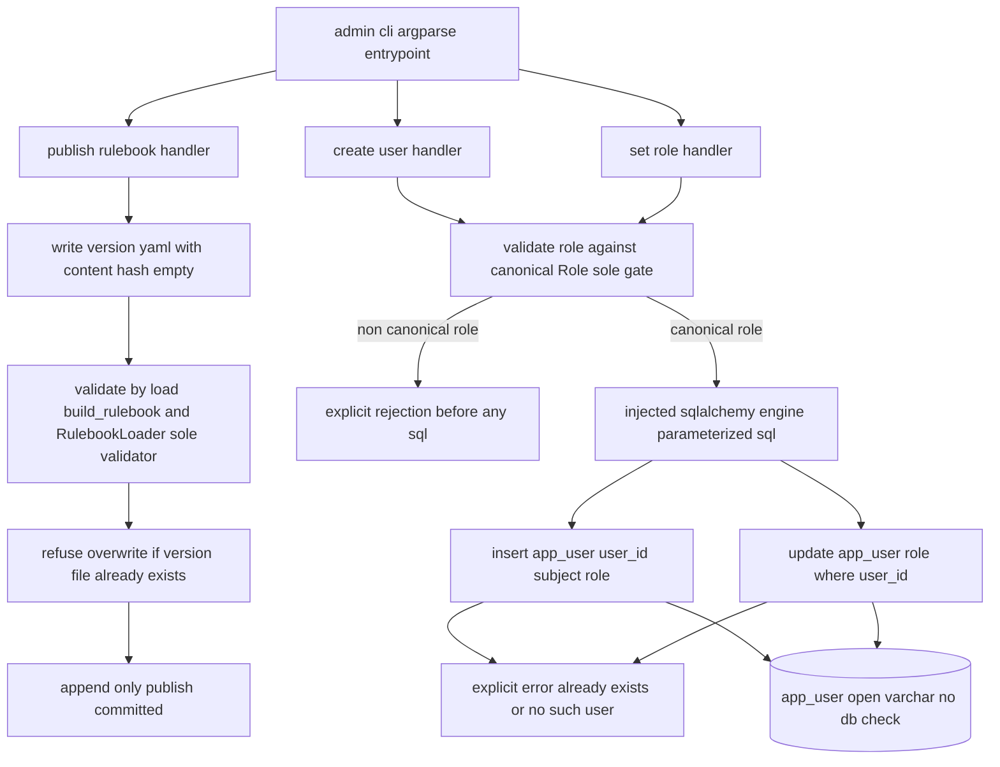

# Business Logic Model — `admin-cli` (U17)

**Stage**: BUILD → Functional Design (per-unit) · out-of-band admin CLI · **Depth**: LIGHTER overall + FULL rigor on the two invariant-bearing mutations
**Unit**: U17 `admin-cli` · **Date**: 2026-07-08 · Stories **US-ADMIN-1/2** · PER-3/6, FR-RULES-6.
**Scope**: The two **mutation flows** (rulebook publish; `app_user` write), the **sole-gate-vs-open-VARCHAR** boundary (ADMIN-Fold-1), a **consumer/dependency map**, and an **invariant self-check**. Built exactly on the five locked answers (A/A/B/A/A) + three ADMIN-Folds — re-opening none. **CLI only; no LLM; no rule evaluation; no recommendation/commit; no admin UI.**

---

## 1. The two mutation flows

`admin-cli` is an argparse CLI (`python -m backend.admin_cli <subcommand>`). Two of its three subcommands are **invariant-bearing mutations** (FULL rigor); each validates **first**, then commits, and fails **loudly** with an explicit operator-facing error.

Mermaid validated before write (alphanumeric node IDs + underscore; every label double-quoted; **no semicolons, no bare colons, no parentheses, no hyphens, no special characters** in labels; balanced blocks). Text alternative follows.

### Text alternative (always included)
1. The **argparse entrypoint** routes `<subcommand>` to `publish-rulebook`, `create-user`, or `set-role` (the composition root injects the rulebook dir + the `sqlalchemy.Engine`).
2. **Publish flow (BR-ADMIN-1/2)**: write `{version}.yaml` (`content_hash` empty → loader recomputes) → **validate by load** via `build_rulebook`/`RulebookLoader` (the **sole** validator — schema + hash + declared-version==filename) → **refuse to overwrite** an existing version (append-only) → the publish is committed. A validation failure publishes **nothing**.
3. **User-write flow (BR-ADMIN-3/4/5)**: both `create-user` and `set-role` pass through the **canonical-role SOLE gate** first — a role **not** in auth-rbac's `Role` value set is **rejected before any SQL runs**; a canonical role proceeds to the **injected `Engine`** (parameterized INSERT / UPDATE).
4. **Explicit errors**: a duplicate user (create) or an absent user (set-role) raises an explicit "already exists" / "no such user" error — never a silent upsert / no-op.
5. The write lands in **`app_user`**, whose `role` column is an **open VARCHAR with no DB CHECK** — so admin-cli's gate (step 3) is the only thing preventing a non-canonical role from being persisted.

---

## 2. Sole-gate vs open-VARCHAR boundary (ADMIN-Fold-1 — the crux)

| Concern | Reality (verified on disk) | Consequence |
|---|---|---|
| `app_user.role` column | **open VARCHAR, NO CHECK** (`0001_initial_schema.sql:54`; BR-DB-12 keeps it open so novel values like `admin` insert without a breaking migration) | the **database accepts any string** — it will **not** reject a non-canonical role |
| auth-rbac `to_role` | fail-closes at **auth time** (non-canonical → `None` → deny) | a persisted bad role would only surface **later** as a **silent lockout**, not a write-time rejection |
| **admin-cli's role gate (BR-ADMIN-5)** | validates `role ∈ Role` **before** the INSERT/UPDATE, rejects with an explicit error | **the SOLE structural gate** — the one thing that prevents a non-canonical role from ever being persisted |

**No false assumption**: admin-cli does **not** rely on a DB CHECK (there is none) and does **not** lean on `to_role`'s later fail-close. Its own pre-write validation is the single point of enforcement — exactly the named-check resolution (ADMIN-Fold-1).

---

## 3. Consumer / dependency map

| Party | Relationship | Direction |
|---|---|---|
| **`rules-engine`** (`build_rulebook` / `RulebookLoader`) | admin-cli **calls** the loader to validate a published rulebook | admin-cli → rules-engine (call-only) |
| **`auth-rbac`** (`Role`) | admin-cli **imports** the canonical `Role` set for the pre-write gate | admin-cli → auth-rbac (call-only) |
| **`database`** (`app_user` schema) | admin-cli **writes** `app_user` via an injected `Engine` (parameterized SQL) | admin-cli → app_user (write; schema owned by database) |
| **`secrets-config`** (`DATABASE_URL`) | the **composition root** builds the injected `Engine`; admin-cli reads **no** secret VALUE | composition root → admin-cli (injected; SEC-3) |
| **provider-config (P2)** | **reserved, not authored** — no store, no `set-provider` command in Phase 1 | future (P2) |

`admin-cli` **imports no consumer**, **edits no dependency's production code** (reference-not-own), **runs no LLM**, and **reaches no decision/commit path**. Direction is **admin-cli → deps (call-only)** and **admin-cli → app_user / rulebook dir (write)**.

---

## 4. Invariant self-check

| Invariant | Honored by | How |
|---|---|---|
| **FR-RULES-6** rulebook versioning/publish | BR-ADMIN-1/2; §1 | write `{version}.yaml` → validate-by-load (`build_rulebook`, sole validator) → append-only refuse-overwrite → declared-version==filename; failed validation publishes nothing |
| **SEC-4** canonical-role gate | BR-ADMIN-5; §2 | role validated against auth-rbac `Role` **before** any write; non-canonical rejected before SQL |
| **BR-DB-12** open-VARCHAR (referenced, not re-opened) | BR-ADMIN-5/6; §2 | admin-cli adds **no** DB CHECK; the open column is respected; admin-cli's gate is the sole enforcement |
| **SEC-3** no secret VALUES | BR-ADMIN-7; §3 | injected `Engine`/URL (secrets-config's); status-only output; no secret literal |
| **Reference-not-own (four surfaces)** | BR-ADMIN-2/6; §3 | `build_rulebook` sole rulebook validator; `Role` sole canonical set; injected-Engine parameterized write; no `database`/`auth_rbac` production import; none edited |
| **Provider-config deferred (P2)** | BR-ADMIN-9; §3 | no `set-provider`, no config store; active provider a static composition-root value (reserved seam) |
| **No LLM / no rule-eval / no decision / no admin UI** | BR-ADMIN-8; §1 | argparse CLI only; manages config, does not underwrite |
