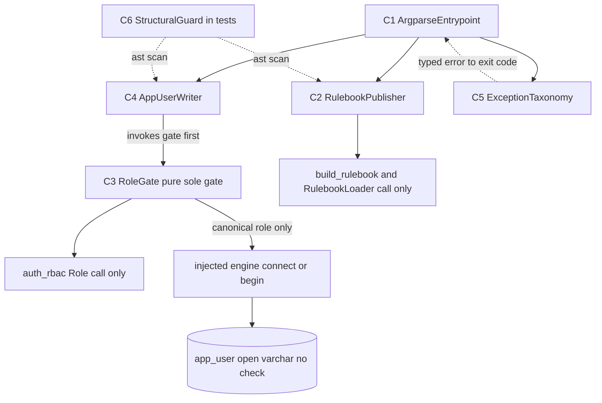

# NFR Design — Logical Components — `admin-cli` (U17)

**Stage**: BUILD → NFR Design (per-unit), **Part 2** · out-of-band admin CLI · **Depth**: **LIGHTER overall (CLI scaffolding) + FULL rigor on the two invariant-bearing mutations**
**Unit**: U17 `admin-cli` · **Date**: 2026-07-08 · Stories **US-ADMIN-1/2** · PER-3/6, FR-RULES-6.
**Built ON** the frozen FD + approved NFR Requirements (BR-ADMIN-1..9, the ten `NFR-ADMIN-*` targets, injected-`Engine` seam, sole-gate-vs-open-VARCHAR analysis, six carried folds) — **re-opening none**. Companion to `nfr-design-patterns.md` (P1–P6). Four NFR-Design answers (all **A**); ambiguity-check **CLEAN** (ADMIN-NFRD-Fold-1/2/3).

Six logical components (**C1–C6**). Each states **responsibility**, **ownership**, and its **reference-not-own** posture. The **RoleGate-before-AppUserWriter-connection** sequencing (the sole-gate structural guarantee) is made a **visible edge** in §4, not merely asserted.

---

## 1. Components (responsibility · ownership · references · realizes)

| Component | Responsibility | Owns / references | Realizes (pattern → target) |
|---|---|---|---|
| **C1 · ArgparseEntrypoint** | argparse root; routes `<subcommand>` (publish-rulebook / create-user / set-role); injects the `Engine` + rulebook-dir from the composition root; maps typed exceptions → exit code + no-secret message (via C5) | **owns**; imports **no** consumed surface (the `Engine` is injected — SEC-3) | P5 → CLIERR-1; message discipline → NOSECRET-1 |
| **C2 · RulebookPublisher** | pure-validate → atomic exclusive-create write (no-overwrite) → validate-by-load publish | **owns** the publish logic; **references** `build_rulebook`/`RulebookLoader` (call-only, sole validator) | P1 → PUBLISH-1 + PUBVALID-1 |
| **C3 · RoleGate** | **pre-connection** canonical-role validation (`role ∈ Role`) — the **sole gate**; **pure** (no DB), unit-covered with the spy engine | **owns** the gate; **references** `auth_rbac.roles.Role` (call-only, sole canonical set) | P2 → ROLEGATE-1 |
| **C4 · AppUserWriter** | the two `app_user` operations (create / set-role) via the injected `Engine`; **composes C3 and invokes it as the first line of each write method** (before `connect()`/`begin()`); explicit conflict/absence detection. **Pure statement-build + result-interpretation counted; the SQL-exec shim omitted from unit coverage** (like `pg_repository.py`, D9) | **owns** the write op; **references** `database` `app_user` columns (schema owned by `database`; **no** CHECK added) | P3 → CREATE-1 + SETROLE-1; composes P2 |
| **C5 · ExceptionTaxonomy** | `AdminCliError` base + three typed subclasses `RulebookPublishError` / `UserWriteError` / `RoleValidationError` | **owns** | P5 → CLIERR-1 |
| **C6 · StructuralGuard / test substrate** | the AST-scan guards + **non-vacuous self-test**; lives in `tests/` (**not** counted toward production coverage) | **owns**; **scans** `backend/admin_cli/` | P4 → REFNOTOWN-1 + NOSECRET-1 + SCOPE-1 (+ P6 absence check) |

> **The sole-gate design property.** C3 (RoleGate) is a **distinct** component that C4 (AppUserWriter) **composes and invokes first**; the **only** path from C4's public API to a DB connection runs **through** C3. That is what makes ROLEGATE-1's "sole gate, structurally un-bypassable" a **design property** (Q1-A), enforced by the spy-engine `connect()`/`begin()`-never-called assertion (ADMIN-NFRD-Fold-1), not prose.

---

## 2. Reference-not-own check (all four consumed surfaces — call-only, none edited; verified on disk)

| Surface | On-disk shape (verified) | How consumed | By | Edited? |
|---|---|---|---|---|
| `rules_engine.loader.build_rulebook` / `RulebookLoader` | `build_rulebook(data)->Rulebook` **pure**; `RulebookLoader(dir).load_rulebook(version)` reads `{version}.yaml`, recomputes/verifies hash, checks declared-version==filename (`loader.py`) | the **sole** publish validator, call-only | C2 | **No** |
| `auth_rbac.roles.Role` | `class Role(str, Enum)` = `{underwriter, auditor, admin}`; `.value` set is the canonical closed app-layer set (`roles.py`) | the canonical set for the pre-write gate, call-only; **not** `to_role` (we reject explicitly, we do not lean on its later fail-close) | C3 | **No** |
| `database` `app_user` | `user_id VARCHAR PK`, `subject VARCHAR UNIQUE`, `role VARCHAR NOT NULL` **open, NO CHECK** (`0001_initial_schema.sql:51-57`) | parameterized INSERT/UPDATE via injected `Engine`; **no** schema/CHECK added | C4 | **No** |
| `secrets-config` `DATABASE_URL` (**indirect**) | `Settings.DATABASE_URL: str` (`settings.py`); the composition root builds the `Engine` from it | the composition root injects the `Engine`; admin-cli reads **no** secret VALUE (SEC-3) | C1 (injected) | **No** |

> **Injected-`Engine` precedent (verified).** `auth_rbac/pg_repository.py` — `PostgresUserRoleRepository(engine: sa.Engine)`, parameterized `sa.text` over `self._engine.connect()`, no secret literal, omitted from unit coverage. **C4 mirrors this posture exactly** (injected `Engine`, parameterized SQL, SQL-exec shim omitted from unit coverage), for the write direction. Confirms **ADMIN-NFR-Fold-2**: the Engine's only DB entry points are `connect()`/`begin()` (no `.execute` on `Engine` in SQLAlchemy 2.0) — the spy watches exactly those.

**Verification/wrapper only** — `build_rulebook` is the sole rulebook validator; `Role` is the sole canonical set; `database` owns the `app_user` schema (no CHECK); no `database`/`auth_rbac` production **write** import; no local hasher/rulebook-schema/DDL (P4 self-tested).

---

## 3. Component → target coverage (no orphan)

| Target | Component(s) | Pattern |
|---|---|---|
| NFR-ADMIN-PUBLISH-1 | C2 | P1 |
| NFR-ADMIN-PUBVALID-1 | C2 | P1 |
| NFR-ADMIN-ROLEGATE-1 | C3 (+C4 composes + invokes first) | P2 |
| NFR-ADMIN-CREATE-1 | C4 | P3 |
| NFR-ADMIN-SETROLE-1 | C4 | P3 |
| NFR-ADMIN-REFNOTOWN-1 | C6 | P4 |
| NFR-ADMIN-NOSECRET-1 | C6 (+C1/C5 message discipline) | P4 |
| NFR-ADMIN-SCOPE-1 | C6 | P4 |
| NFR-ADMIN-CLIERR-1 | C5 (+C1) | P5 |
| NFR-ADMIN-PROVIDER-DEFER-1 | — (documented absence; C6 scan confirms) | P6 |

All ten targets covered; **no orphan**. C3 (RoleGate) + C5 (ExceptionTaxonomy) are shared enablers; C6 is test-substrate (not production coverage).

---

## 4. Component-relationship diagram (7-rule validated) — RoleGate-before-connection made explicit

Validated before write: alphanumeric/underscore node IDs; every node label double-quoted; **no** semicolons, colons, parentheses, hyphens, or special characters in labels; edge labels alphanumeric; balanced blocks. **The only inbound edge to the connection node comes from C3** — so C4 provably cannot reach the DB except through the gate. Text alternative always follows.

### Text alternative (always included)
1. **C1 ArgparseEntrypoint** dispatches to **C2 RulebookPublisher** (publish) and **C4 AppUserWriter** (create/set-role), and holds **C5 ExceptionTaxonomy** for typed-error → exit-code mapping (dashed edge C5→C1).
2. **C2** references `build_rulebook`/`RulebookLoader` (call-only) — its sole validator.
3. **The sole-gate sequence (the crux)**: **C4 invokes the gate first** → **C3 RoleGate** (edge `C4 → C3`, labelled "invokes gate first"); **C3** references `auth_rbac.Role` and, **only for a canonical role**, proceeds to the **injected-engine `connect()`/`begin()`** (edge `C3 → CONNECT`, labelled "canonical role only"). The connection node's **only inbound edge is from C3** — there is **no** `C4 → CONNECT` edge — so `AppUserWriter` structurally cannot acquire a connection except through the gate. The connection then writes to **`app_user`** (open VARCHAR, no CHECK — the DB is not a gate).
4. **C6 StructuralGuard** (in `tests/`) statically scans `backend/admin_cli/` — dashed edges to C4 and C2 (a test-time observer, not a runtime dependency).

---

## 5. Boundary — what these components do NOT do
- **No rulebook validation/schema/hash re-implementation** (C2 delegates to `build_rulebook`, sole validator).
- **No `Role` definition** (C3 references auth-rbac's canonical set; single-sourced).
- **No `app_user` schema/CHECK** (C4 writes only; `database` owns the schema; `role` stays open VARCHAR — BR-DB-12).
- **No secret VALUE** read or printed (C1 injected `Engine`; C5 no-secret messages — SEC-3).
- **No provider-config command/store** (P6 documented absence; C6 confirms).
- **No LLM; no rule evaluation; no recommendation/decision/commit; no admin UI.** WIRE-1 untouched; tier-B NOT authorized.

## 6. Settled items held (not re-opened)
The frozen FD + approved NFR-Req is the substrate — NFR-Design builds components/patterns **on** it. **Reference-not-own** — the four surfaces call-only, none edited (verified on disk §2). **Canonical-role sole gate** (SEC-4; RoleGate before `connect()`/`begin()`, spy-enforced ordering). **SEC-3** no secret VALUES. **Provider-config management deferred to P2.** **No new production dependency; no LLM; no rule-eval; no decision/commit; no admin UI; WIRE-1 untouched; tier-B NOT authorized; no other unit started.**
