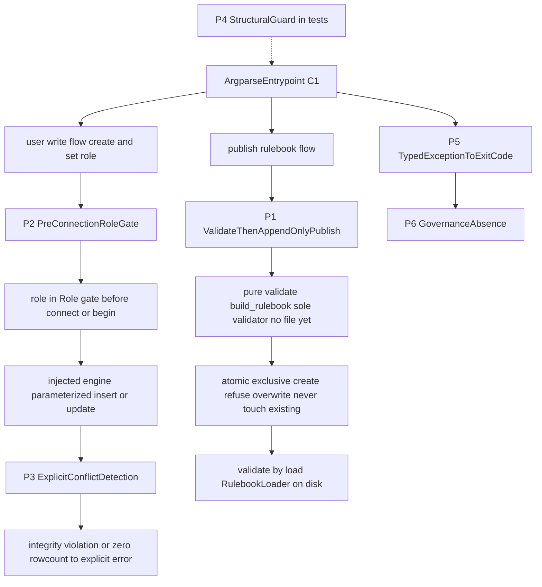

# NFR Design — Patterns — `admin-cli` (U17)

**Stage**: BUILD → NFR Design (per-unit), **Part 2** · out-of-band admin CLI · **Depth**: **LIGHTER overall (CLI scaffolding) + FULL rigor on the two invariant-bearing mutations**
**Unit**: U17 `admin-cli` · **Date**: 2026-07-08 · Stories **US-ADMIN-1/2** · PER-3/6, FR-RULES-6.
**Built ON** the frozen FD (`domain-entities.md` / `business-rules.md` / `business-logic-model.md` — **BR-ADMIN-1..9**, module inventory, injected-`Engine` seam, sole-gate-vs-open-VARCHAR analysis, five FD answers A/A/B/A/A, three ADMIN-Folds) and the approved **NFR Requirements** (ten `NFR-ADMIN-*` targets, tiers **U/Integration**, three ADMIN-NFR-Folds) — **re-opening none**. Four NFR-Design answers (all **A**) locked in the plan; **ambiguity-check CLEAN** with three realization folds (ADMIN-NFRD-Fold-1/2/3 — §5).

Each **pattern** below structurally meets its `NFR-ADMIN-*` target(s). Patterns are **design mechanisms**, not code — concrete arg names / message wording / source format stay Code-Gen (per `tech-stack-decisions.md`).

---

## 1. The six patterns (each meeting its `NFR-ADMIN-*` target)

### P1 · ValidateThenAppendOnlyPublishPattern — meets **NFR-ADMIN-PUBLISH-1 + NFR-ADMIN-PUBVALID-1** (BR-ADMIN-1/2, ADMIN-Fold-2)
**Mechanism** (realized order — safe by construction; see ADMIN-NFRD-Fold-3):
1. **Parse + pure-validate first.** Read the source YAML → `build_rulebook(parsed)` (the **sole** validator — Pydantic allowlist + threshold-shape + recompute/verify `content_hash` + declared `rulebook_version` == target `<version>`). `build_rulebook` is **pure (no I/O)**, so an invalid or version-mismatched source is rejected **before any file is written** → a `RulebookPublishError` and **no published file** (satisfies PUBLISH-1(c)/(d)).
2. **Atomic exclusive-create write (the no-overwrite guard).** Write `{version}.yaml` (with `content_hash: ""` so the loader recomputes + stamps) via **exclusive-create** (`open(path, "x")` / `O_CREAT|O_EXCL`) — a single atomic syscall that **refuses if the version already exists** and, crucially, **never opens the existing file for writing**. A re-publish of an existing version fails cleanly (`RulebookPublishError`) and the existing bytes are **byte-identical before/after** (satisfies PUBLISH-1(b) append-only teeth). This is the atomic realization of the locked answer **Q3-A** ("check existence and refuse; never touch the existing file") — the check and the refusal collapsed into one race-free operation (ADMIN-NFRD-Fold-3).
3. **Validate-by-load teeth.** `RulebookLoader.load_rulebook(version)` then loads the just-written file from disk, re-running `build_rulebook` over the on-disk bytes (recompute/stamp hash, declared-version==filename) — confirming the published version is loadable/replayable at its exact bytes (satisfies PUBLISH-1(a)).
- **Sole-validator property (PUBVALID-1)**: steps 1 and 3 both delegate **all** schema/hash/version validation to `build_rulebook`/`RulebookLoader`; `admin-cli` re-implements **no** local rule schema, allowlist, threshold-shape check, or hasher (enforced structurally by **P4**).
- **Tier**: **U** (tmp_path rulebook dir; no Docker).

> **Ordering note (no FD re-opening).** The frozen FD schematically lists *write → validate-by-load → refuse-overwrite*; P1 realizes those same three decisions in the only **safe** order — pure-validate → **atomic** exclusive-create (which IS the refuse-overwrite) → validate-by-load — so a re-publish provably never mutates the existing file. This is design realization of the frozen goals (sole validator ✓, append-only ✓, declared-version==filename ✓), not a change to them.

### P2 · PreConnectionRoleGatePattern *(highest rigor)* — meets **NFR-ADMIN-ROLEGATE-1** (BR-ADMIN-5, ADMIN-Fold-1 + ADMIN-NFR-Fold-2)
**Mechanism**: a **RoleGate** component — **distinct** from the SQL-writing component (**C3**, not **C4**) — validates `role ∈ Role` (auth-rbac's canonical set, call-only). `AppUserWriter` (**C4**) **composes** the gate and **invokes it as the first line of each write method**, so the **only** path from `AppUserWriter`'s public API to a DB connection runs **through** the gate — the gate is **structurally on the sole path**, un-bypassable via the write API (locked answer **Q1-A**).
- **Pre-connection boundary (ADMIN-NFR-Fold-2)**: the gate runs **before any connection is acquired**. In **SQLAlchemy 2.0** the `Engine` exposes **no `.execute`** — the only Engine→DB entry points are `engine.connect()` and `engine.begin()`. So the tier-U **spy engine** records `connect()` **and** `begin()` and asserts **neither** is called on a non-canonical role (`superuser`, `Admin`, blank, `None`) → `RoleValidationError`; a canonical role (`underwriter`/`auditor`/`admin`) passes and proceeds. **This spy assertion is the structural reorder-guard** (see ADMIN-NFRD-Fold-1): any future edit that acquired the connection **before** gating would trip `connect()`/`begin()` on the rejected path and **fail the regression test** — the ordering is test-enforced, not merely code-reviewed.
- **Sole-gate evidence (Integration, fault-injection)**: a **raw SQL** INSERT of a non-canonical role **directly** (`conn.exec_driver_sql`, **bypassing `AppUserWriter`**) over the disposable testcontainers `app_user` is **accepted by the DB** (no error), proving `app_user.role` is **open VARCHAR with no CHECK** (BR-DB-12) ⇒ the gate is the **SOLE** enforcement (ADMIN-Fold-1). The fault-injection **never** calls admin-cli's write path, so it cannot weaken the gate.
- **Tier**: **U (spy) + Integration (fault-injection)**.

### P3 · ExplicitConflictDetectionPattern — meets **NFR-ADMIN-CREATE-1 + NFR-ADMIN-SETROLE-1** (BR-ADMIN-3/4)
**Mechanism** (DB-constraint-driven, atomic, **no upsert, no pre-SELECT** — locked answer **Q2-A**):
- **create-user**: a single parameterized `INSERT INTO app_user (user_id, subject, role) VALUES (...)`; the DB's **PK `user_id`** / **UNIQUE `subject`** raises an **`IntegrityError`**, which `AppUserWriter` catches and re-raises as **`UserWriteError` "already exists"**. One statement, race-free (no time-of-check/time-of-use window).
- **set-role**: a single parameterized `UPDATE app_user SET role = :role WHERE user_id = :user_id`; **`result.rowcount == 0`** (no matching row) → **`UserWriteError` "no such user"**. Zero rows is the absence signal — no silent no-op.
- **Generic-but-accurate message (ADMIN-NFRD-Fold-2)**: a **generic "already exists"** is **accurate for both** the PK (`user_id`) and the UNIQUE (`subject`) collision — the truthful statement in either case is "a user with that identity already exists." Per CREATE-1(b) the target requires only an **explicit** "already exists" error; **distinguishing which constraint fired is not required** and is deferred as an **optional Code-Gen message-wording** nicety (constraint-name inspection is DB-driver-specific and brittle). Design uses the generic accurate form.
- **Tier**: **Integration** (real INSERT/UPDATE + explicit errors over testcontainers `postgres:16`).

### P4 · StructuralGuardPattern — meets **NFR-ADMIN-REFNOTOWN-1 + NFR-ADMIN-NOSECRET-1 + NFR-ADMIN-SCOPE-1** (BR-ADMIN-6/7/8)
**Mechanism**: a stdlib-`ast` scan of `backend/admin_cli/` (a **`StructuralGuard` in `tests/`** — locked answer **Q4-A**; **not** production code, **not** counted toward production coverage) asserts:
- **REFNOTOWN-1** — imports `build_rulebook`/`RulebookLoader` + `auth_rbac.roles.Role` **only** (call-only); **no** `database`/`auth_rbac` production **write** module; **no** local `hashlib`/rulebook-schema; **no** DDL/CHECK.
- **NOSECRET-1** — **no** secret literal in the package; the DB `Engine`/URL is injected.
- **SCOPE-1** — **no** LLM client / rule-evaluation / commit-service import; no admin UI.
- **Non-vacuous self-test**: a planted local re-implementation / secret literal / forbidden import is **flagged** by the scan (proving the guard is not a no-op). Mirrors the `corpus_generator`/`quality_gates` precedent (D11).
- **Tier**: **U (structural)**.

### P5 · TypedExceptionToExitCodePattern — meets **NFR-ADMIN-CLIERR-1** (BR-ADMIN-8 scaffolding)
**Mechanism**: `AdminCliError` **base** → three typed subclasses `RulebookPublishError` / `UserWriteError` / `RoleValidationError`. Handlers **raise typed**; the **entrypoint** is the single boundary that maps a typed error → a **non-zero exit code** + a human-readable **stderr** message carrying **no secret VALUE** (message discipline shared with NOSECRET-1); success → **exit 0** + a **names-only** status line.
- **Tier**: **U**.

### P6 · GovernanceAbsencePattern *(no component)* — meets **NFR-ADMIN-PROVIDER-DEFER-1** (BR-ADMIN-9, ADMIN-Fold-3)
**Mechanism**: a **documented absence** — **no** `set-provider` command and **no** provider-config store in Phase-1; the active provider stays a **static composition-root value** (Q3-B/FD). Enforced by P4's scan (no `set-provider`, no config store present).
- **Tier**: **governance (+ light structural, U)**.

---

## 2. Pattern-integration diagram (7-rule validated)

Validated before write: alphanumeric/underscore node IDs; every node label double-quoted; **no** semicolons, colons, parentheses, hyphens, or special characters in labels; balanced blocks. Text alternative always follows.

### Text alternative (always included)
1. The **ArgparseEntrypoint (C1)** routes a subcommand into either the **publish-rulebook flow** or the **user-write flow** (create-user / set-role).
2. **Publish flow → P1**: **pure-validate** via `build_rulebook` (the sole validator) with **no file written yet** → **atomic exclusive-create** write that refuses an existing version and never touches the existing file (the no-overwrite guard, append-only teeth) → **validate-by-load** from disk via `RulebookLoader`. A validation failure or an existing version leaves the published set unchanged.
3. **User-write flow → P2**: the **role-in-`Role` gate runs before any `connect()`/`begin()`** (pre-connection) → only a canonical role reaches the **injected-engine parameterized INSERT/UPDATE** → **P3** interprets the result (integrity violation → "already exists"; zero rowcount → "no such user").
4. **P5** wraps both flows: typed exceptions map at the entrypoint to a non-zero exit code + a no-secret stderr message; success → exit 0 + a names-only line. **P6** is the documented absence of any provider-config command/store.
5. **P4 (StructuralGuard, in `tests/`)** statically scans `backend/admin_cli/` (dashed edge — a test-time observer, not a runtime dependency): no forbidden import, no local hasher/schema/DDL, no secret literal, no `set-provider`.

---

## 3. Traceability (pattern → target → BR-ADMIN → tier → rigor; no orphan)

| Pattern | Meets target(s) | BR-ADMIN | Tier | Rigor |
|---|---|---|---|---|
| P1 ValidateThenAppendOnlyPublish | NFR-ADMIN-PUBLISH-1, NFR-ADMIN-PUBVALID-1 | 1, 2 | U | full |
| P2 PreConnectionRoleGate | NFR-ADMIN-ROLEGATE-1 | 5 | U + Integration | full |
| P3 ExplicitConflictDetection | NFR-ADMIN-CREATE-1, NFR-ADMIN-SETROLE-1 | 3, 4 | Integration | standard |
| P4 StructuralGuard | NFR-ADMIN-REFNOTOWN-1, NFR-ADMIN-NOSECRET-1, NFR-ADMIN-SCOPE-1 | 6, 7, 8 | U (structural) | full / standard |
| P5 TypedExceptionToExitCode | NFR-ADMIN-CLIERR-1 | 8 | U | standard |
| P6 GovernanceAbsence | NFR-ADMIN-PROVIDER-DEFER-1 | 9 | governance (+ structural) | soft |

**No orphan** — all ten `NFR-ADMIN-*` targets are met (PUBLISH-1+PUBVALID-1→P1; ROLEGATE-1→P2; CREATE-1+SETROLE-1→P3; REFNOTOWN-1+NOSECRET-1+SCOPE-1→P4; CLIERR-1→P5; PROVIDER-DEFER-1→P6).

---

## 4. Security-Guardrails compliance (enabled extension)

| Control | Status | Rationale |
|---|---|---|
| Input validation | **Compliant (owns it)** | `role` gated against canonical `Role` **before** any connection (P2); `<version>`/source validated by `build_rulebook` (P1); `user_id`/`subject` parameterized (no injection), PK/UNIQUE respected (P3). |
| Prompt-injection defense | **N/A** | No LLM; no untrusted document parsed. |
| Secrets management | **Compliant (owns it)** | **NOSECRET-1 / SEC-3** — no secret literal (P4); injected `Engine`/URL; typed-error messages carry no secret VALUE (P5). |
| Read-only DB access for audit role | **N/A** | admin-cli writes `app_user` (own injected engine) + rulebook files; it does not touch the audit read/write roles (SEC-5 is `audit-store`'s). |
| Audit logging | **N/A** | Out-of-band config management, not the runtime decision audit trail. |
| **Canonical-role authorization gate** | **Compliant (owns it)** | **ROLEGATE-1 / SEC-4** (P2) — non-canonical role rejected **before** persistence, spy-test-enforced ordering; open-VARCHAR DB is not a gate (BR-DB-12). |

No blocking finding.

---

## 5. Ambiguity-check resolutions embedded as folds (NFR-Design realization; no FD/NFR-Req re-opening)

- **ADMIN-NFRD-Fold-1 (check i — RoleGate ordering is test-enforced, not code-review-only).** P2/C3-C4 make the gate a distinct component invoked as `AppUserWriter`'s first line; the **spy-engine assertion that `connect()` and `begin()` are BOTH never called on a non-canonical role** is a **structural reorder-guard** — any future edit that acquired a connection before gating fails the regression test. **Residual (accepted lighter-tier limit)**: the guarantee is exercised over the **two** Phase-1 write methods (create/set-role); a hypothetical future third write method would need its own spy assertion. Given the two-method Phase-1 scope + CLI-scaffolding classification, no per-method AST enforcement is added (would be gold-plating).
- **ADMIN-NFRD-Fold-2 (check ii — generic "already exists" is accurate; constraint distinction not required).** A generic "already exists" is truthful whether the **PK `user_id`** or the **UNIQUE `subject`** fired; CREATE-1(b) requires only an explicit error. Distinguishing the constraint is an **optional Code-Gen message-wording** choice (DB-driver-specific, brittle), **not** an NFR-Design gap. Design uses the generic accurate form.
- **ADMIN-NFRD-Fold-3 (check iii — publish TOCTOU eliminated by atomic exclusive-create; single-operator scope stated).** Q3-A's "check existence and refuse; never touch the existing file" is realized via **atomic exclusive-create** (`open(path, "x")` / `O_CREAT|O_EXCL`) — the check-and-refuse collapsed into **one race-free syscall**, so the check-then-write TOCTOU window a literal `exists()`-then-`open("w")` would open **does not exist**. The existing file is **byte-identical before/after** (PUBLISH-1(b)). **Explicitly accepted operational scope**: this is a single-operator out-of-band CLI; even so the design does **not rely** on that assumption for safety — exclusive-create means a hypothetical concurrent second publish of the same version fails cleanly with `RulebookPublishError` rather than clobbering. (The rejected Q3-B temp-then-rename would be strictly more machinery for the same guarantee.)

## 6. Settled items held (not re-opened)
The frozen FD + approved NFR-Req (BR-ADMIN-1..9, the ten `NFR-ADMIN-*` targets, the injected-`Engine` seam, the sole-gate analysis, the six carried folds) is the substrate. **Reference-not-own** — the four surfaces call-only, none edited; `build_rulebook` sole rulebook validator; `Role` sole canonical set; no schema/CHECK added. **Canonical-role sole gate** (SEC-4; RoleGate before `connect()`/`begin()`). **SEC-3** no secret VALUES. **Provider-config management deferred to P2.** **No new production dependency; no LLM; no rule-eval; no decision/commit; no admin UI; WIRE-1 untouched; tier-B NOT authorized; no other unit started.**
