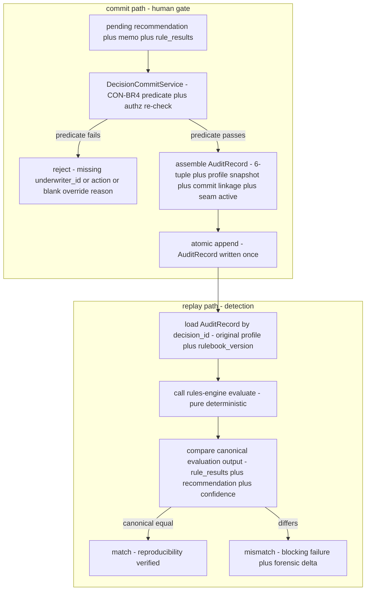

# Business Logic Model — `audit-store` (EPIC-6 / U12)

**Stage**: BUILD → Functional Design (per-unit) · cluster-FD-first unit 3 of 4
**Unit**: U12 `audit-store`
**Date**: 2026-07-03
**Scope**: The `DecisionCommitService.commit` logic (validate predicate → assemble `AuditRecord` →
atomic append), the `ReplayService.replay` orchestration and its **equality set** (Flag 3), the
append-only + OOS-7 supersession model, and the replay-determinism boundary with `rules-engine`.
Technology-agnostic.

---

## 1. Pipeline overview — commit → persist, and replay-as-detection

Frozen contracts (`component-methods.md`): `DecisionCommitService.commit(recommendation_id,
underwriter_id, action, reason=None) -> CommittedDecision`; `AuditStore.persist(audit_tuple) ->
None`; `ReplayService.replay(decision_id) -> RuleResultReport`.

Mermaid validated before write (alphanumeric node IDs; double-quoted labels; **no colons, no
semicolons, no parentheses, no special chars** in labels — hyphens/"plus"/"vs" only; balanced
brackets; no reserved-word `end` node). Text alternative follows.



### Text alternative (always included)

- **Commit path** (human gate): a pending recommendation + memo + `rule_results` reaches
  `DecisionCommitService`, which applies the **CON-BR4 predicate** + the **authz re-check**. On
  failure → **reject** (missing `underwriter_id` or `action`, or a blank `override` reason). On pass
  → **assemble the `AuditRecord`** (the 6-tuple + the **`ApplicantProfileSnapshot`** + the commit
  linkage + the OOS-7 seam `status=active`) → **atomic append** (written once, never mutated).
- **Replay path** (detection): `ReplayService.replay(decision_id)` loads the `AuditRecord` — the
  **original profile snapshot** + the **original `rulebook_version`** — **calls `rules-engine`'s
  pure `evaluate()`**, and **compares the canonical EVALUATION OUTPUT** (`rule_results` +
  `recommendation` + `confidence`). **Canonical-equal → match** (verified); **differs → mismatch**
  (blocking failure + forensic delta).

---

## 2. `DecisionCommitService.commit` logic

```
INPUT:  recommendation_id, underwriter_id, action, reason=None
        (+ the pipeline's rule_results, memo_hash, model_version, engine_version, rulebook_version,
         and the original ApplicantProfile for this recommendation_id)
OUTPUT: CommittedDecision   (or rejection)

# 1. CON-BR4 gate (business-rules BR-COMMIT-GATE) - reject iff:
if underwriter_id is empty:                      reject
if action is missing:                            reject
if action == override and reason.strip() == "":  reject      # blank/whitespace rejected, not just null

# 2. Authz re-check (business-rules BR-AUTHZ-RECHECK, SEC-4) - backend, independent of API layer
if role_of(underwriter_id) is not underwriter:   reject       # auditor read-only cannot reach commit

# 3. Assemble the AuditRecord (superset) - atomic with the commit
decision_id = generate_decision_id()                          # system-generated PK
record = AuditRecord(
    decision_id, application_id, recommendation_id,
    audit_tuple = { rulebook_version, rule_results(canonical), timestamp = now_at_commit,
                    model_version, memo_hash, engine_version },
    applicant_profile_snapshot = { application_id, profile_canonical, content_hash },   # Flag 2
    committed_decision = { recommendation_id, underwriter_id, action, reason },
    status = active, supersedes_decision_id = null )           # OOS-7 seam, Phase 1/2

# 4. Atomic append (business-rules BR-PERSIST-ATOMIC + BR-APPEND-ONLY)
persist_append(record)      # commit + audit-write are ONE atomic op; INSERT-only, never UPDATE
return CommittedDecision(record.committed_decision)
```

- **`timestamp` is captured once here at commit** (wall-clock) — it is **audit metadata**, excluded
  from the replay equality set (§4). This is the only wall-clock read, and it is **outside**
  `evaluate()` — CON-DET-1 is about evaluation, not audit metadata.
- **Atomicity**: no committed decision without its `AuditRecord`, and no `AuditRecord` without a
  passed gate (`business-rules.md §2`).

---

## 3. Append-only + OOS-7 supersession model (Flag 4)

- **Append-only by construction**: committed records take **`INSERT` only** — no `UPDATE`/`DELETE`
  at the service and DB-role layers (`business-rules.md §3`).
- **`status` write-once `active`**; **`superseded`-ness is derived** from the existence of a record
  whose `supersedes_decision_id` points back — a **read-time projection**, never an in-place flip.
- **Phase-3 supersession = a pure APPEND**: a correction is a **new** `AuditRecord` carrying
  `supersedes_decision_id = <prior>`; the prior record is untouched. **Not built** in Phase 1/2 —
  only the seam fields are reserved, so Phase 3 needs **no migration** of existing rows.

---

## 4. `ReplayService.replay` orchestration + the equality set (Flag 3)

```
INPUT:  decision_id
OUTPUT: replay verdict { match | mismatch } (+ forensic delta on mismatch)

record   = load_audit_record(decision_id)                    # audit-store owns load
profile  = deserialize_to_intake_profile(                    # Flag 2 - back to the EXACT intake ApplicantProfile shape
               record.applicant_profile_snapshot.profile_canonical)   # intake's contract governs - CANON-SER
version  = record.audit_tuple.rulebook_version               # the load key

fresh    = rules_engine.evaluate(profile, version)           # rules-engine owns evaluate() - pure, deterministic

# THE EQUALITY SET (business-rules BR-REPLAY-EQUALITY) - evaluation-output PROJECTION over CANON-SER
# projection = per-rule rows + recommendation + confidence   (embedded provenance EXCLUDED)
recorded_output = eval_output_projection(record.audit_tuple.rule_results)  # excludes rulebook_version/content_hash/engine_version
fresh_output    = eval_output_projection(fresh)                            # same projection - identical basis
if recorded_output == fresh_output:
    return match        # reproducibility VERIFIED
else:
    delta = diff(recorded_output, fresh_output)                 # which rule/field diverged
    engine_drift   = (fresh.engine_version != record.audit_tuple.engine_version)   # FORENSIC, not a trigger
    rulebook_drift = (fresh.content_hash  != recorded content_hash)               # FORENSIC, not a trigger
    return mismatch(blocking=True, delta, engine_drift, rulebook_drift)           # OOS-8 detection
```

- **Ownership boundary (rules-engine Q11)**: `audit-store` owns **load + call + compare**;
  **`rules-engine` owns `evaluate()`**. `ReplayService` has no evaluation logic of its own.
- **Equality set = the evaluation-output PROJECTION only** (identical to `business-rules.md §5`):
  the per-rule rows **+** `recommendation` **+** `confidence`, over CANON-SER. **`rulebook_version`
  is the load key.** **`timestamp` / `underwriter_id` / `reason` / `memo_hash` are excluded**, **and
  the provenance fields embedded *inside* `rule_results` (`rulebook_version` / `content_hash` /
  `engine_version`) are excluded from the projection** — so no volatile or provenance field can cause
  a **false** mismatch, while the full deterministic `evaluate()` output **is** compared (no genuine
  logic divergence is hidden).
- **`engine_version` + `content_hash` are FORENSIC/diagnostic**, recorded and surfaced to **explain**
  a mismatch (engine code drift vs rulebook byte-drift vs a real regression) — **not equality
  triggers**. An engine refactor (new git SHA) must **not** mass-flag historical decisions.
- **Memo never re-drafted** (`business-rules.md` BR-REPLAY-NO-MEMO): replay re-evaluates rules only;
  memo integrity is a **`memo_hash`** comparison — **no LLM in replay** (deterministic).
- **Mismatch = blocking reproducibility failure + forensic delta** for the **Phase-3 incident
  workflow** (OOS-8); replay **never mutates** the record.

---

## 5. Flows

### 5.1 Commit (happy path)
Underwriter Approves (or Overrides-with-reason) → gate passes (underwriter_id + action [+ non-blank
reason on override]) → authz re-check passes → `AuditRecord` assembled (6-tuple + profile snapshot +
`status=active`) → atomic append → `CommittedDecision` returned.

### 5.2 Commit rejected (CON-BR4)
Missing `underwriter_id`, missing `action`, or a blank/whitespace `override` reason → **rejected**,
no `AuditRecord` written. An auditor-role caller → rejected at the backend re-check (SEC-4).

### 5.3 Replay match (US-RULES-4 / US-PLAT-8 AC)
Load record → `evaluate(original profile, original rulebook_version)` → canonical output equals
recorded → **reproducibility verified**.

### 5.4 Replay mismatch (detection — G4 / OOS-8)
Canonical output differs → **blocking reproducibility failure** + forensic delta (diverging
rule/field; `engine_version`/`content_hash` drift flags). Surfaced read-only; **record untouched**;
incident-handling is Phase 3.

---

## 6. Invariant compliance (self-check)

| Invariant | How this model holds it |
|---|---|
| **CON-BR4** | `DecisionCommitService` is the single backend write-gate; the precise predicate rejects missing `underwriter_id`/`action` and blank `override` reason; authz re-check blocks auditor writes. |
| **CON-AUDIT-1** | 6-tuple persisted atomically per **committed decision**; append-only; any decision replayable against its **original** `rulebook_version` via the persisted profile snapshot. |
| **SEC-4 / SEC-5** | Auditor read-only (read-only DB role + backend re-check); full audit trail persisted and browsable. |
| **CON-BR1** | The profile snapshot stores demographics, but `evaluate()` structurally excludes them — **storage ≠ influence**; replay cannot let demographics move the result. |
| **CON-DET-1** | Replay re-evaluation is the pure `evaluate()`; canonical serialization + excluded volatile fields ⇒ no false mismatch; `timestamp` is audit metadata outside evaluation. |
| **OOS-7 seam** | `decision_id`/`status`/`supersedes_decision_id` reserved; `status` write-once `active`; supersession = append with derived superseded-ness (no in-place flip). |
| **Advisory-only** | The persisted human `action` is the one correct use of "decision"; the system output stays a **recommendation**. |
| **DATA-4 / DATA-5** | Synthetic profiles only; PostgreSQL (no SQLite). |

---

*End of business-logic-model.md. Schema → `domain-entities.md`; write-gate/append-only/replay rules
→ `business-rules.md`.*
