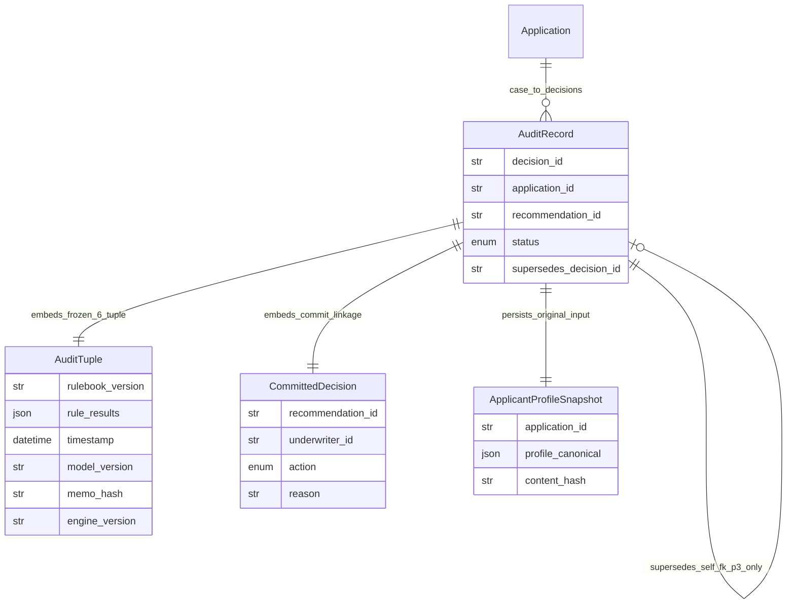

# Domain Entities — `audit-store` (EPIC-6 / U12)

**Stage**: BUILD → Functional Design (per-unit) · cluster-FD-first unit 3 of 4
**Unit**: U12 `audit-store` (owns `AuditRecord`, the `AuditTuple` 6-tuple embedding, `CommittedDecision`,
the OOS-7 seam; backs `DecisionCommitService` / `AuditService` / `ReplayService`)
**Date**: 2026-07-03
**Scope**: Field-by-field **internals** of the frozen contracts (`component-methods.md`): the persisted
**`AuditRecord`** (the CON-AUDIT-1 **6-tuple** + commit linkage + the **persisted original
`ApplicantProfile`** + the OOS-7 seam). The contract **shapes** are frozen; **`AuditRecord` is the
persisted SUPERSET entity that embeds them — not a re-opening of any frozen shape.**

Technology-agnostic. Types are logical (`str`, `Decimal`, `datetime`, `enum`, `json`); the
Pydantic v2 / PostgreSQL realization is a Code-Generation concern (DATA-5: **PostgreSQL, no SQLite**).

---

## 1. Entity-relationship / schema view

Mermaid validated before write (alphanumeric entity IDs; relationship labels quoted; **no
semicolons, no bare colons, no parentheses, no special chars** in labels; balanced blocks). Text
alternative follows.

### Text alternative (always included)

- **`AuditRecord`** is the persisted **superset** entity — one row per **committed decision**,
  keyed by **`decision_id`**. It **embeds** three frozen shapes and adds the input snapshot:
  - the **`AuditTuple`** — the CON-AUDIT-1 **6-tuple** (frozen shape);
  - the **`CommittedDecision`** commit linkage (frozen shape);
  - the **`ApplicantProfileSnapshot`** — the **exact original validated `ApplicantProfile`**
    persisted as-committed (Flag 2, §4) so **`ReplayService` is self-contained**;
  - the **OOS-7 seam** fields (`decision_id`, `status`, `supersedes_decision_id`).
- **`Application`** (the case, keyed by intake's system-assigned `application_id`) relates to
  **zero-or-more** `AuditRecord`s: **exactly one active decision in Phase 1/2**; a Phase-3 chain
  (original + supersessions) via the self-FK.
- The `AuditRecord ||--o| AuditRecord` self-relationship (`supersedes_decision_id`) is the **OOS-7
  seam — reserved, always null in Phase 1/2** (§5).

---

## 2. `AuditRecord` — field-by-field (the persisted superset)

`R` = required (non-null on every committed record). Append-only: written once at commit, **never
updated in place** (`business-rules.md §3`).

| Field | Type | R | Notes |
|---|---|:--:|---|
| `decision_id` | `str` | **R** | **System-generated PK** — identifies **this committed decision** (OOS-7 seam PK). Assigned at commit; the stable handle `ReplayService.replay(decision_id)` and the auditor read surface use. **Distinct from `application_id`** (§6). |
| `application_id` | `str` | **R** | **The case** — intake's **system-assigned** key (from the persisted profile). Links the decision to its application and to the `ApplicantProfileSnapshot`. Phase 1/2: one `application_id` → one active `decision_id` (§6 lineage). |
| `recommendation_id` | `str` | **R** | The **pending recommendation** that was committed (from the commit payload). The middle of the lineage `application_id → recommendation_id → decision_id`. |
| `audit_tuple` | `AuditTuple` | **R** | The frozen **6-tuple** (§3) — embedded, shape unchanged. |
| `applicant_profile_snapshot` | `ApplicantProfileSnapshot` | **R** | The **exact original validated `ApplicantProfile`** as committed (Flag 2, §4) — the replay input. |
| `committed_decision` | `CommittedDecision` | **R** | The human commit linkage (§3) — WHO/WHAT/WHY. |
| `status` | `enum` | **R** | `active \| superseded`. **Write-once `active`** in Phase 1/2 (`business-rules.md §3`). Superseded-ness is **derived** from a superseding record's existence — **never an in-place flip** (Flag 4, §5). |
| `supersedes_decision_id` | `str \| null` | **O** | Nullable **self-FK** to a prior `decision_id`. **Always null in Phase 1/2** (OOS-7 seam, §5). |

> **Superset, not a contract change.** `AuditRecord` **embeds** the frozen `AuditTuple` and
> `CommittedDecision` shapes and **adds** the profile snapshot + OOS-7 seam. `component-methods.md`
> signatures (`DecisionCommitService.commit`, `AuditStore.persist`, `ReplayService.replay`) are
> **unchanged** — this FD designs the persisted record around them.

### 2.1 Canonical serialization convention (CANON-SER — single spec)

**CANON-SER** is the **one** deterministic serialization spec, used for **both** `rule_results`
(§3.1) **and** `profile_canonical` (§4) — so replay-exactness rests on a **single** convention, not
two that could diverge:

- **stable key ordering** (declared/lexicographic — never dict-insertion or hash order);
- **`Decimal` as string** (never float — no IEEE drift);
- **canonical scalar forms** — enums as their declared string value, `null` explicit, no
  environment-dependent number/date formatting;
- **no volatile fields** embedded (no wall-clock, no run-scoped ids).

The same logical content ⇒ the **same CANON-SER bytes on every run** — the basis of a meaningful
replay comparison and of the `content_hash` integrity checks. (The replay **equality set** is a
*projection* over CANON-SER content — see `business-rules.md §5`.)

---

## 3. Embedded frozen shapes (unchanged)

### 3.1 `AuditTuple` — the CON-AUDIT-1 6-tuple

| Field | Type | Notes |
|---|---|---|
| `rulebook_version` | `str` | Semver — the **replay load key** (`business-logic-model.md §3`). Immutable ref. |
| `rule_results` | `json` (CANON-SER) | **The full `RuleResultReport` field-for-field** as `rules-engine` defines it (rules-engine `domain-entities.md §6`) — all per-rule rows + `recommendation` + `confidence` + embedded provenance (`rulebook_version` + `content_hash` + `engine_version`) + reasons. Serialized by **CANON-SER** (§2.1). **Replay compares the evaluation-output PROJECTION only** — per-rule rows + `recommendation` + `confidence`; the embedded provenance fields are **excluded** from the equality set (forensic — `business-rules.md §5`). |
| `timestamp` | `datetime` | Commit wall-clock time — **audit metadata**, captured once at commit; **excluded from the replay equality set** (Flag 3, `business-logic-model.md §4`). |
| `model_version` | `str` | The memo LLM/provider version (from `memo-agent-core`, unit 4). Recorded metadata. |
| `memo_hash` | `str` | Hash of the committed memo — memo integrity is verified by **hash comparison** on replay; the memo is **never re-drafted** (`business-logic-model.md §4`). |
| `engine_version` | `str` | Git SHA of the rules engine — **forensic/diagnostic** (code-drift detector), **NOT a replay equality trigger** (Flag 3). |

### 3.2 `CommittedDecision` — the commit linkage (payload = 4 fields)

| Field | Type | Notes |
|---|---|---|
| `recommendation_id` | `str` | The pending recommendation being committed. |
| `underwriter_id` | `str` | **WHO** — always mandatory (CON-BR4, `business-rules.md §1`). |
| `action` | `enum` | `approve \| override` — **WHAT**; always mandatory. `approve` = agree with the recommendation; `override` = disagree. |
| `reason` | `str \| null` | **WHY** — **mandatory (non-blank) on `override`**; on `approve` the action + endorsed recommendation is the rationale-of-record (`business-rules.md §1`). |

> The **commit payload** the UI sends is exactly `{recommendation_id, underwriter_id, action,
> reason}` (frozen). The **AuditRecord** is the persisted superset assembled from it + the tuple +
> the profile snapshot at commit time.

---

## 4. `ApplicantProfileSnapshot` — the persisted original input (Flag 2 — the replay gap fix)

The frozen 6-tuple does **not** carry the profile; without it `ReplayService` would have nothing to
feed `evaluate()`. So the `AuditRecord` **persists the exact original validated `ApplicantProfile`**,
**defined by reference to intake's contract** — **not** re-declared as a parallel field list (which
could drift from intake's actual schema).

> **Authoritative definition (single source).** `profile_canonical` **is the exact validated
> `ApplicantProfile` as `intake`'s `domain-entities.md` defines it** — that contract **governs** the
> snapshot's shape. This FD does **not** redefine the profile's fields; it persists intake's object
> verbatim. (Key fields, for readability only: the segregated `demographics` sub-object,
> `age_years_derived`, `bmi_derived`, the financial operands, `documents`, `incomplete` — but
> **intake's contract is authoritative**, not this list.)

| Field | Type | Notes |
|---|---|---|
| `application_id` | `str` | Intake's system-assigned key (matches the `AuditRecord.application_id`). |
| `profile_canonical` | `json` (CANON-SER) | The **exact validated `ApplicantProfile` per intake's contract** (above) — **as-persisted, NOT re-parsed** from source documents — serialized by the **single CANON-SER** convention (§2.1, the same one used for `rule_results`). On replay it is **deserialized back to the exact intake `ApplicantProfile` shape** and fed to `evaluate()` (`business-logic-model.md §4`). Includes **all** intake fields, incl. the segregated `demographics`. |
| `content_hash` | `str` | CANON-SER hash of `profile_canonical` — tamper-evidence + a fast integrity check before replay. |

> **CON-BR1 safety (storage ≠ influence).** The snapshot stores the segregated `demographics`
> sub-object, but this is **safe**: `rules-engine.evaluate()` **structurally excludes** demographics
> (its `input_fields` namespace has no demographic path — rules-engine `business-logic-model.md §4`),
> so a replayed re-evaluation cannot let demographics influence the result. This mirrors intake's
> **SEC-1-FORENSIC** pattern — persist for audit/replay, **never** let it influence the outcome.
> **DATA-4**: profiles are synthetic — no real PII is ever stored.

---

## 5. OOS-7 amendment seam (reserved now — field-level schema; behavior is Phase 3)

The Phase-3 append-only supersession seam is **designed at field level now**, **not built**:

| Seam field | Type | Phase 1/2 rule |
|---|---|---|
| `decision_id` | `str` | System-generated PK (§2). |
| `status` | `enum active \| superseded` | **Write-once `active`.** Phase 1/2 **never** writes `superseded`. |
| `supersedes_decision_id` | `str \| null` | Nullable self-FK. **Always null** in Phase 1/2. |

- **Supersession = a pure APPEND** (Phase 3): a correction is a **new** `AuditRecord` whose
  `supersedes_decision_id` points at the prior `decision_id`. The prior record is **never mutated**.
- **`superseded`-ness is DERIVED**, not stored-mutable: a record is effectively superseded **iff a
  newer record references it** via `supersedes_decision_id` (read-time projection) — so the seam
  and **append-only** (Flag 4, `business-rules.md §3`) are consistent; **no `active → superseded`
  in-place flip ever occurs.**
- **Phase-3 amendment behavior is NOT built** here (documented OOS-7); only the fields are reserved,
  so Phase 3 slots in **without migrating** existing records. *(The OOS-7 README / case-study
  documentation commitment remains a closed settled item — this FD designs the seam fields, not the
  docs.)*

---

## 6. `decision_id` vs `application_id` — distinct keys + lineage (Flag 5)

Three system-generated keys at three stages — **distinct granularities**, all carried so the chain
is unambiguous:

| Key | Granularity | Assigned at | Owner |
|---|---|---|---|
| `application_id` | the **application / case** | intake gate pass | intake (system-assigned) |
| `recommendation_id` | the **pending recommendation** on that case | pipeline (pre-gate) | the recommendation flow |
| `decision_id` | the **committed decision** (human) | commit | audit-store (OOS-7 seam PK) |

**Lineage**: `application_id` → `recommendation_id` → `decision_id`. **Phase 1/2**: one
`application_id` → **one active** `decision_id`. **Phase 3**: one `application_id` → a **chain** of
`decision_id`s (original + supersessions) linked via `supersedes_decision_id`. `decision_id` and
`application_id` are **never** the same value or interchangeable.

---

## 7. Cross-consumer contract check (P6 — cluster stability)

| Consumer / path | Needs | Covered by |
|---|---|---|
| `rules-engine` (U3) | persist `rule_results` replay-comparably | `audit_tuple.rule_results` = full `RuleResultReport` field-for-field, canonical (§4.2/§3.1) ✓ |
| `ReplayService` (this unit) | reload exact original input + original version | `applicant_profile_snapshot` (Flag 2) + `rulebook_version` load key ✓ |
| `memo-agent-core` (U4, next) | reserve `memo_hash` + `model_version` | embedded in `AuditTuple` (§3.1) — reserved at contract altitude for unit 4 ✓ |
| C5 read surfaces `ui-history` / `ui-memo-view` (US-PLAT-2) | read the full 6-tuple + replay outcome, read-only | `AuditService` read queries + read-only role (`business-rules.md §4`) ✓ |
| Phase-3 amendment (OOS-7) | supersession without mutation/migration | `decision_id` / `status` / `supersedes_decision_id` seam (§5) ✓ |

No downstream need is un-covered; the `AuditRecord` is stable for the cluster before Code-Gen.

---

*End of domain-entities.md. Write-gate / append-only / replay rules → `business-rules.md`;
commit + replay pipeline logic → `business-logic-model.md`.*
