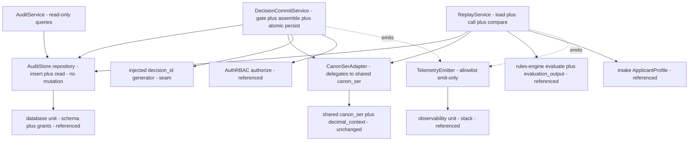

# Logical Components — `audit-store` (C5 / U12)

**Stage**: BUILD → NFR Design (per-unit) · cluster unit 3 of 4 · **Date**: 2026-07-05 · **Runtime**: Python 3.12.
**Scope**: the logical components realizing the `nfr-design-patterns.md` patterns, with responsibilities + relationships,
consistent with the FD entities (`AuditRecord`, `AuditTuple`, `CommittedDecision`, `ApplicantProfileSnapshot`) and the
frozen C5 contract. **Reference-not-own throughout** — no component reimplements rules-engine's `evaluate()` /
`evaluation_output()`, intake's `ApplicantProfile`, the shared CANON-SER, or the `database` unit's DDL/grants.

---

## 1. Components + responsibilities

| Component | Responsibility | Realizes | Owns / references |
|---|---|---|---|
| **DecisionCommitService** | The single fail-closed write-gate: total-function CON-BR4 predicate **+** independent `AuthRBAC` re-check → **assemble** the complete immutable `AuditRecord` (validated **before** BEGIN) → **atomic write** via the repository. | GATE-1, AUTHZ-1, TUPLE-1, ATOMIC-1 | **Owns** the gate + assembly + the transaction boundary. **References** `AuthRBAC.authorize`, the injected `decision_id` generator, `CanonSerAdapter`. |
| **AuditStore** (repository) | Persistence boundary — **`insert` + read only, NO `update`/`delete` method**; opens the single ACID transaction (unit-of-work seam). A Postgres/SQLAlchemy impl + an in-memory fake behind one interface. | ATOMIC-1, APPEND-1, TUPLE-1 | **Owns** the repository interface + impl. **References** the `database` unit's schema + `audit_writer`/`audit_reader` roles (DDL/grants **not** authored here). |
| **ReplayService** | Replay-as-detection: **load** the record → deserialize the snapshot to intake's `ApplicantProfile` → call rules-engine's imported pure **`evaluate()`** → apply rules-engine's imported **`evaluation_output()`** to **both** recorded + fresh → compare → match / mismatch + forensic delta. No LLM, no re-draft, no re-commit. | REPLAY-1, REPLAY-2, BR1-1, STATUS-1 (derived-superseded read) | **Owns** load + call + compare. **References** rules-engine `evaluate()` / `evaluation_output()` / `RuleResultReport` (imported), intake `ApplicantProfile`, `CanonSerAdapter`. |
| **AuditService** | The auditor **read-only** surface — `get(decision_id)` + `browse_history(application_id | across cases)`; returns the full 6-tuple + replay outcome; **no write method**; backend-enforced via the read-only role + authz. | READ-1, LOG-1 | **Owns** the read queries. **References** the `audit_reader` role. |
| **CanonSerAdapter** | Normalize `rule_results` + `profile_canonical` into the shared `canon_ser` value space and delegate to the **UNCHANGED** shared util; `content_hash = sha256(canon bytes)`; pre-replay tamper check. | CANON-1 | **Owns** the local adapter. **References** `backend/common/canon_ser.py` (unchanged) + `decimal_context`. audit-store is the §2.1 **spec authority**. |
| **TelemetryEmitter** | Emit-only allowlist telemetry — ids/enums/int counts/int timing **only**, no demographic/free-text field; commit/replay timing observed-not-gated. Distinct from the SEC-5 audit trail. | OBS-1, PERF-1 | **Owns** the emit seam. **References** the `observability` stack (wired there). |

**Referenced, not components of this unit** (reference-not-own): **`AuthRBAC.authorize`** (`auth-rbac` policy; the commit
re-check call site is audit-store's), the **injected `decision_id` generator** (UUID prod / deterministic fake — a seam,
not a component), **rules-engine `evaluate()`/`evaluation_output()`/`RuleResultReport`**, **intake `ApplicantProfile`**,
the **shared CANON-SER / `decimal_context`**, the **`database`** unit (schema/migrations/grants), **`observability`**
(stack), **`memo-agent-core`** (`memo_hash`/`model_version` computation — persisted here, never computed here).

---

## 2. Component-relationship diagram

Mermaid validated before write (alphanumeric node IDs; double-quoted labels; **no colons, no semicolons, no parentheses**
in labels — hyphens / "plus" only; edge labels double-quoted; balanced brackets; no reserved `end` node). Text
alternative follows.

### Text alternative (always included)

- **`DecisionCommitService`** uses the **`AuditStore` repository** to persist (one atomic transaction), the
  **`CanonSerAdapter`** to serialize, the **injected `decision_id` generator**, and **`AuthRBAC.authorize`** for the
  backend re-check; it **emits** to the **`TelemetryEmitter`**.
- **`ReplayService`** reads via the **repository**, deserializes with the **`CanonSerAdapter`**, calls the referenced
  **rules-engine `evaluate()` / `evaluation_output()`** and reconstructs the intake **`ApplicantProfile`**; it **emits**
  to the **`TelemetryEmitter`**.
- **`AuditService`** reads via the **repository** (read-only).
- The **`CanonSerAdapter`** delegates to the **unchanged shared `canon_ser` / `decimal_context`**.
- The **repository** targets the **`database`** unit's schema + grants (referenced, DDL not owned here).
- The **`TelemetryEmitter`** emits to the **`observability`** unit's stack (referenced).

---

## 3. Reference-not-own check (no violation)

| Boundary | audit-store owns | Referenced (not reimplemented / not authored here) |
|---|---|---|
| Rule evaluation + projection | load + call + compare | rules-engine `evaluate()` / `evaluation_output()` / `RuleResultReport` (imported) |
| Applicant profile shape | the snapshot persistence | intake `ApplicantProfile` (imported; governs the snapshot) |
| Canonical serialization | the local `CanonSerAdapter` | shared `backend/common/canon_ser.py` (unchanged) + `decimal_context` |
| Persistence topology | repository interface + queries + the transaction boundary | `database` schema / migrations / `audit_writer` / `audit_reader` grants |
| Authorization | the commit-time re-check call site | `auth-rbac` `AuthRBAC.authorize` policy |
| Observability | the emit seam | `observability` stack |
| Memo integrity | persist `memo_hash` + compare on replay | `memo-agent-core` computes `memo_hash` / `model_version` |

No component re-declares a frozen shape or reimplements an upstream authority. The six components are stable for Code-Gen.

---

*End of logical-components.md. Design patterns per target → `nfr-design-patterns.md`.*
