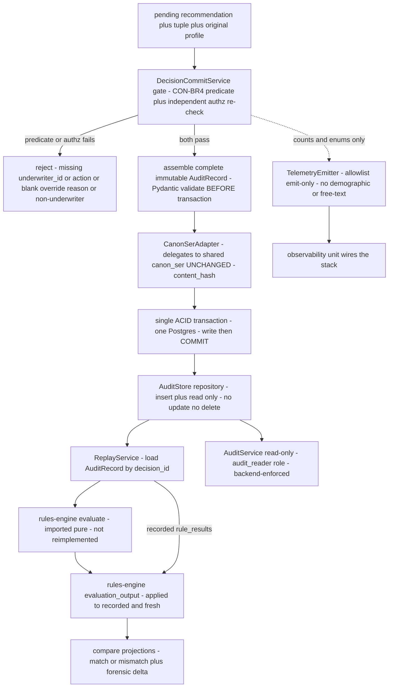

# NFR Design Patterns — `audit-store` (C5 / U12)

**Stage**: BUILD → NFR Design (per-unit) · cluster unit **3 of 4**
**Unit**: U12 `audit-store` — the CON-BR4 write-gate, append-only audit persistence, replay-as-detection, auditor read-only surface.
**Depth**: comprehensive (invariant-bearing audit unit) · **Date**: 2026-07-05 · **Runtime**: Python **3.12 pinned**.
**Scope**: the **design pattern (the "how")** for each approved `NFR-AUDIT-*` target — built **ON** the frozen FD + the
approved NFR Requirements, **re-opening neither** (not the C5 contract, the `AuditRecord` superset shape, the commit
predicate, the replay equality set, nor any NFR target). No code (that is Code-Gen). **Reference-not-own throughout.**

---

## 1. Commit-gate pattern — `NFR-AUDIT-GATE-1` / `NFR-AUDIT-AUTHZ-1`

**Pattern**: a **single fail-closed boundary wrapper** in `DecisionCommitService` — nothing reaches assembly/persist
unless **two independent checks** both pass (mirrors intake's `IntakeGate` / rules-engine's total-function patterns).

- **Total-function predicate (GATE-1)** — one pure predicate evaluates the **closed negative matrix** (BR-COMMIT-GATE):
  **REJECT iff** `underwriter_id` missing/empty **OR** `action` missing **OR** `action ∉ {approve, override}` **OR**
  (`action == override` AND `trim(reason) == ""`). It runs **before any assembly**; a `null` **or** whitespace-only
  override reason both reject (trim-then-empty). `action` is a closed enum → nothing outside the set can commit.
- **Independent backend authz re-check (AUTHZ-1)** — the same boundary calls **`AuthRBAC.authorize`** (referenced) to
  re-confirm the committer holds the **underwriter** role, **independent of the API layer** (defense-in-depth; the service
  is the last line). A read-only auditor is rejected here even if the API control were bypassed.
- **Fail-closed** — assembly + persistence are unreachable unless **both** the predicate and the authz re-check pass.
- **Structurally meets**: GATE-1 (total function over the closed matrix), AUTHZ-1 (backend re-check independent of the API).

---

## 2. Atomic-persist pattern — `NFR-AUDIT-ATOMIC-1`

**Pattern**: a **single ACID database transaction** wrapping the **write** of an already-complete record — the
decomposition-agnostic both-or-neither guarantee.

- **One transaction (the mechanism — Q2)** — the write of the `AuditRecord` **and any normalized rows** it decomposes
  into (e.g. a separate `ApplicantProfileSnapshot` child row, if NFR-Design-of-schema normalizes it) happens inside a
  **single `BEGIN … COMMIT`**. A fault at **any** step of the write → the transaction **rolls back** → **zero trace**
  (no committed decision, no `AuditRecord`, no orphan snapshot row). An accepted commit → **exactly one logical
  `AuditRecord`** (whatever physical row-count), all-or-nothing. The assertion never presumes a two-row "decision row /
  audit row" split.
- **Why single-ACID (not outbox/saga)** — this is a **single-service monolith writing to one Postgres**; there is **no
  cross-service / cross-datastore write**, so the strongest, simplest guarantee applies. Outbox/saga would add complexity
  and an eventual-consistency window for a unit whose **core property is atomicity** — rejected.
- **⚠ Co-location constraint (cross-unit dependency to confirm — sharpening 1).** A single ACID transaction spans only
  tables **co-located in ONE Postgres database reachable within a single connection/transaction**. This pattern therefore
  **depends on the `database` unit's schema** placing audit-store's tables (`audit_record` **and** any normalized
  `applicant_profile_snapshot` row) in **one Postgres database/schema** — **not** split across separate databases or
  services. **This is stated as a dependency ON the `database` unit's schema design, not assumed silently**: if the
  `database` unit were to split these across datastores, the transaction mechanism would need revisiting (outbox/saga).
  **Cross-unit constraint to confirm when the `database` unit is designed** (reference-not-own — audit-store asserts the
  behavior; `database` must provide a single-DB co-located schema for it to hold).
- **Boundary at the repository/unit-of-work seam (Q2↔Q9)** — the atomic-write boundary lives at the **repository /
  unit-of-work seam**, so the **same** `DecisionCommitService` code runs against the real-Postgres impl (real transaction;
  ATOMIC-1 verified by fault injection) **and** the in-memory fake (pure-logic unit tests).
- **Structurally meets**: ATOMIC-1 (both-or-neither under a fault at any write step; decomposition-agnostic).

---

## 3. AuditRecord assembly pattern — `NFR-AUDIT-TUPLE-1` (with the Q2/Q3 sequencing)

**Pattern**: **assemble + validate the complete immutable `AuditRecord` superset in memory BEFORE the transaction opens.**

- **Assemble-complete-first** — the full superset is built as one immutable object: the six `AuditTuple` fields
  (`rulebook_version`, `rule_results`, `timestamp`, `model_version`, `memo_hash`, `engine_version`), the
  `ApplicantProfileSnapshot` (`application_id`, `profile_canonical` via CANON-SER, `content_hash`), the `CommittedDecision`
  linkage, and the seam (`status=active`, `supersedes_decision_id=null`) — **validated by the Pydantic models** (closed
  `action`/`status` enums; non-null tuple fields). No field is computed mid-transaction.
- **Assemble-before-BEGIN (sharpening 2).** **Assembly + Pydantic validation happen BEFORE the transaction opens.** A
  validation failure (a missing/null tuple field, a bad enum) **fails fast and never opens a transaction** — so there is
  **no half-open transaction to roll back**. The transaction (§2) wraps **only the write** of an **already-complete,
  already-valid** `AuditRecord`. Sequence: **assemble + validate → `BEGIN` → write → `COMMIT`**.
- **Structurally meets**: TUPLE-1 (6-tuple + snapshot + linkage + seam all non-null on every persisted record —
  completeness is a **pre-persist invariant**, enforced before any DB work).

---

## 4. Append-only + derived-superseded pattern — `NFR-AUDIT-APPEND-1` / `NFR-AUDIT-STATUS-1`

**Pattern**: a repository that **structurally cannot mutate**, plus superseded-ness as a **pure read**.

- **Insert-only repository (APPEND-1)** — the `AuditStore` repository exposes **only `insert` + read** methods; **no
  `update`, no `delete` method exists** (a structural, testable guarantee at the service layer). Complemented by the
  `database` unit's **INSERT-only write role `audit_writer`** and **read-only `audit_reader`** (referenced) — `UPDATE`/
  `DELETE` on a committed `audit_record` raises an insufficient-privilege error at the DB layer. Two layers, neither a
  single point.
- **`status` write-once + derived-superseded (STATUS-1)** — `status` is written **once as `active`** and never flipped.
  **Superseded-ness is a pure READ query** — a record is superseded **iff** `EXISTS` a newer `AuditRecord` whose
  `supersedes_decision_id == this.decision_id` — a **read-time projection over the already-reserved `supersedes_decision_id`
  field ONLY** (no new column, no new table). In Phase 1/2 `supersedes_decision_id` is always null → the query always
  returns `active`; **no `active → superseded` in-place UPDATE ever occurs** — the OOS-7 seam and append-only stay
  consistent.
- **Structurally meets**: APPEND-1 (no-mutation service surface + DB-role), STATUS-1 (write-once `active`; derived read,
  never a write path; no schema beyond the reserved seam field).

---

## 5. Replay orchestration pattern — `NFR-AUDIT-REPLAY-1` / `-REPLAY-2` / `-BR1-1`

**Pattern**: `ReplayService` owns **load + call + compare only**; the projection is **single-sourced** from rules-engine.

- **Orchestration (REPLAY-2)** — `ReplayService.replay(decision_id)`: (i) **loads** the `AuditRecord`; (ii) **deserializes**
  `profile_canonical` (CANON-SER) back to the **exact intake `ApplicantProfile`** (rules-engine/intake's imported model,
  `model_validate`); (iii) calls **rules-engine's pure `evaluate()`** — **imported, not reimplemented** (audit-store has
  **no evaluation logic of its own**); (iv) it **never** invokes an LLM, **never** re-drafts the memo (memo integrity is a
  separate `memo_hash` recompute-and-compare), and **never** re-commits/mutates the record.
- **Single-sourced projection (REPLAY-1) — structural reference-not-own.** `ReplayService` **imports and calls
  rules-engine's own `evaluation_output()`** (`backend/rules_engine/report.py`) and applies it to **both** sides: it
  reconstructs the **recorded** report by deserializing the stored `rule_results` (CANON-SER) into rules-engine's
  **imported `RuleResultReport`**, then calls `evaluation_output()` on **it** and on the **fresh** report — **one imported
  projection function, not a duplicated reimplementation**. The compared set = `{rule_results, recommendation, confidence,
  decline_reasons, refer_reasons}` over CANON-SER; **`decline_reasons`/`refer_reasons` are pure canonically-sorted
  deterministic projections of the per-rule rows** (permutation-invariant per rules-engine's **DET-2**), redundant-but-
  consistent, so they cannot cause a false mismatch. **Excluded** (so no *false* mismatch): `timestamp` / `underwriter_id`
  / `reason` / `memo_hash`, and the provenance embedded in `rule_results` — `rulebook_version` (load key), `content_hash`,
  `engine_version` (**forensic** — surfaced to explain a mismatch, never compared).
- **Verdict** — projections equal → **match** (reproducibility verified); differ → **blocking mismatch + forensic delta**
  (which rule/field diverged; `engine_version`/`content_hash` drift flags). Deterministic → replay ×N byte-identical.
- **Storage ≠ influence (BR1-1)** — the snapshot stores `demographics`, but `evaluate()` structurally excludes them, so a
  **bias-swap on the snapshot** (swap demographics, identical financials) → **identical projection (delta = 0)**.
- **Structurally meets**: REPLAY-1 (single-sourced projection; forensic excluded), REPLAY-2 (pure `evaluate()` referenced,
  exact round-trip, no LLM/re-draft/re-commit, deterministic), BR1-1 (storage ≠ influence at the replay boundary).

---

## 6. Read-only auditor surface — `NFR-AUDIT-READ-1` / `NFR-AUDIT-LOG-1`

**Pattern**: a **read-only `AuditService`**, DB-role-backed and backend-enforced.

- **Read-only queries (READ-1)** — `AuditService` exposes `get(decision_id)` + `browse_history(application_id | across
  cases)` and returns the full 6-tuple + the replay outcome. It has **no write method**; it is backed by the read-only
  **`audit_reader`** role (referenced) + the backend authz — **backend-enforced, not merely UI-hidden**. Any auditor write
  attempt (commit / raw UPDATE / DELETE) is rejected at the backend (AUTHZ-1 + the read-only role).
- **The trail IS SEC-5 (LOG-1)** — the persisted `AuditRecord` history **is** the SEC-5 audit trail (every committed
  decision retrievable with its full tuple; browsable by `application_id`). It is **distinct** from observability telemetry
  (§8).
- **Structurally meets**: READ-1 (backend-enforced read-only), LOG-1 (the persisted history is the queryable audit trail).

---

## 7. CANON-SER adapter pattern — `NFR-AUDIT-CANON-1`

**Pattern**: an **audit-store-local `CanonSerAdapter`** delegating to the **UNCHANGED** shared `backend/common/canon_ser.py`
for **both** `rule_results` and `profile_canonical`.

- **One convention, shared util unchanged** — the adapter normalizes each payload into `canon_ser`'s value space and calls
  the **single shared util** (the `RulebookCanonAdapter` / intake `CanonSerAdapter` precedent). **No fork, no §2.1 change,
  no re-declaration** — audit-store is the **§2.1 spec authority**, `backend/common/` is the shared **location**.
- **Integrity check** — `content_hash = sha256(canon bytes)`; on replay the recorded `content_hash` is **recomputed and
  compared** (tamper-evidence) **before** re-evaluation; a mutated `profile_canonical` → hash mismatch → replay refused.
- **Structurally meets**: CANON-1 (one convention for both payloads; shared util unchanged; round-trip + tamper-evidence).

---

## 8. Emit-only allowlist telemetry — `NFR-AUDIT-PERF-1` / `NFR-AUDIT-OBS-1`

**Pattern**: an **emit-only allowlist `TelemetryEmitter`** whose schema **structurally cannot carry** demographic /
profile / free-text content (same mechanism as intake / rules-engine).

- **Allowlist schema (OBS-1)** — a Pydantic allowlist of **ids / enums / int counts / int timing only**; **no
  applicant-profile / demographic / free-text field** (a schema-level assertion proves none exists). CON-BR1 extends to
  telemetry **by construction**. **Distinct from the SEC-5 audit trail** (§6), which deliberately persists the full record.
- **Observed-only performance (PERF-1)** — commit/replay **duration is emitted** (int timing) for the soft-budget
  dashboard; there is **no latency-failing check** — correctness / auditability / determinism take precedence. **Emit-only**
  — the `observability` unit wires the stack (reference-not-own).
- **Structurally meets**: OBS-1 (demographic-free allowlist), PERF-1 (observed, not gated).

---

## 9. Pattern → target traceability

| Pattern (§) | Target(s) | Assertion made structurally achievable |
|---|---|---|
| §1 commit-gate wrapper | GATE-1 / AUTHZ-1 | fail-closed total-function predicate + independent backend authz re-check |
| §2 single ACID transaction | ATOMIC-1 | both-or-neither under a fault at any write step; **co-location constraint on `database`** |
| §3 assemble-before-BEGIN | TUPLE-1 | complete 6-tuple + snapshot + linkage + seam validated pre-persist; **no half-open txn** |
| §4 insert-only + derived read | APPEND-1 / STATUS-1 | no-mutation surface + DB-role; write-once `active`; derived-superseded read, reserved field only |
| §5 replay orchestration | REPLAY-1 / -2 / BR1-1 | single-sourced imported `evaluation_output()`; pure `evaluate()` referenced; storage ≠ influence |
| §6 read-only AuditService | READ-1 / LOG-1 | backend-enforced read-only; the persisted history is the SEC-5 trail |
| §7 CanonSerAdapter | CANON-1 | one convention for both payloads; shared util unchanged; tamper-evidence |
| §8 allowlist TelemetryEmitter | OBS-1 / PERF-1 | demographic-free allowlist schema; observed-only timing |

**Held**: frozen FD + approved NFR targets not re-opened; **reference-not-own** — rules-engine `evaluate()` /
`evaluation_output()` / `RuleResultReport` **imported not reimplemented**; intake `ApplicantProfile` referenced; shared
CANON-SER (unchanged) + `decimal_context`; `database` DDL / grants / schema; `auth-rbac` policy; observability stack;
`memo-agent-core` `memo_hash` computation. **No LLM anywhere.** **Infrastructure Design likely SKIPPED** for this unit (no
untrusted parsing → no sandbox NFR; no independent cloud topology — persistence topology owned by `database`/`deploy-config`)
— confirmed + logged when reached.

---

## 10. Pattern-integration diagram

Mermaid validated before write (alphanumeric node IDs; double-quoted labels; **no colons, no semicolons, no parentheses**
in labels — hyphens / "plus" / "then" only; balanced brackets; no reserved `end` node). Text alternative follows.

### Text alternative (always included)

1. A pending recommendation + tuple + the original profile reach the **`DecisionCommitService` gate** — the CON-BR4
   total-function predicate **plus** the independent backend authz re-check. On failure → **reject** (missing
   `underwriter_id` / `action`, blank override reason, or a non-underwriter caller). On **both pass** → assembly.
2. The **complete immutable `AuditRecord` is assembled and Pydantic-validated BEFORE the transaction opens**; the
   **`CanonSerAdapter`** serializes `profile_canonical` + `rule_results` via the **unchanged** shared `canon_ser` and
   computes `content_hash`.
3. A **single ACID transaction** (one Postgres) writes the already-complete record — **both-or-neither**; the **repository
   is insert + read only** (no update/delete).
4. The **`TelemetryEmitter`** emits **counts/enums/timing only** (no demographic/free-text) to the **`observability`** unit
   (referenced).
5. **Replay** (detection): `ReplayService` loads the record, calls **rules-engine's imported pure `evaluate()`**, and
   applies **rules-engine's imported `evaluation_output()`** to **both** the recorded and the fresh report; the compared
   projections decide **match** or **mismatch + forensic delta** (`engine_version`/`content_hash` surfaced, never compared).
6. The **`AuditService`** serves **read-only** queries (backed by the `audit_reader` role, backend-enforced).

---

*End of nfr-design-patterns.md. Logical components + their relationships → `logical-components.md`.*
