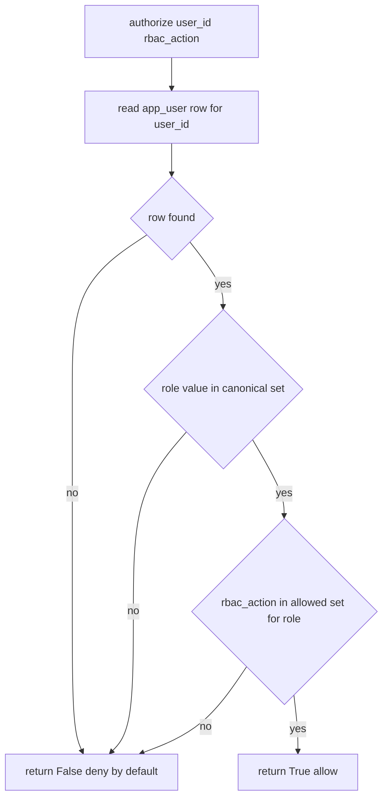

# Business Logic Model — `auth-rbac` (EPIC-6 / U11)

**Stage**: BUILD → Functional Design (per-unit) · invariant-bearing platform unit
**Unit**: U11 `auth-rbac`
**Date**: 2026-07-06
**Scope**: The **behavioral model** — the `authorize()` flow, the **composition-root wiring** of the real
`AuthRBAC` into audit-store's built `Authorizer` Protocol (no audit-store edit), the **two enforcement
points with the single-source-of-truth statement (fold #2)**, the **FD ↔ later-stage boundary**, a
**consumer/dependency map**, and an **invariant self-check**. **No credentials** (SEC-3). **No LLM.**

---

## 1. The `authorize()` flow (deterministic, fail-closed)

Mermaid validated before write (alphanumeric node IDs + underscore; every label double-quoted; **no
semicolons, no bare colons, no parentheses, no hyphens, no special characters** in labels; balanced
blocks). Text alternative follows.



### Text alternative (always included)
1. `authorize(user_id, rbac_action)` reads the **`app_user`** row for `user_id` (the role lookup).
2. **No row** → return `False` (unknown user — BR-AUTH-3 case i).
3. Row found, but the **`role` value is not in the canonical set** `{underwriter, auditor, admin}` (incl.
   a blank value) → return `False` (BR-AUTH-3 cases ii + iii).
4. Role canonical → test **`rbac_action ∈ matrix[role]`** (the role→permission matrix, BR-AUTH-2). Not a
   member → return `False`.
5. Member → return `True` (allow). The result is a deterministic function of `role` + `rbac_action` +
   the static policy — no wall-clock, no randomness (BR-AUTH-12).

*(`app_user.role` is `NOT NULL` in the built DB schema, so a DB-null cannot occur; step 3 still treats
null/blank as deny at the app layer for completeness — fold #1.)*

---

## 2. Composition-root wiring (conform to the built Protocol; no audit-store edit)

audit-store's `DecisionCommitService` is constructed with an injected `authorizer: Authorizer` and calls
it during commit:

```python
# backend/audit_store/commit_service.py  (BUILT — NOT edited)
if not self._authorizer.authorize(underwriter_id, RBAC_COMMIT):   # RBAC_COMMIT == "commit"
    raise UnauthorizedCommit(...)
```

- **At the composition root** (the application wiring layer — a later integration unit, not audit-store
  and not this FD's code), the **real `AuthRBAC` instance is passed as that `authorizer`**. Because
  `AuthRBAC.authorize(user_id, rbac_action) -> bool` structurally satisfies the `@runtime_checkable
  Authorizer` Protocol (BR-AUTH-7), it drops in with **no change to audit-store**.
- The shipped **`AllowRolesAuthorizer`** test fake (`user_id -> {rbac_action}`) stays audit-store's test
  double; the real `AuthRBAC` is its production counterpart — same Protocol, real `app_user`-backed role
  resolution.
- **Reference-not-own**: audit-store owns the **re-check call site**; auth-rbac owns the **policy + the
  real impl**. Neither `seams.py` nor `commit_service.py` is modified.

---

## 3. Two enforcement points, ONE policy (fold #2 — single source of truth)

Authorization is enforced at **two backend points**, and **both resolve through the exact same
`AuthRBAC.authorize` call**:

| Enforcement point | Where | What it checks |
|---|---|---|
| **API-layer guard** | a backend request guard (e.g. a FastAPI dependency) auth-rbac owns, **upstream** of the service | `authorize(current_user_id, <rbac_action for the endpoint>)` — blocks the request early if `False` |
| **Commit re-check** | inside audit-store's **built** `DecisionCommitService` (unedited) | `authorize(underwriter_id, RBAC_COMMIT)` — raises `UnauthorizedCommit` if `False` |

> **Single-source-of-truth invariant (must not be violated by any future maintainer):** the API-layer
> guard is a **second enforcement POINT, not a second policy**. It **must call the same
> `AuthRBAC.authorize`** (the same role→permission matrix, BR-AUTH-2) — it must **NOT** re-implement,
> inline, hardcode, or fork the permission logic (e.g. an ad-hoc `if role == "underwriter"` at the API
> layer is a defect). There is exactly **one** authorization policy; the two points differ only in *where*
> and *with which `rbac_action`* they call it. Defense in depth comes from calling the one policy at two
> points, never from two divergent checks.

**Effect**: a read-only `auditor` is blocked at the API guard (`commit` denied); even if the API layer
were bypassed, the built commit re-check denies again — structurally unable to reach commit (SEC-4),
with no risk of the two layers disagreeing.

---

## 4. FD ↔ later-stage boundary (what THIS FD pins vs what is provisioned later)

| Concern | **Pinned in THIS FD** | **Provisioned later (NFR / Infra / `secrets-config`)** |
|---|---|---|
| Canonical `Role` set + role→permission matrix | ✅ `{underwriter, auditor, admin}` + the matrix (domain-entities §2.2/§2.4) | — |
| `authorize` behavior + fail-closed semantics | ✅ the flow (§1) + BR-AUTH-3 | Test tiers, perf budget (NFR) |
| Protocol conformance + composition-root wiring | ✅ the contract (§2) | The actual wiring code lives in the integration/composition unit (Code-Gen of the app) |
| API-layer guard **design** (single-policy) | ✅ §3 — one policy, two points | The concrete FastAPI dependency + route wiring (Code-Gen) |
| `app_user` **read model** (columns read) | ✅ domain-entities §2.1 | The repository impl + connection (Code-Gen; connection URL = `secrets-config`) |
| DB-role decision | ✅ app-level only, Q7-A (BR-AUTH-9) | A future dedicated auth DB role = `database` migration + Infra + `secrets-config` (deferred-open) |
| OIDC / SSO authentication flow | ❌ **reserved seam only** (BR-AUTH-10) | Phase 3 / OOS-3 |
| Credentials / connection strings | ❌ **never here** (SEC-3) | `secrets-config` |

**Rule of thumb**: this FD defines **the policy and the authorize behavior**; later stages provision the
**wiring, connection, and (if ever) the dedicated DB role**.

---

## 5. Consumer / dependency map

| Party | Relationship to auth-rbac | Notes |
|---|---|---|
| **`database`** (dependency) | auth-rbac **consumes** `app_user` (reads `user_id -> role`) | reference-not-own; no schema edit; open `role` column (BR-DB-12) |
| **`audit-store`** (consumer) | injects the real `AuthRBAC` as its `Authorizer` at the commit re-check | built call site unedited; auth-rbac satisfies `Authorizer` (BR-AUTH-7) |
| **C5 UI facets** (consumer) | consume auth-rbac for the UI-side RBAC facet | thin facet folded into the C5 units (Q1=A) — not a second unit, not designed here |
| **`admin-cli`** (consumer + `app_user` writer) | provisions/manages `app_user` rows; uses `manage_users` / `manage_config` | auth-rbac's Phase-1 own path is read-dominant; provisioning is admin-cli's |
| **`secrets-config`** (dependency) | supplies the app-owner connection URL shape | SEC-3 — values never here |

---

## 6. Invariant self-check

| Invariant | Honored by | How |
|---|---|---|
| **SEC-4** (RBAC segregation) | BR-AUTH-2/4/5/6; §1, §3 | underwriter-only `commit`; auditor read-only; two backend points, one policy |
| **Fail-closed / deny-by-default** | BR-AUTH-3; §1 | unknown user / non-canonical role / null-blank role / unlisted action → `False` |
| **CON-BR4 / human-in-the-loop** | BR-AUTH-4; §2 | only an authorized underwriter reaches the commit boundary; the built re-check enforces it |
| **Authorizer conformance (reference-not-own)** | BR-AUTH-7; §2 | `authorize(user_id, rbac_action) -> bool` satisfies the built Protocol; no audit-store edit |
| **BR-DB-12 (DB role stays open)** | BR-AUTH-1 | role set closed at app layer; no DB CHECK; no `database` migration edit |
| **CON-BR1 (bias-free)** | BR-AUTH-8 | authz uses only `user_id -> role -> rbac_action`; no demographics |
| **Advisory-only** | BR-AUTH-12 | gates *who may act*; "decision" not used for an authz result; no outcome finalized |
| **Reproducibility** | BR-AUTH-12; §1 | `authorize` is a pure function of role + action + static policy |
| **SEC-3 (no secrets)** | §4; BR-AUTH-9 | no credentials/URLs in these artifacts; owned by `secrets-config` |
| **Single source of truth (fold #2)** | §3 | both enforcement points call the same `AuthRBAC.authorize`; no divergent second policy |
| **No LLM** | BR-AUTH-12 | pure Python authz; no model anywhere in `auth-rbac` |
