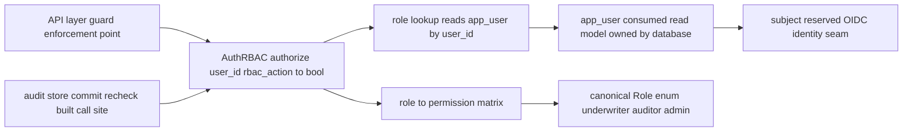

# Domain Entities — `auth-rbac` (EPIC-6 / U11)

**Stage**: BUILD → Functional Design (per-unit) · invariant-bearing platform unit
**Unit**: U11 `auth-rbac` — the **canonical role/permission model** + backend enforcement (API layer +
the built `DecisionCommitService` commit re-check). Story **US-PLAT-1**; owns **SEC-4**; traces PER-4..6.
**Date**: 2026-07-06
**Scope**: The entities auth-rbac introduces or consumes — the **consumed `app_user`** read model
(owned by `database`), the **canonical `Role`** enum (closed at the app layer), the **`rbac_action` /
Permission** model + the **role→permission matrix**, the **`AuthRBAC` service entity** (`authorize` +
role lookup), and the reserved **OIDC `subject`** seam. **No credentials/connection strings** appear
here (SEC-3 — owned by `secrets-config`). **No LLM** in this unit.

> **Reconciled against, not re-opened**: audit-store's built `Authorizer` Protocol (`seams.py`) + the
> commit re-check (`commit_service.py`); `database`'s `app_user` migration/schema (BR-DB-12). auth-rbac
> **conforms to** the Protocol and **consumes** `app_user`; it edits **neither**.

---

## 1. Entity / relationship view

Mermaid validated before write (alphanumeric node IDs + underscore; every label double-quoted; **no
semicolons, no bare colons, no parentheses, no hyphens, no special characters** in labels; balanced
blocks). Text alternative follows.

### Text alternative (always included)
- **`AuthRBAC.authorize(user_id, rbac_action) -> bool`** is the single policy entry point. It is reached
  from **two backend enforcement points**: the **API-layer guard** and the **built audit-store commit
  re-check** (both call the same `authorize` — see `business-logic-model.md`).
- `authorize` performs a **role lookup** by reading the **`app_user`** read model (owned by `database`,
  consumed here) to resolve `user_id -> role`, then checks the **role→permission matrix** keyed by the
  canonical **`Role`** enum.
- **`app_user.subject`** is the **reserved OIDC** identity-binding seam (external issuer/subject); the
  SSO/OAuth flow is deferred (OOS-3).

---

## 2. Entities

### 2.1 `app_user` — consumed read model (owned by `database`, NOT owned here)

`database`'s `0001_initial_schema.sql` owns this table (`user_id` PK, `subject` UNIQUE, `role` VARCHAR
**open** — BR-DB-12). auth-rbac **reads** it; it does **not** re-declare, migrate, or add columns to it.

| Column read | Logical | Used by auth-rbac for |
|---|---|---|
| `user_id` | str (PK) | the lookup key — resolve the acting user |
| `role` | str (**open VARCHAR** in the DB) | mapped to the canonical `Role` (§2.2); the authz input |
| `subject` | str (UNIQUE) | the reserved **OIDC** identity-binding seam (§2.6) — not used in the Phase-1 authz decision |

> **Read contract (reference-not-own):** auth-rbac depends only on these three columns existing with
> these meanings. Writes to `app_user` (user provisioning) are **`admin-cli`'s** path in Phase 1 — see
> `business-logic-model.md §5`. auth-rbac's own Phase-1 path is **read-dominant** (role lookup).

### 2.2 `Role` — the canonical enum (closed at the APP layer; DB stays open)

auth-rbac is the **single source of the canonical role set**. The set is closed here as a domain enum;
the **DB column stays open `VARCHAR` with no CHECK** so extension is a forward-only, non-breaking change
(**BR-DB-12 honored — `database`'s migration is not edited**; BR-AUTH-1).

| `Role` | Meaning | Underwriting actor |
|---|---|---|
| `underwriter` | May reach the human-approval-gate **commit** boundary; may read | **Yes** (acts) |
| `auditor` | **Read-only** — may read audit records / queue / memo; **may NOT commit** (SEC-4) | No |
| `admin` | User/config management via `admin-cli`; **not** an underwriting actor | No |

A role value read from `app_user` that is **not** one of these three (or blank) is treated as
**unauthorized** (fail-closed, BR-AUTH-3). The **senior-underwriter escalation role stays deferred**
(Deferred Decisions #8 / OOS-2); adding it later is an app-layer set extension with **no DB migration**.

### 2.3 `rbac_action` / Permission — the RBAC operation vocabulary

An `rbac_action` is the **RBAC OPERATION** being authorized — **distinct from `CommittedDecision.action`**
(`approve`/`override`), which they must never be conflated with (BR-AUTH-11; the built seam docstring
pins this). The Phase-1 vocabulary:

| `rbac_action` | Operation | Notes |
|---|---|---|
| `commit` | Reach the human-approval-gate commit boundary | **= the built `RBAC_COMMIT = "commit"` constant** (`seams.py`); the underwriter-only operation |
| `view_queue` | View the application queue | read op |
| `view_memo` | View a recommendation memo | read op |
| `read_audit` | Read the audit trail / decision history | read op — aligns with `database`'s `audit_reader` DB role (§2.4, BR-AUTH-9-adjacent) |
| `manage_users` | Create/manage `app_user` rows | admin op (via `admin-cli`) |
| `manage_config` | Manage provider/config | admin op (via `admin-cli`) |

### 2.4 Role → Permission matrix (data, not code branches)

| `Role` | Allowed `rbac_action`s |
|---|---|
| `underwriter` | `commit`, `view_queue`, `view_memo`, `read_audit` |
| `auditor` | `view_queue`, `view_memo`, `read_audit` **(no `commit`)** |
| `admin` | `manage_users`, `manage_config` |

- **Only `underwriter` carries `commit`** → satisfies audit-store's `UnauthorizedCommit` assumption
  (`authorize(user, "commit")` is `False` for auditor/admin).
- **`auditor` is read-only** — its permitted read set is the **app-layer counterpart** of `database`'s
  DB-level `audit_reader` SELECT-only grant (two layers of the same SEC-4 segregation; `business-rules.md`
  BR-AUTH-5 / Q9). `admin` is not an underwriting actor (no `commit`, no case reads by default).

### 2.5 `AuthRBAC` — the service entity

| Member | Signature | Meaning |
|---|---|---|
| `authorize` | `authorize(user_id: str, rbac_action: str) -> bool` | The single policy entry point — **structurally conforms to audit-store's built `Authorizer` Protocol** (BR-AUTH-7). Returns the authorization result (allow/deny). Deterministic (no wall-clock/randomness). |
| user-role read | `UserRoleRepository.get_role(user_id) -> str or None` | The **read contract** returns the **raw `app_user.role` value** — `None` when there is **no matching row**; otherwise the **stored `role` string exactly as persisted** (canonical or not, possibly blank). **The lookup does NOT canonicalize** — mapping the raw string to the `Role` enum and the fail-close decision both happen inside `authorize` (§2.5 note, below). |

> **§2.5 back-annotation (2026-07-07, applied at NFR Requirements):** the user-role read contract returns
> the **raw `str | None`**, and **canonicalization (raw `role` string → `Role` enum) + the fail-close both
> live in `authorize`**, not in the lookup. *(This replaces an earlier `role_of(user_id) -> Role or None`
> phrasing, which folded canonicalization into the lookup.)* **Rationale:** `business-logic-model.md §1`
> already decomposes the flow as *"no row → deny"* **separately from** *"row found but role not in the
> canonical set → deny"*; a `Role | None` lookup collapses "no row" and "non-canonical role" both into
> `None`, making BR-AUTH-3's three deny-by-default cases (unknown user / non-canonical role / null-blank
> role) **indistinguishable** and structurally un-independently-testable. Returning the raw value keeps the
> three cases independently constructible **and** makes the fake and the real Postgres-backed repository
> **identical in shape** (no drift). No invariant, field, or external behavior changes — a seam-shape
> clarification only, fixing an internal `domain-entities` ↔ `business-logic-model` inconsistency.

`authorize` = *read the user's **raw `role` string** via the lookup; if it is `None` (no row), blank, or
**not in the canonical `Role` set**, deny (fail-close, BR-AUTH-3); otherwise map it to the canonical
`Role` and test* `rbac_action ∈ matrix[Role]`. This is a faithful two-level composition of the shipped
test fake `AllowRolesAuthorizer` (which collapses `user_id -> allowed set`); the real impl inserts the
`user_id -> raw role -> canonical Role -> allowed set` resolution.

### 2.6 `subject` — reserved OIDC seam

`app_user.subject` (UNIQUE) is the reserved **external identity-binding** seam (issuer/subject) for a
later OIDC/SSO flow. Phase-1 authz operates over an **already-resolved `user_id`**; **`subject` does not
enter the Phase-1 authorization decision**. The SSO/OAuth authentication flow is **deferred to Phase 3 /
OOS-3** (Deferred Decisions #6; BR-AUTH-10).

---

## 3. What this schema/model is NOT (boundaries held)

- **Not** a re-opening of audit-store's built `Authorizer` Protocol or `commit_service.py` — auth-rbac
  provides a **conforming** impl injected at the composition root; **no audit-store file is edited**.
- **Not** a re-declaration of `database`'s `app_user` — it is **consumed read-only** (three columns);
  no DB CHECK is added (BR-DB-12: the DB `role` column stays open).
- **Not** an authentication (authn) design — Phase-1 is **authz only** over a resolved `user_id`; OIDC
  flow deferred (§2.6).
- **Not** a dedicated auth **DB role** — Phase-1 uses the app-owner connection (Q7-A; `business-rules.md`
  BR-AUTH-9); a dedicated DB role remains an **open forward-only** option owned by `database`.
- **Not** the UI-side RBAC facet — that is a thin consuming facet folded into the C5 UI units (Q1=A at
  Units Generation), not designed here.

---

## 4. Traceability

| Entity / element | Traces to |
|---|---|
| `app_user` read model (user_id/role/subject) | `database` `0001_initial_schema.sql` + BR-DB-12; consumed reference-not-own |
| `Role` enum (underwriter/auditor/admin) | `unit-of-work.md` U11; SEC-4; BR-DB-12 (auth-rbac closes the set) |
| `rbac_action` `commit` | audit-store `seams.py` `RBAC_COMMIT`; `commit_service.py` re-check; CON-BR4 human gate |
| Role→Permission matrix | SEC-4 segregation; PER-4..6; audit-store `UnauthorizedCommit` assumption |
| `AuthRBAC.authorize` | audit-store `Authorizer` Protocol; `component-methods.md` `AuthRBAC.authorize`; US-PLAT-1 |
| `auditor` read set ↔ `audit_reader` | `database` `audit_reader` grant (BR-DB-5); SEC-4 two-layer alignment |
| `subject` OIDC seam | `app_user.subject`; OOS-3 (SSO deferred) |
