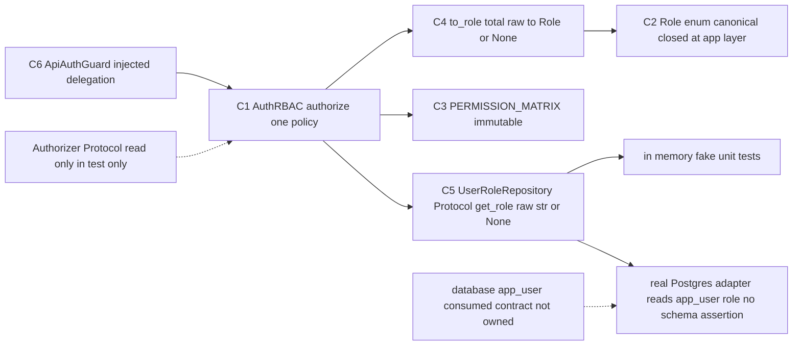

# Logical Components — `auth-rbac` (EPIC-6 / U11)

**Stage**: BUILD → NFR Design (per-unit) · invariant-bearing platform unit
**Unit**: U11 `auth-rbac` · **Date**: 2026-07-07 · **Depth**: comprehensive.
The **6 logical components** this unit introduces (under `backend/auth_rbac/`), their responsibilities, the ownership +
**reference-not-own** check, and the component→target coverage. **No credentials** (SEC-3). **No LLM.**

> **No production import of `audit_store` anywhere (fold 1 — stated once, binding).** Conformance is duck-typed; the
> `Authorizer` import + `isinstance` live **only in the PROTOCOL-1 test**. **Structurally testable**: no
> `from backend.audit_store …` in `auth_rbac` production code. Neither the real `UserRoleRepository` adapter nor
> `ApiAuthGuard` imports any `audit_store` **or** `database` production module.

---

## 1. Components

| ID | Component | Responsibility | Backs |
|---|---|---|---|
| **C1** | **`AuthRBAC`** | The service class; the **one** `authorize(user_id: str, rbac_action: str) -> bool` (FailClosedMatrixLookup: `get_role → to_role → role is None ? False : action ∈ matrix`). The single policy entry point; duck-typed to audit-store's `Authorizer`. | DENY-1, MATRIX-1, COMMIT-1, PROTOCOL-1, BIAS-1, DET-1, PERF-1 |
| **C2** | **`Role`** | The canonical enum `{underwriter, auditor, admin}` — **closed at the app layer** (DB `role` stays open `VARCHAR`, BR-DB-12; no DB CHECK). | MATRIX-1, COMMIT-1, DENY-1 |
| **C3** | **`PERMISSION_MATRIX`** | The module-level **immutable** `dict[Role, frozenset[str]]` — the single policy datum. | MATRIX-1, COMMIT-1 |
| **C4** | **`to_role`** | The **total** `to_role(raw: str | None) -> Role | None` canonicalization + fail-close helper (miss → `None`, no exception-as-control-flow). *(May fold into C1 as a private method — a realization detail; the split is the design view.)* | DENY-1 (ii)/(iii) |
| **C5** | **`UserRoleRepository`** | The **Protocol** `get_role(user_id: str) -> str | None` (raw value, §2.5) + an **in-memory fake** (unit tests, the primary substrate) + a **real Postgres-backed adapter** reading `app_user.role`. `AuthRBAC` depends on the **Protocol** (DIP). | DENY-1, consumption |
| **C6** | **`ApiAuthGuard`** | The API-layer **delegation** enforcement point — holds the **single injected `AuthRBAC`**; only logic is `return self._authz.authorize(...)`; MAY route endpoint → `rbac_action`, MUST NOT decide allow/deny. | SSOT-1 |

**Test substrate (not a production component)**: the in-memory fake `UserRoleRepository`, a stub/spy `AuthRBAC` (for the
SSOT-1 delegation test), and a read-only import of audit-store's `Authorizer` Protocol (for PROTOCOL-1) — all test-only.

### Fold 3 — the real `UserRoleRepository` adapter adds NO `app_user` schema/FIDELITY assertion
The real Postgres-backed adapter reads **exactly** `user_id` + `role` from `app_user` via its **own** query (raw
`str | None`). It **adds no schema/FIDELITY assertion of its own** (consistent with **SCOPE-1** — auth-rbac does not test
`database`'s schema correctness). **`app_user` drift protection, if ever wanted, is `database`'s own concern to add**
(recall `app_user` is not in `database`'s FIDELITY-1 set by design), **not** auth-rbac's. The fake and the real adapter
share the **one Protocol shape** → **no drift** between them.

---

## 2. Component-relationship diagram

Mermaid validated before write (alphanumeric node IDs + underscore; every label double-quoted; **no semicolons, no bare
colons, no parentheses, no hyphens, no special characters** in labels; balanced blocks). Text alternative follows.

### Text alternative (always included)
- **C6 `ApiAuthGuard`** delegates to **C1 `AuthRBAC`** (the one policy).
- **C1** uses **C4 `to_role`** (→ **C2 `Role`**) and **C3 `PERMISSION_MATRIX`**, and reads roles through the **C5
  `UserRoleRepository` Protocol** (`get_role → str | None`), implemented by an **in-memory fake** and a **real Postgres
  adapter** (the latter reads `database`'s `app_user` `role` via its own query — a **consumed contract, not owned**, with
  **no schema/FIDELITY assertion**).
- The **`Authorizer` Protocol** (dashed) is imported **read-only in the PROTOCOL-1 test only** — never in production.

---

## 3. Reference-not-own check

| Concern | Owner | This unit? |
|---|---|---|
| Role/permission **policy** (Role enum, matrix, `authorize`) | **`auth-rbac`** (C1–C4) | ✅ owns |
| The API-layer enforcement **point** | **`auth-rbac`** (C6) | ✅ owns (delegates to C1) |
| audit-store's `Authorizer` Protocol + commit re-check **call site** | **`audit-store`** | ❌ **duck-typed conformance only; imported read-only in the PROTOCOL-1 test; NO production import; not edited** |
| `app_user` **schema / migration / FIDELITY** | **`database`** | ❌ **consumed via the read contract only; the real adapter adds no schema/FIDELITY assertion** (fold 3) |
| Composition-root **wiring** (inject `AuthRBAC` into `DecisionCommitService`) | **integration/app-assembly unit** | ❌ not this unit's production code |
| App-owner **connection URL** / any dedicated auth **DB role** | **`secrets-config`** / **`database`** (deferred-open) | ❌ not here (SEC-3) |
| C5 UI RBAC facet | **C5 UI units** (Q1=A) | ❌ thin consuming facet, not designed here |
| SSO/OAuth authn flow | Phase 3 / OOS-3 | ❌ deferred |
| DB/authz metrics + traces | **`observability`** | ❌ N/A here |

**No component owns a concern reference-not-own assigns elsewhere. No production import of `audit_store` (or `database`)
anywhere in `auth-rbac`** — verifiable structurally (no `from backend.audit_store` / `from backend.database` in
`auth_rbac` production code). No circular dependency.

---

## 4. Component → target coverage (no orphan)

| Target | Component(s) |
|---|---|
| NFR-AUTH-DENY-1 | C1 + C4 + C5 (raw value) |
| NFR-AUTH-MATRIX-1 | C1 + C3 (+ C2) |
| NFR-AUTH-COMMIT-1 | C1 + C3 (+ C2) |
| NFR-AUTH-PROTOCOL-1 | C1 (signature; conformance test-only import) |
| NFR-AUTH-SSOT-1 | C6 (+ C1) |
| NFR-AUTH-BIAS-1 | C1 + C5 (narrow signatures) |
| NFR-AUTH-DET-1 | C1 + C3 (immutable) |
| NFR-AUTH-SCOPE-1 | **governance / exclusion** — cross-cutting boundary, not a component-owned runtime target (documented, not an orphan) |
| NFR-AUTH-PERF-1 | C1 (observed, non-gating) |
| NFR-AUTH-OBS-1 | **N/A — observability-owned** (documented boundary, not an orphan) |

**All ten targets covered.** Every component (C1–C6) backs ≥1 target; every runtime target maps to ≥1 component;
SCOPE-1 + OBS-1 are documented boundaries. No orphan.

---

## 5. Settled items held (not re-opened)
- Frozen FD (role/permission model + BR-AUTH-1..12 + the authorize flow + the §2.5 raw `str | None` read contract) and
  the approved `NFR-AUTH-*` targets — components realize them, re-opening neither.
- **No production import of `audit_store` (fold 1)** — duck-typed conformance; Protocol import read-only in the test.
- **`app_user` consumed, not owned (fold 3)** — the real adapter reads the raw `role` via its own query; adds no
  schema/FIDELITY assertion; drift protection is `database`'s.
- **SSOT (fold 2)** — the guard delegates only; MAY route endpoint→`rbac_action`, MUST NOT decide allow/deny; the stub
  test exercises both stub-True and stub-False.
- **SEC-4** fail-closed; **CON-BR1** structural; **determinism** pure-function; **advisory-only**; **SEC-3** no
  credentials. **No LLM.** **Infrastructure Design** for `auth-rbac` remains **likely a logged SKIP** — decided at that
  stage. Settled non-edits stay closed: `PROJECT-BRIEF.md`, `user-journey.md`, every built unit's code.
