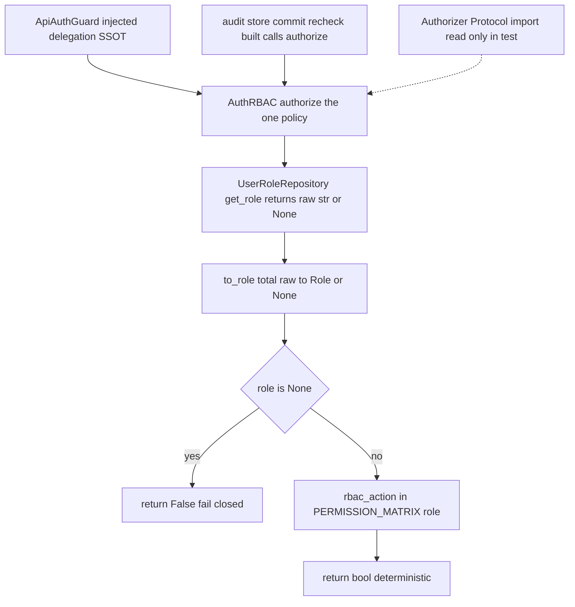

# NFR Design Patterns — `auth-rbac` (EPIC-6 / U11)

**Stage**: BUILD → NFR Design (per-unit) · invariant-bearing platform unit
**Unit**: U11 `auth-rbac` · **Date**: 2026-07-07 · **Runtime**: Python **3.12 pinned** (D6) · **Depth**: comprehensive.
**Built ON** the frozen FD (`domain-entities.md` incl. the §2.5 read-contract back-annotation / `business-rules.md` /
`business-logic-model.md`) + the approved `nfr-requirements.md` — **re-opening neither**. One section per pattern, each
structurally meeting its `NFR-AUTH-*` target(s) + traced. **No credentials** (SEC-3). **No LLM.**

> **No production import of `audit_store` anywhere in `auth-rbac` (stated once, upheld everywhere below).** Conformance
> to audit-store's `Authorizer` is **duck-typed/structural**; the `Authorizer` import + `isinstance` + call-shape
> assertions live **only in the PROTOCOL-1 test**. This is **structurally testable** — *"there is no
> `from backend.audit_store …` in `auth_rbac` production code."* Neither the real `UserRoleRepository` adapter nor
> `ApiAuthGuard` imports any `audit_store` **or** `database` production module. No circular dependency (the
> `fidelity_comparator` posture).

---

## §1 — FailClosedMatrixLookupPattern → NFR-AUTH-DENY-1, NFR-AUTH-MATRIX-1, NFR-AUTH-COMMIT-1

- **Pattern**: **one** linear, fail-closed `authorize`:
  `raw = repo.get_role(user_id)` → `role = to_role(raw)` → **`if role is None: return False`** →
  `return rbac_action in PERMISSION_MATRIX[role]`.
- **Why it satisfies all three targets from ONE implementation**:
  - **DENY-1** — the four cases are just **input variations** through this one flow: (i) unknown `user_id` → `get_role`
    returns `None`; (ii) non-canonical role → `get_role` returns a non-member string; (iii) blank role → `""`;
    (iv) unlisted action for a valid role → non-member of the matrix set. Each is **independently constructible by input
    alone** (the §2.5 raw `str | None` contract makes `None` / `"wizard"` / `""` distinct inputs), so a regression in any
    one is caught in isolation — even though (i)/(ii)/(iii) share the `role is None → False` branch.
  - **MATRIX-1** — the exhaustive `Role × rbac_action` grid is the **same one-line membership test**; every pair yields a
    defined `bool` (no unhandled combination, no exception, no `None`).
  - **COMMIT-1** — `commit` is a member of `PERMISSION_MATRIX[underwriter]` only → `True` solely for `underwriter`.
- **No per-case branching**: there is exactly one decision path; the cases are inputs, not code forks.
- **Tier**: unit (fake `UserRoleRepository`).

## §2 — RawToRoleCanonicalizationPattern → NFR-AUTH-DENY-1 (ii)/(iii)

- **Pattern**: a **total** helper `to_role(raw: str | None) -> Role | None` — returns the `Role` member for an **exact**
  canonical string match; returns **`None`** for `None`, blank/whitespace, or any non-canonical string. A **membership
  lookup** (over `Role`'s value set), **no `try/except` as control flow**.
- **Why**: totality means every input has a defined result, which is what lets DENY-1 cases (ii) non-canonical and (iii)
  blank be **distinct, independently-asserted** fail-close inputs (rather than collapsed at the lookup, the gap the §2.5
  back-annotation fixed). Deterministic (supports DET-1).
- **Tier**: unit.

## §3 — ImmutablePolicyMatrixPattern → NFR-AUTH-MATRIX-1, NFR-AUTH-COMMIT-1

- **Pattern**: a **module-level immutable** `PERMISSION_MATRIX: dict[Role, frozenset[str]]` — the **single policy
  datum**. `authorize` reads it via `rbac_action in PERMISSION_MATRIX[role]` (for a canonical `role`, always present).
  Phase-1: `underwriter → {commit, view_queue, view_memo, read_audit}`, `auditor → {view_queue, view_memo, read_audit}`,
  `admin → {manage_users, manage_config}`.
- **Why**: one source of truth for the policy; `frozenset` + never-mutated supports determinism (DET-1) and makes
  MATRIX-1 exhaustiveness a property of the data, not scattered branches.
- **Tier**: unit.

## §4 — StructuralProtocolConformancePattern → NFR-AUTH-PROTOCOL-1

- **Pattern**: `AuthRBAC` is a plain class defining exactly `def authorize(self, user_id: str, rbac_action: str) ->
  bool:`. Conformance to audit-store's `@runtime_checkable Authorizer` is **duck-typed** — `AuthRBAC` **does not inherit
  from / import** `audit_store` in production.
- **The two assertions that prove it (both required)**:
  1. **Structural presence** — `isinstance(AuthRBAC(...), Authorizer) is True`. *(Caveat: `@runtime_checkable`
     `isinstance` verifies **method presence only**, NOT the signature.)*
  2. **Call-shape / return-type** — `authorize(user_id, rbac_action)` invoked with two `str` args **returns a `bool`**
     (the assertion that actually pins the signature the Protocol declares).
- **Boundary (fold 1)**: the `Authorizer` import + both assertions live **only in the PROTOCOL-1 test** (read-only);
  **no `from backend.audit_store` appears in `auth_rbac` production code** — a structurally testable boundary. Does
  **not** re-test audit-store's `commit_service`/`UnauthorizedCommit` (reference-not-own).
- **Tier**: unit (read-only Protocol import; no audit-store execution).

## §5 — InjectedDelegationGuardPattern → NFR-AUTH-SSOT-1 (folds 2)

- **Pattern**: `ApiAuthGuard(authz: AuthRBAC)` stores the **single injected** `AuthRBAC`. Its decision logic is **solely**
  `return self._authz.authorize(user_id, rbac_action)`. It holds **no `Role`/matrix data** and makes **no** role
  comparison of its own.
- **Routing vs deciding (fold 2, explicit)**: the guard **MAY route an endpoint to its required `rbac_action`** (a
  mapping concern — which operation this endpoint needs) but **MUST NOT decide allow/deny itself**; the allow/deny
  decision belongs **solely to `authorize()`**. Routing selects *which* `rbac_action` to ask about; it never re-computes
  the answer.
- **Why the stub test is meaningful (fold 2, explicit)**: the SSOT-1 test injects a **stub `AuthRBAC`** and drives the
  guard under **both a stub-True and a stub-False configuration**, asserting the **guard's output tracks the stub in both
  directions** for every `(user_id, rbac_action)`. Because the guard's only logic is delegation, its output must equal
  the stub's for every input — any hidden/inlined independent logic would differ on some input and **fail** the test.
- **Import boundary (fold 1)**: `ApiAuthGuard` imports **no** `audit_store`/`database` production module — it references
  only `AuthRBAC` (auth-rbac's own).
- **Tier**: unit (stub/spy `AuthRBAC`).

## §6 — SignatureConstraintPattern → NFR-AUTH-BIAS-1

- **Pattern**: narrow, explicit signatures — `authorize(self, user_id: str, rbac_action: str) -> bool` and
  `UserRoleRepository.get_role(user_id: str) -> str | None`. **No method in the authz path accepts** an
  `ApplicantProfile` / `Demographics` / any demographic-shaped type.
- **Why**: a demographic value **cannot structurally enter** the authorization decision (CON-BR1). Verifiable by
  `inspect.signature` (the BIAS-1 structural assertion), with a belt swap-test as documentation.
- **Tier**: unit (signature/type introspection + swap).

## §7 — PureFunctionPattern → NFR-AUTH-DET-1

- **Pattern**: `authorize` is a **pure function** of (the injected role read result, the immutable `PERMISSION_MATRIX`) —
  **no wall-clock, no RNG, no module-global mutable state** (the matrix is an immutable `frozenset` dict; the repository
  is **injected**, not a global).
- **Why**: same inputs → same `bool`, every call (DET-1 repeat-invariance + the structural no-nondeterminism check).
- **Tier**: unit.

## §8 — ReferencedBoundaryPattern → NFR-AUTH-SCOPE-1, NFR-AUTH-PERF-1, NFR-AUTH-OBS-1

- **SCOPE-1** — a **governance/exclusion statement (not a runtime test)**: the target set tests only auth-rbac's own
  conformance/consumption/policy; it does **not** test audit-store's `commit_service` internals, `database`'s `app_user`
  migration/schema/FIDELITY, the C5 UI facet, or the deferred SSO flow (OOS-3). Enforced by review.
- **PERF-1** — `authorize` latency (in-memory matrix check + ≤1 role lookup) **observed against a soft budget**,
  non-gating. No demographic-derived metric (CON-BR1).
- **OBS-1** — metrics/traces are **`observability`'s** concern (**N/A / referenced**).
- **Tier**: governance / observed / N/A.

---

## §9 — Pattern-integration diagram

Mermaid validated before write (alphanumeric node IDs + underscore; every label double-quoted; **no semicolons, no bare
colons, no parentheses, no hyphens, no special characters** in labels; balanced blocks). Text alternative follows.

### Text alternative (always included)
- **`ApiAuthGuard`** (SSOT delegation) and the **built audit-store commit re-check** both reach the **one**
  `AuthRBAC.authorize` — one policy, two enforcement points.
- `authorize` calls **`UserRoleRepository.get_role`** (raw `str | None`) → **`to_role`** (total → `Role | None`) →
  **`role is None?`** yes → `False` (fail-closed, DENY-1 i/ii/iii); no → **`rbac_action ∈ PERMISSION_MATRIX[role]`**
  (MATRIX-1 / COMMIT-1 / DENY-1 iv) → a deterministic `bool` (DET-1).
- The **`Authorizer` Protocol** is imported **read-only in the PROTOCOL-1 test only** (dashed) — never in production.

---

## §10 — Traceability (pattern → target → tier)

| Pattern | Target(s) | Tier |
|---|---|---|
| FailClosedMatrixLookupPattern | DENY-1, MATRIX-1, COMMIT-1 | unit |
| RawToRoleCanonicalizationPattern | DENY-1 (ii)/(iii) | unit |
| ImmutablePolicyMatrixPattern | MATRIX-1, COMMIT-1 | unit |
| StructuralProtocolConformancePattern | PROTOCOL-1 | unit |
| InjectedDelegationGuardPattern | SSOT-1 | unit |
| SignatureConstraintPattern | BIAS-1 | unit |
| PureFunctionPattern | DET-1 | unit |
| ReferencedBoundaryPattern | SCOPE-1, PERF-1, OBS-1 | governance / observed / N/A |

All ten approved `NFR-AUTH-*` targets covered; no orphan.
