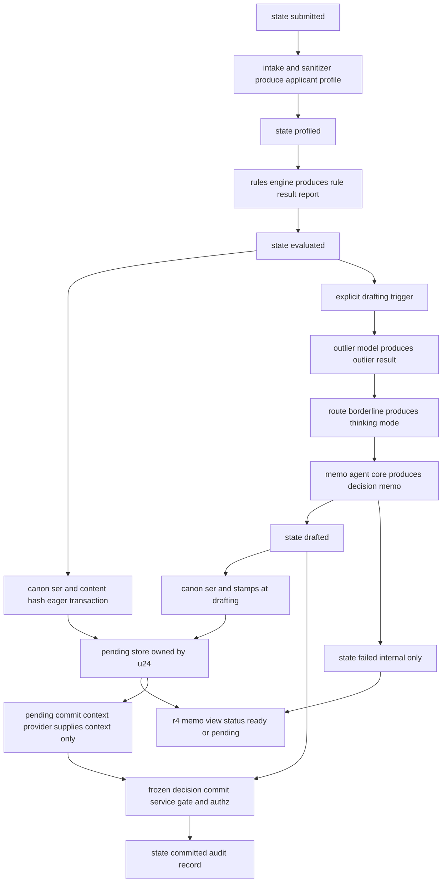

# Business Logic Model — `case-lifecycle` (U24, Scope B)

**Stage**: BUILD → per-unit loop → **Functional Design, Part 2 (Generation)** · **Depth**: **comprehensive** (Q1-A) ·
**Date**: 2026-07-19
**Scope**: the **case lifecycle** — which frozen unit produces each transition, where **`route_borderline`** is invoked,
where **canonicalization / `content_hash`** happen, and the **pending ↔ committed boundary**. Built ON the frozen
contracts — **re-opening none.**

---

## 1. The lifecycle, step by step

### Step 1 — `submitted` (U24 creates the case)
A case row is created. **No frozen unit runs yet.**

### Step 2 — `submitted → profiled → evaluated` — **EAGER, one transaction** (BR-CASE-3)
Both steps are **deterministic and LLM-free**, so they advance together:
1. **`intake` (U1) + `document-sanitizer` (U2)** → a validated, sanitised **`ApplicantProfile`**.
2. **`rules-engine` (U3)** → a **`RuleResultReport`** (+ `Recommendation`, `Confidence`, `rulebook_version`,
   `engine_version`).

**⚑ Canonicalization happens HERE** (BR-CASE-9): both shapes are reduced through the **frozen
`audit_store.CanonSerAdapter`** → `canonical_bytes` + `content_hash`, persisted as **`BYTEA` + hash** exactly as
`0001_initial_schema.sql` does. **`rulebook_version` / `engine_version` land as first-class scalar columns.**
Either the case reaches **`evaluated`** or the transaction fails outright — **never half-parsed**.

### Step 3 — `evaluated → drafted` — **a SEPARATE explicit trigger** (BR-CASE-4)
The one **expensive, non-deterministic, LLM-bearing** step:
1. **`outlier-model` (U18)** → **`OutlierResult`** (advisory; **no verdict field**).
2. **⚑ `route_borderline(rule_report, outlier_result)` → `ThinkingMode`** — **U24 calls this explicitly** (BR-CASE-10). It
   is **not** internal to the orchestrator; it is a **free, pure function** in `memo-extensions` holding no client, no
   provider and no network.
3. The **provider adapter** is constructed with the injected client **and `thinking_mode=`**, then
   **`LangGraphOrchestrator.run(MemoAgentInput)`** → **`DecisionMemo | None`**.

On success → **`drafted`**, and a **`PendingRecommendation`** is created carrying the memo/outlier canonical bytes plus the
**`memo_hash` / `model_version`** stamps. On failure → **`failed`** (BR-CASE-5).

**`ThinkingMode` is deliberately NOT persisted** — it is a pure function of two persisted shapes, so it is **re-derivable
exactly** (BR-CASE-10).

### Step 4 — `drafted → committed` — **the boundary crossing** (BR-CASE-13)
R5 hands `(recommendation_id, underwriter_id, action, reason)` to the **frozen `DecisionCommitService.commit()`**, which:
**(1)** runs the **CON-BR4 gate BEFORE any assembly** · **(2)** runs an **independent backend authz re-check** ·
**(3)** fetches context via **U24's `PendingCommitContextProvider`** · **(4)** assembles + validates in memory ·
**(5)** performs the **atomic write**.

**⚑ U24 supplies context ONLY.** The human-in-the-loop enforcement is the **frozen service's**, never re-implemented.

---

## 2. Where each frozen unit acts

| Transition | Frozen unit | Artifact |
|---|---|---|
| `submitted → profiled` | `intake` (U1) + `document-sanitizer` (U2) | `ApplicantProfile` |
| `profiled → evaluated` | `rules-engine` (U3) | `RuleResultReport` |
| `evaluated → drafted` | `outlier-model` (U18) → **`memo-extensions` router (U19)** → `memo-agent-core` (U4) / U19 adapters | `OutlierResult`, `ThinkingMode`, `DecisionMemo` |
| `drafted → committed` | **`audit-store` (U12)** | `CommittedDecision` + the `audit_record` row |
| *(any drafting failure)* | — | → **`failed`** (U24 terminal, internal) |

---

## 3. The pending ↔ committed boundary

| | **PENDING — U24 owns** | **COMMITTED — `audit-store` owns** |
|---|---|---|
| States | `submitted` · `profiled` · `evaluated` · `drafted` · `failed` | `committed` |
| Storage | `PendingApplication` + `PendingRecommendation` (U24's own tables + migration sequence) | `audit_record` + `applicant_profile_snapshot` (frozen `0001`) |
| Routes | **R2 · R3 · R4** (reads) | **R6 · R7** (reads) |
| Written by | U24 | **only** `DecisionCommitService` |
| Encoding | **CANON-SER `BYTEA` + `content_hash`** | **CANON-SER `BYTEA` + `content_hash`** — *identical, by design* |

**⚑ R5 is the ONLY transition that crosses the boundary**, and it crosses **through the frozen service**. Because both
sides use the **same canonical encoding** (Q8-A), the two rich shapes are **byte-identical** across the crossing — **no
conversion sits on the replay path**.

---

## 4. Flow diagram (validated Mermaid — rectangle-only, alphanumeric IDs, quoted labels, zero edge labels)

### Text alternative (equivalent to the diagram)

- **The eager path**: `state submitted` → **intake and sanitizer** → `state profiled` → **rules engine** → `state
  evaluated`. All of it is **deterministic and LLM-free**, and it completes in **one transaction**.
- **⚑ Canonicalization is a VISIBLE step, twice**: `canon ser and content hash eager transaction` sits between `state
  evaluated` and the `pending store` (the two rich shapes), and `canon ser and stamps at drafting` sits between `state
  drafted` and the store (the four version stamps). **The hash is computed at the same point as the bytes it attests.**
- **⚑ The drafting trigger is a SEPARATE inbound edge** from `state evaluated` — it is **not** reached from R4. Only this
  branch is LLM-bearing.
- **⚑ `route borderline` is a VISIBLE step of its own**, sitting **between** `outlier model` and `memo agent core`: U24
  invokes it explicitly and threads the resulting thinking mode into the adapter. It is **not** hidden inside the
  orchestrator.
- **`state failed` is reachable ONLY from the memo step**, and — like the pending store — it flows into `r4 memo view
  status ready or pending`. **That convergence IS the disclosed projection**: a failed case is reported as `pending`,
  because WIRE-1's discriminator has no third value (register **#14**).
- **⚑ The pending/committed boundary is a VISIBLE structural property**: **`state committed audit record` has exactly ONE
  inbound edge, and it comes from `frozen decision commit service gate and authz`.** No U24 node — not the pending store,
  not the provider, not any state — reaches `committed` directly. The **only** way across is through the frozen service.
- **The provider supplies context, nothing more**: `pending store` → `pending commit context provider supplies context
  only` → `frozen decision commit service`. The provider has **no edge to `committed`**, which is the structural
  expression of BR-CASE-13 — U24 never performs the gate, the authz check, or the write.

**Syntax validation** — all seven rules: **(1)** every node ID is alphanumeric; **(2)** every label is quoted; **(3)** no
label contains any character other than alphanumerics and spaces; **(4)** blocks balanced — **no `subgraph` used**, so no
`end` is required; **(5)** **rectangle-only** — every node uses `ID["label"]`; **(6)** **zero edge labels**, so no special
character can leak in; **(7)** exactly one `flowchart` declaration. Also verified: **every edge endpoint resolves to a
declared node**.

---

## 5. Tier split

| Half | Contents | Tier | Live LLM? |
|---|---|---|---|
| **Deterministic** | state machine · transitions · canonicalization + hashing · persistence · the provider · the R2/R3/R4 read paths | **tier-U**, fully tested | **No** — no key, no network |
| **LLM-bearing** | the `evaluated → drafted` drafting call behind the injected adapter | **tier-U via an OFFLINE DOUBLE** | **No** at tier-U |

**tier-B is NOT authorized and NOT required** — U24's lifecycle is verified on fixtures, the posture every prior unit held.
**`temperature=0` stays centrally fixed in the frozen adapters.**

---

## 6. Settled items held

- **Advisory-only**: the pending store holds **recommendations, never decisions**; a `CommittedDecision` exists **only** as
  R5's result, through the frozen gate.
- **No LLM in the deterministic rules path**: the LLM sits strictly **after** rule evaluation.
- **Bias-free**: no demographic attribute enters rules, outlier features, or any prompt; `ApplicantProfile` is persisted
  **as a frozen shape, not widened**.
- **Reproducibility**: CANON-SER **P1–P4** + `content_hash` + the four stamps; `ThinkingMode` re-derivable from stored
  state.
- **Reference-not-own**: every frozen shape, seam and utility consumed read-only / through its existing seam —
  **including `canon_ser.py` and `borderline_router.py`**.
- **Disclosed, not dropped**: **#8 `DEPLOY-MIGRATE-DEFERRED`** (unchanged) · **#14 `MEMOVIEW-FAILED-STATE-UNMODELLED`**
  (new). **U24 claims no discharge of either.**
- **Untouched**: **WIRE-1's contract text** · **Q1-B** · **`not_wired.py`** · **U23's test** · every frozen unit's
  internals · the **`audit_store` Docker-guard gap** · **tier-B**.
