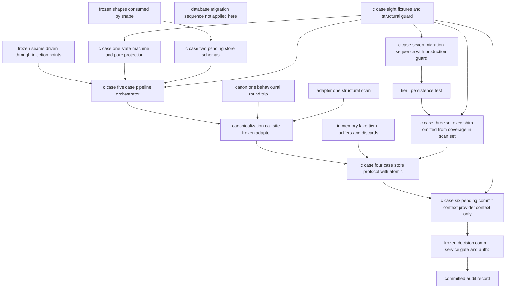

# Logical Components — `case-lifecycle` (U24, Scope B)

**Stage**: BUILD → NFR Design (per-unit), **Part 2 (Generation)** · **Unit**: U24 · **Scope B** ·
**Depth**: **comprehensive** · **Date**: 2026-07-20.
**Built ON** the frozen FD + the **seventeen `NFR-CASE-*`** + the patterns **`P-CASE-1..15`**
(`nfr-design-patterns.md`) — **re-opening none.** Answers **Q1–Q5 (all A)** + folds **CASE-ND-Fold-1..3**.
**Module layout is OPEN** — sized to the components below; exact names finalized at Code-Gen.

---

## 1. Components + signatures (the by-construction surface)

### C-CASE-1 `state machine` (`states.py`) — P-CASE-4, P-CASE-8
**Responsibility**: the case states, the **single** legal-transition table, the transition guard, and the **pure wire
projection**. **No I/O. No SQL. No LLM.**

```python
class CaseState(str, Enum):
    SUBMITTED = "submitted"; PROFILED = "profiled"; EVALUATED = "evaluated"
    DRAFTED   = "drafted";   COMMITTED = "committed"
    FAILED    = "failed"                      # ⚑ INTERNAL ONLY — never a wire value

#: ⚑ THE SINGLE SOURCE OF TRUTH (Q1-A). The illegal set is its COMPLEMENT — never a second table.
LEGAL_TRANSITIONS: frozenset[tuple[CaseState, CaseState]] = frozenset({
    (CaseState.SUBMITTED, CaseState.PROFILED),
    (CaseState.PROFILED,  CaseState.EVALUATED),
    (CaseState.EVALUATED, CaseState.DRAFTED),
    (CaseState.EVALUATED, CaseState.FAILED),
    (CaseState.DRAFTED,   CaseState.COMMITTED),
})

def assert_legal(src: CaseState, dst: CaseState) -> None:
    """Raise ``IllegalTransition`` unless ``(src, dst)`` is in the ONE table."""

def case_to_memo_view_state(case: "PendingApplication") -> Literal["ready", "pending"]:
    """⚑ PURE (Q5-A): no I/O, no state. ``drafted`` -> "ready"; everything else -> "pending".
    ``failed`` projects to "pending" because WIRE-1's discriminator has no third value
    (register #14). The composition root CALLS this; it never re-derives the mapping."""
```

**By-construction guarantees**:
- **⚑ Exhaustiveness is automatic** — the illegal set is `product(CaseState, CaseState) - LEGAL_TRANSITIONS`, so **a newly
  added state instantly appears in it with NO test edit**, and **two tables cannot drift because there is only one**.
- **`FAILED` is unreachable as a wire value** — the projection's return type is `Literal["ready", "pending"]`, so emitting
  a third status is **unrepresentable**.
- **⚑ Ownership rationale (Q5-A, tradeoff accepted explicitly)**: the `failed → pending` decision is **domain knowledge
  only U24 possesses**. The future wiring pass imports this **one pure function** into `backend/app/projections.py` —
  a narrow, I/O-free coupling, consistent with how R1/R6/R7's handlers already delegate all substantive logic. The root
  still owns **assembling the wire body**.

### C-CASE-2 `pending-store schemas` (`schemas.py`) — P-CASE-1, P-CASE-9
**Responsibility**: the two pending entities. **CANON-SER `BYTEA` + `content_hash` + first-class scalar stamps.**

```python
@dataclass(frozen=True)
class PendingApplication:
    application_id: str
    state: CaseState
    profile_canonical: bytes            # CANON-SER (frozen adapter)
    profile_content_hash: str
    rule_results_canonical: bytes | None
    rule_results_content_hash: str | None
    rulebook_version: str | None        # stamp — first-class scalar
    engine_version: str | None          # stamp

@dataclass(frozen=True)
class PendingRecommendation:            # ⚑ created ONLY at the `drafted` transition
    recommendation_id: str              # PK — the key R5 commits by
    application_id: str
    memo_canonical: bytes
    outlier_canonical: bytes | None
    memo_hash: str; model_version: str; engine_version: str; rulebook_version: str
```
**By-construction**: the four stamps are **columns, not blobs**, so reproducibility is directly inspectable; the two rich
shapes are **opaque canonical bytes**, so **no frozen schema is re-declared in DDL**.

### C-CASE-3 `SQL-exec shim` (`repository.py`) — P-CASE-2, P-CASE-12 — **⚑ DUAL-STATUS**
**Responsibility**: the **only** module that issues SQL. It receives **already-canonicalized bytes** and executes.

> **⚑ COVERAGE-OMITTED *and* SCAN-INCLUDED** (CASE-Req-Fold-3). The `omit` governs *where it is exercised* (tier-I, the
> `pg_repository.py` precedent); **ADAPTER-1's scan set is NOT narrowed by it**. The shim is in the scan set **precisely
> because** it is out of the coverage set, and ADAPTER-1 asserts **positively** that it **contains no canonicalization call
> at all** — making *"the shim doesn't canonicalize"* a **tested property, not a design intention**.

### C-CASE-4 `CaseStore` Protocol + fakes (`store.py`, fake in `tests/`) — P-CASE-5, P-CASE-3
**Responsibility**: the injected persistence seam — **one Protocol, two implementations**.

```python
class CaseStore(Protocol):
    def atomic(self) -> Iterator[None]: ...        # ⚑ EXPOSED — mirrors frozen AuditRepository
    def put_application(self, app: PendingApplication) -> None: ...
    def get_application(self, application_id: str) -> PendingApplication | None: ...
    def put_recommendation(self, rec: PendingRecommendation) -> None: ...
    def get_recommendation(self, recommendation_id: str) -> PendingRecommendation | None: ...
```
**By-construction guarantees (CASE-ND-Fold-1)**:
- **⚑ `atomic()` is exposed deliberately, mirroring the frozen `AuditRepository` verbatim.** The tier-U fake
  **buffers-and-discards** exactly like `InMemoryAuditRepository` (flush on clean exit, discard on exception, and
  `put_*` **raises outside `atomic()`**).
- **⚑ Why not a single composite method**: with a composite method the fake would satisfy atomicity **trivially** — a
  single body cannot half-execute — so **EAGER-1's *"no partial row"* and COMMITBOUND-1(d) would be VACUOUS at tier-U**.
  With `atomic()` + a buffering fake, injecting a fault mid-transaction **actually proves** nothing was flushed.
- **Both implementations honour atomicity through the same Protocol shape**; neither needs machinery the other lacks —
  the fake's ~15 lines are **the precedent's own**. **PERSIST-1 (tier-I) is what checks the two agree.**

### C-CASE-5 `CasePipeline` (`pipeline.py`) — P-CASE-5/6/7/9/10
**Responsibility**: drives the frozen units in order; **explicitly invokes `route_borderline`**; canonicalizes at the
finalizing transition. **Injected with everything it needs.**

```python
@dataclass(frozen=True)
class DraftOutcome:                       # ⚑ Q4-A — both outcomes are ordinary return values
    memo: DecisionMemo | None
    outlier: OutlierResult | None
    thinking_mode: ThinkingMode | None
    failure_reason: str | None
    @property
    def succeeded(self) -> bool: return self.memo is not None

class CasePipeline:
    def __init__(self, store: CaseStore, engine_seams: ..., clock: ...) -> None: ...

    def submit(self, raw) -> PendingApplication:
        """⚑ EAGER + ATOMIC: submitted -> profiled -> evaluated inside ONE store.atomic().
        All three steps are LLM-FREE. A mid-way fault leaves NO partial row."""

    def draft(self, application_id: str) -> DraftOutcome:
        """The ONLY LLM-bearing step, behind its own explicit trigger.
        outlier -> route_borderline(rule_report, outlier) -> adapter(thinking_mode=...) ->
        LangGraphOrchestrator.run(...). A `None` memo maps to a FAILURE outcome —
        ⚑ U24 invents no new failure vocabulary."""
```
**By-construction**: `submit()` is **all-or-nothing** (one `atomic()` block); `draft()` **returns** rather than raises, so
the caller's `drafted`-vs-`failed` branch is **one visible decision**, and the `drafted` branch creates the
`PendingRecommendation` **in the same `atomic()` block** (COMMITBOUND-1(d)). **R4's read path calls neither.**

### C-CASE-6 `PendingCommitContextProvider` (`provider.py`) — P-CASE-3
**Responsibility**: the **real** `CommitContextProvider`. **Context only.**

```python
class PendingCommitContextProvider:              # satisfies the FROZEN Protocol
    def __init__(self, store: CaseStore) -> None: ...
    def get(self, recommendation_id: str) -> CommitContext:
        """Load the recommendation + its application; rehydrate the two rich shapes via the
        FROZEN CanonSerAdapter; return a CommitContext.
        ⚑ Performs NO authz, NO gate check, NO write. Raises for an unknown id (R5 -> 404)."""
```
**By-construction**: the **return type is `CommitContext`**, so *"the provider committed something"* is
**unrepresentable**. **A `failed` case cannot reach it**: `PendingRecommendation` is created **only** at `drafted`, so the
object R5 is keyed by **never exists** for a failed case (asserted positively — COMMITBOUND-1(c)).

### C-CASE-7 `migration sequence` (`migrations/` + `apply_case_migrations`) — P-CASE-11, P-CASE-12
**Responsibility**: U24's own forward-only sequence + manifest, applied through the **frozen parameterized** runner.

```python
CASE_MIGRATIONS_DIR = Path(__file__).resolve().parent / "migrations"   # U24's OWN

def apply_case_migrations(engine) -> list[str]:
    _assert_no_collision_with_u15()        # ⚑ PRODUCTION guard (Q3-A) — raises LOUDLY
    return MigrationRunner(engine, migrations_dir=CASE_MIGRATIONS_DIR).apply_all()
```
**By-construction**: the guard is **on the production path**, because the hazard (**a silently skipped migration — a
no-op, not an error**) is a **production** hazard; being production code it is **counted and coverable**. **`database`
(U15) is NOT edited** — the seam is used as designed. **Grants to no U15 role**, which is what keeps tier-I self-contained.
**⚑ Shares no helper with C-CASE-1's transition guard** (CASE-ND-Fold-2) — different domain, different operation.

### C-CASE-8 test substrates (`tests/fixtures.py`, `tests/structural.py`, `tests/test_structural_guard.py`) — P-CASE-7, P-CASE-14 — **test-only**
**Fixtures — five named families (Q2-A)**: `clean_case()` · **`illegal_transition_cases()`** (returned as **ONE
collection — unsplittable**, so the rejection set cannot be trimmed one case at a time) · `drafting_success_double()` ·
**`drafting_failure_double()`** (**its own family**, so FAILED-1 cannot be weakened by a success-path edit) ·
`borderline_refer_case()` — plus the **in-memory `CaseStore` fake** and the offline LLM doubles.
**StructuralGuard**: the **five scans** (P-CASE-14's table), each with a **detector self-test**;
`production_py_files()` **EXCLUDING `tests/`**; an `EXPECTED_PRODUCTION_MODULES` **non-vacuity guard**.

---

## 2. Component-relationship diagram (validated — rectangle-only, alphanumeric IDs, quoted labels, zero edge labels)



### Text alternative (equivalent to the diagram)

- **⚑ The commit-boundary crossing is VISIBLE**: **`committed audit record` has exactly ONE inbound edge — from
  `frozen decision commit service`.** No U24 component reaches it. And **`c case six … context only`'s ONLY outbound edge
  is INTO the frozen service** — the graphical form of *"context only, never a write."*
- **⚑ The CANON-1 / ADAPTER-1 convergence is VISIBLE**: `canon one behavioural round trip` **and**
  `adapter one structural scan` **both point at** `canonicalization call site frozen adapter` — two independent paths
  (bytes vs AST) meeting at one call site.
- **⚑ The tier-I isolation is VISIBLE**: `database migration sequence not applied here` has **ZERO edges**;
  `tier i persistence test` is fed **only** by `c case seven migration sequence with production guard`. **The absence of
  any edge IS the isolation.**
- **One store seam, two implementations**: `in memory fake tier u` and `c case three sql exec shim` **both point at**
  `c case four case store protocol with atomic` — which is why *"no partial row"* is testable at tier-U, and why
  PERSIST-1 exists to check the two agree.
- **`c case eight fixtures and structural guard`** feeds the pipeline and guards the state machine, the shim, the provider
  and the migration sequence. **Test-only.**

**Syntax validation** — all seven rules checked; every edge endpoint resolves to a declared node.

---

## 3. Reference-not-own — **three categories, kept distinct**

| # | Category | Members | Discipline |
|---|---|---|---|
| **1** | **Consumed BY SHAPE** *(frozen output shapes — **READ**)* | `DecisionMemo` · `RuleResultReport` · `ApplicantProfile` · `OutlierResult` | **imported read-only**; instantiated and round-tripped, **never mutated, never re-declared**. **import-to-read ≠ edit.** |
| **2** | **DRIVEN THROUGH AN EXISTING INJECTION POINT** *(frozen seams — **CALLED**)* | the U19 **provider adapters** (`thinking_mode=`) · **`route_borderline`** · **`MigrationRunner`** / `verify_checksums` (`migrations_dir=`) · **`CanonSerAdapter`** (`canonical_bytes` / `content_hash`) | invoked through their **existing** parameters and constructors. **No seam widened, no adapter edited.** `temperature=0` stays **centrally fixed INSIDE** the frozen adapters — **U24 neither sets nor overrides it.** |
| **3** | **COMPOSED WITH, NEVER RE-IMPLEMENTED** *(frozen enforcement — **DEFERRED TO**)* | **`DecisionCommitService`** — its CON-BR4 gate, its independent authz re-check, its atomic write | U24 supplies **only** a `CommitContextProvider`. **It implements NO gate, NO authz check, NO write to `audit_record`** — asserted structurally by P-CASE-3. |

**⚑ The categories must not blur**: **category 1 is READ · category 2 is CALLED · category 3 is DEFERRED TO.** A
**category-3 member appearing anywhere in U24's own logic would mean the human-in-the-loop enforcement had been
duplicated** — the exact failure COMMITBOUND-1 exists to prevent.

**U24 edits no frozen unit · adds no new dependency · adds no metric · adds no route · declares no verdict.**

---

## 4. Component → target coverage (**NO ORPHAN**)

| Component | `NFR-CASE-*` targets met | Patterns |
|---|---|---|
| **C-CASE-1** state machine + projection | STATE-1 · **STATE-2** · **PROJECT-1** | P-CASE-4, P-CASE-8 |
| **C-CASE-2** pending-store schemas | **CANON-1** (the shapes) · CANONTIME-1 | P-CASE-1, P-CASE-9 |
| **C-CASE-3** SQL-exec shim | **ADAPTER-1** (in-scan) · **PERSIST-1** (tier-I) | P-CASE-2, P-CASE-12 |
| **C-CASE-4** `CaseStore` Protocol + fake | **EAGER-1** · **COMMITBOUND-1(d)** · PERSIST-1 (agreement) | P-CASE-5 |
| **C-CASE-5** `CasePipeline` | EAGER-1 · TRIGGER-1 · FAILED-1 · CANONTIME-1 · **ROUTE-1** · **CANON-1** (call site) | P-CASE-5/6/7/9/10/1 |
| **C-CASE-6** provider | **COMMITBOUND-1** (both halves) | P-CASE-3 |
| **C-CASE-7** migration sequence | **MIGNAME-1** · **MIGSCOPE-1** · PERSIST-1 (applies U24's own) | P-CASE-11, P-CASE-12 |
| **C-CASE-8** test substrates | structural halves of ADAPTER-1 / COMMITBOUND-1 / MIGSCOPE-1 / **NOMETRIC-1** / PROJECT-1 · FAILED-1's isolated family | P-CASE-14, P-CASE-7 |
| *(referenced / observed)* | PERF-1 · SEC-1 | P-CASE-15 |

**All seventeen `NFR-CASE-*` covered; NO ORPHAN.**
**⚑ Each LOAD-BEARING target is met across TWO mechanisms**: CANON-1 (C-CASE-2/5 behavioural) **+** ADAPTER-1 (C-CASE-3
structural) as a **cross-component pair**; COMMITBOUND-1 via **C-CASE-6's structural + behavioural halves** with **C-CASE-4
supplying the atomicity** — so **no single edit can weaken both halves of any of the three**.

---

## 5. Settled items held (not re-opened)

- The **frozen FD**, the **approved NFR Requirements** and **`P-CASE-1..15`** are the substrate. **Nothing upstream is
  revised.**
- **Q1-A** — `LEGAL_TRANSITIONS` is the **single source of truth**; the illegal set is its **complement**, so
  exhaustiveness is **automatic** and two tables **cannot drift**.
- **Q2-A** — a `CaseStore` **Protocol**; **CASE-ND-Fold-1** pins that **`atomic()` is EXPOSED** (mirroring the frozen
  `AuditRepository`) with a **buffering fake**, because a composite method would make *"no partial row"* **vacuous**.
- **Q3-A** — the collision guard runs **in production**, on the apply path; **CASE-ND-Fold-2** pins that it shares **no
  helper** with the transition guard.
- **Q4-A** — a **`DraftOutcome`** result object; a `None` memo from the frozen orchestrator maps to a failure outcome, so
  **U24 invents no new failure vocabulary**.
- **Q5-A** — `case_to_memo_view_state` is a **pure function owned by U24** that the root **calls**. **Tradeoff accepted
  explicitly**: a future wiring pass imports one **I/O-free** function into `backend/app/projections.py`. **CASE-ND-Fold-3**
  confirms this needs **no new file under `backend/app/routes/`** and breaks **no** frozen assertion — and records the
  **aggravating factor on register #13**: once R2–R5 are wired in place, `not_wired.py` sits **on the primary user
  journey**, raising the readability cost of its stale name *(the rename remains a matched pair with U23's test relaxation,
  owned by a future authorized change)*.
- **Deferred to Infrastructure Design / Code-Gen**: exact module names; the scan token sets; the migration file's DDL; the
  `pyproject.toml` `--cov` line + its narrow omit entry.
- **Untouched**: **WIRE-1's contract text** · **Q1-B** · **`not_wired.py`** · **U23's test** · every frozen unit's
  internals · the **`audit_store` Docker-guard gap** (**5 errors unchanged**) · **tier-B (NOT authorized)**.
