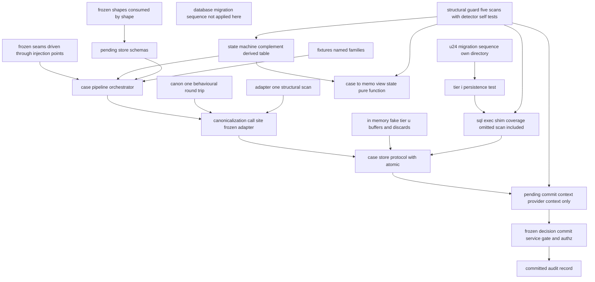

# NFR Design Patterns — `case-lifecycle` (U24, Scope B)

**Stage**: BUILD → NFR Design (per-unit), **Part 2 (Generation)** · **Unit**: U24 · **Scope B** ·
**Depth**: **comprehensive** · **Date**: 2026-07-20.
**Built ON** the frozen FD (**`BR-CASE-1..14`**) **and** the approved NFR Requirements (the **seventeen `NFR-CASE-*`**;
the three **LOAD-BEARING** targets; the **tier-U/tier-I split**; the **scan-included coverage omit**; the **named fixture
families**) — **re-opening NEITHER.** Answers **Q1–Q5 (all A)** + folds **CASE-ND-Fold-1..3**.

> ### What "by construction" means here (the honest scope)
> **Genuinely by construction**: a **complement-derived** transition table makes an unenumerated illegal transition
> **impossible to forget**. Routing through the **frozen `CanonSerAdapter`** makes a second serialization discipline
> **structurally absent**. A provider whose return type is `CommitContext` makes *"the provider committed something"*
> **unrepresentable**. **`atomic()` + a buffering fake** makes *"no partial row"* an **actually-testable** property rather
> than a trivially-true one.
> **Test-only where honest**: call-site and namespace facts can only be enforced by **scan** (each with a **detector
> self-test**); disclosure facts only by **token presence**; byte-identity only by **round-tripping real bytes**.
> **Header comments document; they never enforce.**

---

## 1. Patterns

### P-CASE-1 `CanonicalRoundTripPattern` → NFR-CASE-CANON-1 — **[LOAD-BEARING]**

**How it structurally meets the target**: it exercises the **bytes themselves**, so encoding drift cannot hide.

```python
raw   = CanonSerAdapter.canonical_bytes(report)      # frozen adapter (P-CASE-2 enforces this)
back  = CanonSerAdapter.deserialize(raw, RuleResultReport)
again = CanonSerAdapter.canonical_bytes(back)
assert again == raw                                   # byte-identical round trip
```
- **Mechanism**: **(a)** `serialize → deserialize → serialize` is **byte-identical** for `ApplicantProfile` **and**
  `RuleResultReport`; **(b)** `Decimal`/`date` **return as themselves** (CANON-SER **P2/P3** fidelity, carried by the
  `$dec`/`$date` envelopes); **(c)** `content_hash` is **stable across runs** (**P1/P4** — no key-order or volatile-field
  drift); **(d) mutation detector** — flipping one stored byte makes the hash check **FAIL**; **(e)** a `float` anywhere
  **raises** (`CanonSerError`), so P2 is **enforced, not hoped for**.
- **Why full-highest**: if this drifts, hash equality breaks **silently on a later run**, surfacing only at replay.
- **Tier**: tier-U (component) — **no database required**. **Rigor**: **full (highest) — LOAD-BEARING**.

### P-CASE-2 `FrozenAdapterSoleSourcePattern` → NFR-CASE-ADAPTER-1 — **[LOAD-BEARING]**

**How it structurally meets the target**: it reads the **AST**, not the bytes — so a *forked but correct* serializer is
caught, which P-CASE-1 alone would wave through.

- **Mechanism**: **(a) AST scan** over **every U24 production module** — **no direct `canon_ser(...)` /
  `canon_deserialize(...)` call**, and **no re-implementation of the `.model_dump(mode="python")` reduction**;
  **(b) ⚑ the SQL-exec shim IS IN THIS SCAN SET** (CASE-Req-Fold-3) — the coverage `omit` governs *where a module is
  exercised*, **never** *what it may contain*; the scan additionally asserts **positively** that the shim **contains no
  canonicalization call at all** (it receives already-canonicalized bytes and only executes SQL), making *"the shim doesn't
  canonicalize"* a **tested property, not a design intention**; **(c) detector self-tests** — a synthetic direct
  `canon_ser(...)` **is flagged**, and a synthetic **`model_dump(mode="json")` is flagged** *(load-bearing: `mode="json"`
  pre-stringifies `Decimal`s so the `$dec` envelope never fires, **silently losing P2 fidelity**)*; **(d)** no
  **`$`-prefixed key** in any U24 payload.
- **Tier**: tier-U (structural). **Rigor**: **full (highest) — LOAD-BEARING**.

> #### ⚑ Why P-CASE-1 and P-CASE-2 are TWO patterns
> | | **P-CASE-1** | **P-CASE-2** |
> |---|---|---|
> | Kind | **behavioural** | **structural** |
> | Subject | the **bytes** | the **call sites** |
> | Still passes if… | the serializer is **correct but FORKED** | the serializer is **broken** |
>
> **Neither alone is sufficient — that is exactly why they are two.** They read **different things (bytes vs the AST)**, so
> **no single edit can weaken both**. **⚑ And they converge on ONE call site** — the module invoking `CanonSerAdapter` —
> which §2's diagram shows as two verification paths meeting at a single node.

### P-CASE-3 `ComposedCommitBoundaryPattern` → NFR-CASE-COMMITBOUND-1 — **[LOAD-BEARING]**

**How it structurally meets the target**: the provider's **return type is `CommitContext`**, so *"the provider committed
something"* is **unrepresentable**; the gate and authz live **inside the frozen service**.

```python
class PendingCommitContextProvider:                       # satisfies the FROZEN Protocol
    def get(self, recommendation_id: str) -> CommitContext: ...   # context ONLY
```
- **(a) Structural half**: **no U24 module implements a commit gate, an authorization check, or a write to
  `audit_record`** — **each with its own detector self-test** (a synthetic gate predicate, a synthetic `authorize(...)`
  call, and a synthetic `INSERT INTO audit_record` are all flagged).
- **(b) Behavioural half**: `get()` returns a `CommitContext` **and nothing more** — performs no authz, reaches no write
  path, and **raises for an unknown `recommendation_id`** (R5 → **404**).
- **(c) ⚑ The `failed` case cannot reach the boundary** (CASE-Req-Fold-2), asserted **positively**: **no
  `PendingRecommendation` exists for any case in state `failed`**, and driving `drafting_failure_double()` to `failed` then
  calling the provider **raises**. *(R5 is keyed by `recommendation_id`, the PK of `PendingRecommendation`, created **only**
  at the `drafted` transition — so the failed path and the commit path **structurally do not intersect**.)*
- **(d) Atomicity dependency**: creating the `PendingRecommendation` and the `drafted` transition happen inside **one
  `store.atomic()` block** — closing the **only** route by which (c) could ever open. **Tested with an injected fault**
  (P-CASE-5).
- **Tier**: tier-U (structural + component). **Rigor**: **full (highest) — LOAD-BEARING**.

### P-CASE-4 `ComplementDerivedTransitionPattern` → NFR-CASE-STATE-1 + NFR-CASE-STATE-2 *(Q1-A)*

**How it structurally meets the target**: **one table is the single source of truth**, and the illegal set is its
**complement** — so exhaustiveness is **automatic**, not maintained.

```python
LEGAL_TRANSITIONS: frozenset[tuple[CaseState, CaseState]] = frozenset({...})   # the ONLY table

def assert_legal(src: CaseState, dst: CaseState) -> None:
    if (src, dst) not in LEGAL_TRANSITIONS:
        raise IllegalTransition(src, dst)

# STATE-2's exhaustiveness sweep — derived, never hand-listed:
illegal = set(itertools.product(CaseState, CaseState)) - LEGAL_TRANSITIONS
for src, dst in illegal:
    with pytest.raises(IllegalTransition):
        assert_legal(src, dst)
```
- **⚑ Why**: **a newly added state instantly appears in the derived illegal set with NO test edit** — there is nothing to
  forget, and **two tables cannot drift** because there is only one. **Named landmark cases** (skip-evaluation, a backward
  move, a terminal exit) are asserted **in addition**, for readability.
- **Fixture support**: `illegal_transition_cases()` returns the landmark set **as ONE collection** (Q2-A), so it **cannot
  be trimmed one case at a time**.
- **Tier**: tier-U (component + exhaustiveness detector). **Rigor**: full.

### P-CASE-5 `AtomicEagerAdvancePattern` → NFR-CASE-EAGER-1 (+ COMMITBOUND-1(d)) *(Q2-A / CASE-ND-Fold-1)*

**How it structurally meets the target**: the `CaseStore` Protocol **exposes `atomic()`**, mirroring the frozen
`AuditRepository` **verbatim**, and the in-memory fake **buffers-and-discards** exactly like `InMemoryAuditRepository`.

- **⚑ Why this shape rather than a single composite method** (CASE-ND-Fold-1): with a composite method the fake would
  satisfy atomicity **trivially** — a single body cannot half-execute in a single-threaded test — so *"no partial row"*
  would be **VACUOUS at tier-U**. With `atomic()` + a buffering fake, the assertion **actually tests something**: inject a
  fault mid-transaction and assert **nothing was flushed**. The precedent even supplies the fault injector
  (`fail_on_insert`) and makes `insert()` **raise outside `atomic()`**, so the discipline is **enforced**.
- **Mechanism**: `submitted → profiled → evaluated` runs inside **one `atomic()` block**; both canonical payloads **and**
  their hashes are written; a mid-way fault leaves **no partial row** (asserted by state/row count before and after). All
  three steps are **LLM-free**.
- **Tier**: tier-U (component). **Rigor**: full.

### P-CASE-6 `SideEffectFreeReadPattern` → NFR-CASE-TRIGGER-1

- **Mechanism**: **the R4 read path invokes the pipeline ZERO times** — the injected double **records no calls** and the
  case state is **unchanged** after the read; after the explicit trigger, state is `drafted` and R4 reports `ready`.
  A **spy**, not an absence of failure, is what proves it.
- **Tier**: tier-U (component + spy). **Rigor**: full.

### P-CASE-7 `IsolatedFailureFamilyPattern` → NFR-CASE-FAILED-1 *(Q2-A)*

- **Mechanism**: **`drafting_failure_double()` is its OWN fixture family** (mirroring `exempt_witness_sample()`), so
  **FAILED-1 can never be weakened by an edit made for the success path**. A failing double drives the case to **`failed`**,
  which is **internally distinguishable** from `evaluated` (a never-triggered case ≠ a broken one).
- **Tier**: tier-U (component). **Rigor**: full.

### P-CASE-8 `TokenChecklistGovernancePattern` → NFR-CASE-PROJECT-1 *(DISCLOSE-1 / DOC-1 lineage · Q5-A)*

**How it meets the target**: the wire projection is a **pure function owned by U24**, so PROJECT-1 is testable **inside the
unit that owns it**; the WIRE-1 silence is handled by **token presence**, the only honest mechanism for a disclosure.

```python
def case_to_memo_view_state(case: PendingApplication) -> Literal["ready", "pending"]:
    """`drafted` -> "ready"; everything else -> "pending".
    ⚑ `failed` projects to "pending" because WIRE-1's discriminator has no third value
    (register #14). Pure: no I/O, no state."""
```
- **Mechanism**: **(a)** a `failed` case yields a **WIRE-1-VALID** `MemoView` state of **`"pending"`**; **(b)** a
  **token-set checklist** for register **#14 `MEMOVIEW-FAILED-STATE-UNMODELLED`** — its **name + owner (a future
  authorized WIRE-1 amendment) + rationale** are present, and **no U24 artifact claims WIRE-1 models a failed state**;
  **(c) detector self-test** — removing the disclosure token **fails** the check.
- **⚑ Ownership rationale (Q5-A)**: the `failed → pending` decision is **domain knowledge only U24 possesses**; the
  composition root must not learn that vocabulary. The root keeps assembling the wire body and **delegates only the state
  decision** to this pure function. **WIRE-1's contract text is NOT amended.**
- **Tier**: governance / doc-presence + tier-U. **Rigor**: governance.

### P-CASE-9 `FinalizingTransitionCanonicalizationPattern` → NFR-CASE-CANONTIME-1

- **Mechanism**: canonicalization happens **at the transition that finalizes each shape** — the two rich shapes in the
  **eager** transaction, the **four stamps** at **drafting**. `content_hash` is computed at the **same call site** as
  `canonical_bytes` (one adapter, two static methods over the same bytes), so **it cannot drift from what it attests**.
- **Tier**: tier-U (component). **Rigor**: full.

### P-CASE-10 `ExplicitRoutingRederivablePattern` → NFR-CASE-ROUTE-1

- **Mechanism**: **(a)** a **spy** records that `route_borderline` was called **with the real
  `(rule_report, outlier_result)` arguments** — not merely that a mode appeared; **(b)** a `REFER` report yields
  **`EXTENDED`** and **the adapter actually receives it** (`thinking_mode=` on the constructor); **(c) ⚑ re-derivability** —
  recomputing the mode **from stored state alone** reproduces the same value, which is **what makes not persisting
  `ThinkingMode` safe** for reproducibility. Its absence is a **decision**, and this clause is its proof.
- **Tier**: tier-U (spy + re-derivation). **Rigor**: full.

### P-CASE-11 `NamespacedMigrationGuardPattern` → NFR-CASE-MIGNAME-1 + NFR-CASE-MIGSCOPE-1 *(Q3-A)*

**How it structurally meets the target**: the guard runs **in production**, on the apply path, **before** delegating to the
frozen runner.

```python
def apply_case_migrations(engine) -> list[str]:
    _assert_no_collision_with_u15()          # ⚑ production guard — raises LOUDLY
    return MigrationRunner(engine, migrations_dir=CASE_MIGRATIONS_DIR).apply_all()
```
- **⚑ Why in production** (Q3-A): the hazard — the shared `applied_migrations` PK is the **bare filename**, so a collision
  is **silently skipped as already-applied, a no-op not an error** — is a **production** hazard. A test-only guard would
  not protect a deployment. Being production code, it is also **counted and coverable**.
- **Mechanism**: filenames **disjoint** from U15's; **detector self-test — a synthetic colliding filename IS flagged**;
  `verify_checksums` passes against **U24's own manifest**; and a scan asserts U24 **never** passes `database`'s default
  `MIGRATIONS_DIR`, **never edits U15**, and **authors no CLI entrypoint** (#8 **not adopted, not made worse**), and
  **grants to no U15-owned role** (the condition that keeps tier-I self-contained).
- **⚑ Anti-conflation** (CASE-ND-Fold-2): this guard shares **no helper** with P-CASE-4's transition guard. Different
  domain (filenames vs state pairs), different operation (**disjointness** vs **membership**), different component. *"Both
  are set operations"* is a **superficial** similarity a later refactor must not unify.
- **Tier**: tier-U (structural + detector). **Rigor**: full.

### P-CASE-12 `SelfContainedIntegrationTierPattern` → NFR-CASE-PERSIST-1 — **tier-I**

**How it composes with `database`'s guard without depending on `database`'s migrations:**
```python
def _docker_available() -> bool:
    try:
        import docker; docker.from_env().ping(); return True
    except Exception:
        return False

@pytest.fixture(scope="session")
def case_engine():
    if not _docker_available():
        pytest.skip(...)                                     # ⚑ INSIDE the body -> CLEAN SKIP
    with PostgresContainer("postgres:16") as pg:
        engine = sa.create_engine(pg.get_connection_url())
        MigrationRunner(engine, migrations_dir=CASE_MIGRATIONS_DIR).apply_all()   # U24's ONLY
        yield engine
```
- **⚑ The clean skip is mechanical, not incidental**: the daemon **ping happens inside the fixture body, before any
  container is constructed** — which is why `database`'s pattern skips cleanly and `audit_store`'s `importorskip`-only
  pattern **errors** (the 5 pre-existing errors). **U24 adds ZERO errors.**
- **⚑ Self-contained** (CASE-Req-Fold-1): **no U15 migration is applied**, because **(1)** there is **no cross-unit FK**
  (`PendingRecommendation` FKs to `PendingApplication`, both U24's; the `recommendation_id` later seen in `audit_record` is
  a **logical reference, not a DB FK**); **(2)** U24's store uses the **owner engine** and **grants to no U15 role**;
  **(3)** `applied_migrations` is created **idempotently**.
- **Mechanism**: the two tables exist with their declared columns; a written `BYTEA` **round-trips byte-identically** and
  its `content_hash` still verifies; the scalar stamps round-trip. **This is what checks the in-memory fake and the SQL
  shim agree.**
- **⚑ Expected, stated delta**: U24's tier-I tests **add new CLEAN SKIPS** to the 31 when Docker is absent; the **5 errors
  stay exactly unchanged**. To be **reported explicitly** at Code-Gen.
- **Tier**: **tier-I**. **Rigor**: full (within its tier).

### P-CASE-13 `ProvenanceScanPattern` → NFR-CASE-NOMETRIC-1

- **Mechanism**: **(a) provenance scan** — **no U24 module declares a metric name or `MetricDefinition`** (+ detector);
  **(b) corroborating static check** — `observability`'s **five** `METRIC_DEFINITIONS` and `deploy-config`'s
  `grafana-dashboard.json` (**five panels, no nested `panels` key**) read **read-only** and asserted unchanged.
  **⚑ NEITHER UNIT'S SUITE IS RE-RUN.** *(Mirrors `llm-judge`'s NOMETRIC-1 exactly.)*
- **Tier**: tier-U (structural). **Rigor**: full.

### P-CASE-14 `StructuralGuardPattern` → the structural halves *(U18/U19/U21/U22 substrate)*

One substrate of scans, **each with a mandatory detector self-test**, parsing every **production** `.py` under
`backend/case_lifecycle/` **EXCLUDING `tests/`**, with an `EXPECTED_PRODUCTION_MODULES` **non-vacuity guard**.

| # | Scan | Target |
|---|---|---|
| 1 | no direct `canon_ser` / re-implemented reduction (**shim INCLUDED**) | **ADAPTER-1** |
| 2 | no gate · no authz check · no `audit_record` write | **COMMITBOUND-1** |
| 3 | never passes U15's default `MIGRATIONS_DIR`; no CLI entrypoint; no U15-role grant | MIGSCOPE-1 |
| 4 | no metric name / `MetricDefinition` declared | NOMETRIC-1 |
| 5 | the register-#14 disclosure token set present; no discharge claimed | PROJECT-1 |

- **Tier**: tier-U (structural). **Rigor**: full.

### P-CASE-15 `ObservedNeverGatedGovernancePattern` → NFR-CASE-PERF-1 + NFR-CASE-SEC-1

- **PERF-1**: **U24 owns no runtime SLO** — drafting is **out-of-band** (its own trigger, not a request-path read).
  Nothing is timed at tier-U (the LLM is an offline double); **no U24 test asserts a timing failure**.
- **SEC-1**: the Security-Guardrails posture — review + the P-CASE-14 scans. **#8 `DEPLOY-MIGRATE-DEFERRED`** and
  **#14 `MEMOVIEW-FAILED-STATE-UNMODELLED`** are **named and not discharged**. **Not over-specified.**
- **Tier**: observed / governance. **Rigor**: soft / governance.

---

## 2. Module-relationship diagram (validated — rectangle-only, alphanumeric IDs, quoted labels, zero edge labels)



### Text alternative (equivalent to the diagram)

- **⚑ The commit-boundary crossing is a VISIBLE graph property**: **`committed audit record` has exactly ONE inbound edge,
  and it comes from `frozen decision commit service`.** No U24 component — not the pipeline, not the store, not the shim —
  reaches it. And **`pending commit context provider`'s ONLY outbound edge is INTO the frozen service**: that is the
  graphical form of *"context only, never a write"* (P-CASE-3).
- **⚑ The CANON-1 / ADAPTER-1 convergence is VISIBLE**: **two distinct verification nodes** —
  `canon one behavioural round trip` and `adapter one structural scan` — **both point at the SAME node**,
  `canonicalization call site frozen adapter`. Two independent paths (bytes vs AST) meeting at one call site is the
  "neither alone is sufficient" design made graphical.
- **⚑ The tier-I isolation is VISIBLE**: **`database migration sequence not applied here` has ZERO edges** — nothing in
  U24's graph connects to it — while `tier i persistence test` is fed **only** by `u24 migration sequence own directory`.
  **The ABSENCE of any edge IS the isolation property** (CASE-Req-Fold-1).
- **The store seam is visible as one Protocol with two implementations**: `in memory fake tier u buffers and discards`
  (tier-U) and `sql exec shim coverage omitted scan included` (tier-I) **both point at `case store protocol with atomic`**
  — which is why *"no partial row"* is testable at tier-U (CASE-ND-Fold-1) and why PERSIST-1 exists to check the two agree.
- **The pure projection is U24's**: `state machine` → `case to memo view state pure function`, guarded like every other
  component. The composition root will **call** it at wiring time; it is **not** a WIRE-1 shape.
- **`structural guard`** covers the state machine, the shim, the provider and the projection — five scans, each with a
  detector self-test. **Test-only.**

**Syntax validation** — all seven rules: **(1)** every node ID alphanumeric; **(2)** every label quoted; **(3)** no label
contains any character other than alphanumerics and spaces; **(4)** blocks balanced — **no `subgraph`**, so no `end`;
**(5)** **rectangle-only** — every node `ID["label"]`; **(6)** **zero edge labels**; **(7)** exactly one `flowchart`.
Also verified: **every edge endpoint resolves to a declared node**.

---

## 3. Traceability — pattern → target → tier → rigor (**NO ORPHAN**)

| Pattern | Target(s) | Tier | Rigor |
|---|---|---|---|
| **P-CASE-1 `CanonicalRoundTripPattern`** | **NFR-CASE-CANON-1** | tier-U (component) | **full (highest) — LOAD-BEARING** |
| **P-CASE-2 `FrozenAdapterSoleSourcePattern`** | **NFR-CASE-ADAPTER-1** | tier-U (structural) | **full (highest) — LOAD-BEARING** |
| **P-CASE-3 `ComposedCommitBoundaryPattern`** | **NFR-CASE-COMMITBOUND-1** | tier-U (structural + component) | **full (highest) — LOAD-BEARING** |
| P-CASE-4 `ComplementDerivedTransitionPattern` | NFR-CASE-STATE-1 · NFR-CASE-STATE-2 | tier-U (component + detector) | full |
| P-CASE-5 `AtomicEagerAdvancePattern` | NFR-CASE-EAGER-1 (+ COMMITBOUND-1(d)) | tier-U (component) | full |
| P-CASE-6 `SideEffectFreeReadPattern` | NFR-CASE-TRIGGER-1 | tier-U (component + spy) | full |
| P-CASE-7 `IsolatedFailureFamilyPattern` | NFR-CASE-FAILED-1 | tier-U (component) | full |
| P-CASE-8 `TokenChecklistGovernancePattern` | NFR-CASE-PROJECT-1 (+ register #14) | governance + tier-U | governance |
| P-CASE-9 `FinalizingTransitionCanonicalizationPattern` | NFR-CASE-CANONTIME-1 | tier-U (component) | full |
| P-CASE-10 `ExplicitRoutingRederivablePattern` | NFR-CASE-ROUTE-1 | tier-U (spy + re-derivation) | full |
| P-CASE-11 `NamespacedMigrationGuardPattern` | NFR-CASE-MIGNAME-1 · NFR-CASE-MIGSCOPE-1 | tier-U (structural + detector) | full |
| **P-CASE-12 `SelfContainedIntegrationTierPattern`** | **NFR-CASE-PERSIST-1** | **tier-I** | full (in tier) |
| P-CASE-13 `ProvenanceScanPattern` | NFR-CASE-NOMETRIC-1 | tier-U (structural) | full |
| P-CASE-14 `StructuralGuardPattern` | structural halves of ADAPTER-1 / COMMITBOUND-1 / MIGSCOPE-1 / NOMETRIC-1 / PROJECT-1 | tier-U (structural) | full |
| P-CASE-15 `ObservedNeverGatedGovernancePattern` | NFR-CASE-PERF-1 · NFR-CASE-SEC-1 | observed / governance | soft / governance |

**All seventeen `NFR-CASE-*` covered; NO ORPHAN.** **Each LOAD-BEARING target is met by a pattern whose two halves use
different mechanisms** — CANON-1/ADAPTER-1 as a **cross-pattern pair**, COMMITBOUND-1 as **structural + behavioural within
one pattern** — so **no single edit can weaken both halves of any of the three**.
