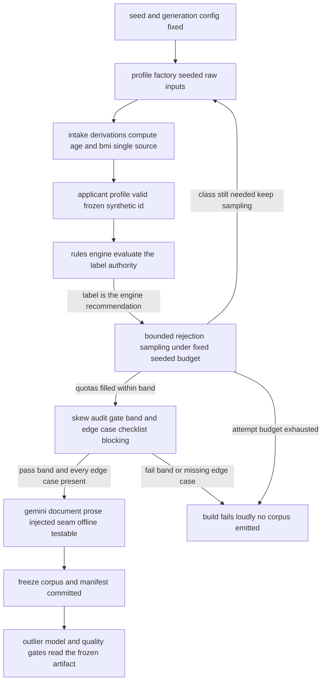

# Business Logic Model — `corpus-generator` (U14)

**Stage**: BUILD → Functional Design (per-unit) · build-time synthetic-corpus unit · **Depth**: comprehensive
**Unit**: U14 `corpus-generator` · **Date**: 2026-07-07 · owns **CON-BR3**, DATA-1/2/3, FR-PROV-4 · Story **US-PLAT-7**.
**Scope**: The **build-time generation flow**, the **bounded-loop termination**, the **freeze-and-commit manifest**, the **FD ↔
later-stage boundary**, a **consumer / dependency map**, and an **invariant self-check**. Built exactly on the eight locked answers
+ four folds — re-opening none. **Seeded, deterministic, no LLM in the label path, no real PII.**

---

## 1. Build-time generation flow

`corpus-generator` runs **once, out of band** (real `GEMINI_API_KEY`), not on a request path. From a fixed **seed** it constructs
profiles, lets the **engine label** them, **bounded-rejection-samples** toward the per-class quotas, passes the **blocking
skew-audit gate**, generates document **prose** (Gemini), and **freezes** the corpus + manifest. Consumers later read the frozen
artifact only.

Mermaid validated before write (alphanumeric node IDs + underscore; every label double-quoted; **no semicolons, no bare colons, no
parentheses, no hyphens, no special characters** in labels; balanced blocks). Text alternative follows.

### Text alternative (always included)
1. From a **fixed seed + `GenerationConfig`**, the **profile factory** seeds raw inputs and calls **`intake.derivations`** to
   compute `age`/`bmi` (single source, boundary-exact), producing a **valid frozen `ApplicantProfile`** with a synthetic
   `application_id`.
2. The **rules-engine `evaluate()`** labels the profile — **the label is the engine's recommendation** (CON-BR2); the intended
   class was only a generation target.
3. **Bounded rejection-sampling**: a labeled profile is **kept if its class still needs filling** toward the ±3pp per-class quota,
   else **discarded**; sampling continues **only within a fixed seeded attempt budget** (loop back to the factory).
4. When the **quotas are filled within the band**, the **blocking skew-audit gate** checks the **conjunction** — ±3pp band **AND**
   every DATA-2 edge case present. If the **attempt budget is exhausted** first, or the gate **fails** (band off or an edge case
   missing), the **build fails loudly** and **no corpus is emitted** (never loops).
5. On **pass**, **Gemini** generates document **prose** (injected seam; offline-testable), and the corpus + manifest are **frozen
   and committed**. **Consumers** (`outlier-model`, `quality-gates`) later **read the frozen artifact only** — never re-invoking the
   generator or Gemini.

---

## 2. Bounded-loop termination (Fold 1 / Fold 3)

- The **engine is the label authority** (BR-CORP-2), so "intended class" is a generation *heuristic* only; the stored `label` is
  always `evaluate(...).recommendation`.
- Sampling is bounded by a **fixed, seeded `attempt_budget`**. Each attempt either **fills a still-needed class** (kept) or is
  **discarded**. The loop **cannot run unbounded**: on budget exhaustion the build **fails the gate loudly** (BR-CORP-3/4).
- Determinism: because the seed and the attempt sequence are fixed, the run is **reproducible** (a test can drive an impossible
  target to assert the loud failure rather than a hang).

---

## 3. Freeze-and-commit + manifest (Q4 / Fold 4)

| Concern | Mechanism |
|---|---|
| **Consumer reproducibility** | corpus + manifest **committed**; consumers read the frozen artifact, **never re-call Gemini** (LLM prose is not byte-stable → frozen, not regenerated) |
| **Freeze integrity** | `content_hash` computed via the **shared CANON-SER** (`common.canon_ser.content_hash()`, **not** a re-declared hasher — BR-CORP-11) over the **canonicalized `CorpusRecord` list** (`profile` + `label` + `edge_case_tags` + `documents_text`), **excluding** the manifest's provenance fields (`generation_timestamp`, etc.) per CANON-SER **P4** — mirroring audit-store's replay projection excluding `engine_version`/timestamp. Prose is a JSON-native `str`, canonicalized in the same pass (no separate raw-bytes path) |
| **Label provenance** | manifest records the **single** `rulebook_version` + `engine_version` used to label (Fold 4) |
| **Provider provenance** | manifest records provider `gemini` + `model_version` (FR-PROV-4) |
| **Audit provenance** | manifest records `seed`, `class_counts`, `class_proportions`, `tolerance_pp = 3`, the `edge_case_checklist` (all true), `profile_count`, `generation_timestamp` (recorded, not an input) |

---

## 4. FD ↔ later-stage boundary

| Concern | **Pinned in THIS FD** | **Later (NFR / Code-Gen / consumers)** |
|---|---|---|
| Modules, records, manifest + config shapes | ✅ `domain-entities.md` | — |
| Determinism, label authority, bounded sampling, skew-audit conjunction, freeze, segregation | ✅ BR-CORP-1..10 | the concrete **tests/gates** land at NFR / Code-Gen |
| Offline test substrate (injected LLM seam; seeded factory) | ✅ direction | the capturing double + fixtures generated at Code-Gen (Q7) |
| The **out-of-band full-corpus run** (real key, small-batch → full) | ✅ named | executed as a build step, not CI (Q7) |
| Concrete Faker field distributions / prose prompt wording | ❌ shape only | pinned at Code-Gen (still seeded, still deterministic) |
| **CON-BR1 bias-swap suite** / feature vector / rule-coverage verification | ❌ **not here** | **`quality-gates`** (U13) / **`outlier-model`** (U18) own these; corpus only *supports* them |
| Mock PDF binaries | ❌ deferred (Q5) | a later pass if ever needed |

---

## 5. Consumer / dependency map

| Party | Relationship | Direction |
|---|---|---|
| **`intake`** (derivations + schema) | corpus-generator **calls** `compute_age`/`compute_bmi`, **imports** `ApplicantProfile` | corpus-generator → intake (call-only) |
| **`rules-engine`** (`evaluate`) | corpus-generator **calls** the engine as the **label oracle** | corpus-generator → rules-engine (call-only) |
| **`memo-agent-core`** (`LLMClient` seam) | corpus-generator **drives** the injected Gemini seam for prose | corpus-generator → seam (injected) |
| **`secrets-config`** (`GEMINI_API_KEY`) | corpus-generator **reads** the key out of band | corpus-generator → secrets-config |
| **shared `common.canon_ser`** (`content_hash` / `canon_ser`) | corpus-generator **calls** the **single** CANON-SER for the manifest `content_hash` (BR-CORP-11) — a **fifth call-only consumed surface**; shared `backend/common/` location that **no unit owns** (same status as its other consumers) | corpus-generator → canon_ser (call-only) |
| **`outlier-model`** (U18, P2) | **reads the frozen corpus** for scoring | outlier-model → `corpus/` (read-only) |
| **`quality-gates`** (U13, P1) | **reads the frozen corpus** for bias-swap / reproducibility / rule-coverage | quality-gates → `corpus/` (read-only) |

`corpus-generator` **imports none of its consumers** and **edits none of its dependencies' production code** (reference-not-own).
The direction is **corpus-generator → deps (call-only)** and **consumers → frozen `corpus/` (read-only)**; never the reverse.

---

## 6. Invariant self-check

| Invariant | Honored by | How |
|---|---|---|
| **CON-BR3** seeded + versioned + skew-audited | BR-CORP-1/4/5/6; §1/§3 | fixed seed; blocking conjunctive skew-audit before use; manifest-frozen |
| **CON-BR2** engine produces the recommendation | BR-CORP-2; §1 | label = `evaluate(...).recommendation`; no independent label; no LLM in the label path |
| **CON-BR1** no demographic proxy (layered-respect) | BR-CORP-7; `domain-entities.md §5` | demographics seeded-independently into the segregated sub-object; never influence label; no swap suite here |
| **CON-DET-1** determinism | BR-CORP-1/3; §2 | seeded, clock-free, bounded, reproducible; timestamp recorded not input |
| **DATA-1** 300+ and ~40/35/25 | BR-CORP-4; §1 | ±3pp band gate |
| **DATA-2** all mandatory edge cases | BR-CORP-4; §1 | edge-case checklist (all true), independent of the band |
| **DATA-3** seeded + manifest + skew-audited | BR-CORP-1/4/5 | all of the above |
| **FR-PROV-4** Gemini build-time doc text frozen | BR-CORP-5/8; §3 | primary provider Gemini prose, frozen in the manifest |
| **Reference-not-own** (four deps) | BR-CORP-8/9; §5 | call-only, none edited; derivations single-sourced in intake |
| **No real PII / no decision finalized** | BR-CORP-10 | synthetic Faker + prose; advisory boundary |
| **Bounded termination** | BR-CORP-3; §2 | fixed seeded attempt budget; gate-fail-loud; never loops |
