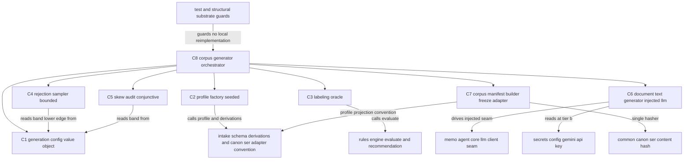

# NFR Design — Logical Components — `corpus-generator` (U14)

**Stage**: BUILD → NFR Design (per-unit) · build-time synthetic-corpus unit · **Depth**: **COMPREHENSIVE**
**Unit**: U14 `corpus-generator` · **Date**: 2026-07-07 · owns **CON-BR3**, DATA-1/2/3, FR-PROV-4 · Story **US-PLAT-7**.
**Built ON** the frozen FD (eleven BR-CORP rules, four folds, five call-only deps incl. `common.canon_ser`) + the approved NFR
Requirements (eleven `NFR-CORP-*` targets, tiers U/S/B, folds NFR-1/NFR-2) — **re-opening none**. Companion to
`nfr-design-patterns.md` (P1–P8 + ND-Fold-1/ND-Fold-2). Components map one-to-one to the patterns; each backs ≥ 1 target (no orphan).

The component names are the FD module inventory (`domain-entities.md §3/§6`) realized as **logical components**; the concrete files
land at Code-Gen under `backend/corpus_generator/`.

---

## 1. Components C1–C8 + test/structural substrate

### C1 — `GenerationConfig` (value object)
- **Responsibility**: the fixed generation parameters — `seed`, `target_split` `{APPROVE 0.40, REFER 0.35, "DECLINE-RECOMMEND" 0.25}`,
  `tolerance_pp = 3`, `attempt_budget`, `min_profiles = 300`, `rulebook_version`, `model_id`. The **single source** of the `seed` and
  the band parameters `(target_split, tolerance_pp)`.
- **Backs**: DET-1 (seed source), BOUND-1 (`attempt_budget`, lower-edge inputs), SKEW-BAND-1 (band params).
- **Key design note (ND-Fold-1)**: both `RejectionSampler` (C4) pre-flight and `SkewAudit` (C5) read `(target_split, tolerance_pp)`
  from **this one object** — one band definition, two uses; they cannot independently disagree.

### C2 — `ProfileFactory`
- **Responsibility**: seeded construction of **raw** inputs → a valid **frozen** `intake.ApplicantProfile`. Derives `age`/`bmi` via
  `intake.derivations`; assigns a deterministic synthetic `application_id` (`corpus-<seed>-<index>`). Populates the segregated
  `Demographics` sub-object **seeded-independently** (never a label input).
- **Backs**: DET-1 (P1), PROFILE-1 (P7), SEGREGATION-1 (P6 — the demographic-independence source).
- **Owns**: raw-field synthesis + profile construction. **Does not own**: derivations (calls `intake.derivations`), the label.

### C3 — `LabelingOracle`
- **Responsibility**: wraps `rules_engine.engine.RulesEngine.evaluate(profile, rulebook_version) -> RuleResultReport` **call-only** and
  returns `report.recommendation` (`Recommendation`). The **only** place a `label` originates.
- **Backs**: LABEL-1 (P2), SEGREGATION-1 (P6 — re-evaluates the swapped profile).
- **Owns**: nothing evaluative — it is a thin call-only wrapper (no rule logic re-implemented).

### C4 — `RejectionSampler`
- **Responsibility**: bounded rejection-sampling toward per-class quotas under `attempt_budget`. **Pre-flight feasibility guard** (band
  lower-edge count `> attempt_budget` → raise `BudgetExhaustedError`, seed-independent — ND-Fold-1 / Fold NFR-2) **plus** a **runtime
  exhaustion guard** (raise `BudgetExhaustedError` on budget exhaustion). Keeps a profile if its engine-labeled class is still needed,
  else discards. Bounded loop → no hang.
- **Backs**: BOUND-1 (P3), DET-1 (P1 — threaded `random.Random(seed)`).
- **Owns**: the bounded sampling loop + both feasibility guards. **Reads**: the band lower-edge inputs from C1.

### C5 — `SkewAudit`
- **Responsibility**: the **blocking** conjunctive gate — **two independent sub-checks** (`band_ok` = each proportion within ±3pp of
  the target using C1's `(target_split, tolerance_pp)`; `edges_ok` = every DATA-2 edge present), **AND-ed only at the top level, never
  blended**. Raises `SkewAuditError` on failure.
- **Backs**: SKEW-BAND-1 + SKEW-EDGE-1 (P4).
- **Owns**: the audit logic (unit-tested on synthetic distributions/checklists at tier U; enforced on the real corpus at tier B).

### C6 — `DocumentTextGenerator`
- **Responsibility**: build-time salary-slip / bank-statement / medical-questionnaire **prose** via the **injected**
  `memo_agent_core.provider.LLMClient` seam (`generate(model, prompt, temperature) -> str`; `temperature=0` central in
  `GeminiAdapter`). Reads `GEMINI_API_KEY` via `secrets-config` at tier B only; a capturing double drives it offline in CI.
- **Backs**: FR-PROV-4, PII-1 (P8 — synthetic prose, no external-identifier source).
- **Owns**: prose orchestration. **Does not own**: the LLM client (injected), the temperature (central), the label (LLM never labels).

### C7 — `CorpusManifestBuilder` / `FreezeAdapter`
- **Responsibility**: project each `CorpusRecord` to the canonicalizable composite `{ profile: profile.model_dump(mode="python"),
  label, edge_case_tags, documents_text }` (reusing intake's projection convention — ND-Fold-2); compute
  `content_hash = common.canon_ser.content_hash(<list>)` (**single** hasher, no local SHA); build the manifest with the **single**
  `rulebook_version` (+ `engine_version`, `model_version`); freeze corpus + manifest under `corpus/`.
- **Backs**: FREEZE-1 + HASH-1 (P5).
- **Field-set (Q4), stated explicitly**: `content_hash` **INCLUDES** `documents_text` (freeze integrity over all committed content);
  DET-1's determinism comparison **EXCLUDES** `documents_text` (non-seeded LLM prose); **both EXCLUDE** manifest provenance
  (`generation_timestamp`, `content_hash` itself, version/count metadata) per CANON-SER **P4**.

### C8 — `CorpusGenerator` (orchestrator)
- **Responsibility**: drives the seeded build — construct (C2) → derive → label (C3) → bounded-sample (C4) → skew-audit gate (C5) →
  prose (C6) → freeze (C7). The **tier-S smoke entrypoint** (Fold NFR-1: a test-scoped `GenerationConfig`, LLM mocked, exercises
  wiring + a valid manifest + the gate invoked; never asserts the real band). Holds the reference-not-own boundary.
- **Backs**: DET-1 + all (composition).

### test / structural substrate
- **Responsibility**: the structural guards — no-edit / no-local-reimplementation over the five surfaces (REFNOTOWN-1 / HASH-1: no
  local `hashlib`/`canon_ser`, no local derivation, no rule-eval, no non-injected temperature), the **non-vacuous self-test** (a
  planted local hasher/derivation is flagged), the PII light-structural check (no external-identifier / no network read), and the
  `SkewAudit` synthetic-input tests.
- **Backs**: REFNOTOWN-1, HASH-1 (structural), PII-1.

---

## 2. Reference-not-own check (the FIVE call-only surfaces — none edited)

| Surface | Owner unit | corpus-generator consumes | Guard (no re-implementation) |
|---|---|---|---|
| `intake.schema.ApplicantProfile` (+ `Demographics`, enums) · `intake.derivations.compute_age`/`compute_bmi` · **`intake.CanonSerAdapter` projection convention `profile.model_dump(mode="python")`** (ND-Fold-2 — part of THIS surface, not a sixth) | `intake` | profile shape · single-sourced age/BMI · the blessed profile→canon projection for C7 | no local derivation; no parallel profile projection |
| `rules_engine.engine.RulesEngine.evaluate` + `rules_engine.report_schema.Recommendation` | `rules-engine` | the label oracle (C3) | no local rule-eval |
| `memo_agent_core.provider.LLMClient` | `memo-agent-core` | the injected prose seam (C6) | no second temperature; injected client |
| `GEMINI_API_KEY` via `secrets_config.settings` | `secrets-config` | the out-of-band real-generation key (tier B) | no secret literal |
| `common.canon_ser.content_hash` (+ `canon_ser`) | shared `backend/common/` (no unit owns it; audit-store = spec authority) | the manifest `content_hash` (C7) | **no local hasher / no local serialization** |

> **Five surfaces, confirmed (ND-Fold-2).** `CanonSerAdapter` lives in `backend/intake/` — consuming its projection convention is
> consuming the already-listed `intake` surface, **not** a sixth surface. corpus-generator reuses the convention
> `profile.model_dump(mode="python")` (identical to what `CanonSerAdapter` uses internally) to build the composite, while
> `common.canon_ser.content_hash` remains the single hasher. **Not owned here**: CON-BR1 bias-swap suite / feature vector
> (`quality-gates` / `outlier-model`), rule-eval logic, decision finalization.

---

## 3. Component → target coverage (no orphan)

| Target | Component(s) |
|---|---|
| NFR-CORP-DET-1 | C1, C2, C4, C8 |
| NFR-CORP-LABEL-1 | C3 |
| NFR-CORP-BOUND-1 | C4 (+C1) |
| NFR-CORP-SKEW-BAND-1 | C5 (+C1) |
| NFR-CORP-SKEW-EDGE-1 | C5 |
| NFR-CORP-FREEZE-1 | C7 |
| NFR-CORP-HASH-1 | C7 (+substrate) |
| NFR-CORP-SEGREGATION-1 | C2, C3 |
| NFR-CORP-REFNOTOWN-1 | C8, substrate |
| NFR-CORP-PROFILE-1 | C2 |
| NFR-CORP-PII-1 | C6, substrate |

**All eleven covered.** Every component backs ≥ 1 target; no component is orphaned and no target is uncovered.

---

## 4. Component-relationship Mermaid (validated) + text alternative

Mermaid validated before write: **alphanumeric node IDs** (underscore allowed), **every label double-quoted**, **no semicolons, no
bare colons, no parentheses, no hyphens, no special characters** in labels, **balanced blocks**.

### Text alternative (always included)
1. **`CorpusGenerator` (C8)** orchestrates C1–C7 in the build order construct → derive → label → sample → gate → prose → freeze.
2. **`ProfileFactory` (C2)** calls `intake` (profile shape + `intake.derivations` for age/BMI); **`LabelingOracle` (C3)** calls
   `rules_engine.evaluate` for the label.
3. **`RejectionSampler` (C4)** and **`SkewAudit` (C5)** both read the band parameters from **`GenerationConfig` (C1)** — the single
   source (ND-Fold-1): C4 uses the band **lower edge** for the pre-flight feasibility guard, C5 uses the band for the ±3pp check.
4. **`DocumentTextGenerator` (C6)** drives the injected `memo-agent-core` `LLMClient` seam for prose and reads `GEMINI_API_KEY` via
   `secrets-config` at tier B only (mocked in CI).
5. **`CorpusManifestBuilder`/`FreezeAdapter` (C7)** delegates hashing to `common.canon_ser.content_hash` (the single hasher) and
   reuses intake's `profile.model_dump(mode="python")` projection convention (ND-Fold-2) to build the composite record.
6. The **test/structural substrate** guards C8 (and the whole unit) against any local re-implementation of the five surfaces.
7. All arrows point **corpus-generator → deps (call-only)**; consumers later read the frozen `corpus/` (read-only), never the reverse.

---

## 5. Security-Guardrails compliance (enabled extension)

| Control | Status | Rationale |
|---|---|---|
| Input validation | **N/A (referenced)** | Emitted profiles are Pydantic-valid (C2/PROFILE-1); application-input validation is `intake`'s SEC-2. |
| Prompt-injection defense | **N/A** | Build-authored prompts over synthetic data (C6); no untrusted external document parsed here (SEC-1 is `document-sanitizer`'s). |
| Secrets management | **Compliant (referenced)** | `GEMINI_API_KEY` via `secrets-config` (SEC-3); no secret literal (substrate/REFNOTOWN-1); mocked in CI. |
| Read-only DB access for audit role | **N/A** | The unit writes `corpus/` files, not the audit DB. |
| Audit logging | **N/A** | Build provenance is the manifest (C7), not the runtime audit trail (SEC-5 is `audit-store`'s). |
| **No real PII / synthetic-only** | **Compliant (owns it)** | **C6 + substrate / PII-1** — Faker + synthetic prose; governance + light structural. |

No blocking finding.

---

## 6. Settled items held (not re-opened)
Frozen FD (BR-CORP-1..11, five call-only deps incl. `common.canon_ser`, manifest/record/config shapes) + approved `NFR-CORP-*`
targets/tiers/folds are the substrate — components realize them, re-opening none. **CON-BR1 verification stays `quality-gates`'** (C2/C3
provide the own layered-respect check only). **CON-BR2** label authority = `rules-engine` (C3 call-only). **No LLM in the label path;
no real PII; WIRE-1 untouched** (backend build-time unit). Tier-B out-of-band full run; mock PDFs deferred. No other unit started.
