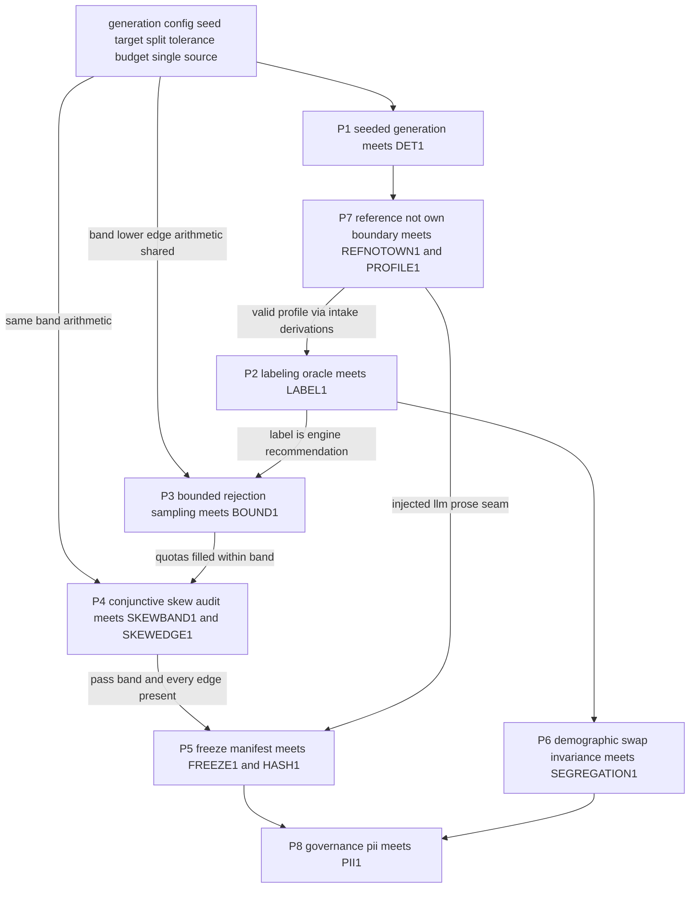

# NFR Design — Patterns — `corpus-generator` (U14)

**Stage**: BUILD → NFR Design (per-unit) · build-time synthetic-corpus unit · **Depth**: **COMPREHENSIVE**
**Unit**: U14 `corpus-generator` · **Date**: 2026-07-07 · owns **CON-BR3**, DATA-1/2/3, FR-PROV-4 · Story **US-PLAT-7**.
**Built ON** the frozen FD (**eleven BR-CORP rules**, **four folds**, **five call-only dependencies** incl. `common.canon_ser`,
the `CorpusManifest`/`CorpusRecord`/`GenerationConfig` shapes) and the approved **NFR Requirements** (**eleven `NFR-CORP-*` targets**,
tiers **U/S/B**, folds **NFR-1/NFR-2**) — **re-opening none**. Four NFR-Design `[Answer]` tags (all **A**) locked in the plan; the
mandatory ambiguity-check resolved two design realizations as **ND-Fold-1** and **ND-Fold-2** (§0).

Each section is a **named design pattern** that structurally meets its `NFR-CORP-*` target(s), at the rigor of the other comprehensive
units (rules-engine / audit-store / memo-agent-core / database). The concrete tests land at Code-Gen; here the **mechanism** is pinned.

---

## 0. Design folds resolved at the NFR-Design ambiguity-check (referenced, not re-derived)

- **ND-Fold-1 — Shared band arithmetic; the pre-flight quota uses the band LOWER EDGE (Q2 / P3 ↔ P4).** The pre-flight feasibility
  guard's per-class "required count" is derived from the **same** band definition `SkewAudit` uses — the **lower band edge**
  `ceil(min_profiles × (target_prop − tolerance_pp/100))`, read from the **single** `(target_split, tolerance_pp)` on
  `GenerationConfig` (C1). It is **not** `min_profiles × class_proportion` (the band center); using the center would be *unsound*
  (it would false-raise on configs the band would accept). **One band definition, two uses:** pre-flight asks "is the lower-edge
  count attainable within `attempt_budget`", `SkewAudit` asks "is the realized proportion within the band". They **cannot
  independently disagree**. Fold NFR-2's coarse pigeonhole (`quota > budget`, seed-independent) is the special case.
- **ND-Fold-2 — `CanonSerAdapter` is part of the already-listed `intake` surface, not a sixth (Q3 / P5 / P7).** `CanonSerAdapter`
  lives in `backend/intake/` — consuming it is consuming `intake` (surface #1). corpus-generator reuses the **projection convention**
  `profile.model_dump(mode="python")` (the blessed profile→canon projection, identical to what `CanonSerAdapter` uses internally) to
  build the composite `CorpusRecord` projection, then delegates hashing to `common.canon_ser.content_hash` (surface #5, the **single**
  hasher). Convention-level reuse → the **five-surface** count is preserved (§ reference-not-own).

---

## 1. Pattern → target map (one pattern per section; no orphan)

| Pattern | Target(s) | Component(s) |
|---|---|---|
| **P1 SeededGenerationPattern** | NFR-CORP-DET-1 | C1, C2, C4, C8 |
| **P2 LabelingOraclePattern** | NFR-CORP-LABEL-1 | C3 |
| **P3 BoundedRejectionSamplingPattern** | NFR-CORP-BOUND-1 | C4 (+C1) |
| **P4 ConjunctiveSkewAuditPattern** | NFR-CORP-SKEW-BAND-1 + NFR-CORP-SKEW-EDGE-1 | C5 (+C1) |
| **P5 FreezeManifestPattern** | NFR-CORP-FREEZE-1 + NFR-CORP-HASH-1 | C7 |
| **P6 DemographicSwapInvariancePattern** | NFR-CORP-SEGREGATION-1 | C2, C3 |
| **P7 ReferenceNotOwnBoundaryPattern** | NFR-CORP-REFNOTOWN-1 + NFR-CORP-PROFILE-1 | C2, C6, C8, substrate |
| **P8 GovernancePIIPattern** | NFR-CORP-PII-1 | C6, substrate |

All **eleven** `NFR-CORP-*` targets covered (FREEZE-1+HASH-1 share P5; SKEW-BAND-1+SKEW-EDGE-1 share P4).

---

## 2. P1 — SeededGenerationPattern → NFR-CORP-DET-1

**Intent**: every structured field of every profile is a pure function of the fixed `seed`; same seed + same deps → byte-identical
structured corpus content.

**Mechanism**:
- **ONE** `random.Random(seed)` instance is constructed from `GenerationConfig.seed` and **threaded** through `ProfileFactory` (C2)
  and `RejectionSampler` (C4). **Faker is seeded from that same seed** (`Faker(...)` + `.seed_instance(seed)`), never the global
  `Faker`/`random` state.
- **No `numpy`** (seeded stdlib `random` only, tech-stack D3) — a single seeded generator is the sole entropy source.
- **No wall-clock, no unseeded randomness, no dict-ordering assumption** in the generation path. `generation_timestamp` is **recorded
  post-hoc** into the manifest and is **never an input** to generation, and is **excluded** from the compared/hashed content (P4).
- `intake.derivations` (clock-free `Decimal`) computes `age`/`bmi`, so derived fields are reproducible and boundary-exact (25.00/30.00).

**Meets DET-1**: (a) two runs (Q1) with the same seed → byte-identical canonicalized content (compared via `canon_ser` bytes over
`profile`+`label`+`edge_case_tags`, **excluding** `documents_text` — ND-Fold via Q4/§6.5); (b) a **structural** test asserts no
`datetime.now`/`date.today`/`time.*` and no bare `random.*` (unseeded) in the generation modules; (c) `generation_timestamp` excluded.

**Tier**: U.

---

## 3. P2 — LabelingOraclePattern → NFR-CORP-LABEL-1

**Intent**: the record's class is **exactly** the engine's recommendation; there is no independent label path.

**Mechanism**:
- `LabelingOracle` (C3) wraps `rules_engine.engine.RulesEngine.evaluate(profile, rulebook_version) -> RuleResultReport` **call-only**
  and returns `report.recommendation` (a `rules_engine.report_schema.Recommendation`: `APPROVE` / `REFER` / `DECLINE-RECOMMEND`).
- The `CorpusRecord.label` is assigned **only** from the oracle's return. `intended_class` is a **generation target / provenance**
  only and is **never** authoritative (Fold 1/3). No other code path sets a label; **no LLM** touches the label path (CON-BR2).

**Meets LABEL-1**: (a) recomputing `evaluate(record.profile, manifest.rulebook_version).recommendation` for every record equals the
stored `label`; (b) **structural** — the label is set only from the oracle; (c) `intended_class` never overrides `label`.

**Tier**: U.

---

## 4. P3 — BoundedRejectionSamplingPattern → NFR-CORP-BOUND-1

**Intent**: generation is bounded and terminates; the happy path completes within budget; an infeasible target **raises loudly**,
never hangs — seed-independently.

**Mechanism (two guards; ND-Fold-1)**:
1. **Pre-flight feasibility guard** — before **any** sampling, `RejectionSampler` (C4) computes, per class, the **band lower-edge
   count** `ceil(min_profiles × (target_prop − tolerance_pp/100))` from `GenerationConfig` (C1) — the **same** `(target_split,
   tolerance_pp)` `SkewAudit` reads (ND-Fold-1). If any per-class lower-edge count **> `attempt_budget`** (`quota > budget`,
   pigeonhole), it raises **`BudgetExhaustedError`** immediately. This is **seed-independent by construction** (no seed can attain a
   count exceeding the attempt budget — Fold NFR-2), making the guarantee **structurally checkable** as asked.
2. **Runtime exhaustion guard** — for a config feasible on paper that the seeded factory cannot satisfy within budget, the bounded
   loop runs to `attempt_budget` and then raises **`BudgetExhaustedError`**. Each attempt either **fills a still-needed class** (keep
   if the class is below its band target) or is **discarded**; the loop is bounded by `attempt_budget` → **no unbounded regeneration**.

Both guards raise the **same** named typed exception (Q1 / P-taxonomy §9). Failure is **loud, not silent**; termination is guaranteed
by the fixed budget.

**Meets BOUND-1**: (a) **happy path** — a satisfiable target within budget produces a corpus, no raise; (b) **loud-failure path** — a
per-class required count strictly greater than `attempt_budget` (e.g. `attempt_budget=1`, require ≥2) raises `BudgetExhaustedError`,
asserted **seed-independently**, provably **not a hang** (bounded loop).

**Tier**: U.

---

## 5. P4 — ConjunctiveSkewAuditPattern → NFR-CORP-SKEW-BAND-1 + NFR-CORP-SKEW-EDGE-1

**Intent**: the blocking gate asserts **two independent conditions** — the ±3pp distribution band **AND** the DATA-2 edge-case
checklist — **AND-ed only at the top level, never blended into one score** (Fold 2).

**Mechanism**:
- `SkewAudit` (C5) computes **two separate sub-checks**, each returning a boolean plus its diagnostic:
  - **`band_ok`** — each realized class proportion is within **±3pp** of `{APPROVE 40, REFER 35, DECLINE-RECOMMEND 25}`, using the
    **same** `(target_split, tolerance_pp)` from `GenerationConfig` the pre-flight guard reads (ND-Fold-1). Computed **only** from
    class counts / total — it does **not** consult the edge checklist.
  - **`edges_ok`** — **every** DATA-2 mandatory edge case is present: `thin-file`, `self-employed/irregular income`, `age 18`,
    `age 65`, `BMI 25.00`, `BMI 30.00`, `DTI 40%`, `single-missing-document`. A **checklist**, not averaged into the band.
- The gate result is `band_ok AND edges_ok`, combined **only at the top**. On any failure it raises **`SkewAuditError`** (Q1) —
  build-blocking; **no partial/ungated corpus is emitted**.

**Meets SKEW-BAND-1**: (a) tier-U — feeding `SkewAudit` **synthetic** proportions: within band → pass, any class off by >3pp → fail,
**regardless** of the edge-checklist state (independence); (b) the band computation does not consult the checklist; (c) tier-B on the
real 300+ corpus. **Meets SKEW-EDGE-1**: (a) tier-U — all edges present → pass, **any one** absent → fail even when the band is
satisfied (never averaged away); (b) the enumerated set is fixed; (c) tier-B enforcement.

**Tier**: U (+B).

---

## 6. P5 — FreezeManifestPattern → NFR-CORP-FREEZE-1 + NFR-CORP-HASH-1

**Intent**: freeze the corpus behind a manifest pinned by a `content_hash` that delegates to the single shared CANON-SER, with an
**explicit** included-vs-excluded field-set and a **single** `rulebook_version`.

**Mechanism**:
- **6.1 Freeze-and-commit** — `CorpusManifestBuilder`/`FreezeAdapter` (C7) writes the corpus + manifest under repo-root `corpus/`.
  Consumers (`outlier-model`, `quality-gates`) read the frozen artifact only; they **never** import the generator or an LLM client.
- **6.2 Single `rulebook_version`** — the manifest records the **one** `rulebook_version` (+ `engine_version`, provider
  `model_version`) used to label; a run **cannot mix versions** (Fold 4). `manifest.rulebook_version` equals the version passed to
  **every** `evaluate()` call in the run.
- **6.3 Canonicalization projection (Q3 / ND-Fold-2)** — each `CorpusRecord` is projected to a `canon_ser`-serializable composite
  `{ profile: profile.model_dump(mode="python"), label, edge_case_tags, documents_text }` — reusing intake's **projection
  convention** (`profile.model_dump(mode="python")`), keeping the profile→canon projection single-sourced with `intake` (surface #1).
- **6.4 Single hasher** — `content_hash = common.canon_ser.content_hash(<list of composite records>)` (surface #5). **No local SHA /
  no local serialization** anywhere in corpus-generator. Prose `documents_text` is a **JSON-native `str`** to `canon_ser`, canonicalized
  **in the same pass** as the structured fields — no separate raw-bytes path, no blended mechanism (BR-CORP-11).
- **6.5 Field-set (Q4) — two field-sets differ by design, both exclude provenance**:
  - **`content_hash` INCLUDES `documents_text`** — freeze/tamper-evidence over **all committed content**
    (`profile` + `label` + `edge_case_tags` + `documents_text`).
  - **DET-1's byte-identity comparison EXCLUDES `documents_text`** — frozen LLM prose is **not** part of *seeded-generation*
    determinism (only the structured `profile`+`label`+`edge_case_tags` are compared across two seeded runs).
  - **Both EXCLUDE** the manifest provenance (`generation_timestamp`, `content_hash` itself, version/count metadata) per CANON-SER
    **P4** — mirroring audit-store excluding `engine_version`/timestamp from its replay-equality projection. The difference is
    **stated explicitly in both artifacts** (here and in `logical-components.md` C7; and in the FD `domain-entities.md §4`).

**Meets FREEZE-1**: (a) one `rulebook_version` across the run == the manifest's; (b) **structural** — reading the frozen corpus imports
no generator and no LLM client; (c) `content_hash` pins the freeze. **Meets HASH-1**: (a) the manifest hash **reproduces** via
`common.canon_ser.content_hash()` over the canonicalized `CorpusRecord` list; (b) mutating a **provenance** field leaves the hash
unchanged, mutating a **profile/label/tag/prose** field changes it; (c) **structural** — no local `hashlib`/serialization.

**Tier**: U (+structural).

---

## 7. P6 — DemographicSwapInvariancePattern → NFR-CORP-SEGREGATION-1

**Intent**: swapping the `Demographics` sub-object on an otherwise-identical profile leaves the **engine label unchanged** — this
unit's **own layered-respect** check (defense-in-depth), explicitly **NOT** `quality-gates`' bias-swap suite.

**Mechanism**:
- `ProfileFactory` (C2) populates demographic identifiers (name / gender / city) **seeded-independently** into the profile's
  **already-segregated `Demographics` sub-object** (frozen schema: *"Never a rule/feature input"*). They never influence the
  financial/medical fields or the label.
- The check: build a profile + a copy differing **only** in `Demographics`; run both through `LabelingOracle` (C3) → the
  **same** `recommendation`.
- **Ownership boundary (not conflated)**: corpus-generator authors **no bias-swap suite and no swap pairs**. The CON-BR1 *verification*
  (delta = 0 across the corpus) is `quality-gates`' (U13); the feature-vector *enforcement* is `outlier-model`'s (U18/P2). P6 is a
  layered-respect point only.

**Meets SEGREGATION-1**: (a) `evaluate` on the two profiles differing only in `Demographics` → same `recommendation`; (b) ownership
note — not a substitute for `quality-gates`' suite.

**Tier**: U.

---

## 8. P7 — ReferenceNotOwnBoundaryPattern → NFR-CORP-REFNOTOWN-1 + NFR-CORP-PROFILE-1

**Intent**: the **five** call-only surfaces are consumed and **none re-implemented or edited**; every emitted profile is a valid
`ApplicantProfile` with single-sourced derivations.

**Mechanism**:
- **Reference-not-own guards** — corpus-generator imports and **calls** the five surfaces but defines **no** local hasher/serialization
  (delegates to `common.canon_ser`), **no** local age/BMI derivation (delegates to `intake.derivations`), **no** rule evaluation
  (delegates to `rules_engine.evaluate`), and **no** second temperature literal (the injected `LLMClient` seam's `temperature=0` is
  central in `GeminiAdapter`). A **non-vacuous self-test** flags a synthetic local hasher / local derivation to prove the guard bites.
- **Valid profile / derivation equality** — `ProfileFactory` (C2) builds raw inputs, calls `intake.derivations.compute_age` /
  `compute_bmi`, and constructs a **frozen** `intake.ApplicantProfile` (`extra="forbid"`) with a deterministic synthetic
  `application_id` = `"corpus-<seed>-<index>"`.

**Meets REFNOTOWN-1**: (a) **structural** — imports the five surfaces; contains no local `hashlib`/`canon_ser`, no local age/BMI
derivation, no rule-eval, no non-injected temperature literal; (b) **non-vacuous** self-test. **Meets PROFILE-1**: (a) every profile
round-trips through Pydantic; (b) `age_years_derived == compute_age(dob, as_of)` and (when height/weight present) `bmi_derived ==
compute_bmi(height_cm, weight_kg)`; (c) `application_id == "corpus-<seed>-<index>"`.

**Tier**: U (structural + round-trip).

---

## 9. P8 — GovernancePIIPattern → NFR-CORP-PII-1

**Intent**: all data is synthetic; no real PII.

**Mechanism**:
- **Governance** — structured fields are Faker-synthetic; prose is build-authored Gemini output over synthetic inputs (C6). No real
  PII at any stage; the unit finalizes no decision.
- **Light-structural (Q4-A)** — a cheap check asserts the generation path reads **no external-identifier source** and makes **no
  network read** (the only network is the injected Gemini seam at tier B, **mocked** in CI).

**Meets PII-1**: (a) governance statement; (b) light structural (no external-identifier / no network read in the generation path).

**Tier**: governance (+ light structural, U).

---

## 10. Named typed-exception taxonomy (Q1 — cross-cutting for P3 / P4)

One unit base exception with two subclasses (**named, typed, catchable**; tests assert the specific subclass):

```text
CorpusGenerationError            (base — the unit's build-time failure)
├── BudgetExhaustedError         (P3 — pre-flight infeasibility OR runtime budget exhaustion)
└── SkewAuditError               (P4 — band failure OR edge-checklist failure)
```

- `BudgetExhaustedError` is raised by **both** P3 guards (pre-flight `quota > budget`; runtime exhaustion).
- `SkewAuditError` is raised by the P4 gate on `band_ok` OR `edges_ok` failure.
- Both are `CorpusGenerationError` subclasses, so a caller may catch the base while tests assert the precise subclass. Build-blocking
  and loud by construction.

---

## 11. Pattern-integration Mermaid (validated) + text alternative

Mermaid validated before write: **alphanumeric node IDs** (underscore allowed), **every label double-quoted**, **no semicolons, no
bare colons, no parentheses, no hyphens, no special characters** in labels, **balanced blocks**.



### Text alternative (always included)
1. **`GenerationConfig`** is the single source of the `seed` and the band parameters `(target_split, tolerance_pp)`. It drives
   **P1 seeded generation** and supplies the **same** band arithmetic to both **P3** (lower-edge feasibility) and **P4** (band check)
   — ND-Fold-1, so the two cannot disagree.
2. **P1** produces seeded raw inputs; **P7** turns them into a **valid `ApplicantProfile`** via `intake.derivations` (single-sourced,
   boundary-exact) and holds the reference-not-own boundary.
3. **P2** labels the profile with the **engine recommendation** (`evaluate()` call-only) — the label authority.
4. **P3 bounded rejection-sampling** keeps a profile if its engine-labeled class is still needed within budget, else discards; it
   raises `BudgetExhaustedError` loudly (pre-flight or runtime), never loops.
5. When quotas are filled, **P4 conjunctive skew-audit** checks the **band AND the edge checklist** independently (never blended),
   raising `SkewAuditError` on failure — build-blocking.
6. On pass, **P5 freeze-manifest** generates prose via **P7's injected LLM seam**, canonicalizes the `CorpusRecord` list, and freezes
   the corpus + manifest with a `common.canon_ser` `content_hash` (provenance excluded).
7. **P6 demographic-swap invariance** is a property over P1/P2 (swap `Demographics` → same engine label); **P8 governance/PII** covers
   P6 and P7 (synthetic-only, no external-identifier / no network read in CI).

---

## 12. Traceability (pattern → target → BR-CORP → tier)

| Pattern | Target(s) | BR-CORP | Tier |
|---|---|---|---|
| P1 SeededGenerationPattern | DET-1 | 1 | U |
| P2 LabelingOraclePattern | LABEL-1 | 2 | U |
| P3 BoundedRejectionSamplingPattern | BOUND-1 | 3 | U |
| P4 ConjunctiveSkewAuditPattern | SKEW-BAND-1 + SKEW-EDGE-1 | 4 (i/ii) | U (+B) |
| P5 FreezeManifestPattern | FREEZE-1 + HASH-1 | 5/6, 11 | U (+structural) |
| P6 DemographicSwapInvariancePattern | SEGREGATION-1 | 7 | U |
| P7 ReferenceNotOwnBoundaryPattern | REFNOTOWN-1 + PROFILE-1 | 8, 9 | U (structural) |
| P8 GovernancePIIPattern | PII-1 | 10 | governance (+ structural) |

**No orphan** — all eleven `NFR-CORP-*` targets covered; BR-CORP-1..11 all mapped.

---

## 13. Security-Guardrails compliance (enabled extension)

| Control | Status | Rationale |
|---|---|---|
| Input validation | **N/A (referenced)** | The unit generates data; emitted profiles are Pydantic-valid (P7/PROFILE-1). Application-input validation is `intake`'s SEC-2. |
| Prompt-injection defense | **N/A** | The Gemini prose call uses build-authored prompts over synthetic data; no untrusted external document is parsed here (SEC-1 is `document-sanitizer`'s). |
| Secrets management | **Compliant (referenced)** | `GEMINI_API_KEY` via `secrets-config` (SEC-3); no secret literal (P7/REFNOTOWN-1); mocked in CI. |
| Read-only DB access for audit role | **N/A** | The unit writes `corpus/` files, not the audit DB. |
| Audit logging | **N/A** | Build provenance is the manifest, not the runtime audit trail (SEC-5 is `audit-store`'s). |
| **No real PII / synthetic-only** | **Compliant (owns it)** | **P8 / PII-1** — Faker + synthetic prose; governance + light structural. |

No blocking finding.

---

## 14. Settled items held (not re-opened)
Frozen FD (BR-CORP-1..11, five call-only deps, manifest/record/config shapes) + approved `NFR-CORP-*` targets/tiers/folds are the
substrate — patterns realize them, re-opening none. **CON-BR1 verification stays `quality-gates`'** (P6 is the own layered-respect
check). **CON-BR2** label authority = `rules-engine`. **No LLM in the label path; no real PII; WIRE-1 untouched.** Tier-B out-of-band
full run; mock PDFs deferred. No other unit started.
