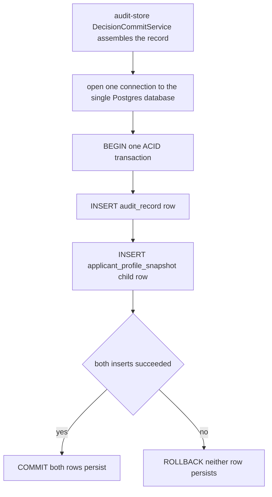

# Business Logic Model — `database` (EPIC-6 / U15)

**Stage**: BUILD → Functional Design (per-unit) · story-less shared infrastructure
**Unit**: U15 `database`
**Date**: 2026-07-06
**Scope**: The **schema-lifecycle model** — how the schema is evolved (migrations), how it is reached
(connection/transaction model that makes ATOMIC-1 valid), the **explicit FD ↔ Infrastructure-Design
boundary** (what is pinned here vs provisioned later), and the **consumer → table map**. Closes with an
invariant self-check. **No provisioning commands, no credentials** (SEC-3).

---

## 1. Migrations model (versioned, forward-only)

- **The migration sequence is the single source of truth for the schema.** An **ordered sequence of
  immutable, forward-only migration steps**; the **initial migration** creates the Phase-1 schema:
  `audit_record` (14 cols) + `applicant_profile_snapshot` (4 cols) + the `audit_writer`/`audit_reader`
  role semantics (grant DDL is Infra-executed, §3) + `app_user` (foundational skeleton).
- **Applied identically in every tier** — dev (Docker Postgres), test/CI (testcontainers Postgres),
  prod (Render Postgres) — so the schema is byte-identical across environments (DATA-5, BR-DB-6).
- **Never edit a published migration in place** — a schema change is a **new** migration appended to
  the sequence. This mirrors the rulebook's append-only-version discipline (a change is a new version,
  not a mutation) and the audit tables' own append-only rule (BR-DB-4).
- **Deferred slots are future migrations**, not present columns: the rulebook-version registry (Q2,
  BR-DB-14) and any auth-rbac user/role columns beyond the skeleton (BR-DB-12) arrive as **later
  forward-only migrations**, authored by those units when they reach their own design.
- **Tool choice is deferred** to Code-Gen / Infrastructure Design (e.g. Alembic vs a raw-SQL runner) —
  this FD pins only the **model** (versioned + forward-only + one authoritative sequence + no-SQLite).

---

## 2. Connection / transaction model (what makes ATOMIC-1 valid)

### Text alternative (always included)
1. audit-store's `DecisionCommitService` assembles the full record **before** opening the transaction
   (no half-open transaction — the assemble-then-BEGIN sequencing from audit-store NFR Design §3).
2. One connection to the **single** Postgres database (co-location, BR-DB-7).
3. **BEGIN** one ACID transaction.
4. INSERT the `audit_record` row, then INSERT the co-located `applicant_profile_snapshot` child row.
5. If **both** succeed → **COMMIT** (both rows persist). If **either** fails → **ROLLBACK** (neither
   persists). This both-or-neither guarantee is audit-store's **ATOMIC-1**, and it is only valid
   because the two tables are co-located on one connection — which is exactly what this schema pins.

- **Append-only at the connection level**: the write path uses the **`audit_writer`** role (INSERT +
  SELECT only, BR-DB-5); reads for the auditor surface use **`audit_reader`** (SELECT only). No path
  issues UPDATE/DELETE on committed rows (BR-DB-4).

---

## 3. FD ↔ Infrastructure-Design boundary (explicit)

This unit runs **two real BUILD stages** (unlike the four prior pure-logic units): **Functional Design
(here)** and **Infrastructure Design (next-after-NFR)**. The split is explicit so nothing leaks:

| Concern | **Pinned in THIS FD** | **Provisioned later (Infrastructure Design / `secrets-config`)** |
|---|---|---|
| Table shapes / columns / types | ✅ `audit_record`, `applicant_profile_snapshot`, `app_user` (§2 of domain-entities) | — |
| PK / FK / NOT-NULL / index | ✅ exactly as verified (BR-DB-1..3) | — |
| Append-only + role **semantics** | ✅ what `audit_writer`/`audit_reader` may do (BR-DB-4/5) | Grant **DDL execution**; role creation on each instance |
| Co-location rule | ✅ one DB/schema/transaction (BR-DB-7) | The actual Postgres instance(s) + how "one database" is realized per tier |
| Migrations **model** | ✅ versioned, forward-only, one sequence (§1) | Migration **tool** + the runner in CI/Render |
| DATA-5 | ✅ Postgres-only rule + structural type guard (BR-DB-6) | Docker Postgres (dev), testcontainers (CI), Render Postgres (prod) wiring |
| Credentials / connection strings | ❌ **never here** (SEC-3, BR-DB-13) | `secrets-config` (env/secrets); connection URL + pooling |

**Rule of thumb**: this FD defines **what the schema is and what the roles may do**; Infrastructure
Design defines **how it is created, connected, and bound**.

---

## 4. Consumer → table map (schema authority; reference-not-own in reverse)

`database` is the **authoritative source of the production schema** (BR-DB / Q9). Consuming units keep
their own SQLAlchemy `Table`/query objects as a **conforming read/write mapping** whose columns MUST
match this authoritative schema. **No consuming unit's code is edited by this FD**; the contract is the
**column set**.

| Consumer | Phase-1 schema need | This unit's provision | Notes |
|---|---|---|---|
| **`audit-store`** | Persist the 6-tuple + original profile; append-only; auditor read | **`audit_record` + `applicant_profile_snapshot`, now, in full** (column-for-column with built `pg_repository.py`) | The built interim TEST DDL is **superseded at the schema-authority level** — this unit's migrations become the production source. **audit-store's test files are NOT rewritten by this FD** (its integration test keeps its own self-contained TEST-only `create_all`). |
| **`rules-engine`** | Rulebook versioning | **Deferred slot, no columns** (BR-DB-14) | Built engine versions via content-hashed YAML; replay resolves via the injected file-based engine — no DB table needed now. |
| **`auth-rbac`** | User/role store; OIDC seam | **`app_user` foundational skeleton** (open `role`, BR-DB-12) | auth-rbac's own FD closes/extends the role set + adds the rest of the model via forward-only migration. |
| **`admin-cli`** | Manage users / publish versions | **Consumes `app_user`**; the rulebook registry is its future slot | Owns no new tables here. |
| Phase-2/3 consumers | outlier corpus metadata, observability stores | **Deferred** | Belong to those units' own design, not this FD. |

---

## 5. Invariant self-check

| Invariant | Honored by | How |
|---|---|---|
| **ATOMIC-1** (co-location) | BR-DB-2, BR-DB-7; §2 | Both audit tables co-located in one DB/schema; single-transaction two-row insert valid |
| **CON-AUDIT-1** (6-tuple + append-only) | §2.1 domain-entities; BR-DB-3/4 | Full 6-tuple columns NOT-NULL; INSERT-only, no UPDATE/DELETE |
| **APPEND-1 / SEC-4 / SEC-5** | BR-DB-4/5 | Two-layer append-only; `audit_writer` INSERT+SELECT, `audit_reader` SELECT-only |
| **DATA-5** (no SQLite) | BR-DB-6 | Postgres every tier; BYTEA/TIMESTAMPTZ structural guard; CI check referenced to quality-gates |
| **REPLAY-1 / DET-2** (byte-fidelity) | BR-DB-10 | Opaque BYTEA CANON-SER, no JSONB/normalize |
| **OOS-7 / OOS-8 seams** | §2.1; BR-DB-8 | `status`/`supersedes_decision_id` reserved, `active` only P1/2; `engine_version` present |
| **CON-BR1** (bias-free) | reference | Demographics persist in the profile snapshot for replay, but `evaluate()` structurally excludes them (audit-store BR1-1) — storage ≠ influence; this schema does not add any demographic-driven column or index |
| **Advisory-only naming** | §2.1 | `decision_id`/`audit_record` name the **human's** committed action — the one correct use of "decision"; nothing implies the system decides |
| **SEC-3** (no secrets) | BR-DB-13 | No credentials/connection strings anywhere in these artifacts |
| **Reference-not-own (reverse)** | §4; BR-DB-11/12/14 | This unit owns the schema only; no consuming unit's business logic or code is decided/edited here |

---

## 6. Column-for-column verification record (from the ambiguity-check)

The Phase-1 audit schema was **verified 18/18 column-for-column** against the built
`backend/audit_store/pg_repository.py` (names, PostgreSQL types via SQLAlchemy `String`→VARCHAR,
`LargeBinary`→BYTEA, `DateTime(timezone=True)`→TIMESTAMPTZ, nullability, PK, the
`applicant_profile_snapshot.decision_id` FK, and the `application_id` index). The three folds
(open `role`; `status` DB-default optional; `action`/`status` as varchar not native ENUM) are reflected
in `domain-entities.md §2` and `business-rules.md` BR-DB-8/9/12. **No consuming-unit code is edited; no
credentials are named.**
