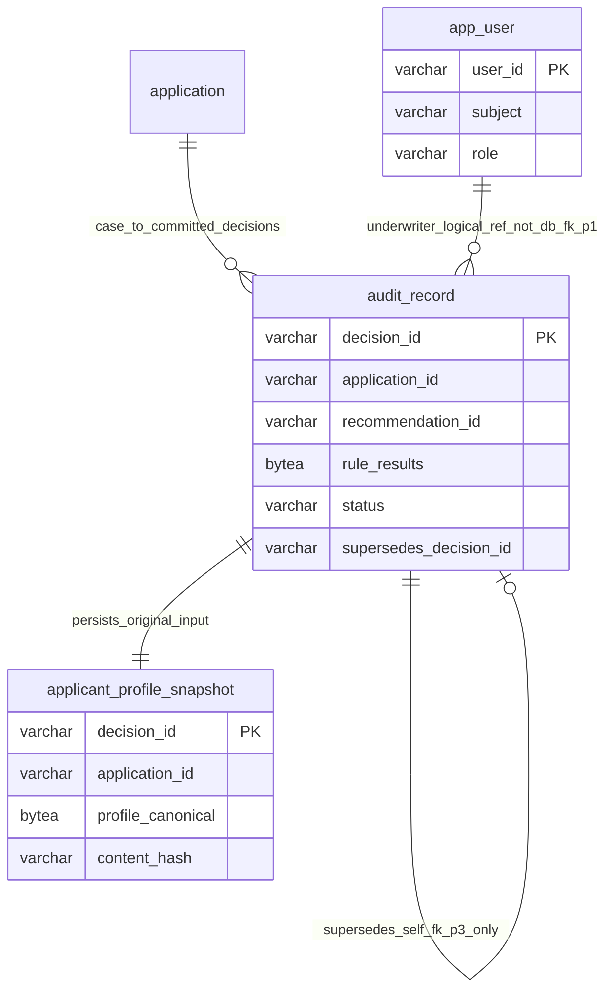

# Domain Entities — `database` (EPIC-6 / U15)

**Stage**: BUILD → Functional Design (per-unit) · story-less shared infrastructure
**Unit**: U15 `database` — the shared **PostgreSQL schema + migrations** substrate depended on by
`audit-store`, `rules-engine`, `auth-rbac`, `admin-cli`.
**Date**: 2026-07-06
**Scope**: The **field-by-field production schema** this unit owns at Phase 1 — the two co-located
audit tables (**column-for-column matching the built `backend/audit_store/pg_repository.py`**, verified
at the ambiguity-check), the **foundational `app_user` skeleton** for auth-rbac (open role dimension),
and the **reserved rulebook-version migration slot** (deferred, no columns). **This unit owns the
schema, not the business logic of its consumers** — reference-not-own, in reverse.

Types are given both **logically** (`str`, `bytes`, `datetime`) and as their **PostgreSQL** column
type (DATA-5: **PostgreSQL everywhere, no SQLite**). **No credentials, connection strings, or
provisioning commands appear here** (SEC-3 — owned by `secrets-config` / Infrastructure Design).

---

## 1. Entity-relationship / schema view

Mermaid validated before write (alphanumeric entity IDs + underscore; relationship labels quoted;
**no semicolons, no bare colons, no parentheses, no special characters** in labels; balanced blocks).
Text alternative follows.

### Text alternative (always included)

- **`audit_record`** — one row per **committed decision**, keyed by **`decision_id`** (system-generated
  PK). Holds the CON-AUDIT-1 6-tuple + the CON-BR4 commit linkage + the OOS-7 seam (full column list
  in §2.1). Append-only (no UPDATE/DELETE on committed rows — see `business-rules.md`).
- **`applicant_profile_snapshot`** — the persisted original `ApplicantProfile` (CANON-SER bytes),
  **co-located child** keyed by `decision_id` (**PK + FK → `audit_record.decision_id`**). Co-location
  in one database/schema is what makes audit-store's single-transaction ATOMIC-1 write valid.
- **`app_user`** — the **foundational auth-rbac skeleton** (§2.3): identity + an **open `role`
  dimension**. Phase-1 known roles are `underwriter` + `auditor`; the column is **not a closed enum** —
  `auth-rbac`'s own FD closes/extends the set.
- **`application`** (logical, keyed by intake's system-assigned `application_id`) relates to
  zero-or-more `audit_record`s — exactly one **active** decision in Phase 1/2; a Phase-3 supersession
  chain via the self-FK (`status`/`supersedes_decision_id`, reserved now).
- The **`app_user` → `audit_record`** edge (`underwriter_id`) is a **logical reference, NOT a
  DB-enforced foreign key in Phase 1** (matches the built repository; see BR-DB-11) — it is drawn for
  meaning, not as a constraint.
- **Reserved, not shown:** the **rulebook-version registry** is a **deferred migration slot with no
  columns** in Phase 1 (§2.4) — the built system versions rulebooks via content-hashed YAML files, so
  no table is drawn.

---

## 2. Field-by-field schema (Phase-1 owned)

**Logical → PostgreSQL type mapping** used below: `str` → `VARCHAR`; `bytes` (CANON-SER) → **`BYTEA`**
(opaque, byte-for-byte — never `JSONB`, BR-DB-10); `datetime` with timezone → **`TIMESTAMPTZ`**. The
`BYTEA` / `TIMESTAMPTZ` choices are deliberate so the schema **cannot silently run on SQLite** (DATA-5,
BR-DB-6). All in **one schema namespace** (co-location, BR-DB-7).

### 2.1 `audit_record` (14 columns — column-for-column with the built `pg_repository.py`)

| # | Column | Logical | PostgreSQL | Null | Key / constraint | Meaning |
|---|---|---|---|---|---|---|
| 1 | `decision_id` | str | VARCHAR | NOT NULL | **PK** | System-generated committed-decision id (OOS-7 seam key) |
| 2 | `application_id` | str | VARCHAR | NOT NULL | **INDEX** | The case (intake's system-assigned id); browse-by-application |
| 3 | `recommendation_id` | str | VARCHAR | NOT NULL | — | The committed pending recommendation |
| 4 | `rulebook_version` | str | VARCHAR | NOT NULL | — | 6-tuple; semver — the **replay load key** |
| 5 | `rule_results` | bytes | **BYTEA** | NOT NULL | opaque | 6-tuple; the full `RuleResultReport` as **CANON-SER bytes** (BR-DB-10) |
| 6 | `timestamp` | datetime(tz) | **TIMESTAMPTZ** | NOT NULL | — | 6-tuple; commit wall-clock — audit metadata, **excluded from replay equality** |
| 7 | `model_version` | str | VARCHAR | NOT NULL | — | 6-tuple; memo LLM/provider version |
| 8 | `memo_hash` | str | VARCHAR | NOT NULL | — | 6-tuple; committed-memo integrity hash |
| 9 | `engine_version` | str | VARCHAR | NOT NULL | — | 6-tuple; rules-engine git SHA — **forensic**, never a replay-equality trigger |
| 10 | `underwriter_id` | str | VARCHAR | NOT NULL | logical ref (BR-DB-11) | Commit linkage — **WHO** (CON-BR4); logical ref to `app_user`, **not a DB FK** in P1 |
| 11 | `action` | str | **VARCHAR** | NOT NULL | CHECK optional | Commit linkage — **WHAT**; the `CommitAction` `.value` (`approve` / `override`) as a **varchar string, not a native PG ENUM** (BR-DB-9) |
| 12 | `reason` | str | VARCHAR | **NULL** | — | Commit linkage — **WHY**; free-text mandatory-on-override is enforced **at the service gate**, not the column (nullable here) |
| 13 | `status` | str | **VARCHAR** | NOT NULL | CHECK optional; DEFAULT optional | OOS-7 seam; `active` / `superseded` as **varchar** (BR-DB-9). App **always writes** it; a DB `DEFAULT 'active'` is **optional belt-and-suspenders, not relied upon** (BR-DB-8) |
| 14 | `supersedes_decision_id` | str | VARCHAR | **NULL** | self-FK (P3) | OOS-7 seam; self-reference for a Phase-3 superseding row — **always null in Phase 1/2** |

### 2.2 `applicant_profile_snapshot` (4 columns — the co-located child)

| # | Column | Logical | PostgreSQL | Null | Key / constraint | Meaning |
|---|---|---|---|---|---|---|
| 1 | `decision_id` | str | VARCHAR | NOT NULL | **PK + FK → `audit_record.decision_id`** | The owning committed decision; **co-located** so both rows insert in one transaction (ATOMIC-1) |
| 2 | `application_id` | str | VARCHAR | NOT NULL | — | The case id (denormalized for direct lookup) |
| 3 | `profile_canonical` | bytes | **BYTEA** | NOT NULL | opaque | The original `ApplicantProfile` as **CANON-SER bytes** — replay reloads the exact input (BR-DB-10) |
| 4 | `content_hash` | str | VARCHAR | NOT NULL | — | `sha256` of the canonical bytes — pre-replay tamper check |

### 2.3 `app_user` — auth-rbac **foundational skeleton** (open role; fold #1)

A **genuine skeleton**, not the full model. It gives the Phase-1 SEC-4 role distinction (which the
built `audit-store` commit-gate re-check already relies on) a schema home, and reserves the OIDC seam —
**without pre-empting `auth-rbac`'s own FD**.

| # | Column | Logical | PostgreSQL | Null | Key / constraint | Meaning |
|---|---|---|---|---|---|---|
| 1 | `user_id` | str | VARCHAR | NOT NULL | **PK** | Stable user identifier |
| 2 | `subject` | str | VARCHAR | NOT NULL | UNIQUE | **OIDC-ready** subject/issuer seam (external identity binding) |
| 3 | `role` | str | **VARCHAR (open)** | NOT NULL | **no closed enum** | **Open role dimension** — Phase-1 known values `underwriter`, `auditor`; **extensible** (e.g. `admin` for `admin-cli`, a future senior-underwriter escalation role) **without a breaking migration**. `auth-rbac`'s FD owns closing/extending the set (BR-DB-12) |

> **Reference-not-own (in reverse), explicit**: `database` provides `app_user` as a substrate + a
> migration slot. It does **not** decide auth-rbac's authn flow, permission model, session handling, or
> the closed role set. Any further column (display name, active flag, issuer specifics, credential
> linkage) is **co-designed when `auth-rbac` reaches its own Functional Design** — added by a
> forward-only migration (BR-DB-12), never pinned here.

### 2.4 Rulebook-version registry — **reserved slot, deferred (no columns)** (Q2)

**No `rulebook_version` table exists in Phase 1.** The built `rules-engine` versions rulebooks via
**content-hashed, semver-named YAML files** (`backend/rules_engine/rulebook/*.yaml`); replay resolves
the original version through the injected file-based engine (verified: `ReplayService` calls
`RulesEngine.evaluate(profile, version)`, no DB table). `content_hash` + semver already give
replay-exact versioning. A published-version **registry** is a **reserved forward-only migration slot**,
authored by `admin-cli` when version-publishing lands — **this FD pins no columns for it** and records
it as a deferred item.

---

## 3. What this schema is NOT (boundaries held)

- **Not** a re-opening of audit-store's frozen record contract — the two audit tables **match the built
  `pg_repository.py` column-for-column** (18/18 verified); `database` only makes them the authoritative
  production schema (BR-DB and `business-logic-model.md §4`).
- **Not** auth-rbac's user/role model — `app_user` is the foundational skeleton only (open `role`).
- **Not** a rulebook store — deferred slot, no columns (§2.4).
- **Not** provisioning — no roles are *created*, no grants *executed*, no connection strings named here
  (Infrastructure Design + `secrets-config`; `business-logic-model.md §3`).
- **Not** a native-PG-ENUM design for `action`/`status` — they are **varchar** matching the built
  `.value` strings (BR-DB-9).

---

## 4. Traceability

| Entity / column | Traces to |
|---|---|
| `audit_record` (14 cols) | audit-store `record_schema.AuditRecord` + built `pg_repository.audit_record`; CON-AUDIT-1 6-tuple; CON-BR4 linkage; DATA-5 |
| `applicant_profile_snapshot` (4 cols) | audit-store `ApplicantProfileSnapshot` + built `pg_repository.applicant_profile_snapshot`; ATOMIC-1 co-location; REPLAY self-containment |
| `status` / `supersedes_decision_id` | OOS-7 seam (`requirements.md §12`); Phase-1/2 `active` only |
| `engine_version` | OOS-8 forensic seam (`requirements.md`) |
| `rule_results` / `profile_canonical` as BYTEA | REPLAY-1 / DET-2 byte-fidelity; shared CANON-SER |
| `app_user` (open role) | `auth-rbac` U (user/role store; OIDC seam); SEC-4 role segregation; extensibility fold #1 |
| rulebook-version deferred slot | `rules-engine`/`admin-cli` dependency; Q2 deferral |
