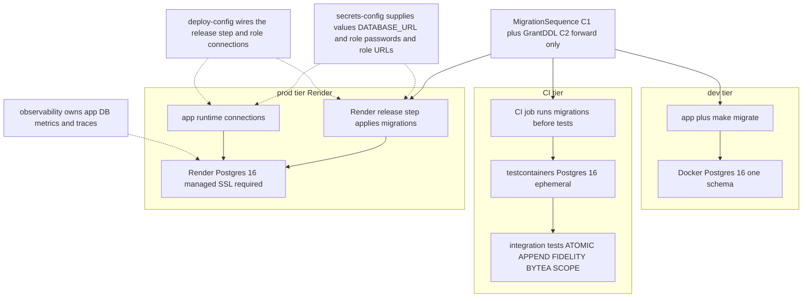

# Deployment Architecture — `database` (EPIC-6 / U15)

**Stage**: BUILD → Infrastructure Design (per-unit) · **Unit**: U15 `database` · **Date**: 2026-07-06
**Depth**: comprehensive. Built ON the frozen FD + approved `NFR-DB-*` + NFR Design (C1–C6) — re-opening none.
**SEC-3**: no credential/connection-string **values** anywhere — only variable-name **shapes**.

Companion to `infrastructure-design.md` (component→infra mapping + deferred-halves + secrets contract). This artifact
gives the **dev / CI / prod topology**, the **migration-execution flow per environment**, the **connection/SSL flow**,
**networking**, and **monitoring**, with a validated deployment-topology Mermaid + text alternative.

---

## 1. Three-tier topology (Storage + Deployment)

| Tier | Postgres provisioning | Version | Migration execution point | SSL |
|---|---|---|---|---|
| **dev** | Local **Docker Postgres** via `docker-compose.yml` (named volume, healthcheck, mapped port) | **`postgres:16`** | Compose / `make migrate` target | `disable` locally (optional) |
| **CI** | **testcontainers Postgres** — `PostgresContainer("postgres:16")`, ephemeral per run | **`postgres:16`** | Before the integration tests, against the container | container-local |
| **prod** | **Render Postgres** — managed, free-tier (Phase-2 validation deploy) | **`postgres:16`** | Render release / pre-deploy step (wired by `deploy-config`) | **`require`** |

All three tiers hold **one database + one schema** with the two co-located audit tables + `app_user` (ATOMIC-1 /
COLOC-1). `postgres:16` is pinned everywhere so dev/CI/prod share the **same major version** — dialect parity protects
replay/versioning byte-fidelity (BR-DB-6/10). **No SQLite anywhere** (DATA-5). The CI image pin matches the built
`backend/audit_store/tests/test_pg_integration.py:45` (`PostgresContainer("postgres:16")`).

---

## 2. Migration execution flow per environment

The migration sequence (C1) is **forward-only, one authoritative sequence, idempotent-apply** — model unchanged. The
**grants migration** (C2) runs as a step **within** the same sequence in **every** tier, so `audit_writer` /
`audit_reader` exist and are granted identically across dev/CI/prod (APPEND-1 real everywhere).

1. **dev** — developer runs `make migrate` (or the Compose migrate service) against the local Docker Postgres. Grants
   run with **ephemeral local** passwords substituted from the local `.env` (gitignored — `infrastructure-design.md
   §5.2`).
2. **CI** — the CI job applies the full sequence to the fresh testcontainer **before** the integration tests, so
   ATOMIC-1 / APPEND-1 / FIDELITY-1 / BYTEA-1 / SCOPE-1 all run on the **migrated** schema. Grants run with **ephemeral
   throwaway** passwords.
3. **prod** — a **Render release command / pre-deploy step** (wired by `deploy-config`) applies the sequence **before**
   the app serves traffic. Grants run with the **`AUDIT_WRITER_PASSWORD` / `AUDIT_READER_PASSWORD`** values supplied by
   `secrets-config`, substituted into the placeholder-bearing committed file at execution time (the pinned mechanism,
   `infrastructure-design.md §3.2`). The **rendered SQL is never logged**.

Migrations are **not** run at app startup (races across instances; a failed migration would block startup; the
checksum/immutability discipline prefers an explicit gated step).

---

## 3. Connection / SSL flow (runtime)

Two runtime connection surfaces, both least-privilege and role-scoped — this is what makes APPEND-1's DB-role
enforcement **real in prod** (`infrastructure-design.md §5.1`):

- **Write path** → connects **as `audit_writer`** via **`AUDIT_WRITER_URL`** (INSERT + SELECT only).
- **Auditor read surface** → connects **as `audit_reader`** via **`AUDIT_READER_URL`** (SELECT only).
- **Schema-owning / migration / admin** → the app/owner connection via **`DATABASE_URL`** (validated by C3's
  `DbUrlGuard`, `postgresql://` scheme only).

Engine config names the knobs (values from `secrets-config`): bounded `pool_size` + `max_overflow` (free-tier cap),
`pool_timeout`, **`pool_pre_ping=True`** (drop stale connections — Render free-tier recycles), and **`sslmode=require`**
on Render. The **actual runtime selection of which role-scoped connection the app uses** is **`audit-store` /
`deploy-config`'s** concern (reference-not-own) — `database` guarantees the roles exist + are granted and names the
contract.

---

## 4. Networking

Narrow + managed. On Render, the app connects to Postgres over Render's **internal / private** connection URL where
available (lower latency, not public) with **`sslmode=require`**; the **external** URL is used only for migration/admin
from CI/deploy. **No load balancer, API gateway, or custom VPC** is designed for a managed single-instance Postgres —
N/A for a schema unit (justified). All connection **values** come from `secrets-config` (SEC-3).

---

## 5. Monitoring

**Provider-level only; app telemetry deferred.**

- **Render managed Postgres metrics** (connection count, storage, CPU) are the available DB-health signal for the
  validation deploy.
- A basic **connection/health check** — the pool **`pre_ping`** + a **`SELECT 1` readiness probe**.
- **App-level DB metrics/traces + Grafana dashboards are `observability`'s (U21) concern** — referenced, not built
  here. **No demographic-derived metric** (CON-BR1).

---

## 6. Deployment-topology diagram

Mermaid validated before write against the 7 rules (alphanumeric node IDs + underscore; every label double-quoted; **no
semicolons, no bare colons, no parentheses, no special characters** in labels; balanced blocks). Text alternative
follows.

### Text alternative (always included)

- **MigrationSequence (C1) plus the GrantDDL step (C2)** — forward-only, one authoritative sequence — is applied
  identically into all three tiers: dev (`make migrate`), CI (before tests), prod (Render release step).
- **dev tier**: the app plus a `make migrate` target run against a local **Docker Postgres 16** holding one schema.
- **CI tier**: the CI job runs migrations against an **ephemeral testcontainers Postgres 16** before the integration
  tests (ATOMIC-1, APPEND-1, FIDELITY-1, BYTEA-1, SCOPE-1) execute on the migrated schema.
- **prod tier (Render)**: a Render release step applies the migrations to the managed **Render Postgres 16** (SSL
  required) before the app serves traffic; the app's runtime connections then reach the same instance.
- **`secrets-config`** (dashed, external) supplies the VALUES — `DATABASE_URL`, the role passwords, and the role-scoped
  URLs — to the prod release step and the prod app runtime (never in the repo, SEC-3).
- **`deploy-config`** (dashed, external) wires the release step and the runtime role connections.
- **`observability`** (dashed, external) owns app-level DB metrics and traces (referenced, not built here).

---

## 7. Settled items held (not re-opened)

- C1's migration **model** + C2's grant-DDL **text** unchanged — only their **execution/provisioning/connection** per
  tier is designed.
- **SEC-3**: no credential/connection-string values; the rendered grant SQL is never logged.
- **DATA-5** (`postgres:16` every tier, no SQLite), **ATOMIC-1/COLOC-1** (one co-located DB/schema per tier),
  **APPEND-1** (roles granted per tier; real in prod via the required role-scoped runtime connections).
- Reference boundaries: `secrets-config` (values + `.env` hygiene), `deploy-config` (pipeline + role-connection
  wiring), `observability` (app DB telemetry), `quality-gates` (no-SQLite CI aggregation) — named, not authored here.
- **CON-BR1** (no demographic-derived infra/metric), **advisory-only**, **no LLM** in `database`.
