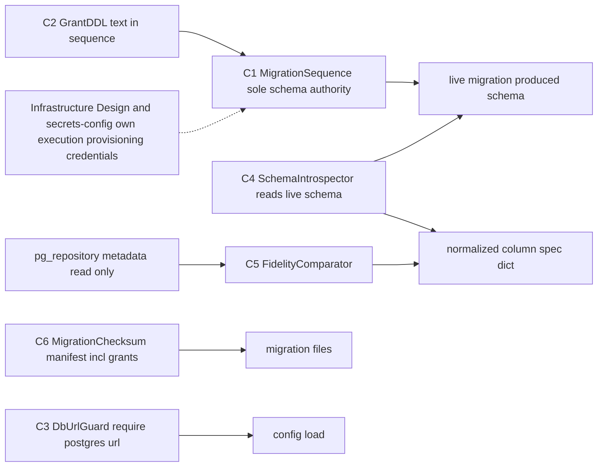

# Logical Components — `database` (EPIC-6 / U15)

**Stage**: BUILD → NFR Design (per-unit) · story-less shared infrastructure
**Unit**: U15 `database` · **Date**: 2026-07-06 · **Depth**: comprehensive.
The **6 logical components** this unit introduces (under `backend/database/`), their responsibilities, the
**no-third-schema-representation** statement, ownership, the reference-not-own check, and component→target coverage.
No credentials/provisioning anywhere (SEC-3).

---

## 1. No third schema representation (fold #1 — stated once, binding)

The **migration sequence (C1) is the SOLE authoritative schema representation** in this unit.
- `SchemaIntrospector` (C4) reads the **live migration-produced schema** — a **live read**, never a stored copy.
- `FidelityComparator` (C5) reads **`pg_repository`'s Table metadata read-only** — the **consumer's own
  declaration**, not a copy this unit maintains.
- `app_user` is validated by **minimal targeted presence assertions** (SCOPE-1 / MIGRATE-1), **not** a duplicate
  MetaData baseline.

**There is no hand-maintained third schema baseline anywhere in this unit.**

---

## 2. Components

| ID | Component | Responsibility | Backs |
|---|---|---|---|
| **C1** | **MigrationSequence** | The versioned, forward-only, immutable migration steps — the **sole schema authority** (initial-schema migration + the grants step). Applied from empty in every tier. | ATOMIC-1, COLOC-1, MIGRATE-1, BYTEA-1, SCOPE-1 (schema), APPEND-1 (via C2) |
| **C2** | **GrantDDL** | The `CREATE ROLE`/`GRANT` **text** as a **dedicated step within** the migration sequence (`audit_writer` INSERT+SELECT; `audit_reader` SELECT-only). **Text only — never executed against a deployed instance here.** | APPEND-1 |
| **C3** | **DbUrlGuard** | The pure `require_postgres_url(url)` config-load validator — raises on any non-`postgresql://` scheme. Unit-testable, no container. | DATA5-1 |
| **C4** | **SchemaIntrospector** | Reflect the **live** migration-produced schema → a **normalized column-spec dict** (`{name, type, nullable, pk, fk_target, indexed}`, base-type tokens, length/precision ignored). **Shared by MIGRATE-1 + FIDELITY-1** (single source, no duplication). | MIGRATE-1, FIDELITY-1 |
| **C5** | **FidelityComparator** | Read `pg_repository`'s Table metadata **read-only** → same-shape dict; compare to C4's over the **two audit tables**, **CHECK excluded**; drift either side fails. | FIDELITY-1 |
| **C6** | **MigrationChecksum** | The committed `{migration_filename: sha256}` manifest **including the grants file** + recompute-and-compare. | MIGRATE-2 |

**Test substrate (not a production component)**: a **testcontainers-Postgres harness** + fixtures;
`@pytest.mark.integration`, auto-skipped locally, run in CI.

---

## 3. Component-relationship diagram

Mermaid validated before write (alphanumeric node IDs + underscore; every label double-quoted; **no semicolons, no
bare colons, no parentheses, no special characters** in labels; balanced blocks). Text alternative follows.

### Text alternative (always included)
- **C1 MigrationSequence** is the sole schema authority → produces the **live migration-produced schema**.
- **C2 GrantDDL** is a text step **within** C1 (never executed here).
- **C4 SchemaIntrospector** reads the **live schema** → a **normalized column-spec dict**.
- **C5 FidelityComparator** takes C4's dict **and** the **read-only `pg_repository` metadata** → the fidelity compare
  (two audit tables, CHECK excluded).
- **C6 MigrationChecksum** hashes the **migration files including the grants file**.
- **C3 DbUrlGuard** validates the DB URL at config load.
- **Infrastructure Design + `secrets-config`** (dashed, external) own **execution / provisioning / credentials** —
  **not** this unit.

---

## 4. Reference-not-own check (in reverse)

| Concern | Owner | This unit? |
|---|---|---|
| Grant-DDL **text** authoring | **`database`** (C2, in the migration sequence) | ✅ owns the text |
| Grant-DDL **execution** on a real deployed instance | **Infrastructure Design + `secrets-config`** | ❌ **no component executes grants against a deployed instance** (tests use an ephemeral container) |
| Postgres **provisioning** / instances / pooling | **Infrastructure Design** | ❌ not here |
| **Credential / connection-string** binding | **`secrets-config`** | ❌ **no credentials anywhere** (SEC-3) |
| Migration **tool** (Alembic vs raw-SQL) | **Code-Gen / Infrastructure** | ❌ deferred (C1 is the tool-agnostic model) |
| audit-store's `pg_repository.py` | **`audit-store`** | ✅ **imported read-only** by C5 for FIDELITY-1 only; **never edited** |
| `app_user` full user/role model | **`auth-rbac`** (its own FD) | ❌ only the open-`role` skeleton substrate here |
| Rulebook-version registry | **`admin-cli`** (deferred) | ❌ reserved slot, no table |
| DB metrics / traces | **`observability`** | ❌ N/A here |

**No component owns a concern reference-not-own assigns elsewhere.** No circular dependency: `database` production
code never imports `audit_store`; only C5's **test** imports `pg_repository` metadata read-only; `audit_store` never
imports `database`.

---

## 5. Component → target coverage (no orphan)

| Target | Component(s) |
|---|---|
| NFR-DB-ATOMIC-1 | C1 (schema) + harness |
| NFR-DB-COLOC-1 | C1 (one DB/schema) |
| NFR-DB-APPEND-1 | C2 (+ C1) |
| NFR-DB-DATA5-1 | C3 (+ C1 structural types) |
| NFR-DB-MIGRATE-1 | C1 + C4 |
| NFR-DB-MIGRATE-2 | C6 |
| NFR-DB-FIDELITY-1 | C4 + C5 |
| NFR-DB-BYTEA-1 | C1 (BYTEA columns) + harness |
| NFR-DB-SCOPE-1 | C1 (app_user) + C4 (introspect absence) |
| NFR-DB-PERF-1 | measured over C1 apply/insert (observed, non-gating) |
| NFR-DB-OBS-1 | **N/A — observability-owned** (documented boundary, not an orphan) |

**All 11 targets covered.** Every component (C1–C6) backs ≥1 target; every target maps to ≥1 component or a
documented N/A boundary. No orphan.

---

## 6. Settled items held (not re-opened)
- Frozen FD (schema + BR-DB-1..14 + lifecycle) and the approved NFR targets — patterns/components realize them,
  re-opening neither.
- Migrations = sole schema authority; no third schema representation (§1). FIDELITY scope = the two audit tables
  `pg_repository` declares; `app_user` via presence assertions.
- Grant-DDL **text** owned here (C2); **execution** + provisioning + credentials = Infra + `secrets-config` (SEC-3).
- Checksum manifest includes the grants file (MIGRATE-2). Fault mechanism = duplicate-PK `IntegrityError`
  (ATOMIC-1). Type-normalization = base-type token, length/precision ignored (FIDELITY-1).
- DATA-5 / SEC-3 / SEC-4 / SEC-5 / REPLAY-1 / DET-2 / CON-BR1 held. No LLM. Reference-not-own throughout.
- **Infrastructure Design remains a distinct, REAL next stage** for this unit.
