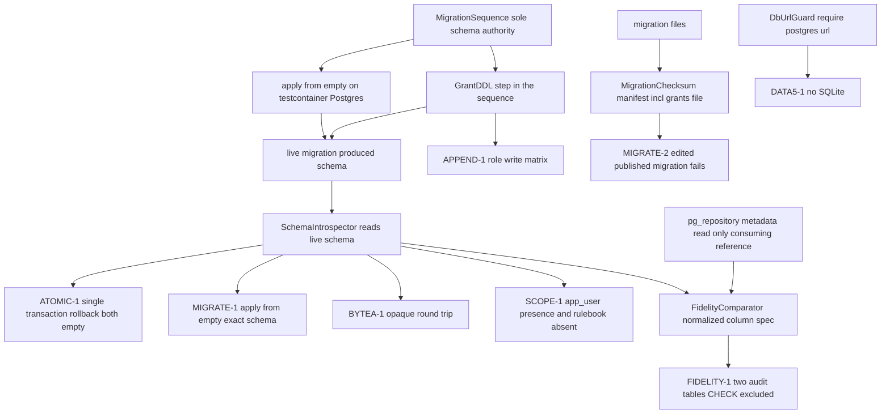

# NFR Design Patterns — `database` (EPIC-6 / U15)

**Stage**: BUILD → NFR Design (per-unit) · story-less shared infrastructure
**Unit**: U15 `database` · **Date**: 2026-07-06 · **Runtime**: Python **3.12 pinned** (D6) · **Depth**: comprehensive.
**Built ON** the frozen FD (`domain-entities.md` / `business-rules.md` / `business-logic-model.md`) + the approved
`nfr-requirements.md` — **re-opening neither**. One section per pattern, each structurally meeting its `NFR-DB-*`
target + traced. No credentials/connection strings/provisioning commands (SEC-3). **No pattern requires
Infrastructure Design's deliverables.**

> **Sole schema authority (fold #1, stated once, upheld everywhere below)**: the **migration sequence is the ONLY
> authoritative schema representation** in this unit. `SchemaIntrospector` reads the **live migration-produced
> schema** (a live read, never a stored copy). `FidelityComparator` additionally reads `pg_repository`'s Table
> metadata **read-only** (the consumer's own declaration). **No third, hand-maintained schema baseline exists
> anywhere in this unit.**

---

## §1 — SingleTransactionCoLocationPattern → NFR-DB-ATOMIC-1, NFR-DB-COLOC-1

- **Pattern**: open **one connection** to the single Postgres database, `BEGIN` **one** transaction, INSERT
  `audit_record` then INSERT `applicant_profile_snapshot`; on any fault the whole transaction **ROLLBACK**s → both
  rows absent. Both tables share **one database + one schema** reachable on that one connection (COLOC-1) — which is
  precisely what makes the single-transaction both-or-neither valid (ATOMIC-1).
- **Concrete fault mechanism (fold #3)**: the injected fault is a **duplicate primary key on the 2nd insert**, which
  raises a **DB-enforced `IntegrityError`** — **deterministic** (no timing/randomness), the **same proven mechanism
  audit-store already uses** (`test_fault_mid_transaction_rolls_back_both_rows`). The test asserts the error via
  **`pytest.raises(IntegrityError)`** and then runs a **follow-up query confirming BOTH tables are empty** (0 rows).
- **Independence**: inserts run via **Table handles reflected from the migration-produced schema** — **not** the
  `pg_repository` import, **not** audit-store's interim TEST DDL.
- **Tier**: integration (testcontainers Postgres, `@pytest.mark.integration`, auto-skip locally, CI).

## §2 — GrantDDLInMigrationPattern → NFR-DB-APPEND-1

- **Pattern**: the role grants — `CREATE ROLE audit_writer …; GRANT INSERT, SELECT ON <audit tables> TO audit_writer;
  CREATE ROLE audit_reader …; GRANT SELECT ON <audit tables> TO audit_reader;` — are authored as a **dedicated step
  in the migration sequence** (a grants migration applied after the tables migration). The test **applies the full
  sequence incl. grants** onto the testcontainer, then **connects as each role** and asserts the write matrix:
  - `audit_writer`: INSERT ✓, SELECT ✓, **UPDATE raises**, **DELETE raises**.
  - `audit_reader`: SELECT ✓, **INSERT raises**, **UPDATE raises**, **DELETE raises**.
- **Ownership boundary (fold #1 / SEC-3)**: the grant-DDL **text** is **this unit's Code-Gen deliverable** (part of
  the migration sequence) — so APPEND-1 is **writable/runnable here**. Infrastructure Design owns only
  **per-environment execution** + credential binding; **no pattern executes grants against a real deployed
  instance** (the test applies them to an **ephemeral** container).
- **Tier**: integration (real Postgres role connections).

## §3 — DbUrlGuardPattern + PostgresOnlyTypePattern → NFR-DB-DATA5-1

- **DbUrlGuardPattern**: a **pure function** `require_postgres_url(url) -> url` that parses the URL scheme and
  **raises on any non-`postgresql://` scheme** (SQLite rejected), invoked at config load. **Unit-tested**
  (`postgresql://` → ok; `sqlite://` → raises; another scheme → raises) — **no container, writable today**, a
  `database`-unit deliverable (no Infra dependency).
- **PostgresOnlyTypePattern**: the schema's `BYTEA` / `TIMESTAMPTZ` / DB-roles make the migration DDL **structurally
  unable to apply on SQLite** (a structural/integration assertion). Repo-wide "no SQLite anywhere" CI aggregation is
  **`quality-gates`**' concern (referenced, not owned).
- **Tier**: unit (guard) + structural/integration (Postgres-only types).

## §4 — ForwardOnlyMigrationSequencePattern → NFR-DB-MIGRATE-1

- **Pattern**: an **ordered, immutable, forward-only** migration sequence; **apply-from-empty** against a fresh
  Postgres → **introspect** → assert the exact expected schema. **Forward-only**: a fresh apply is always the source
  of truth (no down-migration relied upon).
- **Oracle layering (fold #1)**: for the **two audit tables**, the expected shape is the `pg_repository` metadata
  comparison (that is FIDELITY-1's job, §6 — MIGRATE-1 leans on the same `SchemaIntrospector`). For **`app_user`**
  (which `pg_repository` does **not** declare), MIGRATE-1/SCOPE-1 use **minimal targeted presence assertions** ("the
  `app_user` table exists with columns `user_id` / `subject` / `role`") — a **test oracle, NOT a duplicate
  authoritative MetaData**.
- **Tier**: integration (fresh container, introspect after apply).

## §5 — ChecksumImmutabilityPattern → NFR-DB-MIGRATE-2

- **Pattern**: a **committed manifest** `{migration_filename: sha256}` covering **every published migration**; the
  test **recomputes** the hash of each migration file and compares to the manifest — an **edited published file** →
  changed hash → **fail**. A **new** migration is an **append** to the manifest (allowed); editing a published one is
  not (mirrors the append-only discipline: change = a new migration, never a mutation).
- **Grants file covered (fold #2)**: the manifest **explicitly includes the grants migration file** alongside the
  schema migrations. An **edited `GRANT`/`CREATE ROLE` statement** — e.g. a **silently weakened `audit_reader`
  permission** (adding INSERT) — is caught **identically** to an edited table migration. This ties **append-only /
  SEC-4 integrity** to the immutability check (a security-relevant regression closed).
- **Tier**: unit (hash files; no container).

## §6 — SchemaIntrospectionComparatorPattern → NFR-DB-FIDELITY-1

- **Pattern**: `SchemaIntrospector` (C4) reads the **live migration-produced schema** and extracts a **normalized
  column-spec dict** per table; `FidelityComparator` (C5) reads **`pg_repository`'s Table metadata read-only** and
  extracts the same-shape dict; the two are compared. **Drift on EITHER side fails** (a migration that changes a
  column, OR a `pg_repository.py` edit expecting a column the schema lacks).
- **Comparison scope (fold #1)**: **exactly the two audit tables `pg_repository` declares** — `audit_record` +
  `applicant_profile_snapshot`. **`app_user` is NOT in the FIDELITY set** (it is not in `pg_repository`; it is
  covered by SCOPE-1/MIGRATE-1 presence assertions, §4 / §8).
- **Compared fields**: **`{name, type, nullable, pk, fk_target, indexed}`** — **CHECK constraints EXCLUDED** (so an
  optional `action`/`status` CHECK, and `role`'s absence of a CHECK, never cause a false mismatch).
- **Type-normalization (fold #4)**: map both sides to **common canonical BASE-TYPE TOKENS** — `LargeBinary`/`BYTEA`
  → `bytea`; `String`/`VARCHAR`/`character varying` → `string`; `DateTime(timezone=True)`/`TIMESTAMPTZ` →
  `timestamptz`. **Length/precision parameters are ignored** (`pg_repository` uses **unparameterized `sa.String`**,
  so a length difference must **not** cause a false mismatch). The schema uses **only** these three types (verified
  against `domain-entities.md §2`) — **no column type falls outside the mapping**.
- **Direction of truth**: `database` migrations = authority; `pg_repository` metadata = consuming reference; this
  test = **one-directional consistency guard** (read-only import; no production cross-import; no circular
  dependency).
- **Tier**: integration (introspect live schema) + read-only consuming-metadata import.

## §7 — OpaqueRoundTripProbePattern → NFR-DB-BYTEA-1

- **Pattern**: write an **adversarial byte-probe set** into the `rule_results` / `profile_canonical` `BYTEA`
  columns, read back, assert **byte-identical**; recompute `content_hash` over the readback → matches. Proves **no
  DB-side normalization** (REPLAY-1 / DET-2).
- **The five-case adversarial set** (bytes a `JSONB` column would re-order/re-encode): **(i)** non-canonical JSON key
  order; **(ii)** differing number formatting (`1.0` vs `1`, trailing zeros); **(iii)** extra whitespace; **(iv)**
  non-UTF8 / high bytes; **(v)** empty bytes. Plus a realistic case: the **actual CANON-SER output** of a sample
  profile/report.
- **Independence**: inserts driven off reflection of the migration-produced schema.
- **Tier**: integration (real Postgres round-trip).

## §8 — ExtensibleRoleInsertPattern + DeferredTableAbsencePattern → NFR-DB-SCOPE-1

- **ExtensibleRoleInsertPattern**: insert an `app_user` row with a **novel `role` value (`admin`)** and assert it
  **succeeds** — the **negative property** proving `role` carries **no closing CHECK** (fold #1 of the FD; keeps the
  dimension open for auth-rbac).
- **DeferredTableAbsencePattern**: introspect the schema and assert **no rulebook-registry table exists** (the
  deferred slot has no columns).
- **Guard**: **no pattern asserts a CHECK EXISTS on `action`/`status`** (optional per BR-DB-9 — "may", not "must");
  FIDELITY-1 excludes CHECK from its comparison (§6). **Nothing about auth-rbac authn/permissions or rules-engine
  evaluation is tested** (reference-not-own, in reverse).
- **Tier**: integration (app_user insert) + structural (rulebook absent).

## §9 — ObservedSoftBudgetPattern → NFR-DB-PERF-1 (+ NFR-DB-OBS-1 N/A)

- **Pattern**: measure migration-apply + insert latency and **report against a soft budget, non-gating** (schema
  infra — no hard SLO). **OBS-1 = N/A** — DB metrics/traces are **`observability`'s** concern (referenced). No
  demographic-derived metric (CON-BR1).
- **Tier**: observed (non-gating) / N/A.

---

## §10 — Pattern-integration diagram

Mermaid validated before write (alphanumeric node IDs + underscore; every label double-quoted; **no semicolons, no
bare colons, no parentheses, no special characters** in labels; balanced blocks). Text alternative follows.

### Text alternative (always included)
- **MigrationSequence** (sole schema authority) is **applied from empty** on a testcontainer and includes the
  **GrantDDL** step → together they produce the **live migration-produced schema**.
- **SchemaIntrospector** reads that live schema and backs: **ATOMIC-1** (single-transaction rollback → both empty),
  **MIGRATE-1** (apply-from-empty exact schema), **BYTEA-1** (opaque round-trip), **SCOPE-1** (app_user presence +
  rulebook absent).
- The **GrantDDL** step backs **APPEND-1** (role write matrix on real roles).
- **FidelityComparator** takes the introspector's normalized column-spec **and** the **read-only `pg_repository`
  metadata** (consuming reference) → **FIDELITY-1** over exactly the two audit tables, CHECK excluded.
- **MigrationChecksum** hashes the **migration files including the grants file** → **MIGRATE-2** (edited published
  migration fails).
- **DbUrlGuard** (`require_postgres_url`) backs **DATA5-1** (no SQLite).

---

## §11 — Traceability (pattern → target → tier)

| Pattern | Target(s) | Tier |
|---|---|---|
| SingleTransactionCoLocationPattern | ATOMIC-1, COLOC-1 | integration |
| GrantDDLInMigrationPattern | APPEND-1 | integration |
| DbUrlGuardPattern + PostgresOnlyTypePattern | DATA5-1 | unit + structural |
| ForwardOnlyMigrationSequencePattern | MIGRATE-1 | integration |
| ChecksumImmutabilityPattern | MIGRATE-2 | unit |
| SchemaIntrospectionComparatorPattern | FIDELITY-1 | integration |
| OpaqueRoundTripProbePattern | BYTEA-1 | integration |
| ExtensibleRoleInsertPattern + DeferredTableAbsencePattern | SCOPE-1 | integration + structural |
| ObservedSoftBudgetPattern | PERF-1 (+ OBS-1 N/A) | observed / N/A |

All 11 approved `NFR-DB-*` targets covered; no orphan.
