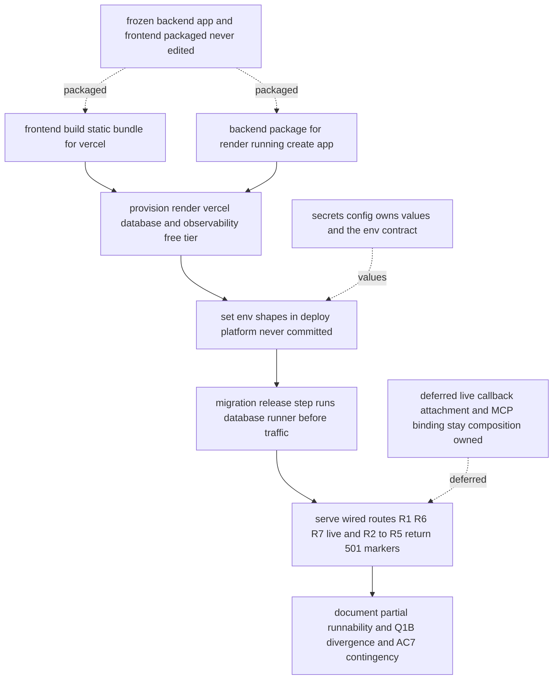

# Business Logic Model — `deploy-config` (U23, EPIC-6, Phase 2)

**Stage**: BUILD → Functional Design (per-unit) · **Unit**: U23 `deploy-config` · EPIC-6 · **Phase 2** · **Depth**: lighter ·
**Date**: 2026-07-19 · Story **US-PLAT-11**.
**Nature**: the **deploy lifecycle** of a packaging/config unit — no domain logic. Built on **Q1–Q5 = A** and **DEP-FD-Fold-1..3**
(plan §4.5). **NO code in this stage.**

---

## 1. The deploy lifecycle (validation/staging, free-tier)

1. **Build** — the **frontend** is bundled into a **static bundle** (an entry mounting the frozen `App.jsx`) for Vercel; the
   **backend** is packaged to run the frozen `backend/app` `create_app()`/`app` on Render (BR-DEP-2/-3).
2. **Provision** — Render backend service + Vercel static project + the free-tier `database` + the observability **deployment half**
   (Prometheus/Grafana/Langfuse free-tier), all **free-tier** (BR-DEP-5/-8).
3. **Configure env** — set the variable-name **shapes** (Phase-1 required + Phase-2 reserved) **in the deploy platform**, never
   committed (BR-DEP-4); the langfuse SDK reads `LANGFUSE_*` from env, but **consuming** them is composition's (set-not-consume,
   DEP-FD-Fold-1).
4. **Release** — the **migration release step** runs the `database` runner **before** traffic (BR-DEP-8; the runner is database's).
5. **Serve** — **R1/R6/R7 live**; **R2–R5 return their honest `501` markers** (BR-DEP-6); R6/R7 enforce `READ_AUDIT` **as-built**
   (the Q1-B divergence, deployed not resolved — DEP-FD-Fold-3).
6. **Document** — the deploy doc records the **partial-runnability** (live vs `501` routes), the **Q1-B divergence**, and that
   **AC-7's 100%-trace audit is provisioned-for but not yet dischargeable** (contingent on the deferred composition-owned live
   binding — DEP-FD-Fold-2). Nothing is over-claimed (BR-DEP-7).

## 2. Invariants
- **INV-DEP-FROZEN**: every step **packages/configures** the frozen system; **no frozen unit and no composition-root file is edited**
  (BR-DEP-1).
- **INV-DEP-SEC3**: no secret **value** is committed — only shapes; values live in the deploy platform (BR-DEP-4).
- **INV-DEP-HONEST**: the deploy claims **only** what is actually working — the wired slice + a proven pipeline — and documents every
  gap (R2–R5, Q1-B, AC-7 contingency) (BR-DEP-6/-7).
- **INV-DEP-SCOPE**: no domain route, no live callback/MCP integration code, no Q1-B resolution — all separately owned
  (BR-DEP-6/-8/-9).

---

## 3. Lifecycle diagram (validated — rectangle-only, alphanumeric IDs, quoted labels, no special characters)

### Text alternative (always included)
- The **frozen backend app and frontend** are **packaged, never edited**: the frontend into a **static bundle for Vercel**, the
  backend into a **Render service running `create_app`**.
- Both feed **provision** — Render + Vercel + database + observability, all **free-tier**.
- **Provision** flows to **set env shapes** in the deploy platform (never committed); **`secrets-config`** supplies the **values**.
- Env flows to the **migration release step** (running the database runner before traffic), then to **serve** — **R1/R6/R7 live**,
  **R2 through R5 return `501` markers**.
- **Serve** flows to **document** — partial-runnability, the **Q1-B divergence**, and **AC-7's contingency**.
- The **deferred live callback attachment and MCP binding** (composition-owned) are shown **not wired here** — they touch **serve**
  only once composition discharges them.

## 4. Invariant self-check
- Every node is a **packaging/config** step — none is domain logic (INV-DEP-SCOPE ✓).
- `frozen` connects only via **packaged** (dashed) — no edit edge (INV-DEP-FROZEN ✓).
- `secrets` connects only via **values** into `env` — no value is in a committed artifact (INV-DEP-SEC3 ✓).
- `serve` reaches `document`, which records every gap — nothing over-claimed (INV-DEP-HONEST ✓).
- `deferred` is a dashed **deferred** edge, never a solid wiring edge (INV-DEP-SCOPE ✓).
