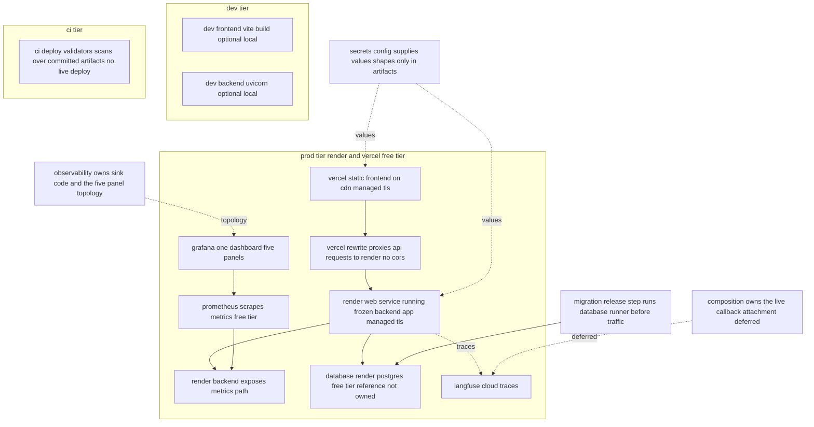

# Deployment Architecture — `deploy-config` (U23, EPIC-6, Phase 2)

**Stage**: BUILD → Infrastructure Design (per-unit) · **Unit**: U23 `deploy-config` · EPIC-6 · **Phase 2** · **Date**: 2026-07-19
**Depth**: comprehensive. Built ON the frozen FD + approved `NFR-DEP-*` + NFR Design (**C-DEP-1..5**) — re-opening none.
**SEC-3**: no key/endpoint/connection **values** anywhere — only variable-name **shapes**. **No frozen unit edited.**

Companion to `infrastructure-design.md` (component→infra mapping + deferred-halves topology + secrets contract). This artifact gives
the **dev / CI / prod topology**, the **request/deploy flow**, the **frontend↔backend connectivity**, the **`/metrics` scrape path**,
and the `secrets-config` / `database` / `observability` / composition boundaries — with a validated deployment-topology Mermaid +
text alternative. Answers **Q1–Q9 (all A)** + folds **INFRA-DEP-Fold-1..3**.

---

## 1. Three-tier topology (Deployment)

| Tier | Frontend | Backend | Live sinks / DB |
|---|---|---|---|
| **dev** | **optional/local** — Vite dev build, developer-run | **optional/local** — `uvicorn backend.app.main:app` | local Docker Postgres (`database`'s dev tier); observability optional |
| **CI** | **no live deploy** — the `deploy_validators` scans run over committed artifacts (`NFR-DEP-*`) | **no live deploy** — in-process `openapi()` introspection only (ROUTES-1) | **NO** live deploy/DB/network (the 31 skips + 5 Docker errors unchanged) |
| **prod** | **Vercel** free-tier static build on CDN, managed TLS | **Render** free-tier Web Service running the frozen `backend.app.main:app`, managed TLS | `database`'s Render Postgres free-tier; Prometheus + Grafana + Langfuse Cloud free-tier |

**Free-tier everywhere** (validation/staging, distinct from Phase-3 production per OOS-4). **CI runs no live deploy** — deploy-config's
tier-U surface is config validation over committed artifacts.

---

## 2. Request / deploy flow (prod)

1. **Deploy** — Vercel builds the frontend (`npm run build` → `dist`, Vite) and serves it on its CDN; Render builds the backend
   (`pip install -r requirements.txt`) and runs the frozen `backend.app.main:app`. The **migration release step** runs `database`'s
   sequence **before** the Render service serves traffic (env set → migrate → traffic).
2. **Request** — the browser loads the Vercel static frontend; the frontend's API calls hit **same-origin `/api/*`** paths that the
   **Vercel rewrite proxies** to the Render backend (**no CORS**, no backend edit — Fold-1). The backend answers **R1/R6/R7** live and
   **R2–R5** with their `501` markers.
3. **Observe** — the Render backend exposes `/metrics`; **Prometheus scrapes** it; **Grafana** renders the one five-panel dashboard;
   the backend would send traces to **Langfuse Cloud** once the composition-owned callback binding lands (**AC-7 provisioned-for, not
   discharged**).

---

## 3. Frontend↔backend connectivity (Networking) — the Vercel rewrite/proxy

The Vercel static frontend and the Render backend are **different origins**. The frozen `backend/app` has **no CORS middleware**, and
adding it would **edit the CLOSED composition root** (BR-DEP-1 violation). Resolution: a **`vercel.json` rewrite** proxies the
frontend's `/api/*` requests to the Render backend — the **browser makes same-origin requests**, so **no CORS is needed and the
backend is not edited**. The rewrite **destination** is the Render backend's **public host** — a **non-secret build/env shape**
(`RENDER_BACKEND_URL`), set in the Vercel project env, never committed (Fold-1; a public host is not a credential SEC-3 flags).

---

## 4. Migration release step + DB (Storage-reference)

The Postgres is **`database`'s** Render free-tier `postgres:16` (referenced, not re-provisioned). deploy-config wires the
**connection env** (`DATABASE_URL` + role-scoped `AUDIT_WRITER_URL` / `AUDIT_READER_URL`, shapes only) and the **Render release /
pre-deploy step** running `database`'s forward-only, idempotent migration sequence (grants substituted from `secrets-config`) **before
traffic**. Ordering: **env set → migration release step → serve** (Fold-2 — the doc's `ENV-SHAPES` list and the release step's
prerequisites name the same required set).

## 5. Monitoring (the observability deployment half)

- **Prometheus** scrapes the Render backend's **`/metrics`** path (Grafana Cloud agent or Render-hosted, free-tier), pull-based.
- **The Grafana dashboard-as-code file** — **one dashboard, five panels 1:1 to `observability`'s frozen metrics** (decision latency ·
  decisions by recommendation type · rule-evaluation duration · LLM-call errors · outlier-flag rate), datasource = Prometheus,
  demographic-free (Fold-3 — observability owns the panel topology; deploy-config owns the committed file that realizes it, no drift).
- **Langfuse Cloud** project + `LANGFUSE_*` env; the **live callback attachment stays composition's** (AC-7 provisioned-for, not
  discharged).

## 6. Deployment-topology diagram

Mermaid validated before write against the 7 rules (alphanumeric node IDs + underscore; every label double-quoted; **no hyphens, no
semicolons, no colons, no parentheses, no special characters** in labels; balanced blocks; rectangle-only). Text alternative follows.

### Text alternative (always included)
- **dev tier**: an optional local Vite frontend build + a local `uvicorn` backend; observability optional.
- **CI tier**: **no live deploy** — the `deploy_validators` scans run over the committed artifacts (and ROUTES-1's in-process
  `openapi()` introspection); the 31 skips + 5 Docker errors stay unchanged.
- **prod tier (Render + Vercel, free-tier)**: the **Vercel static frontend** serves the bundle; its **rewrite proxies** `/api`
  requests to the **Render backend** (no CORS); the Render backend reaches **`database`'s Postgres**, exposes **`/metrics`** (which
  **Prometheus scrapes** and **Grafana** renders as one five-panel dashboard), and would send **traces to Langfuse Cloud**.
- **migration release step** (external) runs `database`'s runner against the Postgres **before traffic**.
- **`secrets-config`** (dashed, external) supplies the **values** to the Render + Vercel envs — never in the repo (SEC-3).
- **`observability`** (dashed, external) owns the sink code + the **five-panel topology** the Grafana file realizes.
- **composition** (dashed, external) owns the **live callback attachment** — deferred; AC-7 is provisioned-for, not discharged.

---

## 7. Settled items held (not re-opened)
- The four config artifacts (C-DEP-2..5) are realized as free-tier Render/Vercel topology; C-DEP-1 is CI/test logic. `database`'s +
  `observability`'s Infra passes are **referenced, not re-opened**.
- **BR-DEP-1**: no frozen unit edited; the **CLOSED composition root packaged, never edited** (the Vercel rewrite keeps CORS out of
  the backend). **SEC-3**: no key/endpoint/connection values — shapes only. **CON-BR1**: no demographic panel/label.
- **AC-7 provisioned-for, not discharged**; the **Q1-B divergence** deployed as-built + documented; the **`OBS-SINK-DEFERRED` code
  half + `MCP-TRANSPORT-DEFERRED`** composition/application-owned.
- **Free-tier only**; **validation/staging**, not production (OOS-4). **No new dependency**; `requirements.txt` / `package.json` NOT
  edited. **tier-B N/A + NOT authorized**; the **`audit_store` Docker-guard gap untouched**; **no other unit started**; the **23-unit
  decomposition unchanged**.
