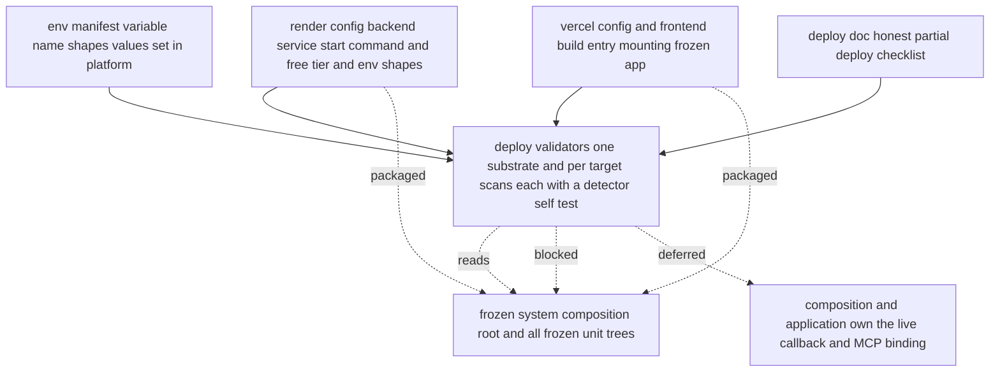

# Logical Components — `deploy-config` (U23, EPIC-6, Phase 2)

**Stage**: BUILD → NFR Design (per-unit) · **Unit**: U23 `deploy-config` · EPIC-6 · **Phase 2** · **Depth**: lighter ·
**Date**: 2026-07-19.
**Built ON** the frozen FD + the eleven `NFR-DEP-*` + the patterns **`P-DEP-1..11`** (`nfr-design-patterns.md`) — re-opening none.
The **five logical components** (one validator + four config artifacts) with responsibilities/ownership stated **honestly per their
declarative vs validator-logic nature**. Answers **Q1–Q3 (all A)** + folds **NFR-ND-DEP-Fold-1..3**.
**Module/layout is OPEN** (DEP-D8) — the config filenames + the validator file home are a **Code-Gen decision**; NFR Design pins the
**component set + responsibilities + the scan substrate shape**, not the paths.

---

## 1. Components

### C-DEP-1 `deploy_validators` — the scan logic (the one plausibly-Python component) — P-DEP-1..11
**Kind**: validator logic. **Responsibility**: **one shared scan substrate + per-target scan functions, each with its detector
self-test** (Q2-A — the sibling `StructuralGuard`/`structural.py` shape adapted). **No LLM. No frozen edit. Owns no domain logic.**

```text
deploy_validators  (file home a Code-Gen decision — DEP-D8)
  substrate:  committed-artifact enumeration · pathlib prefix helpers · text/regex secret+token scanners ·
              pyyaml/json parse helpers · create_app().openapi() route reader · detector-self-test harness
  per-target scan functions (each + a detector self-test, Req-Fold-3):
    scan_no_frozen_edit()        -> NFR-DEP-NOEDIT-1   (P-DEP-1)
    scan_no_secret_value()       -> NFR-DEP-SEC3-1     (P-DEP-2)
    check_route_table()          -> NFR-DEP-ROUTES-1   (P-DEP-3, in-process openapi, no server/DB/env)
    check_doc_tokens()           -> NFR-DEP-DOC-1      (P-DEP-4)
    check_build_presence()       -> NFR-DEP-BUILD-1a   (P-DEP-5a; the deploy-time fact is named-not-tested)
    check_boot_presence()        -> NFR-DEP-BOOT-1a    (P-DEP-5a; the deploy-time fact is named-not-tested)
    scan_free_tier()             -> NFR-DEP-FREETIER-1 (P-DEP-6)
    scan_scope_boundary()        -> NFR-DEP-SCOPE-1    (P-DEP-7)
    validate_config_format()     -> cross-cutting      (P-DEP-8)
    assert_no_verdict()          -> NFR-DEP-ADVISORY-1 (P-DEP-9)
```

**By-construction**: the substrate reads **committed artifacts only** (no live deploy/DB/network); `check_route_table` imports the
production `backend.app.main` **read-only** to introspect (import-to-read ≠ edit — NFR-ND-DEP-Fold-3); every scan carries a detector
self-test (P-DEP-11).

### C-DEP-2 `render.yaml` — the Render backend service config **[config artifact (declarative); filename/home a Code-Gen decision, DEP-D8]**
**Kind**: config artifact. **Responsibility**: the Render service — a **start command** running the frozen `backend.app.main:app`, a
**free-tier plan**, the **env shapes** (Phase-1 required + Phase-2 reserved), and the **migration release step** (the `database`
hand-off). **Validated by**: BOOT-1 (presence — P-DEP-5a) · FREETIER-1 (P-DEP-6) · format (P-DEP-8) · SEC3-1 (no value — P-DEP-2).

### C-DEP-3 `vercel.json` + the frontend build entry — the Vercel static build **[config artifact (declarative); home a Code-Gen decision]**
**Kind**: config artifact + build entry. **Responsibility**: the Vercel static-frontend build — `vercel.json` (build command, output
dir, free-tier) + an `index.html` + a `main` entry **mounting the frozen `App.jsx`** + a `build` script producing the static bundle
(the browser-runnability Scope-A §9 deferred here). **Validated by**: BUILD-1 (presence + `App.jsx` reference — P-DEP-5a) · FREETIER-1
· format (P-DEP-8). The **frozen `App.jsx` is composed, never edited** (P-DEP-1).

### C-DEP-4 env manifest — the variable-name shapes **[config artifact (declarative); home a Code-Gen decision]**
**Kind**: config artifact. **Responsibility**: an `.env.example`-style manifest of the variable-name **shapes** the deploy sets —
Phase-1 required (`DATABASE_URL`, `AUDIT_WRITER_URL`, `AUDIT_READER_URL`, `AUDIT_WRITER_PASSWORD`, `AUDIT_READER_PASSWORD`,
`GEMINI_API_KEY`) + Phase-2 reserved (`LANGFUSE_*`, `ANTHROPIC_API_KEY`, `OLLAMA_HOST`). **Values are set in the deploy platform,
never committed** (SEC-3). **Validated by**: SEC3-1 (no value — P-DEP-2) · BOOT-1 (the six required shapes listed — P-DEP-5a).

### C-DEP-5 deploy doc — the honest partial-deploy README **[config artifact (declarative); home a Code-Gen decision]**
**Kind**: config artifact (documentation). **Responsibility**: the checklist-complete deploy documentation — the **live-vs-`501`
route split**, the **Q1-B divergence**, **AC-7's contingency**, **free-tier**, and the **env-shape list** — each carrying its required
marker token. **Validated by**: DOC-1 (token-set completeness — P-DEP-4).

---

## 2. Component-relationship diagram (validated — rectangle-only, alphanumeric IDs, quoted labels, no special characters)



### Text alternative (always included)
- The four **config artifacts** — `render config`, `vercel config + frontend build entry`, `env manifest`, `deploy doc` — flow into
  the **deploy validators** (one substrate + per-target scans, each with a detector self-test).
- **No-edit is a visible structural property**: the validators **read** the **frozen system** (dashed **reads** — ROUTES-1's
  in-process `openapi()`), with a **blocked** dashed edge showing they **never write** it; `render config` and `vercel config` +
  build entry **package** the frozen system (dashed **packaged**), never editing it (the frozen `App.jsx` / `backend.app.main` are
  composed).
- The dashed **deferred** edge shows the live callback attachment + MCP binding stay **composition/application-owned**, not U23's.

---

## 3. Reference-not-own check — **three distinct categories, kept separate**

| # | Category | Members | Discipline |
|---|---|---|---|
| **1** | **Frozen system — packaged/read, never edited** | the composition root `backend/app/**` + `frontend/src/app/**` · the 17 P1 + U18/U19/U21 trees | ROUTES-1 **reads** `backend.app.main` in-process (import-to-read ≠ edit); the build entry **mounts** the frozen `App.jsx`; **no write** to any frozen path (NOEDIT-1) |
| **2** | **Config artifacts — U23-owned** | C-DEP-2..5 (`render.yaml` · `vercel.json`+entry · env manifest · deploy doc) | authored by U23 at Code-Gen; **filenames/home a Code-Gen decision** (DEP-D8); the only U23-authored deliverables |
| **3** | **Deferred to composition/application** | the live `langfuse` **callback attachment** + per-node passthrough · the **MCP transport binding** | **NOT U23's** (DEP-FD-Fold-1) — guarded by SCOPE-1; U23 sets env, never writes the consuming code |

**Edits no frozen unit; imports the composition root read-only for introspection only; owns only declarative config. Adds no new
dependency; adds no LLM/recommendation path; wires no domain route.**

## 4. Component → target coverage (no orphan)

| Component | `NFR-DEP-*` targets | Patterns |
|---|---|---|
| **C-DEP-1 `deploy_validators`** | NOEDIT-1 · SEC3-1 · ROUTES-1 · DOC-1 · BUILD-1a · BOOT-1a · FREETIER-1 · SCOPE-1 · ADVISORY-1 (+ format, detector substrate) | P-DEP-1..11 |
| **C-DEP-2 `render.yaml`** | BOOT-1 (presence) · FREETIER-1 · SEC3-1 | P-DEP-5, 6, 2, 8 |
| **C-DEP-3 `vercel.json` + build entry** | BUILD-1 (presence) · FREETIER-1 · SEC3-1 | P-DEP-5, 6, 2, 8 |
| **C-DEP-4 env manifest** | SEC3-1 · BOOT-1 (shapes listed) | P-DEP-2, 5 |
| **C-DEP-5 deploy doc** | DOC-1 | P-DEP-4 |
| *(named deploy-time facts)* | BUILD-1b · BOOT-1b · PERF-1 · SEC-1 | P-DEP-5b, 10, 9 |

**All eleven `NFR-DEP-*` covered; no orphan.** BUILD-1/BOOT-1's **presence half** maps to C-DEP-3/C-DEP-2; their **deploy-time-fact
half** is named-not-tested (NFR-ND-DEP-Fold-1) — honest, not a gap. C-DEP-1 carries the machine-checked half of every scan target.

## 5. Settled items held (not re-opened)
- **Q1-A**: config artifacts are first-class components, tagged declarative + home-open (DEP-D8). **Q2-A**: one `deploy_validators`
  substrate + per-target scans each with a detector self-test. **Q3-A**: one P-DEP-5 carrying both BUILD-1/BOOT-1 halves visibly
  distinct.
- **Deferred to Infrastructure Design (comprehensive)**: the actual Render/Vercel topology + build commands + env manifest contents +
  migration release step + observability scrape/dashboard config. **Deferred to Code-Gen**: the config filenames, the validator file
  home, the exact token literals.
- **No new dependency** (`pyyaml` floored+installed; stdlib `json`/`ast`/`pathlib`); **no frozen unit edited**; the CLOSED composition
  root untouched (read-only introspection only); **tier-B N/A + NOT authorized**; the **`audit_store` Docker-guard gap untouched** (31
  skips + 5 Docker errors to stay unchanged); **no other unit started**; the **23-unit decomposition unchanged**.
