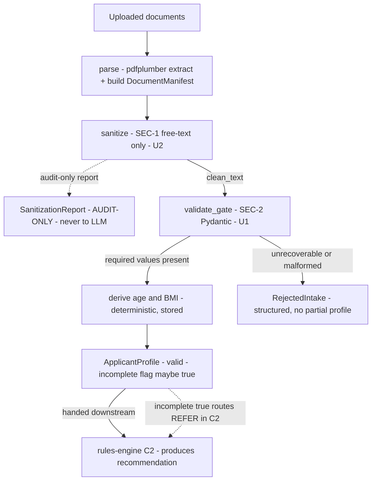

# Business Logic Model — `intake` + `document-sanitizer`

**Stage**: BUILD → Functional Design (per-unit) · cluster-FD-first unit 1 of 4
**Units**: U1 `intake` · U2 `document-sanitizer`
**Date**: 2026-07-03
**Scope**: Pipeline logic, the sanitizer neutralization algorithm, the SEC-1 forensic invariant,
and happy/unhappy flows aligned to `services.md §6` Scenario-1. Technology-agnostic.

---

## 1. Pipeline overview — `parse → sanitize → gate`

The C1 intake pipeline is three ordered stages across two units. Frozen contracts
(`component-methods.md`): `parse(documents) -> ApplicantProfile`, `sanitize(raw_text) ->
SanitizedText`, `validate_gate(extracted) -> ApplicantProfile | RejectedIntake`.

Mermaid validated before write (alphanumeric node IDs; labels quoted where punctuated; **no bare
parentheses, no semicolons** in labels; balanced brackets; no reserved-word `end` node). Text
alternative follows.



### Text alternative (always included)

1. **parse** (`intake` module, pdfplumber): extract text and structured fields from each uploaded
   document; build the `DocumentManifest` with a four-state `status` and a `content_hash` per
   expected type (salary slip, bank statement, medical questionnaire).
2. **sanitize** (`document-sanitizer`, SEC-1): neutralize injection patterns in **free-text fields
   only**; emit `SanitizedText` (`clean_text` + an **audit-only** `SanitizationReport`).
3. **validate_gate** (`intake`, SEC-2): validate the **sanitized** draft. If a required primitive
   **value** is missing/unrecoverable or input is malformed ⇒ **`RejectedIntake`** (no partial
   profile). Otherwise **derive** `age`/`bmi` deterministically, set `incomplete` if any optional
   operand/document is absent, and emit a valid **`ApplicantProfile`**.
4. The profile is handed to **`rules-engine`**, which produces the recommendation; an `incomplete`
   profile is routed to **REFER** by C2 — **intake never recommends** (CON-BR2).

---

## 2. Stage logic

### 2.1 `parse` (intake)
- Per document: extract text + structured fields (pdfplumber); compute `content_hash` of the
  parsed bytes and bind the documents into **one coherent applicant set** by hash (failure mode #2
  retrieval-miss guard). The stable `application_id` is **not** known yet at parse — it is
  **system-assigned when the gate admits the profile** (§2.3), and the content hashes are
  associated with it at that point.
- Populate the `DocumentManifest`: `parsed` on success, `unparseable` on parse failure, `missing`
  for any expected type not supplied. Parsing **never** raises to the caller — a parse failure is
  recorded as `unparseable` and decided at the gate.
- Assemble a draft field set from form + parsed documents. Free-text/narrative fields are collected
  for sanitization; structured/numeric/demographic fields pass straight to the gate.

### 2.2 `sanitize` (document-sanitizer) — see §3

### 2.3 `validate_gate` (intake, SEC-2)
- Apply `business-rules.md §1` (required primitives, types/ranges) to the **sanitized** draft.
- Apply the **reject-vs-REFER boundary** (`business-rules.md §2`): reject only structurally
  unrecoverable input; otherwise build a valid profile, setting `incomplete` per the optional-field
  rules.
- On the valid branch, run the deterministic derivations (`business-rules.md §3` DR-AGE, DR-BMI)
  and **store** the results.
- On the valid branch, **assign the system-generated `application_id`** (stable correlation key)
  and associate the per-document `content_hash` set with it — this is the **first point the key
  exists**. A `RejectedIntake` never receives one.
- Output exactly one of `ApplicantProfile` (valid) or `RejectedIntake` (structured; no partial
  profile leaks).

---

## 3. Sanitizer neutralization algorithm (U2, SEC-1)

```
INPUT:  free_text_fields  (only fields that can flow toward the LLM memo)
OUTPUT: SanitizedText { source_ref, clean_text, was_modified, report[] }

for each field in free_text_fields:
    spans = detect_injection_spans(field.text)      # categories per business-rules SR-DETECT
    if spans is empty:
        keep field.text unchanged
        continue
    for each span in spans:
        neutralized = defang(span)                  # strip / inert placeholder
        replace span with neutralized in field.text
        report.append({ source_field, original_span = span.verbatim,   # AUDIT-ONLY
                        neutralized_span = neutralized,
                        pattern_category = span.category })
        was_modified = true
    clean_text += field.text (now neutralized)

# never raise; suspicious input is cleaned, not rejected (SR-NEUTRALIZE)
return SanitizedText
```

- Detection is **pattern/heuristic based and deterministic** — no LLM is used to sanitize (an LLM
  in the sanitizer would reintroduce the very injection surface being defended; also CON-DET-1).
- The algorithm is **idempotent**: re-running `sanitize` on `clean_text` produces no further
  changes (empty report) — a property the SEC-1 tests assert.

---

## 4. SEC-1 forensic-span invariant (Resolution 3 — explicit)

> **INVARIANT (SEC-1-FORENSIC).** The `SanitizationReport` and every `original_span` it preserves
> are **audit-only**. They are persisted for forensics and shown only on audit/security surfaces.
> They **MUST NEVER re-enter any LLM-bound context** — not the memo prompt, not MCP grounding, not
> any provider call, not any retry payload. Only `SanitizedText.clean_text` (the neutralized text)
> is permitted to flow toward `memo-agent-core`.

**Why**: the report deliberately keeps the raw injection verbatim so an investigator can see what
was attempted. If that raw span were ever fed back to the LLM, the neutralized injection would
**re-enter through the forensic record** — defeating SEC-1. The clean/forensic split is therefore a
hard boundary: neutralized text flows downstream; the original span stays in the audit lane.

**Enforcement seam (designed here, realized later)**: the object handed to `memo-agent-core` is
`clean_text` only; `SanitizationReport` travels a separate audit path to `audit-store`. Tests
assert no LLM-bound payload can reference `original_span`.

---

## 5. Flows

### 5.1 Happy path (complete)
Documents parse → no injection (or neutralized) → all required values present, all documents
`parsed` → `age`/`bmi` derived → `ApplicantProfile(incomplete=false)` → handed to `rules-engine`.

### 5.2 Thin-file / single-missing-document path (FR-INTAKE-3)
Required **values** all present (some from the form), but a corroborating **document** is `missing`
or an optional operand (e.g. `existing_debt_obligations_annual`) is absent → valid
`ApplicantProfile(incomplete=true)` → `rules-engine` routes **REFER**. **No rejection; no
recommendation emitted by intake** (CON-BR2).

### 5.3 Unhappy path — `RejectedIntake` (reconciled with `services.md §6` Scenario-1)
Input is **malformed**, **unparseable**, or a **required primitive value is unrecoverable** from any
source → `validate_gate` returns `RejectedIntake { reason_category, field_errors, missing_items }`.
The UI shows the underwriter the reasons + missing-items list; **no agent runs on rejected input**.
`services.md §6` Scenario-1 has been **reconciled to this model** (Option 1): its alt-branch now
**neutralizes injection-laden input and continues to the gate**, reserving `RejectedIntake` for
**malformed / unparseable / missing-required-primitive-value** only — matching SR-NEUTRALIZE here.

> **Reconciliation note (no standing deviation)**: an earlier `services.md §6` draft listed
> "injection-laden" alongside malformed as a rejection trigger. That diagram has now been
> **updated (Option 1 reconciliation)** so injection is **neutralized-and-logged, not rejected**
> (Q7=A / SR-NEUTRALIZE), and only malformed / unparseable / missing-required-value reaches
> `RejectedIntake`. Functional Design and `services.md §6` now **agree**; the frozen contract
> signatures are unchanged.

---

## 6. Invariant compliance (self-check)

| Invariant | How this model holds it |
|---|---|
| **SEC-2** | Single gate in `intake.validate_gate`; rejects before any agent. |
| **SEC-1** | Single sanitizer in `document-sanitizer`; free-text scope; neutralize-and-log; §4 forensic invariant. |
| **CON-BR2** | Intake emits no recommendation; `incomplete` is a flag; C2 recommends/REFERs. |
| **CON-DET-1** | DR-AGE/DR-BMI derive from stored inputs only; no wall-clock; sanitizer deterministic + idempotent. |
| **CON-BR1** | Demographics segregated (`domain-entities.md §3`); never in the LLM-bound narrative or feature vector. |
| **DATA-4** | Synthetic/mock inputs only; no real PII. |

---

*End of business-logic-model.md. Schema → `domain-entities.md`; field rules → `business-rules.md`.*
