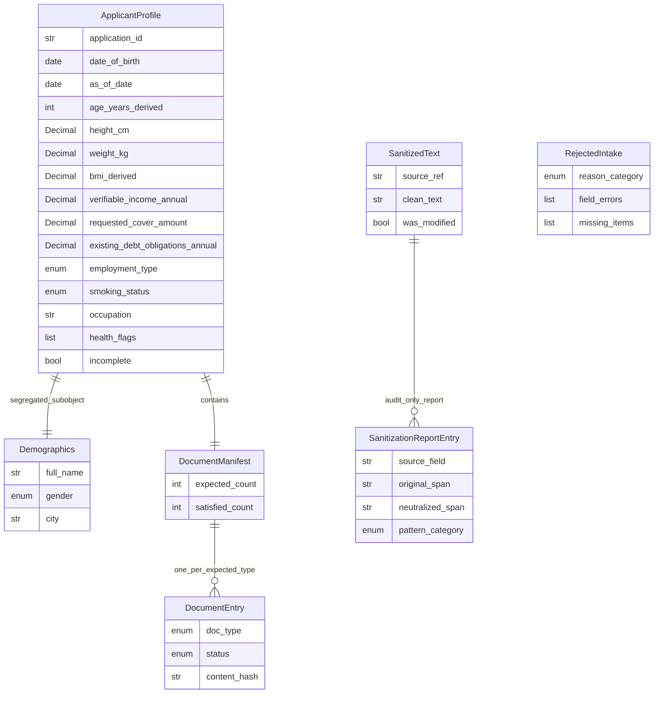

# Domain Entities — `intake` + `document-sanitizer`

**Stage**: BUILD → Functional Design (per-unit) · cluster-FD-first unit 1 of 4
**Units**: U1 `intake` (owns `ApplicantProfile`, `DocumentManifest`, `RejectedIntake`, SEC-2 gate) +
U2 `document-sanitizer` (owns `SanitizedText`, `SanitizationReport`, SEC-1)
**Date**: 2026-07-03
**Scope**: Field-by-field **internals** of the frozen C1 contracts (`component-methods.md`).
The contract **shapes** are frozen; this defines their fields only.

Technology-agnostic. Types are logical (`Decimal`, `date`, `int`, `enum`, `str`, `bool`, `list`);
the Pydantic v2 realization is a Code-Generation concern.

---

## 1. Entity-relationship view

Mermaid validated before write (alphanumeric node/entity IDs; relationship labels quoted, no
special characters; no bare parentheses; no semicolons; balanced blocks). Text alternative follows.

### Text alternative (always included)

- **`ApplicantProfile`** is the single validated object downstream trusts. It **contains** a
  **`DocumentManifest`** and a structurally **segregated `Demographics` sub-object** (CON-BR1 —
  rule-input and feature-vector builders never reach into it).
- **`DocumentManifest`** holds one **`DocumentEntry`** per expected document type (salary slip,
  bank statement, medical questionnaire), each with a four-state `status` and a `content_hash`.
- **`SanitizedText`** (produced by `document-sanitizer`) carries the neutralized `clean_text`
  plus a **`SanitizationReport`** of zero or more **`SanitizationReportEntry`** rows — the report
  is **audit-only** (see `business-logic-model.md` SEC-1 invariant).
- **`RejectedIntake`** is the gate's rejection output — structured errors + a missing-items list,
  **carrying no partial `ApplicantProfile`**.

---

## 2. `ApplicantProfile` — field-by-field (U1)

`R` = required primitive (absent value ⇒ **reject** at the SEC-2 gate). `O` = optional-and-flagged
(absent ⇒ profile still valid, `incomplete` may be set ⇒ `rules-engine` routes REFER). `D` =
derived-and-stored in intake (single-sourced for all consumers). `S` = **system-assigned** at
successful intake (generated by intake on gate pass; **not** applicant input, so it can never be
"missing" and is not in the required-primitive reject set).

| Field | Type | Unit | R/O/D | Range / validity (intake gate) | Consumed by | Notes |
|---|---|---|:--:|---|---|---|
| `application_id` | `str` | — | **S** | system-generated, stable, unique per application; assigned **only** when the gate passes | all; audit binding | **System-assigned correlation key** — the key `audit-store` binds decisions to for retrieval-integrity and replay. **Not** applicant input and **not** a demographic; intake generates it at successful gate pass, so it is never validated as a required input and can never be "missing" (no `BR-REQ` rule). Documents are bound into one coherent set during parse via `content_hash` (failure mode #2); the key is attached when the profile is admitted. |
| `date_of_birth` | `date` | ISO date | **R** | valid date; `<= as_of_date` | age derivation | Raw; never compared to the 18/65 band at intake (that is a `rules-engine` call — CON-BR2). |
| `as_of_date` | `date` | ISO date | **R** | valid date; `>= date_of_birth` | age derivation; replay | Application/submission date **captured at intake**; the fixed reference that makes age reproducible (CON-DET-1 — no wall-clock). |
| `age_years_derived` | `int` | years | **D** | 0–120 sanity | `rules-engine` (18–65 band), `outlier-model` | Completed whole years from `date_of_birth`→`as_of_date` (see `business-rules.md` DR-AGE). Derived **and stored** so downstream reads a fixed value. |
| `height_cm` | `Decimal` | cm | **O** | `> 0` if present | BMI derivation | Raw operand for BMI. |
| `weight_kg` | `Decimal` | kg | **O** | `> 0` if present | BMI derivation | Raw operand for BMI. |
| `bmi_derived` | `Decimal` | kg/m² | **D** | present only if height+weight present | `rules-engine` (25/30 bands), `outlier-model` | Derived **and stored** (DR-BMI, fixed rounding). Absent ⇒ `incomplete`. |
| `verifiable_income_annual` | `Decimal` | currency | **R** | `>= 0` | `rules-engine` (DTI, income-multiple), `outlier-model` | Operand rules-engine needs for its owned ratios. `Decimal` (Q4). |
| `requested_cover_amount` | `Decimal` | currency | **R** | `> 0` | `rules-engine` (income-multiple) | Requested loan/cover. `Decimal`. |
| `existing_debt_obligations_annual` | `Decimal` | currency | **O** | `>= 0` if present | `rules-engine` (DTI) | **Resolution 1** — captured here so DTI's operands are single-sourced in intake; **the DTI *ratio* is derived in `rules-engine`, not here** (Q5). Absent ⇒ `incomplete`. |
| `employment_type` | `enum` | — | **O** | `salaried \| self_employed \| contract \| unemployed \| unknown` | `rules-engine` (employment flag) | Financial/employment fact. |
| `smoking_status` | `enum` | — | **O** | `smoker \| non_smoker \| unknown` | `rules-engine` (lifestyle) | Lifestyle fact. |
| `occupation` | `str` | — | **O** | free-choice code/label | `rules-engine` (occupation-risk) | Occupation-risk operand; **not** a demographic proxy (US-RULES-5 — influences outcome only via its sanctioned rule). |
| `health_flags` | `list` | — | **O** | list of coded flags | `rules-engine` (health flags) | From the medical questionnaire (structured extraction). |
| `incomplete` | `bool` | — | **D** | default `false` | `rules-engine` (REFER routing) | Set `true` when any optional operand/document needed for a fuller assessment is missing. **A flag, never a recommendation** (CON-BR2). |
| `demographics` | `Demographics` | — | **R (segregated)** | see §3 | **bias-swap suite only** | The segregated sub-object; see §3 and CON-BR1. |
| `documents` | `DocumentManifest` | — | **R** | see §4 | `rules-engine` (doc-completeness), audit | Completeness is a first-class field (Q6). |

> **CON-BR2 boundary restated:** intake stores facts and one structural `incomplete` flag. It
> **never** derives DTI, income-multiple, eligibility, or a recommendation — those live in
> `rules-engine`. Age-band (18/65) and BMI-band (25/30) *thresholds* are rules-engine's; intake
> only produces the reproducible `age_years_derived` / `bmi_derived` values they compare.

---

## 3. `Demographics` — segregated sub-object (CON-BR1)

Captured because the **bias-swap suite** swaps these across identical financials and the
recommendation must not move (delta = 0). **Structurally segregated**: it is a distinct nested
object, and by design **no rule-input builder or feature-vector builder reads from it** — CON-BR1
is true *by construction*, not by allowlist discipline (Q1=A).

| Field | Type | Range / validity | Notes |
|---|---|---|---|
| `full_name` | `str` | non-empty | Never an identity linkage key (that is `application_id`). |
| `gender` | `enum` | free demographic set incl. `unspecified` | — |
| `city` | `str` | non-empty | — |

> Demographics are **structured fields** validated by the SEC-2 gate. They are **not** part of the
> LLM-bound narrative, so SEC-1 sanitization (free-text only, Q8) never touches them, and they
> never enter any prompt that influences the outcome.

---

## 4. `DocumentManifest` / `DocumentEntry` — completeness (Q6)

One `DocumentEntry` per **expected** document type; completeness is first-class and audited.

**Expected `doc_type`**: `salary_slip`, `bank_statement`, `medical_questionnaire`.

| `DocumentEntry` field | Type | Values | Notes |
|---|---|---|---|
| `doc_type` | `enum` | the three expected types | — |
| `status` | `enum` | `present \| parsed \| missing \| unparseable` | Four-state (Q6). `present`=uploaded, not yet parsed; `parsed`=extracted OK; `missing`=not supplied; `unparseable`=supplied but parse failed. |
| `content_hash` | `str` | hash of parsed bytes; empty if missing | Document-ID binding + hash verification (failure mode #2 retrieval-miss guard). |

`DocumentManifest.expected_count` / `satisfied_count` summarize the entries. **Document status is
tracked separately from field presence** — the crux of the reject-vs-REFER rule
(`business-rules.md` BR-GATE-BOUNDARY): a missing *document* whose value is present elsewhere does
not reject. **All four `status` values map to exactly one gate outcome** in the state-to-outcome
table in `business-rules.md §2` — no state-combination is unhandled.

---

## 5. `SanitizedText` / `SanitizationReport` — U2 output contract (Q9)

`sanitize(raw_text: str) -> SanitizedText` (frozen signature; fields below).

| `SanitizedText` field | Type | Notes |
|---|---|---|
| `source_ref` | `str` | Which document/field the text came from. |
| `clean_text` | `str` | Neutralized text safe to flow toward the SEC-2 gate and later the LLM memo. |
| `was_modified` | `bool` | `true` iff at least one neutralization occurred. |
| `report` | `list[SanitizationReportEntry]` | Zero rows when nothing suspicious was found. **Audit-only.** |

| `SanitizationReportEntry` field | Type | Notes |
|---|---|---|
| `source_field` | `str` | Narrative field the span came from. |
| `original_span` | `str` | The suspicious original text, preserved verbatim for forensics. **AUDIT-ONLY — must never re-enter any LLM-bound context** (`business-logic-model.md` SEC-1 invariant). |
| `neutralized_span` | `str` | What replaced the original span in `clean_text`. |
| `pattern_category` | `enum` | `instruction_override \| role_injection \| delimiter_escape \| tool_mimic \| other` |

---

## 6. `RejectedIntake` — gate rejection output (Q12)

`validate_gate(extracted) -> ApplicantProfile | RejectedIntake` (frozen; fields below).
**Carries no partial `ApplicantProfile`** — nothing partial leaks downstream — and **no
`application_id`**: the system-assigned key is generated only on gate pass, so a rejected intake
has none.

| Field | Type | Notes |
|---|---|---|
| `reason_category` | `enum` | `malformed \| unparseable \| missing_required` |
| `field_errors` | `list[FieldError]` | Each: `{ field: str, code: str, message: str }`. |
| `missing_items` | `list[str]` | Missing **required primitives** and/or unparseable documents — the "missing-items list" surfaced to the underwriter (`services.md §6` Scenario-1). |

---

## 7. Cross-consumer field-need check (P5 — cluster stability)

Confirms the field set above covers every **known** downstream need, so the field-level contract
is stable before any Code-Gen in this cluster.

| Downstream consumer | Needs | Covered by |
|---|---|---|
| `rules-engine` (U3) | age, BMI, income, requested cover, existing debt, employment, smoking, occupation, health flags, doc-completeness | `age_years_derived`, `bmi_derived`, `verifiable_income_annual`, `requested_cover_amount`, `existing_debt_obligations_annual`, `employment_type`, `smoking_status`, `occupation`, `health_flags`, `documents` ✓ |
| `rules-engine` owned derivations | DTI ratio (= debt ÷ income), income-multiple (= cover ÷ income) | **Operands present** (`existing_debt_obligations_annual`, `verifiable_income_annual`, `requested_cover_amount`); ratios computed in C2, not intake (Q5) ✓ |
| `outlier-model` (U18, P2) | demographic-**excluded** numeric feature vector | financial/medical/lifestyle fields above; `Demographics` structurally excluded (CON-BR1) ✓ |
| `memo-agent-core` (U4) | read-only profile facts to cite | whole profile, read-only ✓ |
| `audit-store` (U12) | stable **system-assigned** `application_id` binding; reproducible derived values | `application_id` (assigned at gate pass), fixed `age_years_derived`/`bmi_derived`, `content_hash` ✓ |

No downstream need is un-covered; no derived field is double-owned (age/BMI in intake, ratios in
rules-engine). **Decimal money convention (Q4) carries forward to rules-engine's DTI/income-multiple.**

---

*End of domain-entities.md. Field-level validation & derivation rules → `business-rules.md`;
pipeline logic → `business-logic-model.md`.*
