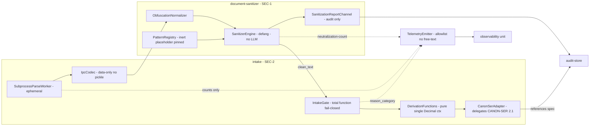

# Logical Components — `intake` + `document-sanitizer` (coupled pair)

**Stage**: BUILD → NFR Design (per-unit) · cluster unit 1
**Units**: U1 `intake` (SEC-2) + U2 `document-sanitizer` (SEC-1)
**Date**: 2026-07-04
**Scope**: The **logical components** the NFR-Design patterns introduce (`nfr-design-patterns.md`) —
responsibilities + relationships, **consistent with the FD's entities**. **Logical only — no code**
(that is Code-Gen). Components map to the frozen FD's `parse → sanitize → gate` pipeline; they realize
the quality patterns, they do **not** re-open the FD or the NFR targets.

---

## 1. Component inventory

| Component | Unit | Responsibility | Realizes pattern |
|---|:--:|---|---|
| **`SubprocessParseWorker`** | intake | Run pdfplumber on **one untrusted PDF** in a **fresh ephemeral, resource-bounded, killable** subprocess; return the extracted result or a **kill→`unparseable`** signal. No cross-parse state. | §1 subprocess isolation |
| **`IpcCodec`** | intake | Encode/decode the parse result across the subprocess boundary — **data-only, fixed-schema, stable-ordered, explicit-UTF-8, NO pickle**. Its **own** canonical encoder for the *parse-result shape* (distinct from CANON-SER). | §1 IPC contract |
| **`ObfuscationNormalizer`** | document-sanitizer | Build the **deterministic detection view** — fixed pipeline **NFKC → case-fold → collapse-whitespace → strip-zero-width**. **Detection-only** (never becomes `clean_text`). | §3 obfuscation-normalization |
| **`PatternRegistry`** | document-sanitizer | The **versioned, data-defined** set of deterministic matchers (one per category) + the **inert placeholder** whose **inertness is a pinned property** (P1 unmatched, P2 self-delimiting). | §2 / §2.1 |
| **`SanitizerEngine`** | document-sanitizer | Apply the `PatternRegistry` matchers **fixed-order** over the detection view; **defang matched spans to the inert placeholder**; produce `SanitizedText.clean_text` + the `SanitizationReport`. **No LLM.** Idempotent **given** placeholder-inertness. | §2 |
| **`IntakeGate`** (boundary wrapper) | intake | The **single fail-closed exit** of `validate_gate`: map **every** input/failure to `ApplicantProfile \| RejectedIntake`; unexpected exception → `RejectedIntake(malformed)`. Wraps the Pydantic v2 gate. | §4 total-function gate |
| **`DerivationFunctions`** | intake | **Pure** DR-AGE / DR-BMI / money derivations under a **single declared `Decimal` context**; compute-once-store. | §6 determinism |
| **`CanonSerAdapter`** | intake | Serialize/deserialize `ApplicantProfile` by **delegating to the single CANON-SER spec (audit-store §2.1)** — round-trip byte-identical. **No parallel convention.** | §6 CANON-SER round-trip |
| **`SanitizationReportChannel`** | document-sanitizer | The **separate audit channel** carrying the `SanitizationReport` (span text) to `audit-store` — **the only carrier of span text**. | §5 surface-1 |
| **`TelemetryEmitter`** | both | The **single telemetry choke point** with an **allowlist schema of typed non-text fields only** (int counts, enums, durations, bools) — **NO free-text field** → span text **structurally unrepresentable**; extends to logs. Emit-only; the `observability` unit wires it. | §5 surface-3 / §7 emit-only |

> **Consistency with the FD**: these components realize the FD's frozen pipeline —
> `SubprocessParseWorker`+`IpcCodec` implement `parse`; `ObfuscationNormalizer`+`PatternRegistry`+
> `SanitizerEngine` implement `sanitize` (producing `SanitizedText` + `SanitizationReport`);
> `IntakeGate`+`DerivationFunctions` implement `validate_gate` (producing `ApplicantProfile` |
> `RejectedIntake`). **No FD entity is changed** — these are the *how*, not new *what*.

---

## 2. Ownership boundaries (reference-not-own)

| Concern | Owner | This unit |
|---|---|---|
| CANON-SER spec + implementation | `audit-store` (§2.1) — single shared utility | **references** via `CanonSerAdapter` (no copy) |
| Observability stack (Langfuse/Prometheus/Grafana) | `observability` unit | **emits** via `TelemetryEmitter` (emit-only) |
| Secrets | `secrets-config` / SEC-3 | out of scope |
| Blocking-gate harness | `quality-gates` | authors its own unit tests at Code-Gen; targets feed the gates |
| Persistence (Postgres, DATA-5) | `audit-store` / `database` | commits only to CANON-SER serializability |
| Cloud infra / deployment | `deploy-config` / `database` | **Infrastructure Design SKIPPED** (sandbox = security NFR) |

---

## 3. Component-relationship view

Mermaid validated before write (alphanumeric node IDs; double-quoted labels; **no colons, no
semicolons, no parentheses** in labels; balanced brackets; no reserved `end` node). Text alternative
follows.

### Text alternative (always included)

- **`document-sanitizer` (SEC-1)** contains the `ObfuscationNormalizer` (detection view) →
  `SanitizerEngine` (defang, no LLM) driven by the `PatternRegistry` (inert-placeholder pinned). The
  `SanitizerEngine` emits `clean_text` to the gate and routes span text **only** to the
  `SanitizationReportChannel` → `audit-store`.
- **`intake` (SEC-2)** contains the `SubprocessParseWorker` → `IpcCodec` (data-only, no pickle) →
  (into the sanitizer) and, post-sanitize, the `IntakeGate` (total function, fail-closed) →
  `DerivationFunctions` (pure, single `Decimal` context) → `CanonSerAdapter` (**delegates** to
  `audit-store`'s CANON-SER §2.1).
- The **`TelemetryEmitter`** (allowlist schema, no free-text field) receives **only** counts /
  `reason_category` / durations from the components and forwards to the **`observability` unit**. Span
  text **never** reaches it (nor any log). The **audit path** (`SanitizationReportChannel` →
  `audit-store`) is **disjoint** from the telemetry path.

---

## 4. Consistency + ownership check (P5)

- **Builds on the frozen FD** — every component maps to a frozen FD method (`parse` / `sanitize` /
  `validate_gate`) and the FD entities (`ApplicantProfile`, `SanitizedText`, `SanitizationReport`,
  `RejectedIntake`); **no FD entity/contract re-opened**.
- **Builds on the approved NFR targets** — every component realizes a pattern that makes an
  `NFR-INT-*` assertion structurally achievable at Code-Gen; **no NFR target re-opened**.
- **Reference-not-own held** — CANON-SER (audit-store §2.1), observability stack, secrets,
  quality-gates harness, persistence, cloud infra all owned elsewhere; this unit references/emits.
- **Infrastructure Design SKIPPED** for this unit (logged when reached).

---

*End of logical-components.md. Design patterns → `nfr-design-patterns.md`.*
