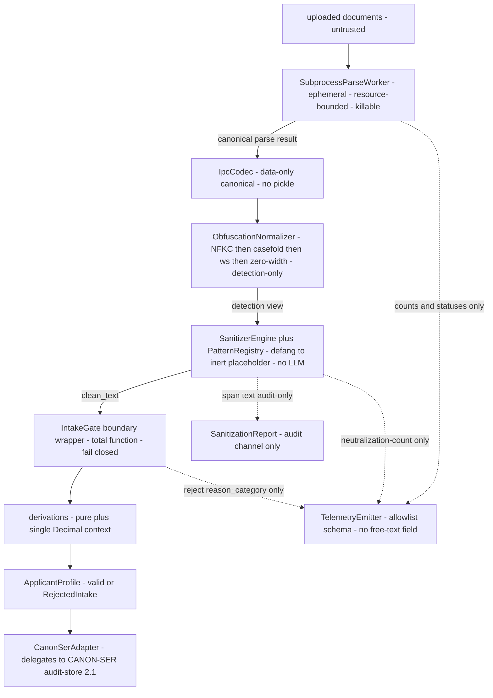

# NFR Design Patterns — `intake` + `document-sanitizer` (coupled pair)

**Stage**: BUILD → NFR Design (per-unit) · cluster unit 1
**Units**: U1 `intake` (SEC-2) + U2 `document-sanitizer` (SEC-1)
**Depth**: comprehensive (security-critical)
**Date**: 2026-07-04
**Scope**: The **design pattern (the "how")** for each approved `NFR-INT-*` target — built **ON the
frozen FD + the approved NFR Requirements, re-opening neither.** Each pattern states **how the
target's assertion is structurally met**; the components that realize it are in `logical-components.md`.
No code (that is Code-Gen).

---

## 1. Subprocess-isolation pattern — `NFR-INT-SEC1-SANDBOX`

**Pattern**: **ephemeral subprocess per parse** + a **data-only canonical IPC boundary** + a
**parse-in-subprocess / everything-else-in-process split**.

- **Ephemeral worker** — each document parse spawns a **fresh, short-lived subprocess** (resource
  limits: memory / CPU / **wall-time**), runs pdfplumber, returns the extracted result, and **exits**.
  No state is carried between documents (no cross-parse contamination; deterministic — each parse
  starts clean). A **timeout / oom / crash kills the worker** and the document is recorded a
  **deterministic `unparseable`** `DocumentEntry.status`.
- **IPC boundary — `IpcCodec` (data-only, canonical)** — only **extracted text + structured fields**
  cross the boundary — **never live objects, never pickle**. The `IpcCodec` uses a **fixed schema,
  stable field ordering, explicit UTF-8** so the **same PDF → byte-identical IPC bytes**. `IpcCodec`
  is its **own** canonical encoder for the *parse-result shape* — **distinct from CANON-SER** (which
  is the `ApplicantProfile` spec, §6). **No code executes in the parent from the worker's output**
  (data only — defense against a hostile parse result + no unsafe deserialization).
- **In-process / subprocess split** — **subprocess = the untrusted-PDF parse ONLY**; **in-process =
  sanitize (SEC-1) + the SEC-2 gate + the deterministic derivations** (DR-AGE/DR-BMI, `Decimal`),
  running on the returned canonical data. Rationale: the derivations are determinism-sensitive; keeping
  them in-process on already-returned data avoids any process-hop non-determinism.
- **Outside the replay path** — the subprocess runs **once at intake, upstream of persistence**;
  **replay never re-parses** (`audit-store`'s `ReplayService` feeds the persisted snapshot). So the
  subprocess is entirely **outside the replay determinism boundary**; IPC determinism matters for
  **single-run** reproducibility + the sanitizer/gate tests, not replay.
- **Structurally meets**: NFR-INT-SEC1-SANDBOX (isolation scope, resource bounds, timeout→unparseable,
  canonical boundary encoding).

---

## 2. Sanitizer neutralization pattern — `NFR-INT-SEC1-NEUT`

**Pattern**: a **versioned `PatternRegistry` of deterministic matchers**, applied **fixed-order** over
a normalized detection view, each match **defanged to an inert placeholder** and logged.

- **Deterministic matchers, fixed order** — one matcher per category (`instruction_override`,
  `role_injection`, `delimiter_escape`, `tool_mimic`), applied in a **fixed, declared order** over the
  normalized detection view (§3). Pure Python, **NO LLM** (D4 — an LLM would be non-deterministic and
  itself a new injection surface). The registry is **data/versioned** so the pattern set is auditable
  and testable against the adversarial corpus `C`.
- **Defang-to-placeholder** — each matched span is replaced by an **inert placeholder** and logged to
  the `SanitizationReport` (`original_span` + `neutralized_span` + `pattern_category`).

### 2.1 Idempotence is structural **only given placeholder-inertness** (pinned property)

`sanitize ∘ sanitize == sanitize` holds **by construction only if the placeholder is provably inert.**
This is a **pinned property**, not an assumption:

- **(P1) The placeholder matches NO matcher** in the registry — a second pass finds nothing to defang.
- **(P2) The placeholder is self-delimiting / opaque** — inserting it **cannot combine with adjacent
  text into a NEW match** (no matcher span crosses a placeholder boundary).

**Registry-invariant test** (pins the property): **∀ matcher `m` in the registry**:
`m(placeholder) == no-match`, **and** for any text with placeholders inserted, **no match produced by
any `m` spans a placeholder boundary**. If a candidate placeholder fails either, it is not a valid
placeholder. **Idempotence holds GIVEN (P1)+(P2)** — the design states it, does not assume it.

- **FP budget** — managed by matcher precision + the legitimate-text corpus `L` test
  (`fp_rate(L) ≤ 2.0%`, NFR-INT-SEC1-NEUT).
- **Structurally meets**: NFR-INT-SEC1-NEUT (100% neutralization over `C`; idempotence by construction;
  FP ≤ budget).

---

## 3. Obfuscation-normalization pattern (detection-only, deterministic)

**Pattern**: a **deterministic, detection-only normalization pre-pass** — a **fixed pipeline** applied
identically every run.

- **Fixed pipeline (declared order)**: **`NFKC` → case-fold → collapse-whitespace → strip-zero-width**.
  Each step is a **pure, deterministic** transform; `NFKC` is a Unicode-standard-defined normal form.
- **Detection-only** — matching runs on the **normalized view**, but **neutralization edits map back
  to the original span** (`clean_text` stays faithful to the input **except** for defanged spans). The
  normalized view is **transient** — it **never** becomes `clean_text`, so normalization **cannot
  alter faithful output**.
- **Determinism note** — `NFKC`'s output depends on the Unicode version bundled with the Python
  runtime; that is **pinned by the Python-version pin** (D6, `tech-stack-decisions.md`), so the
  pipeline is byte-stable for the pinned runtime. This determinism serves **single-run** sanitizer
  reproducibility + the neutralization test — **not** replay (replay never re-sanitizes).
- **FP control** — normalization is **bounded** (only the four listed steps) so it does not
  over-trigger on benign text (keeps FP ≤ budget); it does **not** aggressively rewrite content.
- **Structurally meets**: NFR-INT-SEC1-NEUT (obfuscation robustness) + CON-DET-1 (deterministic pre-pass).

---

## 4. Total-function gate pattern — `NFR-INT-SEC2-TOTAL` / `-COVERAGE`

**Pattern**: a **single fail-closed boundary wrapper** around the Pydantic v2 gate — the **only** exit
point of `validate_gate`.

- **Every failure mode → structured `RejectedIntake`**: Pydantic `ValidationError` → per-field errors
  + `reason_category`; parse-failure/`unparseable` → `unparseable`; empty / oversized / wrong-type /
  corrupt → mapped category; **any unexpected exception is caught at the boundary and mapped to
  `RejectedIntake(malformed)`** (**fail-closed** — no leak, no crash, no raise).
- **Provable return type** — because the wrapper is the **sole** exit, `validate_gate` provably returns
  `ApplicantProfile | RejectedIntake`; **no input can cause an unhandled raise**.
- **Combination coverage** — the four-state (`present`/`parsed`/`missing`/`unparseable`) ×
  value-presence matrix maps to exactly one outcome; thin-file / single-missing-doc **always** →
  valid+`incomplete`→REFER (never a hard reject) — the FD's coverage table under the negative-input
  matrix.
- **Structurally meets**: NFR-INT-SEC2-TOTAL (total function) + NFR-INT-SEC2-COVERAGE.

---

## 5. SEC-1-FORENSIC pattern — structural exclusion across **three surfaces** — `NFR-INT-FORENSIC`

**Pattern**: span text (`original_span` **and** `neutralized_span` content) is confined to **one
channel** and made **structurally unrepresentable** on every other surface.

- **Surface 1 — the audit channel (the only place span text lives)**: the `SanitizationReport` travels
  a **separate audit channel** to `audit-store`. It is the **sole** carrier of span text.
- **Surface 2 — LLM context**: the object handed toward `memo-agent-core` is `SanitizedText.clean_text`
  only; `MemoAgentInput` **structurally cannot carry** the report (memo-agent-core FD). Span text is
  **never** in any LLM-bound payload.
- **Surface 3 — telemetry (allowlist schema, NO free-text field)**: the **`TelemetryEmitter` accepts
  only an allowlisted schema of typed non-text fields** — **int counts, enum categories, durations,
  booleans/statuses** — **and has NO free-text / `str` field**. Span text is therefore
  **structurally unrepresentable** in telemetry (there is no field to hold it). A **schema-level
  assertion** verifies the emitter schema contains no `str`/free-text field (beyond the payload-scan
  test).
- **Extends to logs** — the guarantee **covers logs too**: span text is **never passed to any logger
  or sink**; the sanitizer's log statements reference **counts/categories only**. A **lint/assertion**
  guards it. The **audit channel is disjoint** from the telemetry + log seams **by construction**.
- **Structurally meets**: NFR-INT-FORENSIC (a) LLM-context exclusion + (b) telemetry exclusion + the
  logs extension.

---

## 6. Determinism pattern — `NFR-INT-DET-1` / `-DET-2`

**Pattern**: **pure derivation functions + a single declared `Decimal` context**, and a
**`CanonSerAdapter` delegating to the single CANON-SER spec**.

- **Pure derivations** — DR-AGE / DR-BMI / `Decimal` derivations are **pure** (inputs → output; no
  wall-clock, no unseeded randomness, no dict-order reliance). A **single declared `Decimal` context**
  (precision + `ROUND_HALF_UP`) is set **once for the unit** and applied everywhere → identical
  rounding, no per-call context drift. Derived values are **computed once and stored** (FD) so no
  consumer re-derives divergently. (NFR-INT-DET-1: byte-identical ×N≥10 + boundary cases.)
- **CANON-SER round-trip — delegation, not re-implementation** — the **`CanonSerAdapter`** applies
  **audit-store's single CANON-SER spec (§2.1)** to the `ApplicantProfile` (incl. segregated
  `demographics` + nested `DocumentManifest`); it **delegates** to that one implementation — **no
  parallel convention**. Round-trip `serialize → deserialize → serialize` is byte-identical. This is
  the **replay dependency** (audit-store persists via this spec; `ReplayService` deserializes back to
  feed `evaluate()`). *(At Code-Gen the CANON-SER implementation is a **single shared utility** both
  units import — not copy-pasted; module placement is a Code-Gen detail.)*
- **Structurally meets**: NFR-INT-DET-1 (derivations) + NFR-INT-DET-2 (round-trip, no drift).

---

## 7. Emit-only observability + bounded-performance patterns — `NFR-INT-OBS` / `NFR-INT-PERF`

- **Emit-only observability** — the unit emits through a **thin, stack-agnostic instrumentation seam**
  (the `TelemetryEmitter`, §5 surface-3): spans for parse/sanitize/gate; counters for
  neutralization-count, reject `reason_category`, `incomplete`; derivation timings. The
  **`observability` unit wires** it to Langfuse/Prometheus/Grafana. **Reference-not-own** — this unit
  does not configure the stack. The seam's allowlist schema keeps it **forensic-free** (§5).
- **Bounded performance** — **observed + recorded, not gated**: the parse→sanitize→gate duration is
  emitted so the dashboard tracks the **p95 soft budget** (no build-failing latency check). The **only
  enforced timing is the hard subprocess timeout** (a security bound, tested). Correctness / security /
  determinism take precedence over speed.
- **Resilience** — **fail-closed to `unparseable`, no retry of hostile input** (a timed-out/failed
  parse is recorded `unparseable`; the pipeline continues; re-parsing a malicious PDF would just
  re-trigger). Distinct from the memo agent's benign citation retry (that retries the LLM's own draft;
  this is untrusted external input, never retried). Transient-infra retry/backoff is a cross-cutting
  orchestration concern, **not** re-designed here.
- **Structurally meets**: NFR-INT-OBS (emit-only, forensic-free) + NFR-INT-PERF (soft budget observed,
  hard bound enforced).

---

## 8. Pattern → target traceability

| Pattern (§) | Target | Assertion made structurally achievable |
|---|---|---|
| §1 subprocess isolation | NFR-INT-SEC1-SANDBOX | isolation scope, resource bounds, timeout→unparseable, canonical IPC |
| §2 sanitizer neutralization (+2.1) | NFR-INT-SEC1-NEUT | 100% neutralization; **idempotence given placeholder-inertness** |
| §3 obfuscation-normalization | NFR-INT-SEC1-NEUT / CON-DET-1 | obfuscation robustness; deterministic pre-pass |
| §4 total-function gate | NFR-INT-SEC2-TOTAL / -COVERAGE | never raises; full combination coverage |
| §5 SEC-1-FORENSIC (3 surfaces) | NFR-INT-FORENSIC | audit-only span; **no str field in telemetry**; logs covered |
| §6 determinism | NFR-INT-DET-1 / -DET-2 | byte-identical derivations; CANON-SER round-trip (delegated) |
| §7 observability / perf / resilience | NFR-INT-OBS / -PERF | emit-only forensic-free; soft budget + hard timeout |

**Held**: frozen FD + approved NFR targets not re-opened; ownership reference-not-own (CANON-SER =
audit-store §2.1 shared utility; observability/secrets/quality-gates/persistence owned elsewhere);
**Infrastructure Design SKIPPED** for this unit (sandbox = security NFR, not cloud topology; skip
logged).

---

## 9. Pattern-integration diagram

Mermaid validated before write (alphanumeric node IDs; double-quoted labels; **no colons, no
semicolons, no parentheses** in labels — hyphens/"plus"/"then" only; balanced brackets; no reserved
`end` node). Text alternative follows.

### Text alternative (always included)

1. **Untrusted documents** enter the **`SubprocessParseWorker`** (ephemeral, resource-bounded,
   killable) — timeout/crash → `unparseable`.
2. The worker returns a **canonical, data-only parse result** via the **`IpcCodec`** (no pickle).
3. The **`ObfuscationNormalizer`** builds a deterministic **detection view** (NFKC → case-fold →
   collapse-whitespace → strip-zero-width).
4. The **`SanitizerEngine` + `PatternRegistry`** defang matched spans to **inert placeholders** (no
   LLM); the raw spans go **only** to the **`SanitizationReport`** on the **audit channel**.
5. `clean_text` reaches the **`IntakeGate` boundary wrapper** (total function → `ApplicantProfile` or
   `RejectedIntake`, fail-closed).
6. On the valid branch, **pure derivations** (single `Decimal` context) produce the
   **`ApplicantProfile`**, serialized by the **`CanonSerAdapter`** (delegating to CANON-SER §2.1).
7. The **`TelemetryEmitter`** emits **only** counts / enum-categories / durations / statuses — **no
   span text** (structurally unrepresentable; extends to logs). The audit channel is **disjoint** from
   telemetry.

---

*End of nfr-design-patterns.md. Logical components + their relationships → `logical-components.md`.*
