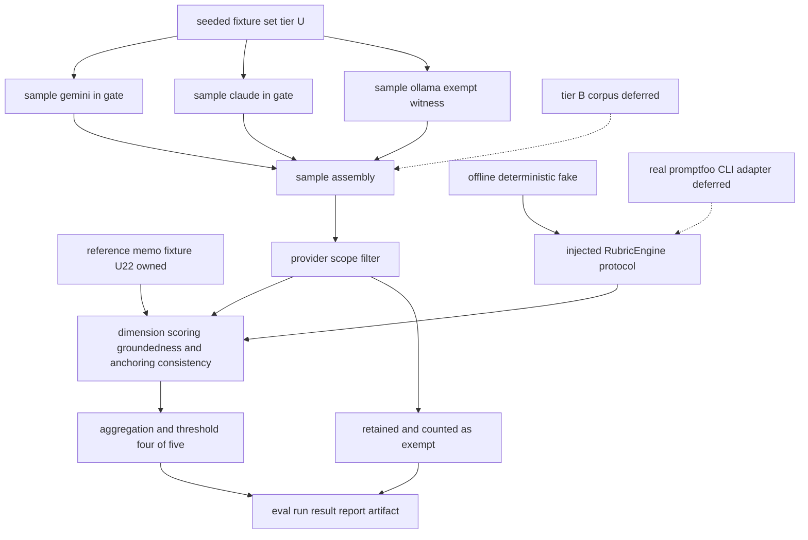

# Business Logic Model — `llm-judge` (EPIC-6 / U22, Phase 2)

**Stage**: BUILD → per-unit loop → **Functional Design, Part 2 (Generation)** · **Depth**: **standard** (Q5-A) ·
**Date**: 2026-07-19
**Scope**: the **evaluation lifecycle** — assemble → scope-filter → score → aggregate → report — plus the **tier split**,
the **injected `RubricEngine` seam**, and the **fixture set's Ollama-present-but-excluded design**. Built ON the frozen
U4 / U19 / U21 contracts — **re-opening none**.

---

## 1. The lifecycle

`llm-judge` has **one flow**, run at one of two tiers. It is **strictly downstream** of memo generation: memos arrive
already drafted, and **nothing here feeds back into generation** (Q2-A / BR-JUDGE-11).

### Step 1 — Assemble the sample set
Collect `JudgedSample`s, each carrying a frozen `DecisionMemo`, its `RuleResultReport` (the grounding source), and a
`ProviderScopeTag`.
- **tier-U**: the **seeded, hand-authored fixture set** — deterministic, in-repo, **no live LLM, no key, no network**.
- **live (deferred)**: the tier-B corpus — **`JUDGE-EVAL-DEFERRED`**, not run here.

**⚑ The fixture set is deliberately composed** (BR-JUDGE-3 / BR-JUDGE-5) and must contain **all four**:

| Fixture | Purpose | Without it |
|---|---|---|
| A `gemini` sample | in-gate scoring path | GATE-2's in-gate half unproven |
| A `claude` sample | in-gate scoring path (secondary) | in-gate set not representative |
| **An `ollama` sample** | **the non-vacuity witness** — present, retained, **excluded from scoring** | the exemption passes **vacuously** — nothing present to exclude |
| A **close** and a **divergent** memo vs the reference | anchoring-consistency teeth | a single close fixture passes vacuously |

### Step 2 — Scope-filter by provider (FR-PROV-GATE-2)
Partition on `ProviderScopeTag`: `gemini`/`claude` → **in-gate** (scored, counted); `ollama` → **exempt** (retained in
`sample_scores`, counted in `exempt_count`, **excluded from scoring and from the aggregate**).
**Exempt ≠ dropped, and exempt ≠ untested** (BR-JUDGE-4) — the exempt record carries an explicit tag naming *memo-quality*
as the exemption's scope. Ollama's **decision-level** gates are asserted by frozen U19 and are **referenced, not
re-derived**.

### Step 3 — Score each in-gate sample through the injected seam
For each in-gate sample, call `RubricEngine.score(sample, rubric)` → a `DimensionScore` per dimension:
- **`groundedness`** — is the prose supported by the handed rule report, and is every cited id present in it? (AC-2/AC-6)
- **`anchoring_consistency`** — is the wording/structure consistent with the **reference memo**? (QA-4, *"not claimed
  bit-identical"* ⇒ style/structure, not identity.)

**Only `memo.narrative_prose` (the `L` region) is judged.** The `D`/`RO`/`M` regions are deterministic or injected and are
**never scored** — judging them would re-open CON-BR2-TYPE.

### Step 4 — Aggregate and apply the threshold
Mean the dimension scores per sample → `SampleScore.aggregate`; `passed = aggregate >= 4`. Mean across **in-gate samples
only** → `EvalRunResult.aggregate_score`; `gate_passed = aggregate_score >= 4`. **Pure arithmetic**, deterministic given the
dimension scores — including the boundary cases `4` (pass) and `3.99` (fail), with **`>=`** stated explicitly.

### Step 5 — Emit the run report
Produce `EvalRunResult` — **all** samples in deterministic order (including exempt), `scored_count`, **`exempt_count`**,
`aggregate_score`, `gate_passed`, `tier`.
**Q6-A**: this report is the **only** emission. **No Prometheus metric, no dashboard panel** — a sixth would be drift
against `observability`'s frozen five and would break `deploy-config`'s five-panel no-drift scan.

---

## 2. The tier split (Q4-A) — why the discipline holds

The unit divides cleanly, and **the deterministic half is the whole unit minus the act of judging**.

| Half | Contents | Tier | Live LLM? |
|---|---|---|---|
| **Deterministic** | rubric definition · sample assembly · **provider scope-filtering** · **aggregation** · **threshold arithmetic** · report shape · exempt accounting | **tier-U**, fully tested on fixtures | **No** — no key, no network, no Node |
| **Live judging** | the actual LLM scoring pass behind `RubricEngine` | **deferred** | Yes — at the authorized run only |

⇒ **U22 is not the first unit to break the tier-U discipline; it is the third to NAME a deferred live step** — after
`corpus-generator`'s tier-B and `observability`'s AC-7. Any live call, when it eventually runs, uses **`temperature=0`**.

---

## 3. The injected `RubricEngine` seam (Q3-A)

```text
RubricEngine.score(sample: JudgedSample, rubric: GroundednessRubric) -> list[DimensionScore]
```

| Binding | Tier | Properties |
|---|---|---|
| **Offline deterministic fake** | **tier-U** | Fixture-declared scores. **No Node, no npx, no network, no telemetry, no key.** Drives every tier-U test. |
| **Real promptfoo CLI adapter** | **deferred** | **`PROMPTFOO-CLI-DEFERRED`** — Node + npx present, CLI **pinned**, telemetry opt-out, adapter bound, **verified on fixtures**. **No corpus / tier-B / key required.** |

The seam is what makes Step 3 substitutable while Steps 1–2 and 4–5 stay pure — the reason the deterministic half is
**fully** verifiable offline.

---

## 4. The two deferrals are distinct (Fold-1)

| | `PROMPTFOO-CLI-DEFERRED` | `JUDGE-EVAL-DEFERRED` |
|---|---|---|
| **Discharges on** | Node+npx · CLI pinned · telemetry opt-out · adapter bound · verified **on fixtures** | tier-B corpus authorized+built · live Gemini+Claude keys · ≥4/5 evaluated over **real memos** |
| **Needs the corpus?** | **No** | **Yes** |
| **Needs tier-B?** | **No** | **Yes** |
| **Depends on the other?** | No | **Yes** — needs a working engine first |

**One-way dependency, therefore two items.** You can verify the real engine on fixtures while tier-B stays unauthorized;
you cannot run the real evaluation without an engine. Same asymmetry as `OBS-SINK-DEFERRED`'s deployment/code split.

---

## 5. The reference memo (Fold-3) — and why it needs no U4 change

`anchoring_consistency` needs something to compare against. That is a **U22-owned, hand-authored fixture**, built via the
**imported frozen `DecisionMemo` schema** (instantiating a frozen model is **using** it, not modifying it).

**⚑ The decisive distinction — direction of data flow:**

| Direction | What it is | Whose |
|---|---|---|
| Exemplars **INTO** `PromptBuilder` at draft time | few-shot anchoring — would **edit frozen U4** | **`FEWSHOT-ANCHOR-UNIMPLEMENTED`** — not here |
| Memo **OUT OF** generation, compared **against** a reference downstream | anchoring-consistency **scoring** | **U22 — delivered here** |

**U4 never sees the reference memo.** It lives in U22's own fixture module — **never** added to
`backend/memo_agent_core/tests/`, which would be a frozen-unit edit. It inherits U22's own rules: **advisory-only wording**
and **no demographic identifier** (mirroring `PromptBuilder`, which deliberately omits name/city/gender). **One** canonical
reference serves the whole set — a style/structure exemplar, not a per-applicant twin.

---

## 6. Flow diagram (validated Mermaid — rectangle-only, alphanumeric IDs, quoted labels)



**Syntax validation** — all seven rules checked: **(1)** every node ID is alphanumeric; **(2)** every label is quoted;
**(3)** no hyphens, semicolons, colons, parentheses or special characters appear inside any label (`four of five` for the
threshold, `tier U` / `tier B` unhyphenated); **(4)** blocks balanced — **no `subgraph` used**, so no `end` is required;
**(5)** **rectangle-only** — every node uses `ID["label"]`; **(6)** edges are plain `-->` (solid) or `-.->` (dashed, for the
two deferred paths) with **no edge labels**, so no special characters can leak in; **(7)** single `flowchart TD` declaration.

### Text alternative (equivalent to the diagram)

The **seeded fixture set (tier U)** yields three samples: a **gemini** sample and a **claude** sample (both in-gate), and an
**ollama** sample (the exempt witness). All three flow into **sample assembly**, then into the **provider scope filter**.
The filter routes in-gate samples to **dimension scoring** (groundedness and anchoring consistency) and routes the ollama
sample to **retained and counted as exempt** — present in the report, excluded from scoring. The **reference memo fixture
(U22 owned)** also feeds dimension scoring, supplying the anchoring comparison target. Scoring is performed through the
**injected RubricEngine protocol**, which at tier U is driven by the **offline deterministic fake**; the **real promptfoo
CLI adapter** connects to the same protocol by a **dashed (deferred)** edge. The **tier B corpus** likewise connects to
sample assembly by a **dashed (deferred)** edge. Scored samples flow into **aggregation and threshold four of five**, and
both the aggregated result and the exempt records flow into the **eval run result report artifact**.

Only the two dashed edges are deferred; every solid path is exercised at tier U with no live LLM, no key, no network and no
Node.

---

## 7. Settled items held

- **Advisory-only**: the judge scores prose and emits **no** recommendation or verdict — structurally unrepresentable
  (BR-JUDGE-7); **CON-BR2-TYPE** intact.
- **No LLM in the deterministic rules path**: U22 sits **downstream of the memo**, never inside rule evaluation.
- **Bias-free**: no demographic identifier in any rubric input, prompt, justification, report, or the reference memo
  (BR-JUDGE-10).
- **`temperature=0`** stays **centrally fixed** inside U19's frozen adapters — U22 neither sets nor overrides it.
- **Reference-not-own**: U4's shapes, U19's adapters, `corpus-generator`'s records, U21's Protocols — all read-only.
  **FR-PROV-GATE-1 stays `quality-gates`'**; U22 single-sources **GATE-2** only.
- **Disclosed, not dropped**: `PROMPTFOO-CLI-DEFERRED` · `JUDGE-EVAL-DEFERRED` · **`FEWSHOT-ANCHOR-UNIMPLEMENTED`**.
- **Untouched**: WIRE-1 · the 17 frozen P1 units (**including `memo-agent-core`**) · U18 · U19 · U20 · U21 · U23 · the
  closed composition root · tier-B (**not authorized**) · the `audit_store` Docker-guard gap · the 23-unit decomposition.
