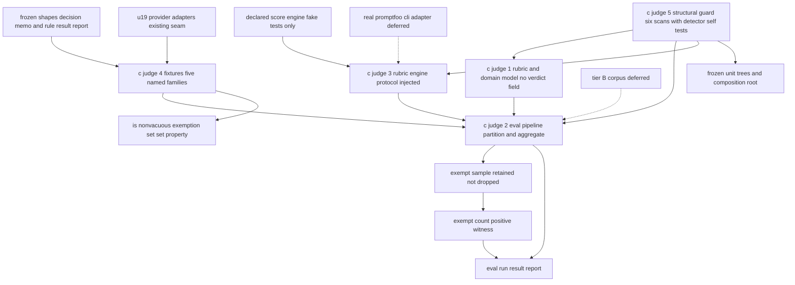

# Logical Components — `llm-judge` (U22, EPIC-6, Phase 2)

**Stage**: BUILD → NFR Design (per-unit), **Part 2 (Generation)** · **Unit**: U22 `llm-judge` · EPIC-6 · **Phase 2** ·
**Depth**: **standard** · **Date**: 2026-07-19.
**Built ON** the frozen FD + the **eleven `NFR-JUDGE-*`** + the patterns **`P-JUDGE-1..14`** (`nfr-design-patterns.md`) —
**re-opening none**. The **five logical components** (three owned production + two test substrates) with responsibilities,
ownership, and the **exact signatures that enforce each by-construction guarantee**.
Answers **Q1–Q3 (all A)** + folds **NFR-JUDGE-ND-Fold-1..3**.
**Module layout is OPEN** — sized to the lifecycle's concerns; exact module names finalized at Code-Gen (no frozen
file-count constraint).

**⚑ U22 is the LAST unit in the entire 23-unit decomposition.**

---

## 1. Components + signatures (the by-construction surface)

### C-JUDGE-1 `rubric` + domain model (`rubric.py` / `schemas.py`) — P-JUDGE-8, P-JUDGE-10, P-JUDGE-1

**Responsibility**: the declarative rubric and every value object U22 owns. **No LLM. No network. No frozen edit. Declares
no verdict.**

```python
class ProviderScopeTag(Enum):                 # the SINGLE place in-gate vs exempt is represented
    gemini = "gemini"                         # IN-GATE  (primary)
    claude = "claude"                         # IN-GATE  (secondary, tested)
    ollama = "ollama"                         # EXEMPT from MEMO-QUALITY gates only

class EvalTier(Enum):
    unit = "unit"                             # fixtures (here)
    live = "live"                             # the deferred authorized run

@dataclass(frozen=True)
class RubricDimension:
    dimension_id: str                         # "groundedness" | "anchoring_consistency"
    description: str                          # advisory-only wording; no demographic reference
    weight: int                               # equal by default — no hidden weighting

@dataclass(frozen=True)
class GroundednessRubric:
    rubric_id: str
    dimensions: tuple[RubricDimension, ...]   # DECLARED ORDER IS THE REPORT ORDER (determinism)
    threshold: int = 4                        # AC-6 / QA-4  ">= 4/5"
    scale_max: int = 5

@dataclass(frozen=True)
class JudgedSample:
    sample_id: str
    memo: DecisionMemo                        # frozen U4 shape, imported READ-ONLY
    rule_report: RuleResultReport             # frozen grounding source, imported READ-ONLY
    provider: ProviderScopeTag

@dataclass(frozen=True)
class DimensionScore:
    dimension_id: str
    score: int                                # 1..5
    justification: str                        # advisory-only; no demographic reference

@dataclass(frozen=True)
class SampleScore:
    sample_id: str
    provider: ProviderScopeTag
    dimension_scores: tuple[DimensionScore, ...]
    aggregate: float
    passed: bool                              # aggregate >= threshold
    in_gate: bool

@dataclass(frozen=True)
class EvalRunResult:
    rubric_id: str
    sample_scores: tuple[SampleScore, ...]    # ALL samples — INCLUDING exempt ones
    scored_count: int
    exempt_count: int                         # THE POSITIVE WITNESS — required, never optional
    aggregate_score: float
    gate_passed: bool
    tier: EvalTier
```

**By-construction guarantees**:
- **⚑ No `Recommendation`-typed or verdict-typed field exists anywhere above** ⇒ *"the judge changed the recommendation"* is
  **unrepresentable**, not merely forbidden (P-JUDGE-10). **CON-BR2-TYPE intact.**
- **`exempt_count` is a required field**, so an exempt sample is **counted, not dropped** — the exemption is provable **by
  presence** (P-JUDGE-1).
- **`dimensions` is an ordered tuple** ⇒ declared order **is** report order ⇒ **byte-reproducible** given fixed scores
  (P-JUDGE-8).
- **Only `memo.narrative_prose` (the `L` region) is ever read for scoring**; `D`/`RO`/`M` are never scored.
- **Header comment** documents: holds no LLM; edits no frozen unit; declares no verdict *(documentation only — it never
  enforces)*.

### C-JUDGE-2 `eval pipeline` (`pipeline.py`) — P-JUDGE-1, P-JUDGE-2, P-JUDGE-8, P-JUDGE-9

**Responsibility**: the five-step lifecycle — assemble → **scope-filter** → score-through-the-seam → **aggregate/threshold**
→ **report assembly** — plus the **run-validity predicate** (Q1-A). **Strictly downstream; nothing feeds back into memo
generation.**

```python
def partition_by_scope(
    samples: Sequence[JudgedSample],
) -> tuple[list[JudgedSample], list[JudgedSample]]:
    """(in_gate, exempt) — a PARTITION: every sample lands in exactly one side, so
    'scored' and 'retained' can never silently diverge (P-JUDGE-9)."""

def is_nonvacuous_exemption_set(samples: Sequence[JudgedSample]) -> bool:
    """⚑ Q1-A — True iff at least one sample is exempt-tagged, i.e. there is something to exclude.

    A SET property, not a test-configuration opinion. It FLAGS NOTHING and RAISES NOTHING on its
    own; the TEST applies it (False over degenerate_all_in_gate_set(), True over the three-sample
    composition). Nothing in production calls it as a gate, so it CANNOT wrongly reject a
    legitimate run over a genuinely Ollama-free corpus.

    ⚑ ANTI-COLLAPSE (ND-Fold-2): takes samples, returns bool. It NEVER constructs, runs, or reads
    an EvalRunResult — implementing it via the pipeline would collapse it into P-JUDGE-1.
    """
    return any(s.provider is ProviderScopeTag.ollama for s in samples)

def aggregate_sample(scores: Sequence[DimensionScore], threshold: int) -> tuple[float, bool]:
    """(aggregate, passed) — PURE. passed = aggregate >= threshold, the `>=` explicit."""

def run_eval(
    samples: Sequence[JudgedSample],
    rubric: GroundednessRubric,
    engine: RubricEngine,                     # INJECTED — never constructed here
    tier: EvalTier = EvalTier.unit,
) -> EvalRunResult:
    """Assemble -> partition -> score in-gate through the seam -> aggregate -> assemble report.
    Exempt samples are RETAINED in sample_scores and counted in exempt_count — never dropped."""
```

**By-construction guarantees**: the engine is **injected** (nothing to gain by editing a frozen unit — P-JUDGE-5);
`partition_by_scope` is a **partition**, so retention and scoring cannot diverge; `aggregate_sample` is **pure** (no RNG, no
wall-clock); `run_eval` **cannot drop an exempt sample** without failing `exempt_count`. **The predicate is deliberately a
sibling of the pipeline, not a step in it** — it is never invoked by `run_eval`.

### C-JUDGE-3 `engine seam` (`engine.py` — Protocol in production; **the fake lives in `tests/`**) — P-JUDGE-5

**Responsibility**: the one substitutable point in the whole unit — *the act of judging*.

```python
# PRODUCTION (engine.py)
class RubricEngine(Protocol):
    def score(self, sample: JudgedSample, rubric: GroundednessRubric) -> list[DimensionScore]: ...

# TESTS ONLY (tests/fakes.py) — declared-echo, exactly as the FD froze it
class DeclaredScoreEngine:
    """Returns FIXTURE-DECLARED scores. No Node, no npx, no network, no telemetry, no key,
    no live LLM. ⚑ It does NOT compute similarity — see P-JUDGE-6's honest scope."""
    def score(self, sample: JudgedSample, rubric: GroundednessRubric) -> list[DimensionScore]: ...
```

**By-construction guarantees**:
- **⚑ The fake lives in `tests/`, NEVER in production** — so **no production module can depend on it**, and CLIDEFER-1's
  "no promptfoo import in production" scan has a **clean production set** to scan.
- **Protocol proof (Q2-A)**: `assert isinstance(fake, RubricEngine)` (**satisfiable**) **∧**
  `assert not isinstance(object(), RubricEngine)` (**non-vacuous** — the exact U19 assertion).
- **⚑ NO by-value interop replica, and that absence is part of the pattern's definition** (P-JUDGE-5): the pattern's
  **precondition is a frozen on-disk shape to mirror**, and for U22 that precondition is **absent**. Real-shape interop is
  the **5th named discharge criterion** of `PROMPTFOO-CLI-DEFERRED`.

### C-JUDGE-4 `fixtures` substrate (`tests/fixtures.py`) — P-JUDGE-2, P-JUDGE-6 — **test-only**

**Responsibility**: **one shared module, five deliberately-separate named families** (Q1-A) — the exact U18/U19 convention.

```python
def in_gate_samples() -> list[JudgedSample]:            # gemini + claude   -> INGATE-1
def exempt_witness_sample() -> JudgedSample:            # ollama, its OWN family -> EXEMPT-1 (positive)
def degenerate_all_in_gate_set() -> list[JudgedSample]: # ⚑ EXEMPT-1's NEGATIVE fixture
def anchoring_pair() -> tuple[JudgedSample, JudgedSample]:  # (close, divergent) TOGETHER -> ANCHOR-1
def reference_memo() -> DecisionMemo:                   # the ONE canonical style exemplar
```

**By-construction guarantees**:
- **`anchoring_pair()` returns a tuple** ⇒ the pair is **unsplittable at the type level** — a test cannot take one without
  the other (P-JUDGE-6). It is **its own family, NOT overlapped** onto the provider-tagged samples, so a provider-scope edit
  cannot silently move the anchoring baseline.
- **⚑ `degenerate_all_in_gate_set()` is a GENUINELY SEPARATE builder** (Req-Fold-1), not an alias of `in_gate_samples()`:
  **distinct `sample_id`s** (never identity-equal) · **no call into `in_gate_samples()`** · a **self-asserting precondition**
  (`all(s.provider is not ProviderScopeTag.ollama)`) so it **fails at construction** rather than letting the guard go
  vacuous. Its invariant (*"contains NO exempt sample"*) is **different in kind** from `in_gate_samples()`'s
  (*"contains gemini and claude"*) — they merely coincide today.
- **`reference_memo()`** is built via the **imported frozen `DecisionMemo` schema** (**import-to-read ≠ edit**); it lives
  **here**, never in `backend/memo_agent_core/tests/`, and inherits **advisory-only wording** and **no demographic
  identifier**.

### C-JUDGE-5 `StructuralGuard` substrate (`tests/structural.py` + `tests/test_structural_guard.py`) — P-JUDGE-13 — **test-only**

**Responsibility**: the six scans, **each with a mandatory detector self-test**. **Not a runtime dependency.**

```python
UNIT_DIR = pathlib.Path(__file__).resolve().parent.parent          # backend/llm_judge/
EXPECTED_PRODUCTION_MODULES = {"rubric.py", "schemas.py", "pipeline.py", "engine.py"}  # non-vacuity guard

def production_py_files() -> list[pathlib.Path]:
    """Every .py under backend/llm_judge/ EXCLUDING the tests package (verbatim U21 behaviour)."""
    return [p for p in UNIT_DIR.rglob("*.py") if "tests" not in p.parts]
```

| # | Scan | Target | Detector self-test |
|---|---|---|---|
| 1 | authored paths ⊆ own tree, **disjoint** from frozen trees + `backend/app/**` | **NOEDIT-1** | synthetic frozen-path write **flagged** |
| 2 | **no U22 module declares a metric name / `MetricDefinition`** (**provenance — the primary NOMETRIC mechanism**) | **NOMETRIC-1** | synthetic `MetricDefinition(...)` **flagged** |
| 3 | no production import of the promptfoo shim (AST, not substring) | CLIDEFER-1 | synthetic `import promptfoo` **flagged** |
| 4 | no `Recommendation`/verdict-typed field; no bare verdict token as output | ADVISORY-1 / NOVERDICT-1 | synthetic verdict-emitting type **flagged** |
| 5 | no demographic token in any artifact **or `reference_memo()`** | NODEMO-1 | planted demographic token **flagged** |
| 6 | disclosure token set present; no discharge claimed (**anti-conflation**) | DISCLOSE-1 | token removal **fails**; the other item's tokens do **not** mask it |

**Plus the corroborating read-only no-drift assertion** (P-JUDGE-4(b), Q3-A) — `len(METRIC_DEFINITIONS) == 5` + the five
names **by value**; `len(panels) == 5` + **no nested `panels` key** + panel exprs == the frozen five. **The technique is
`deploy_config/tests/test_scope.py`'s, reused not reinvented; neither U21's nor U23's suite is re-run.**

---

## 2. Component-relationship diagram (validated — rectangle-only, alphanumeric IDs, quoted labels, no special characters, zero edge labels)



### Text alternative (equivalent to the diagram)

- **⚑ No-frozen-edit is a VISIBLE graph property**: **`frozen unit trees and composition root` has exactly ONE inbound edge,
  from `c judge 5 structural guard`** — a read-only scan. **No component U22 authors (C-JUDGE-1, C-JUDGE-2, C-JUDGE-4, the
  predicate) has any edge into it.** The **absence of an authored edge IS the guarantee**; the single guard edge proves that
  absence **non-vacuously**.
- **⚑ Exempt-count-as-positive-witness is a VISIBLE graph property**: `c judge 2 eval pipeline` → `exempt sample retained
  not dropped` → `exempt count positive witness` → `eval run result report`. The exempt sample **terminates in a counted
  witness inside the report**, never a dead end.
- **EXEMPT-1's two halves are visibly separate**: `c judge 4 fixtures` feeds **both** the pipeline (P-JUDGE-1's behavioural
  teeth) **and**, on a **separate edge**, the `is nonvacuous exemption set` predicate (P-JUDGE-2's set-property safeguard).
  **The predicate has NO edge to the report** — it never constructs an `EvalRunResult`, which is the anti-collapse mechanism.
- **Frozen inputs are consumed, never edited**: `frozen shapes decision memo and rule result report` and `u19 provider
  adapters existing seam` flow **into** the fixtures module only.
- **The seam is injected**: the `declared score engine fake` (tests-only) binds `c judge 3 rubric engine protocol`; the
  `real promptfoo cli adapter` connects to the **same** protocol by a **dashed (deferred)** edge.
- **Only two dashed edges exist, both deferrals**: the real CLI adapter (`PROMPTFOO-CLI-DEFERRED`) and the `tier B corpus`
  (`JUDGE-EVAL-DEFERRED`). **Every solid path is exercised at tier U** — no live LLM, no key, no network, no Node.
- **`c judge 5 structural guard`** covers the rubric, the pipeline and the protocol, and reads the frozen trees read-only.
  Six scans, each with a detector self-test. **Test-only.**

---

## 3. Reference-not-own check — **three distinct categories, kept separate**

| # | Category | Members | Discipline |
|---|---|---|---|
| **1** | **CONSUMED BY SHAPE — from frozen OUTPUTS** | `DecisionMemo` · `MemoDraftOutput` · `CitationValidationResult` · `MissingInformationItem` (**U4, frozen**) · `RuleResultReport` · `Recommendation` · `Confidence` (**rules-engine, frozen**) · `ApplicantProfile` (**intake, frozen**) · `METRIC_DEFINITIONS` (**U21, frozen**) · `deploy/grafana-dashboard.json` (**U23, frozen**) | **imported READ-ONLY; never mutated, never re-derived.** **import-to-read ≠ edit** (ROUTES-1 / Q2-A). `reference_memo()` is **built via** the imported frozen `DecisionMemo` schema — instantiating a frozen model is **using** it. The U21/U23 artifacts are read **read-only for the corroborating no-drift assertion; neither suite is re-run.** |
| **2** | **DRIVEN THROUGH AN EXISTING SEAM** | `ClaudeAdapter` · `OllamaAdapter` + the `ProviderAbstraction` seam (**U19, frozen**) | driven through their **EXISTING** seam — **no new seam, no adapter edit**. **`temperature=0` stays CENTRALLY fixed inside U19's adapters; U22 neither sets nor overrides it.** U19's decision-level assertions for Ollama are **REFERENCED, never re-derived**. |
| **3** | **DEFERRED TO AN AUTHORIZED RUN** | the **tier-B corpus** (`CorpusRecord` / `CorpusManifest`, `corpus-generator` `R` edge) · the **real promptfoo CLI adapter** | **`JUDGE-EVAL-DEFERRED`** and **`PROMPTFOO-CLI-DEFERRED`** — **two DISTINCT items** with **disjoint discharge criteria** and a **one-way prerequisite** (Fold-1). **tier-B NOT authorized and NOT required** for U22's completion. Reached only by the two **dashed** edges. |

**⚑ The three categories must not blur**: category 1 is **read**, category 2 is **driven**, category 3 is **not reached at
all**. A category-3 member appearing on a solid edge would mean U22 had quietly discharged a named deferral.

**U22 edits no frozen unit · imports no frozen unit for mutation · adds no new dependency · adds no metric · adds no route ·
adds no LLM/recommendation path · declares no verdict.**

---

## 4. Component → target coverage (**NO ORPHAN**)

| Component | `NFR-JUDGE-*` targets met | Patterns |
|---|---|---|
| **C-JUDGE-1** `rubric` + domain model | **ADVISORY-1/NOVERDICT-1** (unrepresentable verdict) · THRESH-1 (declared order, threshold) · EXEMPT-1 (`exempt_count` required) | P-JUDGE-10, 8, 1 |
| **C-JUDGE-2** `eval pipeline` | **EXEMPT-1 (both halves)** · THRESH-1 · INGATE-1 · EXEMPTSCOPE-1 · EVALDEFER-1 (`tier == unit`) | P-JUDGE-1, 2, 8, 9, 12 |
| **C-JUDGE-3** `engine seam` | **CLIDEFER-1** · EVALDEFER-1 (the seam is what lets tier-U hold) | P-JUDGE-5, 12 |
| **C-JUDGE-4** `fixtures` substrate | **ANCHOR-1** (unsplittable pair) · EXEMPT-1 (the witness + the **separate** degenerate builder) · NODEMO-1 (`reference_memo()`) | P-JUDGE-6, 2, 11 |
| **C-JUDGE-5** `StructuralGuard` substrate | **NOEDIT-1** · **NOMETRIC-1** · CLIDEFER-1 · ADVISORY-1/NOVERDICT-1 · NODEMO-1 · DISCLOSE-1 *(structural halves)* | P-JUDGE-3, 4, 7, 10, 11, 13 |
| *(referenced / observed)* | PERF-1 · SEC-1 | P-JUDGE-14 |

**All eleven `NFR-JUDGE-*` covered (+ PERF-1 / SEC-1); NO ORPHAN.**
**⚑ Each LOAD-BEARING target is met across TWO components/patterns** — EXEMPT-1 via C-JUDGE-2 (teeth) **+** C-JUDGE-4
(the separate degenerate builder); NOEDIT-1/NOMETRIC-1 via C-JUDGE-5's **two independent scans** (path + provenance) — so
**no single edit can weaken both halves of either**.

---

## 5. Settled items held (not re-opened)

- The **frozen FD**, the **approved NFR Requirements** and **`P-JUDGE-1..14`** are the substrate. **Nothing upstream is
  revised.**
- **Q1-A** — `is_nonvacuous_exemption_set()` is **pure production logic applied by the test**; **ND-Fold-2** pins the
  anti-collapse signature (samples → bool; never constructs an `EvalRunResult`) and confirms it tests a **genuinely
  different thing** from P-JUDGE-1's teeth (INPUT set vs OUTPUT report; it **guards their precondition**).
- **Q2-A** — the fake stays **declared-echo exactly as the FD froze it**; **ANCHOR-1's honest scope is a first-class clause
  of P-JUDGE-6**; engine discrimination is a **named `PROMPTFOO-CLI-DEFERRED` criterion**. **ND-Fold-1**: a legitimate
  Design-stage clarification of a consequence the **frozen FD had already determined** — **not** a material change to the
  approved NFR Requirements (all four acceptance criteria survive untouched). *One disclosure carried to the stage gate.*
- **Q3-A** — **property assertions, not a content-hash pin**; **ND-Fold-3** re-scopes P-JUDGE-4 so the **provenance scan is
  primary** (non-duplicative of U23's frozen test) with the property read **corroborating**, adds the **no-row-nesting**
  robustness assertion, and confirms the mechanism is **`deploy_config/tests/test_scope.py`'s, reused not reinvented**.
- **Deferred to Infrastructure Design / Code-Gen**: exact module names; the fake's precise surface; the exact scan token
  sets; the `--cov=backend/llm_judge` line in `pyproject.toml`.
- **Deferred by name (NOT discharged)**: `PROMPTFOO-CLI-DEFERRED` · `JUDGE-EVAL-DEFERRED` · `FEWSHOT-ANCHOR-UNIMPLEMENTED`.
- **Untouched**: **WIRE-1** · the **17 frozen P1 units (INCLUDING `memo-agent-core`)** · `outlier-model` (U18) ·
  `memo-extensions` (U19) · `ui-outlier-view` (U20) · `observability` (U21) · `deploy-config` (U23) · the **CLOSED
  composition root** · **tier-B (NOT authorized)** · the **`audit_store` Docker-guard gap** (31 skips + 5 Docker errors to
  stay unchanged) · **no other unit started** · the **23-unit decomposition**.
