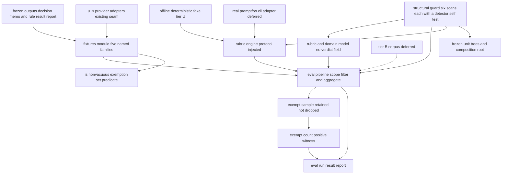

# NFR Design Patterns — `llm-judge` (U22, EPIC-6, Phase 2)

**Stage**: BUILD → NFR Design (per-unit), **Part 2 (Generation)** · **Unit**: U22 `llm-judge` · EPIC-6 · **Phase 2** ·
**Depth**: **standard** (`unit-of-work.md` L249 pin) · **Date**: 2026-07-19.
**Built ON** the frozen FD (**`BR-JUDGE-1..11`**; the domain model; the injected **`RubricEngine`** seam; the four fixture
roles; the three register items) **AND** the approved NFR Requirements (the **eleven `NFR-JUDGE-*`**; the **two LOAD-BEARING
full-highest** targets **EXEMPT-1** + **NOEDIT-1/NOMETRIC-1**; the three named deferrals) — **re-opening NEITHER.**
Answers **Q1–Q3 (all A)** + folds **NFR-JUDGE-ND-Fold-1..3** (plan §5.5).
**Backend Python unit** — "component relationship" = module/class relationships + data flow.

**⚑ U22 is the LAST unit in the entire 23-unit decomposition.**

> ### What "by construction" means for this unit (the honest scope)
> **Genuinely by construction**: an **injected `RubricEngine`** makes reaching into a frozen unit **structurally
> unnecessary** — there is *nothing to gain* (P-JUDGE-5). A domain model that **declares no `Recommendation`-typed field**
> makes *"the judge changed the recommendation"* **unrepresentable**, not merely forbidden (P-JUDGE-10). **`exempt_count`
> as a required report field** makes the exemption **provable by presence** rather than by absence (P-JUDGE-1). A
> **tuple-returning** `anchoring_pair()` makes the pair **unsplittable at the type level** (P-JUDGE-6).
> **Test-only where that is the honest answer**: import/namespace/path facts can only be enforced by **scan**, so every scan
> carries a **mandatory detector self-test** (P-JUDGE-13). Disclosure facts can only be enforced by **token presence**
> (P-JUDGE-7). **Header comments document; they never enforce.**

---

## 1. Patterns

### P-JUDGE-1 `PositiveWitnessExemptionPattern` → NFR-JUDGE-EXEMPT-1 *(positive half)* — **[LOAD-BEARING]**

**How it structurally meets the target**: the exemption is proven by something **present and counted**, never by an absence.
`exempt_count` is a **required field** on `EvalRunResult` and the scope-filter **retains** the exempt sample in
`sample_scores` — so "excluded from scoring" and "dropped from the report" are **different states the type system keeps
apart**.

```python
@dataclass(frozen=True)
class EvalRunResult:
    rubric_id: str
    sample_scores: list[SampleScore]   # ALL samples, deterministic order — INCLUDING exempt ones
    scored_count: int                  # in-gate samples actually scored
    exempt_count: int                  # present but excluded — THE POSITIVE WITNESS (required, not optional)
    aggregate_score: float             # mean over IN-GATE samples only
    gate_passed: bool                  # aggregate_score >= 4
    tier: EvalTier
```

- **Mechanism (spelled out)**: teeth over the **three-sample composition** `in_gate_samples() + exempt_witness_sample()` —
  `scored_count == 2` **∧** `exempt_count == 1` **∧** the Ollama sample **present in `sample_scores`**.
- **Detector self-test**: were the Ollama sample wrongly **scored**, `scored_count` would read **`3`** and the assertion
  fails — the teeth cannot pass on a broken partition.
- **⚑ Why load-bearing**: a frozen U19 artifact (`memo_extensions/tests/test_provgate.py`) **assigns this duty to
  `llm-judge` (U22) BY NAME** and deliberately declines to assert it. **If U22 does not assert it, nothing in the build
  does.**
- **Tier**: component (teeth). **Rigor**: **full (highest) — LOAD-BEARING**.

### P-JUDGE-2 `DegenerateSetGuardPattern` → NFR-JUDGE-EXEMPT-1 *(the DISTINCT structural safeguard)* — **[LOAD-BEARING]**

**How it structurally meets the target** *(Q1-A)*: a **pure predicate over the INPUT sample set**, living in production and
**applied by the test**. It **flags nothing and raises nothing on its own** — so it can never wrongly reject a legitimate
production run over a genuinely Ollama-free corpus.

```python
def is_nonvacuous_exemption_set(samples: Sequence[JudgedSample]) -> bool:
    """True iff at least one sample is exempt-tagged — i.e. there is something to exclude.

    A SET property, not a test-configuration opinion. Constructs no EvalRunResult and runs
    no pipeline (that would collapse this into P-JUDGE-1).
    """
    return any(s.provider is ProviderScopeTag.ollama for s in samples)
```

- **Mechanism**: the test applies it to **`degenerate_all_in_gate_set()`** asserting **`False`**, and to the three-sample
  composition asserting **`True`**. A set yielding `exempt_count == 0` is thereby **flagged as a degenerate verification
  configuration — never silently accepted as a passing run**.
- **⚑ Genuinely distinct from P-JUDGE-1, not a rename (ND-Fold-2)** — different **subject** (INPUT set vs OUTPUT report),
  different **field** (`sample.provider` vs `exempt_count`), different **stage** (pre-run vs post-run), different **failure
  mode** (degenerate fixture vs mis-partitioning pipeline). **One guards the other's PRECONDITION**: over an all-in-gate set
  a pipeline that never implemented exemption at all would still report `scored_count == 2`, so P-JUDGE-1's teeth would pass
  **vacuously** — P-JUDGE-2 is what makes them non-degenerate. **Anti-collapse**: the signature takes samples and returns
  `bool`; it never constructs or reads an `EvalRunResult`.
- **Fixture separation (Req-Fold-1)**: `degenerate_all_in_gate_set()` is a **genuinely separate builder** — distinct
  `sample_id`s, **no call into `in_gate_samples()`**, and a **self-asserting precondition** so it fails at construction
  rather than going vacuous.
- **Tier**: structural (set-property teeth). **Rigor**: **full (highest) — LOAD-BEARING**.

### P-JUDGE-3 `FrozenPathScanPattern` → NFR-JUDGE-NOEDIT-1 — **[LOAD-BEARING]** *(U23 `P-DEP-1` lineage)*

**How it structurally meets the target**: the **U23 `P-DEP-1` mechanism REUSED, not reinvented** — a `pathlib` scan
enumerating every path a U22 deliverable authors, asserting the authored set **⊆ `ALLOWED_U22_PREFIXES`** (U22's own tree)
**and disjoint from `FROZEN_PREFIXES`** (every frozen `backend/<unit>/` tree + `backend/app/**`, the CLOSED composition
root).

- **Detector self-test**: a synthetic authored path under a frozen tree (or under `backend/app/`) **is flagged** — the scan
  cannot pass vacuously.
- **Import-to-read ≠ edit**: U22 imports frozen shapes read-only (`DecisionMemo`, `RuleResultReport`, `METRIC_DEFINITIONS`);
  NOEDIT-1 forbids **writes**, so the read-only imports and this scan **agree by construction** (the settled ROUTES-1 / Q2-A
  position).
- **Tier**: structural / path scan. **Rigor**: **full (highest) — LOAD-BEARING**.

### P-JUDGE-4 `StaticNoDriftAssertionPattern` → NFR-JUDGE-NOMETRIC-1 — **[LOAD-BEARING]** *(Q3-A)*

**⚑ Re-scoped by ND-Fold-3 to eliminate a real overlap.** `deploy-config`'s **frozen** `test_scope.py` **already** asserts
the dashboard↔metrics no-drift property in both directions. A U22 check that merely re-asserted it would be a near-duplicate
of a frozen test — and U22 cannot rely on it executing anyway (the standing instruction forbids re-running either unit's
suite). So the pattern has a **primary** mechanism nothing else makes, plus a **corroborating** one:

- **(a) PRIMARY — the provenance scan (genuinely U22's to make)**: an AST scan over **U22's OWN production tree** asserting
  **no U22 module declares a metric name or a `MetricDefinition`**. Nothing else in the build asserts this.
  **+ detector self-test** (a synthetic `MetricDefinition(...)` in a U22 module **is flagged**).
- **(b) CORROBORATING — the read-only property assertion (Q3-A)**: pins the baseline U22 claims not to have moved, making
  (a) non-vacuous. **Property assertions, NOT a content-hash pin**:

```python
frozen_metrics = {m.name for m in METRIC_DEFINITIONS}      # imported READ-ONLY, by value
assert len(METRIC_DEFINITIONS) == 5                        # no sixth metric
dashboard = json.loads(GRAFANA_DASHBOARD.read_text(encoding="utf-8"))
panels = dashboard["panels"]
assert len(panels) == 5                                    # no sixth panel
assert not any("panels" in p for p in panels)              # robustness: no row-nesting under-count
assert {p["targets"][0]["expr"] for p in panels} == frozen_metrics
```

- **⚑ Mechanism reused, not invented (ND-Fold-3)**: this is `deploy_config/tests/test_scope.py`'s **exact technique**. The
  nested-`panels` assertion is U22's one addition — **measured on disk**: the committed dashboard is a **flat, unnested,
  5-element** array with **no `row`-type panel**, so `len()` is unambiguous *today*; the extra assertion makes it **fail
  loudly** rather than silently under-count if row-nesting were ever introduced.
- **⚑ Why property assertions and not a hash (Q3-A)**: a hash pin would make **any** future legitimate edit by U21's or
  U23's owners break **U22's** suite, and U22 would be asserting a constant **it invented at Code-Gen time** — converting
  *"U22 changed nothing"* into *"nobody may ever change these files,"* a stronger claim than the last unit in the build is
  entitled to make. **No suite is re-run**; both artifacts are read **read-only**.
- **Tier**: structural (read-only). **Rigor**: **full (highest) — LOAD-BEARING**.

### P-JUDGE-5 `SatisfiableNonVacuousProtocolPattern` → NFR-JUDGE-CLIDEFER-1

**A two-part contract — and the SECOND part is part of the pattern's definition, not a footnote.**

```python
class RubricEngine(Protocol):
    def score(self, sample: JudgedSample, rubric: GroundednessRubric) -> list[DimensionScore]: ...

# tier-U (the fake lives in tests/, never in production)
assert isinstance(fake, RubricEngine)            # SATISFIABLE
assert not isinstance(object(), RubricEngine)    # NON-VACUOUS — the exact U19 assertion
```

- **(1) DELIVERED**: satisfiability **∧** non-vacuity (U19's `test_signal.py` assertion, mirrored), plus the **production
  AST scan** proving **no U22 production module imports the promptfoo shim** (+ detector self-test). The whole suite passes
  with **no Node, no npx, no network, no telemetry, no key, no live LLM**.
- **(2) ⚑ DELIBERATELY NOT DELIVERED — and this is a PROPERTY OF THE PATTERN.** **The pattern's PRECONDITION is the
  existence of a frozen, on-disk shape to mirror.** U19 could build a by-value replica because U18's `OutlierResult` **is**
  such a target — verifiable. **For U22 that precondition is ABSENT**: the promptfoo CLI is **absent**, and its output shape
  is **external, version-dependent and unpinned** (an `npx` run-time fetch). A replica would attest to an **assumption** and
  **pass green while the real interop was broken** — worse than no test. ⇒ **real-shape interop is the 5th named discharge
  criterion of `PROMPTFOO-CLI-DEFERRED`**, not a faked test. *Stating the precondition IS the pattern; a designer who later
  gains a pinned CLI can see exactly when the replica becomes legitimate.*
- **Tier**: tier-U absence + Protocol teeth. **Rigor**: full.

### P-JUDGE-6 `UnsplittablePairedFixturePattern` → NFR-JUDGE-ANCHOR-1 *(Q2-A)*

**How it structurally meets the target**: the pair is **one return value**, so a test **cannot take one without the other**
— unsplittability is enforced at the **type level**, not by convention.

```python
def anchoring_pair() -> tuple[JudgedSample, JudgedSample]:
    """(close, divergent) — returned TOGETHER so ANCHOR-1's pair cannot be split.
    Its OWN family: never overlapped onto the provider-tagged samples (Q1-A)."""
```

- **Mechanism**: the close sample lands with a **higher** `SampleScore.aggregate` than the divergent one; both are scored
  against the single canonical `reference_memo()`. **Detector self-test**: a single-fixture-only configuration is **flagged
  as insufficient**. **Non-overlap** (Q1-A) means a provider-scope edit cannot silently move the anchoring baseline.
- **⚑ HONEST SCOPE — a first-class clause of this pattern, not a caveat (Q2-A / ND-Fold-1).** The tier-U `RubricEngine` fake
  is **frozen by the FD** as returning **fixture-DECLARED** scores. Therefore what ANCHOR-1 proves at tier-U is **the
  paired-fixture plumbing and the unsplittable-pair safeguard** — that **two distinguishable samples flow through the seam
  and land as distinguishable `SampleScore`s with the close one higher**, in declared order, aggregated correctly. It does
  **NOT** prove that a real judge scores divergence lower; **that is engine behaviour, and it is a named criterion of
  `PROMPTFOO-CLI-DEFERRED`'s discharge.**
- **⚑ Why the fake is NOT given a similarity heuristic**: U22 would then own **a scoring heuristic that is not what the real
  engine does**, and a green ANCHOR-1 would attest to **U22's own heuristic rather than to the rubric** — the identical
  false-confidence failure mode already rejected for the by-value interop replica (P-JUDGE-5). **The same principle applied
  twice, deliberately.**
- **Tier**: component (paired teeth) + detector self-test. **Rigor**: full.

### P-JUDGE-7 `TokenChecklistGovernancePattern` → NFR-JUDGE-DISCLOSE-1 *(U23 `DOC-1` lineage)*

**How it meets the target**: a rule whose entire content is *"this is honestly not implemented"* **has no behaviour to
exercise**, so the honest mechanism is a **token-set checklist** matching **tokens, not headings or prose** — U23's DOC-1
technique.

- **Token set**: **`FEWSHOT-ANCHOR-UNIMPLEMENTED`** **+ its `memo-agent-core` (U4) owner attribution** + its rationale,
  **plus a negative assertion** that no U22 artifact or report field claims discharge. **Detector self-test**: removing the
  disclosure token **fails** the check.
- **⚑ ANTI-CONFLATION with P-JUDGE-5 (Req-Fold-3)** — the two disclosures must stay non-interchangeable: DISCLOSE-1's token
  set is keyed to the **register name + U4 owner attribution**; CLIDEFER-1's is keyed to its **five discharge criteria**.
  **Each detector self-test additionally asserts that the OTHER's tokens being present does NOT mask its own token's
  removal.** They differ in content, **owner** (U4/future-authorized — **never U22's to discharge** — vs U22's own seam),
  direction of data flow, and dischargeability (**structurally blocked** vs merely not-yet-done).
- **⇒ Labelled governance/documentation-presence, and labelling it so is HONEST**, exactly as `deploy-config` labelled
  BUILD-1/BOOT-1's deploy-time halves *named-not-tested*.
- **Tier**: governance / doc-presence + detector self-test. **Rigor**: governance.

### P-JUDGE-8 `PureBoundaryArithmeticPattern` → NFR-JUDGE-THRESH-1

- **By construction**: aggregation and the gate are a **pure function** of the dimension scores — no RNG, no wall-clock, no
  external call — so given fixed scores the result is **byte-reproducible**, with dimension order following the rubric's
  **declared** order.
- **Mechanism**: `passed = aggregate >= threshold`, with the **`>=` asserted explicitly** and both boundary cases exercised:
  **`aggregate == 4` PASSES** and **`aggregate == 3.99` FAILS**. `gate_passed` is computed over the **in-gate mean**, with an
  exempt sample present and **provably not contributing** to it.
- **Tier**: component (teeth). **Rigor**: full.

### P-JUDGE-9 `ScopePartitionPattern` → NFR-JUDGE-INGATE-1 + NFR-JUDGE-EXEMPTSCOPE-1

- **By construction**: `ProviderScopeTag` is the **single place** the in-gate/exempt decision is represented, and the filter
  is a **partition** — every sample lands in exactly one side, so "scored" and "retained" cannot silently diverge.
- **INGATE-1**: over `in_gate_samples()` — `scored_count == 2`, both `in_gate == True`, both in `sample_scores`.
  **GATE-1's decision-level gates remain `quality-gates`'** — U22 single-sources **GATE-2 only**.
- **EXEMPTSCOPE-1**: the exempt record carries an **explicit reason tag naming *memo-quality*** as the exemption's scope; a
  scan finds **no** "untested"-equivalent characterization of Ollama in any U22 artifact. U19's decision-level assertions
  are **REFERENCED, never re-derived**.
- **Tier**: component (teeth) + structural. **Rigor**: full.

### P-JUDGE-10 `UnrepresentableVerdictPattern` → NFR-JUDGE-ADVISORY-1 / NOVERDICT-1

- **By construction (the strong half)**: **no U22 type declares a `Recommendation`-typed or verdict-typed field** ⇒ *"the
  judge changed the recommendation"* is **unrepresentable**, not merely forbidden. Only `memo.narrative_prose` (the **`L`**
  region) is judged; the `D`/`RO`/`M` regions are never scored — scoring them would re-open **CON-BR2-TYPE**.
- **Scan half**: a **token scan** over every U22 artifact for a bare verdict token (`APPROVE`/`REFER`/`DECLINE`) used as a
  judge **output**, **+ detector self-test** (a synthetic verdict-emitting type or token **is flagged**). All rubric text,
  dimension descriptions, justifications and report copy use **"recommendation"**, never a bare "decision".
- **Tier**: structural + token scan. **Rigor**: full.

### P-JUDGE-11 `DemographicTokenScanPattern` → NFR-JUDGE-NODEMO-1

- **Mechanism**: a demographic-token scan over **every U22 artifact AND the hand-authored `reference_memo()`**, **+ detector
  self-test** — a **synthetic demographic token planted in a fixture IS flagged**, proving the scan non-vacuous. Mirrors
  U4's `PromptBuilder`, which deliberately omits name/city/gender.
- **Tier**: structural + detector self-test. **Rigor**: full.

### P-JUDGE-12 `AbsenceProofDeferralPattern` → NFR-JUDGE-EVALDEFER-1

- **Mechanism**: the whole suite passes with **tier-B unauthorized and the corpus absent**; `EvalRunResult.tier` reads
  **`unit`**; **no test reads the real corpus**.
- **⚑ Distinct absence from P-JUDGE-5's (Fold-1)**: *no corpus read* vs *no engine present*, with **disjoint discharge
  criteria** and a **one-way prerequisite** (`JUDGE-EVAL-DEFERRED` needs `PROMPTFOO-CLI-DEFERRED` first). Precedent: U18
  completed with an `R` corpus edge and *"tier-B NOT authorized (not required)"*.
- **Tier**: tier-U absence + named deferral. **Rigor**: full.

### P-JUDGE-13 `StructuralGuardPattern` → the structural halves *(U18/U19/U21 substrate)*

One substrate of independent scans, **each with a mandatory detector self-test**, parsing every **production** `.py` under
`backend/llm_judge/` **EXCLUDING `tests/`** (verbatim U21 `structural.py` behaviour), with an
**`EXPECTED_PRODUCTION_MODULES` non-vacuity guard** so no scan can pass over an empty file set.

| # | Scan | Target |
|---|---|---|
| 1 | authored paths ⊆ own tree, disjoint from frozen trees + `backend/app/**` | **NOEDIT-1** |
| 2 | no U22 module declares a metric name / `MetricDefinition` (**provenance**) | **NOMETRIC-1** |
| 3 | no production import of the promptfoo shim | CLIDEFER-1 |
| 4 | no `Recommendation`/verdict-typed field; no bare verdict token as output | ADVISORY-1 / NOVERDICT-1 |
| 5 | no demographic token in any artifact or the reference memo | NODEMO-1 |
| 6 | the disclosure token set present; no discharge claimed (**anti-conflation**) | DISCLOSE-1 |

- **Tier**: structural. **Rigor**: full.

### P-JUDGE-14 `ObservedNeverGatedGovernancePattern` → NFR-JUDGE-PERF-1 + NFR-JUDGE-SEC-1

- **PERF-1**: **U22 owns no runtime SLO** — memo-quality evaluation is an **out-of-band quality activity**, not a
  request-path concern. Nothing to time at tier-U (the engine is an offline fake); **no U22 test asserts a timing failure**.
- **SEC-1**: the Security-Guardrails governance posture — review + the P-JUDGE-13 scans. The three register items are
  **named, owner-attributed and disclosed**; **U22 claims no discharge of any of them**. **Not over-specified.**
- **Tier**: observed / governance. **Rigor**: soft / governance.

---

## 2. Module-relationship diagram (validated — rectangle-only, alphanumeric IDs, quoted labels, no special characters, zero edge labels)



### Text alternative (equivalent to the diagram)

- **⚑ The no-frozen-edit guarantee is a VISIBLE graph property.** **`frozen unit trees and composition root` has exactly
  ONE inbound edge, and it comes from `structural guard`** — a **read-only scan**. **No component U22 authors — not the
  rubric, not the eval pipeline, not the fixtures, not the predicate — has any edge into it.** The **absence of an authored
  edge IS the guarantee** (P-JUDGE-3), and the single guard edge is what proves that absence **non-vacuously**.
- **⚑ The exempt-count-as-positive-witness mechanism is a VISIBLE graph property.** The exempt route is a three-node chain:
  `eval pipeline` → `exempt sample retained not dropped` → `exempt count positive witness` → `eval run result report`. The
  exempt sample **terminates in a counted witness INSIDE the report**, never in a dead end — proof **by presence**, not by
  absence (P-JUDGE-1).
- **The two EXEMPT-1 halves are visibly separate**: the `fixtures module` feeds **both** the `eval pipeline` (P-JUDGE-1's
  behavioural teeth, via the three-sample composition) **and**, on a **separate edge**, the
  `is nonvacuous exemption set predicate` (P-JUDGE-2's set-property safeguard). The predicate has **no edge to the report** —
  it never constructs an `EvalRunResult`, which is exactly the anti-collapse mechanism.
- **Frozen inputs are consumed, never edited**: `frozen outputs decision memo and rule result report` and
  `u19 provider adapters existing seam` flow **into** the `fixtures module` only.
- **The seam is injected**: the `offline deterministic fake` binds the `rubric engine protocol` at tier U; the
  `real promptfoo cli adapter` connects to the **same** protocol by a **dashed (deferred)** edge.
- **Only two edges are dashed, and both are deferrals**: `real promptfoo cli adapter` → the protocol
  (`PROMPTFOO-CLI-DEFERRED`) and `tier B corpus` → the pipeline (`JUDGE-EVAL-DEFERRED`). **Every solid path is exercised at
  tier U** with no live LLM, no key, no network and no Node.
- **`structural guard`** covers the rubric, the pipeline and the protocol, and reads the frozen trees — six scans, each with
  a detector self-test. It is **test-only** and is not a runtime dependency.

---

## 3. Traceability — pattern → target → tier → rigor (**NO ORPHAN**)

| Pattern | Target(s) | Tier | Rigor |
|---|---|---|---|
| **P-JUDGE-1 `PositiveWitnessExemptionPattern`** | **NFR-JUDGE-EXEMPT-1** *(positive)* | component (teeth) | **full (highest) — LOAD-BEARING** |
| **P-JUDGE-2 `DegenerateSetGuardPattern`** | **NFR-JUDGE-EXEMPT-1** *(distinct safeguard)* | structural (set property) | **full (highest) — LOAD-BEARING** |
| **P-JUDGE-3 `FrozenPathScanPattern`** | **NFR-JUDGE-NOEDIT-1** | structural / path scan | **full (highest) — LOAD-BEARING** |
| **P-JUDGE-4 `StaticNoDriftAssertionPattern`** | **NFR-JUDGE-NOMETRIC-1** | structural (read-only) | **full (highest) — LOAD-BEARING** |
| P-JUDGE-5 `SatisfiableNonVacuousProtocolPattern` | NFR-JUDGE-CLIDEFER-1 | tier-U absence + Protocol | full |
| P-JUDGE-6 `UnsplittablePairedFixturePattern` | NFR-JUDGE-ANCHOR-1 *(**honest scope**: plumbing + unsplittability, **not** engine discrimination — Q2-A)* | component (paired teeth) | full |
| P-JUDGE-7 `TokenChecklistGovernancePattern` | NFR-JUDGE-DISCLOSE-1 | governance / doc-presence | governance |
| P-JUDGE-8 `PureBoundaryArithmeticPattern` | NFR-JUDGE-THRESH-1 | component (teeth) | full |
| P-JUDGE-9 `ScopePartitionPattern` | NFR-JUDGE-INGATE-1 · NFR-JUDGE-EXEMPTSCOPE-1 | component + structural | full |
| P-JUDGE-10 `UnrepresentableVerdictPattern` | NFR-JUDGE-ADVISORY-1 / NOVERDICT-1 | structural + token | full |
| P-JUDGE-11 `DemographicTokenScanPattern` | NFR-JUDGE-NODEMO-1 | structural + self-test | full |
| P-JUDGE-12 `AbsenceProofDeferralPattern` | NFR-JUDGE-EVALDEFER-1 | tier-U absence + deferral | full |
| P-JUDGE-13 `StructuralGuardPattern` | structural halves of NOEDIT / NOMETRIC / CLIDEFER / ADVISORY / NODEMO / DISCLOSE | structural | full |
| P-JUDGE-14 `ObservedNeverGatedGovernancePattern` | NFR-JUDGE-PERF-1 · NFR-JUDGE-SEC-1 | observed / governance | soft / governance |

**All eleven `NFR-JUDGE-*` covered (+ PERF-1 / SEC-1); NO ORPHAN.**
**Both LOAD-BEARING targets are covered by TWO patterns each** — EXEMPT-1 by P-JUDGE-1 + P-JUDGE-2, NOEDIT-1/NOMETRIC-1 by
P-JUDGE-3 + P-JUDGE-4 — so **no single edit can weaken both halves of either**.

---

## 4. Settled items held (not re-opened)

- The **frozen FD** and the **approved NFR Requirements** are the substrate; **neither is revised**.
- **Q1-A** — `is_nonvacuous_exemption_set()` is **production, pure, applied by the test**; **ND-Fold-2** pins the
  anti-collapse signature.
- **Q2-A** — the fake stays **declared-echo exactly as frozen**; ANCHOR-1's scope is **honestly narrowed in P-JUDGE-6's own
  definition**; engine discrimination becomes a **named `PROMPTFOO-CLI-DEFERRED` criterion**. **ND-Fold-1**: a legitimate
  Design-stage clarification of a consequence the **frozen FD** had already determined — **not** a material change to what
  the NFR Requirements gate approved (all four acceptance criteria survive untouched). *One disclosure is carried to the
  stage gate.*
- **Q3-A** — **property assertions, not a hash pin**; **ND-Fold-3** re-scopes P-JUDGE-4 so its **primary** mechanism is the
  provenance scan (non-duplicative) with the property read **corroborating**, and adds the **no-row-nesting** robustness
  assertion. **Neither U21's nor U23's suite is re-run.**
- **Deferred to Infrastructure Design / Code-Gen**: the exact module names under `backend/llm_judge/`; the fake's precise
  surface; the exact scan token sets; the `pyproject.toml` `--cov=backend/llm_judge` line.
- **Deferred by name (NOT discharged)**: `PROMPTFOO-CLI-DEFERRED` · `JUDGE-EVAL-DEFERRED` · `FEWSHOT-ANCHOR-UNIMPLEMENTED`.
- **Untouched**: **WIRE-1** · the **17 frozen P1 units (INCLUDING `memo-agent-core`)** · U18 · U19 · U20 · U21 · U23 · the
  **CLOSED composition root** · **tier-B (NOT authorized)** · the **`audit_store` Docker-guard gap** · the **23-unit
  decomposition**.
