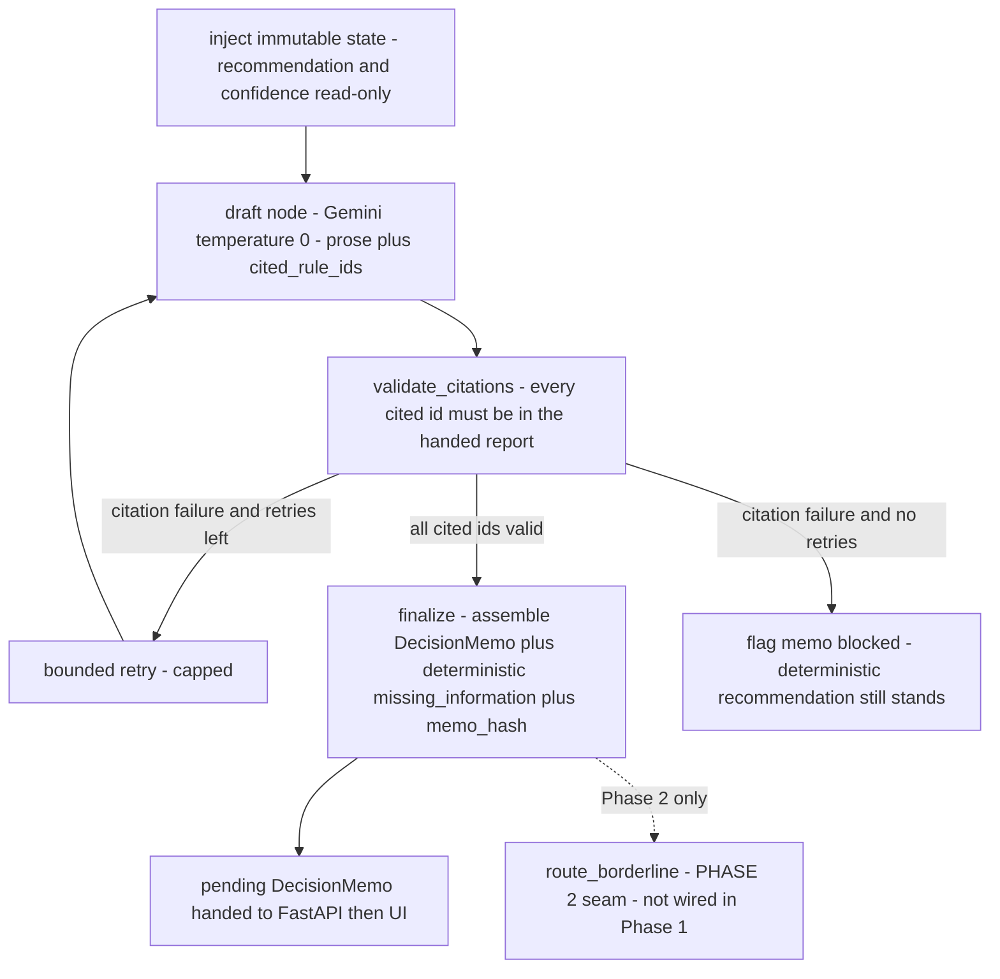

# Business Logic Model — `memo-agent-core` (C4 / U4)

**Stage**: BUILD → Functional Design (per-unit) · cluster-FD-first unit 4 of 4 (the last)
**Unit**: U4 `memo-agent-core`
**Date**: 2026-07-03
**Scope**: The LangGraph memo sub-flow (draft → validate_citations → retry/finalize), the
immutable-recommendation state (CON-BR2 inside the graph), the graph-persistence/interrupt pattern
(gate EXTERNAL), the temperature=0 Gemini call path (P1), `memo_hash` at finalize, the dual-path
commit note, and the replay boundary. Technology-agnostic.

---

## 1. Memo sub-flow overview — `draft → validate_citations → retry/finalize`

Frozen contracts (`component-methods.md` C4): `draft(profile, rule_report, outlier_result|None) ->
DecisionMemo`; `validate_citations(memo_draft, rulebook) -> CitationValidationResult`;
`route_borderline(...) -> ThinkingMode` (**Phase 2 seam — not wired here**). **LangGraph is scoped
to this C4 memo sub-flow ONLY**; the deterministic pipeline (intake→rules→outlier) ran **before** the
graph.

Mermaid validated before write (alphanumeric node IDs; double-quoted labels; **no colons, no
semicolons, no parentheses, no special chars** in labels — hyphens/"plus"/"vs" only; balanced
brackets; no reserved-word `end` node). Text alternative follows.

### Text alternative (always included)

1. **Inject immutable state** — `recommendation` + `confidence` enter the graph as **read-only**
   channels (produced upstream); **no node can write them** (§2, CON-BR2 state layer).
2. **`draft`** — a Gemini call at **temperature=0** (P1) via the provider-abstraction, producing
   `narrative_prose` + `cited_rule_ids` (structured XML→Pydantic).
3. **`validate_citations`** — every `cited_rule_id` must be a **member of the handed
   `RuleResultReport`** (`business-rules.md §2`). **Citation failure with retries left → bounded
   `retry` → `draft`**; **failure with no retries → `flag`** (memo blocked, deterministic
   recommendation stands); **all valid → `finalize`**.
4. **`finalize`** — assemble the `DecisionMemo` (LLM prose + citations + the **deterministic**
   `missing_information` list + the read-only recommendation/confidence) and compute **`memo_hash`**
   (§3). The **pending** `DecisionMemo` is handed to FastAPI → UI.
5. **`route_borderline`** is a **Phase-2 seam only** (`memo-extensions`) — **not wired in Phase 1**
   (shown dashed/marked for context, not on the execution path).

---

## 2. Immutable-recommendation state + the graph-persistence/interrupt pattern

### 2.1 Immutable recommendation (CON-BR2 state layer)
- `recommendation` + `confidence` are injected into the graph's **initial state as read-only**; the
  state schema marks them **input-only** and **no node has write access**. The graph's output is
  prose + citations + `missing_information` — **never** a recommendation (`business-rules.md
  BR-CONBR2-STATE`).

### 2.2 Graph persistence NONE / interrupt NO — the gate is EXTERNAL

> **BACK-ANNOTATION (pinned at the register #33/#34 code-gen pass, 2026-09-12 — #34
> `CHECKPOINT-POISONS-REDRAFT`, candidate C2).**
> ⛔ **SUPERSEDED — this section's heading and first bullet.** The heading read *"2.2 Checkpointer
> YES / interrupt NO"*; the bullet read *"**Checkpointer: YES** — for **state durability + the
> citation-validation retry loop + 100%-step Langfuse tracing**. (Its Phase-1 justification is
> retry/durability/observability — not the borderline step, which is Phase 2.)"*
>
> **The decision is now: NO checkpointer.** The graph is compiled with a bare `graph.compile()` and
> no graph state is persisted. ⛔ **All three Phase-1 justifications were false, and the mechanism
> did active harm**: `run()` keys the thread by `application_id`, so the **second** draft of one
> application restored the read-only channels, seeding took the reducer branch, and
> `_reject_channel_write` fired on the **seed** — every re-draft raised `RuntimeError` (#34).
>
> * *citation-validation retry loop* — the `add_conditional_edges` cycle is plain graph state.
>   ⚑ **Reproduced working with no checkpointer at all**: bad-then-good provider → 2 calls, memo
>   finalized.
> * *state durability* — `MemorySaver` is in-process, and ⛔ **nothing ever read a checkpoint back**:
>   no `get_state`, `update_state`, `get_state_history`, `.stream`, `astream` or `interrupt` exists
>   anywhere in this repository.
> * *100%-step Langfuse tracing* — ⚠️ **this clause was false BEFORE C2 and is NOT a consequence of
>   it.** Tracing was never wired through a checkpointer at all, and
>   `observability.TraceRecorder.on_step` has **no production caller** (owned by OBS-SINK-DEFERRED,
>   not by this unit).
>
> ⚑ **The interrupt half is UNCHANGED and remains true** — the bullet below stands as written, and
> §2.1's read-only-channel contract (CON-BR2-STATE) is untouched in substance.

- **In-graph interrupt for the human gate: NO.** The graph **finishes** as advisory output (a
  **pending** `DecisionMemo`); the **human approval gate is OUTSIDE the graph** — it is
  `DecisionCommitService` (in `audit-store`), a **separate boundary** reached via FastAPI
  (`services.md §1` Q6). There is **no `interrupt_after` for the gate**.
- **Consistency with `audit-store`**: the commit boundary lives in `DecisionCommitService`
  (audit-store FD) — this unit produces the memo, it does **not** commit.

---

## 3. `memo_hash` at `finalize` (shared CANON-SER — byte-identical to ReplayService)

- At **`finalize`**, `memo_hash` = a deterministic hash over the `DecisionMemo`'s canonical content,
  serialized by the **single `CANON-SER` convention defined in `audit-store` `domain-entities.md
  §2.1`** — **referenced, not re-declared** (one spec, no drift).
- **Hashed content** = `narrative_prose` + `cited_rule_ids` + `missing_information` +
  `recommendation` + `confidence`; **`timestamp` (and other volatile metadata) excluded** (CANON-SER
  "no volatile fields").
- `memo-agent-core` **computes** the hash; `audit-store` **persists** it in the 6-tuple;
  `ReplayService` **recomputes/compares** it to verify the stored memo — **byte-identical by
  construction** because both use the same spec. Replay **never re-drafts** the memo.

---

## 4. Dual-path commit note + replay boundary

### 4.1 Dual path (CON-BR2 commit layer)
- The **committed** recommendation routes **`rules-engine` → `DecisionCommitService`** via
  **`recommendation_id`**, **bypassing the memo**. The memo's echoed `recommendation` field is for
  **display/citation only**; the commit **never** reads it (`business-rules.md BR-CONBR2-COMMIT`).
  So even if the prose disagreed, what commits is the deterministic recommendation.

### 4.2 Replay boundary (consistent with `audit-store`)
- On replay, the memo is **verified by `memo_hash`** (byte-identity), **never re-drafted** (no LLM in
  replay — non-deterministic). The **memo is OUTSIDE the replay evaluation-equality set** (which is
  rules-engine's `rule_results` + `recommendation` + `confidence`). This matches `audit-store`'s
  replay projection exactly — deterministic core = replay-compared; memo = hash-verified.

---

## 5. Phase boundary (P1 memo-agent-core vs P2 memo-extensions)

| Capability | Phase | Home |
|---|:--:|---|
| provider-abstraction interface + **Gemini** adapter + central **temperature=0** + XML→Pydantic | **1** | **`memo-agent-core`** (this unit) |
| `draft` → `validate_citations` → retry/finalize graph + `memo_hash` | **1** | **`memo-agent-core`** |
| deterministic `missing_information` | **1** | **`memo-agent-core`** |
| secondary (**Claude**) / showcase (**Ollama**) adapters | 2 | `memo-extensions` |
| **MCP** servers (supplementary descriptions) | 2 | `memo-extensions` |
| **`route_borderline`** extended-thinking routing (FR-MEMO-6/7) | 2 | `memo-extensions` |

This FD builds the **Phase-1** scope and **marks the Phase-2 seams without wiring them**.

---

## 6. Invariant compliance (self-check)

| Invariant | How this model holds it |
|---|---|
| **CON-BR2** | Three layers: type (no writable recommendation field), graph-state (read-only channel, no node write), commit-path (committed rec bypasses the memo). QA-5 asserts. |
| **temperature=0** | Central enforcement in the provider-abstraction (Gemini P1), every production call (`business-rules.md §6`). |
| **Hallucination guard** | `validate_citations`: every cited id a member of the handed report; failure → memo blocked, deterministic recommendation stands. |
| **CON-DET-1 boundary** | `missing_information` deterministic; `memo_hash` deterministic via shared CANON-SER; the memo is not in the replay equality set; replay verifies by hash, never re-drafts. |
| **SEC-1-FORENSIC** | The forensic span is structurally never handed to this unit; no LLM-bound payload references `original_span`. |
| **Advisory-only** | System prompt enforces "recommendation", never "decision" (`business-rules.md §6`). |
| **Gate external** | The human gate is `DecisionCommitService` (audit-store), outside the graph; no in-graph interrupt. |
| **DATA-4** | Synthetic inputs only. |

---

*End of business-logic-model.md. Schema → `domain-entities.md`; grounding/citation/CON-BR2/SEC-1
rules → `business-rules.md`.*
