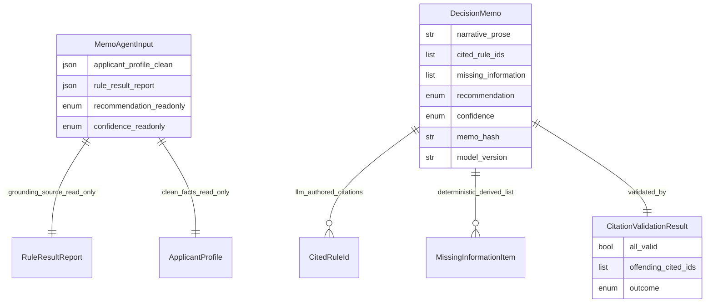

# Domain Entities — `memo-agent-core` (C4 / U4)

**Stage**: BUILD → Functional Design (per-unit) · cluster-FD-first **unit 4 of 4 — the LAST cluster unit**
**Unit**: U4 `memo-agent-core` (owns `DecisionMemo`, `CitationValidationResult`, the memo-agent input
contract; where the **LLM enters**, downstream of deterministic results)
**Date**: 2026-07-03
**Scope**: Field-by-field **internals** of the frozen C4 contracts (`component-methods.md`): the
`DecisionMemo` schema (LLM-authored prose **separated** from the deterministic `missing_information`
list and the **read-only** recommendation/confidence), `memo_hash`, and the agent input contract.
The contract **shapes** are frozen; this defines their fields.

Technology-agnostic. Types are logical (`str`, `enum`, `list`, `json`); the Pydantic v2 / XML
realization is a Code-Generation concern.

---

## 1. Entity-relationship / schema view

Mermaid validated before write (alphanumeric entity IDs; relationship labels quoted; **no
semicolons, no bare colons, no parentheses, no special chars** in labels; balanced blocks). Text
alternative follows.

### Text alternative (always included)

- **`MemoAgentInput`** is what the agent is handed — **clean, read-only artifacts only**: the
  sanitized `ApplicantProfile` (facts), the `RuleResultReport` (the **grounding source**), and the
  **read-only** `recommendation` + `confidence` (produced upstream). It **never** contains the
  SEC-1 forensic span (§4 / `business-rules.md`).
- **`DecisionMemo`** has three structurally distinct regions (§2): **LLM-authored** (`narrative_prose`
  + `cited_rule_ids`), **deterministically-derived** (`missing_information`), and **injected
  read-only** (`recommendation` + `confidence`) — plus `memo_hash` + `model_version` metadata.
- **`CitationValidationResult`** is the hallucination-guard output (§3): whether every cited ID is a
  member of the handed report; offending IDs; the outcome.

---

## 2. `DecisionMemo` — field-by-field (three regions; CON-BR2 structural)

`L` = **LLM-authored** · `D` = **deterministically-derived** (not LLM) · `RO` = **injected read-only**
(produced upstream, the LLM cannot write) · `M` = metadata.

| Field | Type | Origin | Notes |
|---|---|:--:|---|
| `narrative_prose` | `str` | **L** | The advisory memo prose the LLM drafts. **Advisory-only language** — "recommendation", never "decision" (FR-MEMO-4). May *render/reference* `missing_information`, but does **not** author the structured list (§ Q1↔Q3 fix). |
| `cited_rule_ids` | `list[str]` | **L** | Rule IDs the LLM cites. **Every ID must be a member of the handed `RuleResultReport`** (`business-rules.md §2` — the grounding + hallucination guard). |
| `missing_information` | `list[MissingInformationItem]` | **D** | **Deterministically derived** from intake's completeness manifest + the `not_evaluated` rule results (`business-rules.md §4`) — **NOT LLM-authored**, reproducible, grounded. **This structured list is the authoritative output** surfaced to the underwriter (the C5 `ui-memo-view` MemoView element, G3). |
| `recommendation` | `enum` | **RO** | `APPROVE \| REFER \| DECLINE-RECOMMEND` — **injected read-only** from `rule_report.recommendation` by the orchestrator, **never** part of the XML→Pydantic parse the model fills. **No writable field/setter** through which LLM output can alter it — structural CON-BR2 (QA-5). |
| `confidence` | `enum` | **RO** | `High \| Medium \| Low` — **injected read-only** from the core (produced deterministically upstream in `rules-engine`, G2). The memo does **NOT** generate confidence. |
| `memo_hash` | `str` | **M** | Deterministic hash over the memo's canonical content — §5. Handed to `audit-store` for the 6-tuple; `ReplayService` verifies by hash (never re-drafts). |
| `model_version` | `str` | **M** | The provider/model that drafted the prose (Gemini primary, P1) — recorded in the 6-tuple. |

> **CON-BR2 by construction (type layer).** `DecisionMemo` has **no writable `recommendation`
> field** the model populates: `recommendation`/`confidence` are **`RO`** (set by the orchestrator
> from `rule_report`); the model's structured output only ever fills `narrative_prose` +
> `cited_rule_ids`. The type itself makes "the LLM changed the recommendation" **unrepresentable**
> (QA-5 asserts). The graph-state and commit-path layers are in `business-logic-model.md §2/§4`.

### 2.1 `MissingInformationItem` (deterministic)

| Field | Type | Notes |
|---|---|---|
| `source` | `enum` | `missing_document \| unparseable_document \| not_evaluated_rule \| incomplete_flag` — where the gap came from. |
| `detail` | `str` | The specific item — e.g. the `doc_type` missing, or the `rule_id` that was `not_evaluated`. |

> Every item traces to a **deterministic signal** in the handed inputs (manifest status /
> `RuleResult.status == not_evaluated` / `profile.incomplete`). No item is LLM-invented.

---

## 3. `CitationValidationResult` — the hallucination guard (frozen `validate_citations`)

`validate_citations(memo_draft, rulebook) -> CitationValidationResult` (frozen signature).

| Field | Type | Notes |
|---|---|---|
| `all_valid` | `bool` | `true` iff every `cited_rule_id` is a **member of the handed `RuleResultReport`** (authoritative) — and, belt-and-suspenders, exists in the active `rulebook` (`business-rules.md §2`). |
| `offending_cited_ids` | `list[str]` | Cited IDs not present in the report (and/or not in the rulebook). |
| `outcome` | `enum` | `valid \| citation_failure` — on `citation_failure` the memo is **blocked, not surfaced** (`business-rules.md §2`; bounded retry then flagged). |

---

## 4. `MemoAgentInput` — the agent input contract (SEC-1-FORENSIC non-ingestion)

What `memo-agent-core` is handed — **clean, read-only artifacts only**:

| Field | Type | Notes |
|---|---|---|
| `applicant_profile_clean` | `json` | The `ApplicantProfile` whose free-text already flows as `SanitizedText.clean_text` (intake SEC-1). Read-only facts. |
| `rule_result_report` | `json` | The `RuleResultReport` (rules-engine) — the **sole grounding source** (`business-rules.md §2`). |
| `recommendation_readonly` | `enum` | Injected read-only. |
| `confidence_readonly` | `enum` | Injected read-only. |

> **SEC-1-FORENSIC boundary (intake carry-forward).** The `SanitizationReport` / `original_span`
> is **AUDIT-ONLY** and **structurally never passed** to `memo-agent-core` — it travels a separate
> audit path to `audit-store`. The memo prompt-builder has **no reference** to it; tests assert **no
> LLM-bound payload can reference `original_span`** (`business-rules.md §5`). The neutralized
> injection cannot re-enter through the memo.

---

## 5. `memo_hash` — deterministic, via audit-store's single CANON-SER

- `memo_hash` = a **deterministic hash over the `DecisionMemo`'s canonical content**, computed
  **once at `finalize`** (`business-logic-model.md §3`).
- **Serialization = the single `CANON-SER` convention defined in `audit-store`
  `domain-entities.md §2.1`** — **referenced, NOT re-declared here** (one spec, not two that could
  drift). CANON-SER = stable key ordering, `Decimal`-as-string, canonical scalar forms, **no
  volatile fields**.
- **Hashed content** = the memo's stable content fields (`narrative_prose`, `cited_rule_ids`,
  `missing_information`, `recommendation`, `confidence`) — **excluding volatile metadata**
  (`timestamp` is not hashed; per CANON-SER "no volatile fields").
- **`audit-store` persists** `memo_hash` in the 6-tuple; **`ReplayService` verifies** the stored
  memo by **recomputing/comparing the hash** — it **never re-drafts** the memo (no LLM in replay).
  Because both units use the **same CANON-SER spec**, the hash `memo-agent-core` computes is
  **byte-identical** to the one `ReplayService` checks.

---

## 6. Cross-consumer / cluster-closure check (P6 — closes the 4-unit cluster)

| Consumer / producer | Needs / provides | Covered by |
|---|---|---|
| `rules-engine` (U3) → here | grounding source (what fired) + read-only recommendation/confidence | `MemoAgentInput.rule_result_report` + `recommendation_readonly`/`confidence_readonly` ✓ |
| here → `audit-store` (U12) | `memo_hash` + `model_version` for the 6-tuple (the fields audit-store reserved, its FD §7) | `DecisionMemo.memo_hash` (CANON-SER, §5) + `model_version` ✓ |
| here → `ReplayService` | a hash it can recompute + verify without re-drafting | `memo_hash` via the shared CANON-SER (§5) ✓ |
| here → C5 `ui-memo-view` | the memo prose + cited rules + confidence + the **missing_information** list | `narrative_prose` + `cited_rule_ids` + `confidence` + `missing_information` (G3) ✓ |
| intake (U1) → here | clean facts only; **no** forensic span | `applicant_profile_clean`; `original_span` structurally excluded (§4) ✓ |

**The cluster contract is closed**: the four contract-bearing units
(`intake`/`document-sanitizer` → `rules-engine` → `audit-store` → `memo-agent-core`) agree
field-for-field, and `memo_hash` shares audit-store's CANON-SER — stable before any Code-Gen.

---

*End of domain-entities.md. Grounding / citation / CON-BR2 / SEC-1 rules → `business-rules.md`;
LangGraph sub-flow + replay boundary → `business-logic-model.md`.*
