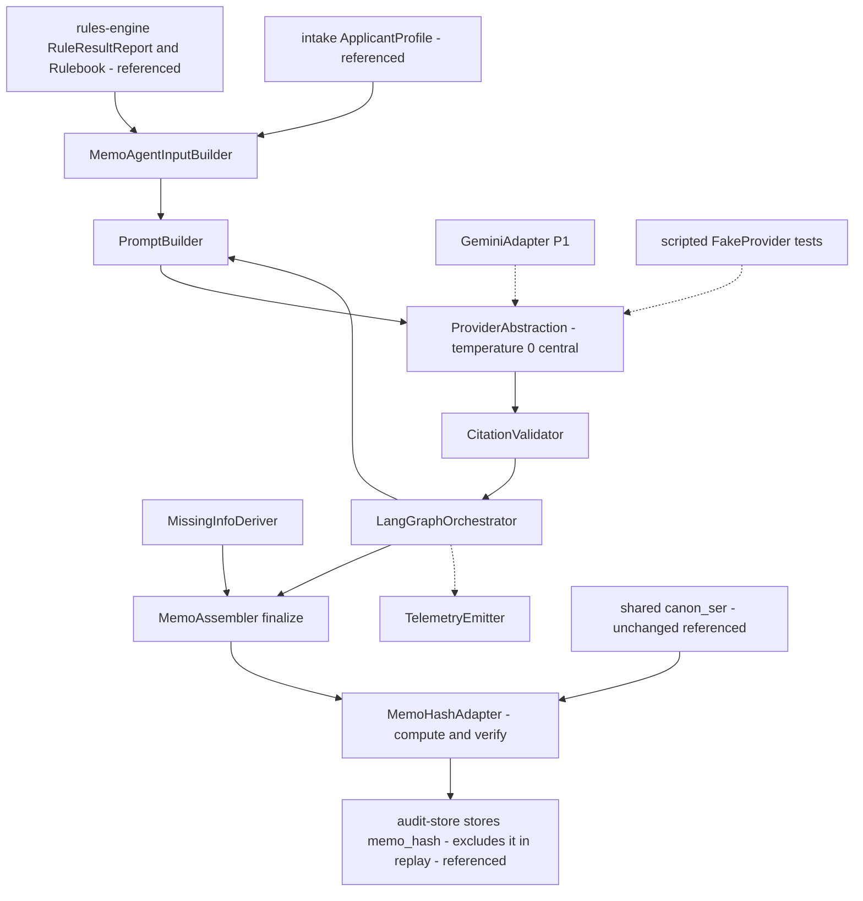

# NFR Design — Logical Components — `memo-agent-core` (C4 / U4)

**Phase / Stage**: BUILD → NFR Design, **Part 2** · cluster unit **4 of 4 — the LAST** (where the LLM enters)
**Date**: 2026-07-06 · **Runtime**: Python **3.12 pinned** · **Depth**: comprehensive
**Built ON**: the frozen FD + C4 contract + approved 15 `NFR-MEMO-*` targets — **re-opening none**. The 10 components below realize the §1–§10 patterns (`nfr-design-patterns.md`). Each maps to ≥1 target; **reference-not-own** everywhere.

---

## 1. Components + responsibilities

| # | Component | Responsibility | Realizes (target) |
|---|---|---|---|
| 1 | **MemoAgentInputBuilder** | Assemble `MemoAgentInput` from the handed clean artifacts (`ApplicantProfile`, `RuleResultReport`, read-only recommendation/confidence). **Structurally carries no `original_span`/`SanitizationReport`.** | SEC1-1, GROUND-1 |
| 2 | **PromptBuilder** | Build the LLM prompt **only** from `MemoAgentInput`; embed the advisory-only system-prompt template. **No MCP client in P1.** | GROUND-1, ADVISORY-1, SEC1-1 |
| 3 | **ProviderAbstraction** (Protocol) **+ GeminiAdapter** (P1) **+ scripted FakeProvider** (tests) | `complete(prompt, schema) -> StructuredOutput`; **temperature=0 fixed centrally**; XML→Pydantic. Gemini in prod; the deterministic, **call-count-aware** fake in tests (records params). Claude/Ollama/MCP/`route_borderline` = named not-wired stubs. | PROV-1, TEMP0-1 |
| 4 | **CitationValidator** | `validate_citations(memo_draft, rulebook)` — pure function; every `cited_rule_id ∈ RuleResultReport` (authoritative) + belt-and-suspenders `∈ rulebook`; else `citation_failure` + offending ids. | CITE-1, CITE-FAILURE |
| 5 | **MissingInfoDeriver** | Pure derivation of `missing_information` from the 3 signals, emitted in the **fixed total cross-source order** (source-enum order + within-source key). Not LLM-authored. | MISSINGINFO-1 |
| 6 | **MemoHashAdapter** | `compute(memo_content) -> str` at finalize **and** standalone `verify(recorded_hash, memo_content) -> bool` (no LLM), both delegating to the **unchanged shared `canon_ser`**. Verify runs **outside** the rules-replay path. *(Named `MemoHashAdapter` everywhere — not `CanonSerAdapter`.)* | HASH-1, REPLAY-1 |
| 7 | **MemoAssembler** (finalize) | Assemble `DecisionMemo` — LLM prose + validated citations + the deterministic `missing_information` + the **injected read-only** recommendation/confidence + `memo_hash` + `model_version`. **No writable recommendation field.** | CONBR2-TYPE |
| 8 | **LangGraphOrchestrator** | The sub-flow `draft → validate_citations → retry/finalize` (+ `flag`); **read-only recommendation/confidence channels (no node write)**; bounded-retry policy with the **shared cap constant** `MEMO_CITATION_RETRY_CAP` (≥ 2); **no graph persistence / interrupt NO** (gate external). | CONBR2-STATE, CITE-FAILURE |
| 9 | **(unit boundary — no commit component)** | **Absence pattern**: the unit constructs **no `DecisionCommitService`** and makes no commit call; the committed rec bypasses the memo via `recommendation_id`. | CONBR2-COMMIT |
| 10 | **TelemetryEmitter** | Emit-only **allowlist** (ids/enums/int counts/timing); **no prose/demographic/free-text/`original_span`**. Observed-not-gated latency. | OBS-1, PERF-1 |

> Component 9 is listed for completeness — CONBR2-COMMIT is held by the **absence** of any commit path, a property of the unit boundary, not a positive component. The 10 named components are #1–#8, #10, plus this boundary property.

---

## 2. Ownership table (owned here vs referenced)

| Artifact | Owned / Referenced | Note |
|---|---|---|
| `MemoAgentInput`, `DecisionMemo`, `MissingInformationItem`, `CitationValidationResult`, `MemoDraftOutput` | **Owned** (this unit) | FD-defined shapes; realized as Pydantic v2. |
| `MemoHashAdapter` (compute + verify) | **Owned** | Delegates to the shared `canon_ser` (unchanged). |
| `ProviderAbstraction` Protocol + `GeminiAdapter` + `FakeProvider` | **Owned** (P1) | Claude/Ollama/MCP/`route_borderline` = Phase-2 seams, named not wired. |
| `LangGraphOrchestrator`, `PromptBuilder`, `CitationValidator`, `MissingInfoDeriver`, `MemoAssembler`, `TelemetryEmitter`, `MemoAgentInputBuilder` | **Owned** | The unit's logic. |
| `RuleResultReport`, `evaluation_output`, `Rulebook` | **Referenced** (rules-engine) | Grounding source + citation check; imported read-only, never re-derived. |
| `ApplicantProfile` | **Referenced** (intake) | Clean facts; `original_span` structurally excluded. |
| `backend/common/canon_ser.py`, `decimal_context.py` | **Referenced (unchanged)** | The single CANON-SER; `MemoHashAdapter` delegates to it. |
| `AuditTuple` / `ReplayService` (persist `memo_hash`; rules-only replay, excludes `memo_hash`) | **Referenced** (audit-store) | This unit produces `memo_hash` + owns verify; audit-store stores it, cannot re-derive. |
| `OutlierResult` | **Referenced** (outlier-model, Phase 2) | `None` in P1. |
| `DecisionCommitService` | **Referenced** (audit-store) | **Never instantiated here** — CONBR2-COMMIT bypass. |
| Langfuse tracing | **Referenced** (observability) | Owned by `observability`; **not** wired by this unit. |
| QA-4 groundedness eval | **Referenced** (quality-gates) | Live-provider eval, not this unit's gate. |

> **BACK-ANNOTATION (pinned at the register #33/#34 code-gen pass, 2026-09-12 — #34
> `CHECKPOINT-POISONS-REDRAFT`, candidate C2).**
> ⛔ **SUPERSEDED — two statements in this document.** Component table **row 8** read
> *"**checkpointer YES / interrupt NO** (gate external)"*, and the reference table above read
> *"Langfuse tracing … **Wired externally via the checkpointer**."*
>
> **Both are corrected: the graph is compiled with no checkpointer** (register #34, candidate C2 —
> a persisted thread made every re-draft of one application raise `RuntimeError`). ⚠️ **The Langfuse
> row was false BEFORE C2 and not because of it** — tracing was never wired through a checkpointer,
> and `observability.TraceRecorder.on_step` has no production caller (OBS-SINK-DEFERRED owns that
> gap). ⚑ **The interrupt/gate-external half of row 8 is unchanged and remains true.**

**Reference-not-own check: NO violation.** Every rules-engine / intake / shared-canon_ser / audit-store / outlier-model / memo-extensions / observability / quality-gates artifact is **referenced, never re-declared or edited**. No shared-code change.

---

## 3. Component-relationship diagram

Mermaid validated before write (alphanumeric node IDs; double-quoted labels; **no colons, no semicolons, no parentheses, no special chars** in labels; balanced brackets; no reserved-word `end` node). Text alternative follows.

### Text alternative (always included)

- **`MemoAgentInputBuilder`** consumes the **referenced** rules-engine `RuleResultReport`/`Rulebook` and intake `ApplicantProfile` (clean; no `original_span`) → hands `MemoAgentInput` to **`PromptBuilder`**.
- **`LangGraphOrchestrator`** drives the sub-flow: `PromptBuilder` → **`ProviderAbstraction`** (temperature=0 central; **`GeminiAdapter`** prod / scripted **`FakeProvider`** tests) → **`CitationValidator`** → back to the orchestrator (retry / flag / finalize with the shared cap constant).
- On finalize, **`MissingInfoDeriver`** (fixed total cross-source order) + the injected read-only recommendation/confidence feed **`MemoAssembler`**, then **`MemoHashAdapter`** (delegating to the **unchanged** shared `canon_ser`) computes `memo_hash`; audit-store **stores** it (and excludes it in rules-only replay — this unit owns verify).
- **`TelemetryEmitter`** (emit-only allowlist) observes the orchestrated steps.
- **No `DecisionCommitService`** is constructed anywhere (CONBR2-COMMIT bypass).

---

## 4. Component → target coverage (no orphan)

| Target | Component(s) |
|---|---|
| CONBR2-TYPE | MemoAssembler (+ `MemoDraftOutput` schema) |
| CONBR2-STATE | LangGraphOrchestrator |
| CONBR2-COMMIT | unit boundary (no commit component) |
| GROUND-1 | MemoAgentInputBuilder, PromptBuilder |
| CITE-1 | CitationValidator |
| CITE-FAILURE | CitationValidator + LangGraphOrchestrator (shared cap) |
| MISSINGINFO-1 | MissingInfoDeriver |
| HASH-1 | MemoHashAdapter |
| REPLAY-1 | MemoHashAdapter (standalone verify) |
| SEC1-1 | MemoAgentInputBuilder, PromptBuilder |
| TEMP0-1 | ProviderAbstraction |
| ADVISORY-1 | PromptBuilder (+ enums in MemoAssembler) |
| PROV-1 | ProviderAbstraction + GeminiAdapter + FakeProvider |
| PERF-1 | TelemetryEmitter |
| OBS-1 | TelemetryEmitter |

Every target has an owning component; every component maps to ≥1 target.

---

## 5. Settled items held (not re-opened)
- Patterns/components realize the frozen FD + C4 contract + approved 15 `NFR-MEMO-*` targets — re-opening none.
- **Reference-not-own** throughout (§2). Shared `canon_ser` **unchanged**; `MemoHashAdapter` delegates to it.
- **CON-BR2 load-bearing** — three independent components/patterns. **No LLM** in the deterministic path / tests (fake) / replay.
- **`memo_hash`** compute + verify owned solely here (named `MemoHashAdapter`); audit-store stores it + can't re-derive; `ReplayService` excludes it.
- **`missing_information`** fixed total cross-source order (feeds the hashed content — byte-stability). **`outlier_result` Phase-2-optional** (None in P1). Python **3.12**; **DATA-4** synthetic only.

---

*End of logical-components.md. Patterns → `nfr-design-patterns.md`. Next stage on approval: Infrastructure Design (likely SKIP-logged) → Code-Gen.*
