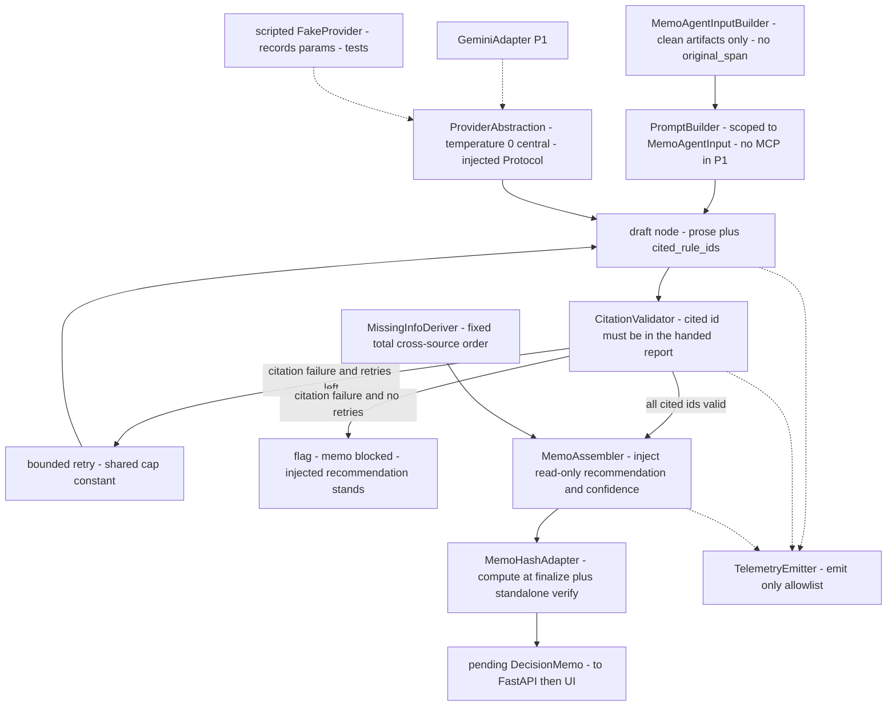

# NFR Design — Patterns — `memo-agent-core` (C4 / U4)

**Phase / Stage**: BUILD → NFR Design, **Part 2** · cluster unit **4 of 4 — the LAST** (where the LLM enters)
**Date**: 2026-07-06 · **Runtime**: Python **3.12 pinned** · **Depth**: comprehensive
**Built ON**: the frozen FD (`domain-entities.md` / `business-rules.md` / `business-logic-model.md`) + the frozen C4 contract + the **approved 15 `NFR-MEMO-*` targets** (`nfr-requirements.md`) — **re-opening none**. Each pattern **structurally meets** its target and is verifiable against the **injected fake `ProviderAbstraction`** (no live LLM, no network).

**Reference-not-own** throughout: rules-engine `RuleResultReport`/`evaluation_output`/`Rulebook`; intake `ApplicantProfile`; shared `backend/common/canon_ser.py` (**unchanged**) + `decimal_context`; audit-store persist/replay (`ReplayService` re-evaluates rules only and **excludes `memo_hash`**); LLM provider (injected; fake in tests); `outlier-model` `OutlierResult` (Phase 2); `memo-extensions` (Phase 2); `observability`; `quality-gates`.

---

## §1 — CON-BR2-TYPE: schema-unrepresentability (type layer)

- **Pattern**: The model's structured-output type (`MemoDraftOutput`) declares **only** `narrative_prose: str` + `cited_rule_ids: list[str]`. `DecisionMemo.recommendation` / `.confidence` are **`RO`** — injected by `MemoAssembler` from `rule_report`, with **no writable field / no setter** the model output can reach. The XML→Pydantic parse targets `MemoDraftOutput`, never `DecisionMemo`.
- **Structurally meets**: a fake provider that *emits* a recommendation in its structured output **cannot** populate `DecisionMemo.recommendation` — the field is unrepresentable in the model's output type. "The LLM changed the recommendation" fails to parse.
- **Target**: **NFR-MEMO-CONBR2-TYPE** · FD `business-rules.md` BR-CONBR2-TYPE, `domain-entities.md §2`.

## §2 — CON-BR2-STATE: read-only LangGraph channel (graph-state layer)

- **Pattern**: In the memo graph's state schema, `recommendation` + `confidence` are **input-only channels** seeded at graph entry from the injected read-only values; **no node declares them as writable outputs** and the channel reducer **rejects writes** (they are not in any node's return map). The nodes (`draft` / `validate_citations` / `retry` / `finalize` / `flag`) read/write only `narrative_prose`, `cited_rule_ids`, `missing_information`, and control fields — **never** `recommendation` / `confidence`.
- **Consistency with §9 (the sub-flow)**: this is the same graph as the LangGraph substrate — `finalize` **reads** the RO recommendation/confidence to assemble the `DecisionMemo` but does **not** write the state channel. No topology node mutates them.
- **Structurally meets**: a fake returning prose that contradicts the recommendation → `DecisionMemo.recommendation` == the injected value, unchanged.
- **Target**: **NFR-MEMO-CONBR2-STATE** · FD `business-logic-model.md §2.1`, BR-CONBR2-STATE.

## §3 — CON-BR2-COMMIT: no-commit-path / bypass (commit-path layer)

- **Pattern**: `memo-agent-core` constructs **no** `DecisionCommitService` and makes **no** commit call — an **absence pattern** owned by the unit boundary. The committed recommendation routes `rules-engine → DecisionCommitService` (in audit-store) via `recommendation_id`, **bypassing the memo**; the built audit-store `commit` takes `recommendation_id`, never a memo.
- **Structurally meets**: a static assertion that the unit imports/instantiates no commit service; the memo's `recommendation` is display/citation-only. Even contradictory prose cannot change what commits.
- **Target**: **NFR-MEMO-CONBR2-COMMIT** · FD `business-logic-model.md §4.1`, BR-CONBR2-COMMIT.

> **Three independent layers, no single point of trust.** Any one layer failing in isolation is still blocked by the other two (TYPE = unrepresentable; STATE = unwritable channel; COMMIT = memo bypassed). Each has its **own** distinct test.

## §4 — Prompt-scoping (grounding) + citation-validation (hallucination guard)

- **Prompt-scoping pattern (GROUND-1)**: `PromptBuilder` takes **only** `MemoAgentInput` and constructs the prompt from its clean artifacts. **No MCP client is constructed in P1** (structural assertion). No tool re-derives what fired (retrieval-miss guard).
- **Citation-validation pattern (CITE-1)**: `CitationValidator.validate_citations(memo_draft, rulebook)` is a **pure function** — every `cited_rule_id` must be a **member of the handed `RuleResultReport`** (authoritative), belt-and-suspenders present in the active `rulebook`; otherwise `outcome = citation_failure` with the offending ids. Tested with Hypothesis (∀ cited ids not in the report → `citation_failure`).
- **Structurally meets**: pure/structural — no provider call; grounding and hallucination guard both hold by construction.
- **Targets**: **NFR-MEMO-GROUND-1**, **NFR-MEMO-CITE-1** · FD `business-rules.md §1/§2`.

## §5 — Bounded-retry policy (with the shared cap constant)

- **Pattern**: A **capped-retry edge** in the graph — `validate_citations` → `retry` → `draft` while retries remain; → `flag` when the cap is exhausted; → `finalize` when all cited ids are valid. The retry cap is a **single named constant** `MEMO_CITATION_RETRY_CAP` (**≥ 2**), the one source of truth.
- **Both-directions test harness (scripted fake)**: the deterministic `FakeProvider` is **call-count-aware** (returns the i-th scripted response). Two **explicit, named** tests, **both importing `MEMO_CITATION_RETRY_CAP`** (no duplicated literals):
  1. **`test_retry_recovers_within_cap`** — script: hallucinated cite on the first attempt(s), a **valid** cite at attempt `k ≤ cap` → the graph reaches `finalize` with a valid `DecisionMemo`; injected `recommendation` unchanged. (Meaningful because `cap ≥ 2`.)
  2. **`test_retry_exhausts_cap`** — script: **always** hallucinate → after exactly `cap` draft attempts, `validate` with no retries left → `flag` (memo blocked); injected `recommendation` unchanged; **no hallucinated rule reaches the underwriter**.
  Both run entirely on the fake — **no live LLM in the retry loop**.
- **Structurally meets**: termination is bounded by the constant; the two runs are distinguishable and deterministic.
- **Target**: **NFR-MEMO-CITE-FAILURE** · FD `business-rules.md §2` (BR-CITE-FAILURE), `business-logic-model.md §1`.

## §6 — `MissingInfoDeriver`: deterministic derivation with a **fixed total cross-source order**

- **Pattern**: A **pure function** deriving `missing_information` from three signals in the handed inputs — **not LLM-authored**:
  - (i) `applicant_profile_clean.documents.entries[]` with `status ∈ {missing, unparseable}` → `source = missing_document | unparseable_document`, `detail = doc_type`;
  - (ii) `rule_result_report.rule_results[]` with `status == not_evaluated` → `source = not_evaluated_rule`, `detail = rule_id`;
  - (iii) `applicant_profile_clean.incomplete == true` → `source = incomplete_flag`, `detail = a fixed constant` (e.g. `"profile_incomplete"`).
- **Fixed TOTAL canonical order (fold #1 — a `memo_hash` byte-stability requirement, the DET-2 class from rules-engine)**: the emitted list is sorted by a **total order across all three sources**, not merely within each source:
  1. **primary key = the fixed source-enum order** `missing_document < unparseable_document < not_evaluated_rule < incomplete_flag`;
  2. **secondary key = the within-source sort key** — `doc_type` for `missing_document` / `unparseable_document`, `rule_id` for `not_evaluated_rule`, the fixed constant for `incomplete_flag`.
  The resulting list is **byte-stable regardless of which sources fire or their internal iteration order**. This matters because **`missing_information` is a hashed field (§7 / HASH-1)** and the built `canon_ser` **preserves list order** (P1 sorts dict keys, **not** list order) — so an order left to incidental iteration would make a permuted run byte-different (exactly the DET-2 defect rules-engine fixed).
- **Structurally meets**: same inputs → **identical** `missing_information` ×N, independent of the (fake) LLM output; every item traces to a deterministic signal.
- **Target**: **NFR-MEMO-MISSINGINFO-1** · FD `business-rules.md §4` (BR-MISSINGINFO), `domain-entities.md §2.1`.

## §7 — `MemoHashAdapter`: compute at finalize + standalone verify (outside the rules-replay path)

- **Pattern**: A **`memo-agent-core`-local `MemoHashAdapter`** (named `MemoHashAdapter` **everywhere in this unit** — distinct from intake's / audit-store's `CanonSerAdapter`; it signals **compute + verify**, not just serialize) that **delegates to the unchanged shared `backend/common/canon_ser.py`**:
  - **`compute(memo_content) -> str`** at `finalize` — hashed content = `narrative_prose` + `cited_rule_ids` + `missing_information` (in the §6 fixed total order) + `recommendation` + `confidence`; **volatile metadata excluded** (`timestamp`, etc. — CANON-SER P4). Byte-identical to an independent recompute via the shared util.
  - **`verify(recorded_hash, memo_content) -> bool`** — a **standalone recompute-and-compare, no LLM**, invoked **OUTSIDE** the rules-replay path.
- **Cross-unit ownership (corrected — matches the built system)**: **`memo-agent-core` is the sole owner of both compute and verify.** **audit-store stores `memo_hash` (a `str`; it does not store the memo text) and structurally cannot re-derive it.** **audit-store's `ReplayService` re-evaluates rules only and EXCLUDES `memo_hash` from its equality set — it never checks / recomputes / verifies it.** No fork, no shared-code edit; closes the Deferred-Decisions carry-forward.
- **Structurally meets**: `compute` deterministic ×N; any hashed-field change → different hash; volatile change → same hash; `verify` recomputes-and-compares with **no `ProviderAbstraction` constructed**.
- **Targets**: **NFR-MEMO-HASH-1**, **NFR-MEMO-REPLAY-1** · FD `domain-entities.md §5`, `business-logic-model.md §3/§4.2`.

## §8 — SEC-1-FORENSIC: schema-exclusion (non-ingestion)

- **Pattern**: `MemoAgentInput` (and **every** LLM-bound payload) declares **no `original_span` / `SanitizationReport` field** — a **structural** exclusion (intake's `original_span` lives on `SanitizationReportEntry`, AUDIT-ONLY, segregated from `ApplicantProfile`). `PromptBuilder` references only clean artifacts.
- **Structurally meets**: a schema-level assertion (`MemoAgentInput` has no such field) **plus** a serialized-payload assertion (a canonical serialization of any LLM-bound payload contains no forensic span). The neutralized injection cannot re-enter through the memo.
- **Target**: **NFR-MEMO-SEC1-1** · FD `business-rules.md §5` (BR-SEC1-NOINGEST), `domain-entities.md §4`.

## §9 — LangGraph sub-flow substrate + injected `ProviderAbstraction` + central temperature=0

- **Sub-flow pattern**: LangGraph scoped to the C4 memo sub-flow **only** — `draft → validate_citations → retry/finalize` (+ `flag`). **Checkpointer YES** (retry loop + state durability + 100%-step Langfuse tracing); **in-graph interrupt NO** (the human approval gate is EXTERNAL — `DecisionCommitService` in audit-store, via FastAPI). `route_borderline` not wired. The graph is the substrate for §2 (read-only channels) and §5 (retry edges).
- **Injected-provider pattern (PROV-1)**: `ProviderAbstraction` is an injected **Protocol** — a **`GeminiAdapter` (P1)** and a deterministic **`FakeProvider` (tests)**. **Claude / Ollama adapters, MCP `rulebook-tools`, `route_borderline` are named not-wired stubs (Phase-2 `memo-extensions`)**.
- **Central temperature=0 pattern (TEMP0-1)**: `temperature=0` is fixed **inside** `ProviderAbstraction` (not passed per-call by any node); the `FakeProvider` **records** every call's params → asserted `temperature == 0` on every call, including every retry draft.
- **Advisory-only pattern (ADVISORY-1)**: fields/enums use "recommendation" (`APPROVE | REFER | DECLINE-RECOMMEND`); the `PromptBuilder` system-prompt template asserts advisory language; "decision" is reserved for the human's committed action.
- **Structurally meets**: the whole sub-flow (incl. retry) runs against the fake; provider swap is injection-only; temp=0 is central and unavoidable.
- **Targets**: **NFR-MEMO-PROV-1**, **NFR-MEMO-TEMP0-1**, **NFR-MEMO-ADVISORY-1** · FD `business-logic-model.md §1/§2.2/§5`, `business-rules.md §6`.

## §10 — Emit-only allowlist telemetry (observed-not-gated)

- **Pattern**: A `TelemetryEmitter` with a **structural allowlist** — only ids / enums / int counts / timing may be emitted; the emitter schema **structurally carries no** prose / demographic / free-text / `original_span` field. **PERF is observed-not-gated** (duration emitted; no latency-failing check). Langfuse 100%-step tracing via the checkpointer is wired by `observability` (reference-not-own).
- **Structurally meets**: a schema-level assertion that no disallowed field can be emitted; no PERF gate exists.
- **Targets**: **NFR-MEMO-OBS-1**, **NFR-MEMO-PERF-1** · FD `business-rules.md §5` (telemetry extension), phase boundary.

---

## §11 — Pattern-integration diagram

Mermaid validated before write (alphanumeric node IDs; double-quoted labels; **no colons, no semicolons, no parentheses, no special chars** in labels — hyphens/"plus"/"and" only; balanced brackets; no reserved-word `end` node). Text alternative follows.

### Text alternative (always included)

1. **`MemoAgentInputBuilder`** hands **only** clean artifacts (no `original_span`) to **`PromptBuilder`**, which builds the prompt scoped to `MemoAgentInput` (no MCP in P1).
2. The **`draft`** node calls the LLM through the injected **`ProviderAbstraction`** (temperature=0 central) — **`GeminiAdapter`** in production (P1), the scripted **`FakeProvider`** in tests (records params).
3. **`CitationValidator`** checks every cited id against the handed report: **failure with retries left → bounded `retry` → `draft`** (capped by the shared constant); **failure with no retries → `flag`** (memo blocked, injected recommendation stands); **all valid → `MemoAssembler`**.
4. **`MissingInfoDeriver`** (fixed total cross-source order) feeds `MemoAssembler`, which injects the **read-only** recommendation + confidence and assembles the `DecisionMemo`.
5. **`MemoHashAdapter`** computes `memo_hash` at finalize (and owns the standalone verify, outside this path); the **pending** `DecisionMemo` goes to FastAPI → UI.
6. **`TelemetryEmitter`** (emit-only allowlist) observes the draft / validate / assemble steps — ids/enums/counts/timing only.

---

## §12 — Traceability (pattern → target)

| Pattern (§) | Target(s) |
|---|---|
| §1 schema-unrepresentability | NFR-MEMO-CONBR2-TYPE |
| §2 read-only graph channel | NFR-MEMO-CONBR2-STATE |
| §3 no-commit-path / bypass | NFR-MEMO-CONBR2-COMMIT |
| §4 prompt-scoping + citation-validation | NFR-MEMO-GROUND-1, NFR-MEMO-CITE-1 |
| §5 bounded-retry (shared cap constant) | NFR-MEMO-CITE-FAILURE |
| §6 deterministic derivation (fixed total order) | NFR-MEMO-MISSINGINFO-1 |
| §7 MemoHashAdapter compute + standalone verify | NFR-MEMO-HASH-1, NFR-MEMO-REPLAY-1 |
| §8 schema-exclusion | NFR-MEMO-SEC1-1 |
| §9 sub-flow + injected provider + central temp0 + advisory | NFR-MEMO-PROV-1, NFR-MEMO-TEMP0-1, NFR-MEMO-ADVISORY-1 |
| §10 emit-only allowlist telemetry | NFR-MEMO-OBS-1, NFR-MEMO-PERF-1 |

All 15 targets covered; every pattern traces to ≥1 target; no orphan target.

---

*End of nfr-design-patterns.md. Component blueprint → `logical-components.md`.*
