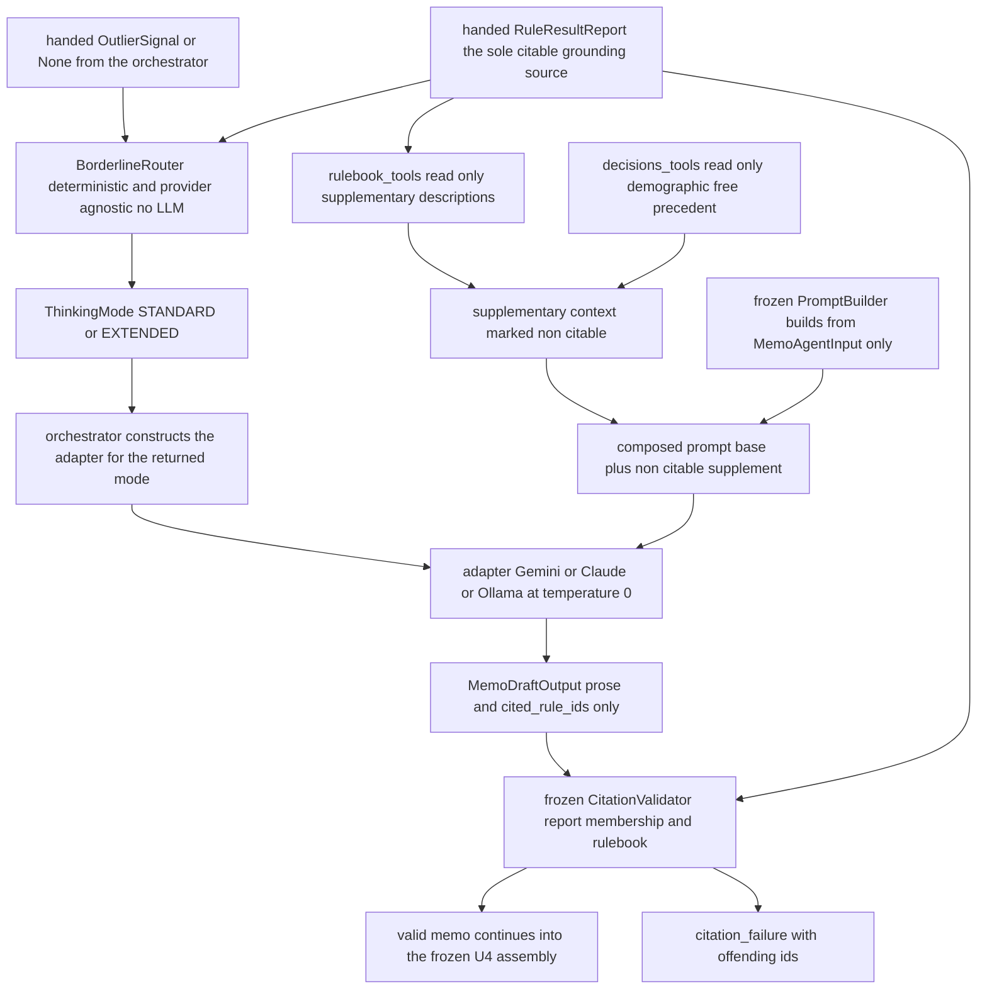

# Business Logic Model — `memo-extensions` (U19, C4, Phase 2)

**Stage**: BUILD → Functional Design (per-unit) · **Unit**: U19 `memo-extensions` · C4 · **Phase 2** · **Depth**: comprehensive · **Date**: 2026-07-17 · Stories **US-MEMO-5/6/7**.
**Scope**: the three extension axes and how they compose onto the **frozen** U4 memo sub-flow — **route** (deterministic borderline trigger) → **construct** (the adapter for the mode) → **enrich** (MCP, supplementary + non-citable) → **draft** (any of three providers at `temperature=0`) → **validate** (the frozen, unchanged citation gate). Built on **Q1/Q2/Q3/Q7 = A**, **Q4/Q5/Q6 = N/A**, and **FD-MEXT-Fold-1..5** (plan §5.8), re-opening none. **NO code in this stage.**

---

## 1. The three extension axes (Q3-A — one FD, as F4 grouped them)

| Axis | Story | What U19 adds | What it must NOT disturb |
|---|---|---|---|
| **Routing** | US-MEMO-6 | `BorderlineRouter` — deterministic, provider-agnostic, **LLM-free** | U4's `route_borderline` stub **stays not-wired** (BR-MEXT-11) |
| **Grounding** | US-MEMO-5 | two **read-only** MCP servers — **supplementary** context only | the handed report stays the **sole citable source** (BR-MEXT-6) |
| **Provider breadth** | US-MEMO-7 | Claude **secondary** (tested) + Ollama **showcase** (wired-only) | `temperature=0` + CON-BR2-TYPE hold for **all three** (BR-MEXT-5/12) |

**The unit's shape in one line**: U19 **extends** U4 **from its own modules** — it **implements** U4's Protocol and **composes** U4's builder; it **modifies nothing**, and **two frozen P1 tests enforce that** (BR-MEXT-11 / Fold-2).

---

## 2. The lifecycle, step by step

### Route (deterministic — no LLM, no provider)
1. The **orchestrator** hands the router the **`RuleResultReport`** and an **`OutlierSignal | None`** (Q2-A — **handed in**; U19 imports no `outlier-model`, matching the frozen edge list).
2. **`route_borderline`** evaluates **two deterministic triggers**: **rule-proximity** (within `RULE_PROXIMITY_MARGIN` of a threshold, **including any REFER**) **OR** **`outlier_score` above `OUTLIER_SCORE_CUTOFF`**. Either fires ⇒ **`EXTENDED`**; neither ⇒ **`STANDARD`** (BR-MEXT-1).
3. **`None` degrades naturally** to **rule-proximity alone** — the frozen contract's own `?`, and precisely FR-MEMO-7 (BR-MEXT-2).

### Construct (the frozen signatures are preserved — Fold-1)
4. The **orchestrator constructs the adapter for the returned mode**, because the frozen `complete(prompt, schema)` admits **no** thinking parameter and U4 must not be amended. This is the **frozen `CitationValidator` pattern** — per-invocation state supplied **at construction** *"so the frozen signature is preserved unchanged"* (BR-MEXT-4).
5. **Provider capability degrades at the ADAPTER, never at the trigger** (BR-MEXT-3): Ollama's lack of extended thinking changes **how its adapter handles `EXTENDED`**, never **whether** the router returned it. **Gemini** (the PRIMARY) reaches its **thinking budget** through the **injected `LLMClient`** — a thinking-configured client is just another implementation of that frozen seam, so **U4 is untouched and U19 adds no Gemini module** (`domain-entities.md §2.2`).

### Enrich (supplementary — never citable)
6. The two **read-only** MCP servers may supply context: **`rulebook-tools`** (human-readable rule **descriptions**) and **`decisions-tools`** (**demographic-free** precedent). **Neither can write** (BR-MEXT-7); **neither may source a citation** (BR-MEXT-6); **neither may carry a demographic identifier** (BR-MEXT-9).
7. U19 **composes, never modifies**: it **appends** an explicitly-marked **non-citable** supplementary section to the string U4's frozen `PromptBuilder.build()` returns (Fold-4).
8. **A retrieval miss is non-fatal** (BR-MEXT-8): drafting continues on the handed report alone; the supplement is simply absent. **The citable set never depended on it.**

### Draft + validate (the frozen gate, unchanged)
9. The adapter calls the provider at **`temperature=0`, fixed centrally inside the adapter** — for **all three** providers, in **both** modes (BR-MEXT-5). Structured output → **`MemoDraftOutput`**, which still declares **no** recommendation/confidence field (BR-MEXT-12).
10. The **frozen `CitationValidator`** — **constructed with the handed report, unchanged by U19** — requires every cited id ∈ **report** *and* ∈ **rulebook**. An MCP-described-but-not-evaluated rule **fails report-membership** ⇒ `citation_failure`. **The retrieval-miss guard is structural, not instructional** (BR-MEXT-6).

---

## 3. Flow diagram (validated — rectangle-only, alphanumeric IDs, quoted labels, no special characters)

### Text alternative (always included)
- **Route**: the handed `RuleResultReport` and the handed `OutlierSignal` (**or `None`**) both feed the **`BorderlineRouter`**, which is deterministic, provider-agnostic, and holds **no LLM**. It emits a **`ThinkingMode`** of either `STANDARD` or `EXTENDED`.
- **Construct**: that mode drives the **orchestrator's construction of the adapter** — the mode cannot ride `complete()`, whose frozen signature is `(prompt, schema)`.
- **Enrich**: the handed report also drives **`rulebook-tools`**, which — together with **`decisions-tools`** (demographic-free precedent) — produces a **supplementary context marked non-citable**. That supplement is appended to the output of the **frozen `PromptBuilder`** (which itself builds from `MemoAgentInput` **only**), forming the **composed prompt**.
- **Draft**: the composed prompt goes to the constructed **adapter** (Gemini **or** Claude **or** Ollama), which calls its provider at **`temperature=0`** and returns a **`MemoDraftOutput`** carrying **prose and cited rule ids only** — no recommendation, no confidence.
- **Validate**: the draft **and the handed report** both enter the **frozen `CitationValidator`**, which checks report-membership plus rulebook-membership. It branches to either a **valid memo** (continuing into U4's frozen assembly) or **`citation_failure` with the offending ids**. **Note both arrows into the validator**: the report is the authority, which is why an MCP-sourced id cannot survive.

---

## 4. Determinism argument (CON-DET-1 / AC-1 / skill #5 — unchanged by adding two providers)

- **Routing is a pure function** of `(rule_report, outlier_signal)` — no LLM, no provider, no network, no wall-clock, no RNG; both thresholds are **single fixed named constants** (BR-MEXT-1).
- **The routing outcome is provider-independent** (BR-MEXT-3), so selecting Claude or Ollama **cannot** change which cases route to extended thinking.
- **`temperature=0` holds for all three providers**, in **both** modes (BR-MEXT-5) — **extended thinking never implies a non-zero temperature**.
- **The recommendation is provider-independent by TYPE** (BR-MEXT-12 / CON-BR2-TYPE): `MemoDraftOutput` has no recommendation field, so **no provider and no mode can alter it** — which is exactly why FR-PROV-GATE-1 applies the decision-level gates to **all three**, Ollama included.
- **The seeded outlier score** (U18, BR-OUT-4) is reproducible, so the outlier **half** of the trigger is reproducible too — the Q12=C rationale (*"routing does not break the reproducibility guarantee"*) holds end-to-end.

## 5. Groundedness argument (FR-MEMO-5 / Q7-A / brief §10 FM1–FM2)

Adding a retrieval path to an LLM normally **widens** the hallucination surface. Here it **cannot**, and not because the prompt says so:

1. The **citable set** is the **handed report** — fixed **before** any MCP call (BR-MEXT-6).
2. The **frozen `CitationValidator`, unchanged**, enforces **report-membership** as authoritative. An MCP-described rule that **wasn't evaluated for this applicant** is **rejected** — this is the retrieval-miss guard **with teeth**.
3. A **miss degrades** rather than blocks (BR-MEXT-8), so the guard is never under pressure to relax.
4. **Both** MCP servers are **read-only** (BR-MEXT-7) and **demographic-free** (BR-MEXT-9), so grounding **widens no authority and reintroduces no bias vector**.

**Net**: MCP can make the prose **better-explained**; it cannot make it **differently-grounded**.

## 6. Scope-line argument (Q1-A / BR-MEXT-13 — why this FD has three module groups, not four)

**In U19 the outlier value decides a routing MODE; the LLM never sees it.** The router reads **only** `{is_outlier, outlier_score}` — never `flagged_features`, `shap_value`, or `provenance` — so **the minimal read surface is itself the scope guard**. *"The memo narrative cites outlier flags"* is **real, unassigned, and registered** as **`OUTLIER-IN-PROSE`** (plan §4.3, with its four proving sources) for a **future deliberate decision** — **not folded in here, not silently dropped**. Absorbing it would require a field on the **frozen, `extra="forbid"` `MemoAgentInput`** owned by **U4**.

## 7. Consumer / dependency map

- **Depends on (frozen, its three matrix edges `:48`)**: **`memo-agent-core`** (implements `ProviderAbstraction`; composes `PromptBuilder`; imports `ThinkingMode`/`MemoDraftOutput`; leaves `CitationValidator` unchanged) · **`rules-engine` `R`** (`RuleResultReport` + `Rulebook`, read-only) · **`audit-store` `R`** (decision records, read-only). Plus `secrets-config` for keys (`unit-of-work-dependency.md:54`).
- **Does NOT depend on**: **`outlier-model`** — **no edge, no import**; reached only as a **handed-in structural signal** (Q2-A / BR-MEXT-2), mirroring U20's *"never imported"* discipline.
- **Consumed by (downstream, not built here)**: **`observability`** (U21, `:50` — traces U19's agent/tool steps) · **`llm-judge`** (U22, `:51` — groundedness on **Gemini + Claude**; **Ollama exempt**, BR-MEXT-10). **They import U19; U19 imports no consumer.**
- **Edits nothing frozen** (BR-MEXT-11).

## 8. FD↔later boundary

- **FD pins**: the four module surfaces; the two deterministic triggers + their **constant names**; the **construction-time** mode mechanism; the MCP **supplementary + read-only + demographic-free** boundary; the Q1-A scope line.
- **NFR / Code-Gen owns**: the `RULE_PROXIMITY_MARGIN` / `OUTLIER_SCORE_CUTOFF` **values** (configurable per FR-MEMO-6; the `Z_SCORE_FLAG_THRESHOLD` precedent); the MCP library/transport; model strings; retry/timeout posture on a miss.
- **deploy-config / composition owns** (**already** frozen-deferred by U4): the real `LLMClient` wrapping + per-provider capability config (**Gemini thinking budget**, Claude extended-thinking flag) + keys.
- **Out of scope (named-not-designed)**: **`OUTLIER-IN-PROSE`**; the orchestrator wiring itself (the caller's — U18's *"the unit owns the scorer; the orchestration is downstream"* boundary); U21/U22 consumption.

## 9. Invariant self-check

| Invariant | Holds because | Rule |
|---|---|---|
| Routing never calls an LLM | the router is a pure function; no provider import | BR-MEXT-1 |
| Routing is reproducible | fixed named constants + a seeded outlier score + no wall-clock/RNG | BR-MEXT-1 |
| Routing is provider-agnostic | the trigger references no adapter; capability degrades at the adapter | BR-MEXT-3 |
| No frozen signature changes | the mode arrives at construction — the `CitationValidator` precedent | BR-MEXT-4 |
| `temperature=0` on all three providers | fixed centrally inside each adapter; never caller-controlled | BR-MEXT-5 |
| A retrieval miss cannot hallucinate a rule | the frozen validator requires **report**-membership | BR-MEXT-6 |
| A retrieval miss cannot block a memo | the supplement is optional by construction | BR-MEXT-8 |
| MCP cannot write | neither server exposes a mutate surface | BR-MEXT-7 |
| MCP cannot reintroduce demographics | demographic-free projections; swap-identical context | BR-MEXT-9 |
| Ollama claims no untested quality | exempt from memo-quality gates; **held to decision-level gates** | BR-MEXT-10 |
| U4 stays frozen and its tests stay green | U19 extends from its own modules; the stub stays not-wired | BR-MEXT-11 |
| No provider can alter a recommendation | `MemoDraftOutput` has no such field — unrepresentable | BR-MEXT-12 |
| The LLM never sees outlier data | the router reads only `{is_outlier, outlier_score}` | BR-MEXT-13 |
