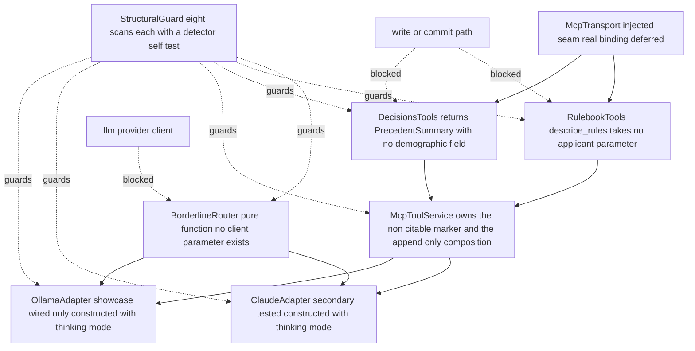

# Logical Components — `memo-extensions` (U19, C4, Phase 2)

**Stage**: BUILD → NFR Design (per-unit) · **Unit**: U19 `memo-extensions` · C4 · **Phase 2** · **Depth**: comprehensive · **Date**: 2026-07-17.
**Built ON** the frozen FD + the **fifteen `NFR-MEXT-*`** + the patterns **`P-MEXT-1..11`** (`nfr-design-patterns.md`) — re-opening none. The **six logical components** (five owned + the `StructuralGuard` substrate) with responsibilities, ownership, and the **exact signatures that enforce each by-construction guarantee** (signatures + typed surfaces + injected deps **are** the guarantee; **scans regress**; **header comments document, never enforce**). Answers **Q1–Q3 (all A)** + folds **NFR-ND-MEXT-Fold-1..3**.

**All five owned components live in the frozen four modules** (`unit-of-work.md:70–71`) — **no fifth module is added** (Q3-A).

---

## 1. Components + signatures (the by-construction surface)

### C-MEXT-1 `BorderlineRouter` (`borderline_router.py`) — P-MEXT-1, P-MEXT-5
**Responsibility**: the **deterministic, provider-agnostic** borderline trigger (rule-proximity **OR** outlier cutoff) → `ThinkingMode`. **No LLM. No state.**
**Owns**: `RULE_PROXIMITY_MARGIN`, `OUTLIER_SCORE_CUTOFF` (one module-level literal each), the `OutlierSignal` Protocol.

```python
from __future__ import annotations

RULE_PROXIMITY_MARGIN: Final[float] = ...    # ONE module-level literal; tests parameterize OFF it
OUTLIER_SCORE_CUTOFF:  Final[float] = ...    # ONE module-level literal; tests parameterize OFF it

@runtime_checkable                            # Q2-A — mirrors U4's own ProviderAbstraction
class OutlierSignal(Protocol):
    is_outlier: bool                          # the ONLY two members the router may read
    outlier_score: float
    # NO flagged_features / shap_value / provenance — they do not EXIST on this type (P-MEXT-5)

def route_borderline(
    rule_report: RuleResultReport,
    outlier_signal: OutlierSignal | None = None,   # HANDED IN; None => rule-proximity alone (FR-MEMO-7)
) -> ThinkingMode: ...
    # NO client / provider / adapter parameter EXISTS — a provider is structurally un-injectable.
```

**By-construction guarantees**: **(i)** no parameter exists through which a provider could arrive (P-MEXT-1 — signature-level); **(ii)** the return type is the frozen `ThinkingMode` enum, so no provider-specific value is expressible; **(iii)** `OutlierSignal`'s **narrowness** makes the prose-bearing fields **unreachable** — `signal.flagged_features` is an attribute that **does not exist on the declared type** (P-MEXT-5), which is what holds **`OUTLIER-IN-PROSE`** out of scope; **(iv)** the module's **top-level imports are ALLOW-LISTED** (Q1-A) — `__future__`, `typing`, `enum`/`dataclasses`, `backend.memo_agent_core.schemas` (`ThinkingMode`), `backend.rules_engine.report_schema` (may be `TYPE_CHECKING`-only), U19-local — **`audit_store` deliberately absent** (Fold-3). **Header comment** documents: holds no LLM client; both triggers deterministic; the outlier value is **handed in, never imported** *(documentation only)*.

### C-MEXT-2 `RulebookTools` (`mcp_tools.py`, handler surface 1) — P-MEXT-6, P-MEXT-7, P-MEXT-3
**Responsibility**: read-only **supplementary human-readable rule descriptions** from the active `Rulebook` (`rules-engine` `R`). **Supplementary only — never a citation source.**

```python
class RulebookTools:
    def __init__(self, rulebook: Rulebook) -> None: ...
    def describe_rules(self, rule_ids: Sequence[str]) -> list[RuleDescription]: ...
        # NO applicant-shaped parameter EXISTS => a demographic cannot enter (P-MEXT-6)
    # NO commit* / write* / persist* / update* member EXISTS (P-MEXT-7)
```

**By-construction**: demographic-free **because it takes no applicant** — strictly stronger than a swap test that could not fail (a swap test here would have **nothing to swap**); read-only **because no write member exists to call**.

### C-MEXT-3 `DecisionsTools` (`mcp_tools.py`, handler surface 2) — P-MEXT-6, P-MEXT-7, P-MEXT-8
**Responsibility**: read-only **demographic-free precedent** from committed decision records (`audit-store` `R`), through an **injected record-source seam** (no live DB at tier-U).

```python
class PrecedentSummary(BaseModel):            # frozen, extra="forbid"
    ...                                        # NO full_name / gender / city / demographics field
    # A demographic is UNREPRESENTABLE in the return type (the U18 FeatureInputs analog)

class DecisionsTools:
    def __init__(self, record_source: DecisionRecordSource) -> None: ...   # injected; fake at tier-U
    def recent_precedent(self, query: PrecedentQuery) -> list[PrecedentSummary]: ...
        # PrecedentQuery carries NO demographic field either (input side, P-MEXT-6)
    # NO commit* / write* / persist* / update* member EXISTS (P-MEXT-7)
```

**By-construction + swap-tested (Fold-3)**: the demographics live in the **stored data it returns**, so the projection type makes them **unrepresentable**, and the **output-projection swap teeth** (records differing **only** in demographics → **byte-identical** projection) are the **regression layer** on that guarantee. **Header comment**: read-only; supplementary only; **no citation may originate here**; demographic-free by construction *(documentation only)*.

### C-MEXT-4 `McpToolService` (`mcp_tools.py`) — P-MEXT-3, P-MEXT-7 — **owns the append + the marker (Q3-A)**
**Responsibility**: compose the two handler surfaces into the **supplementary context**, and perform the **append-only** prompt composition carrying the **non-citable marker**.

```python
SUPPLEMENT_MARKER: Final[str] = ...           # explicitly marks the block NON-CITABLE

class McpToolService:
    def __init__(self, rulebook_tools: RulebookTools, decisions_tools: DecisionsTools) -> None: ...
    def supplementary_context(self, rule_report: RuleResultReport) -> SupplementaryContext: ...
    def supplementary_block(self, context: SupplementaryContext) -> str: ...      # PURE
    def compose_prompt(self, base_prompt: str, context: SupplementaryContext) -> str:   # PURE
        return base_prompt + SUPPLEMENT_MARKER + self.supplementary_block(context)
    # NO write member; NO memo_agent_core.prompt_builder import (Fold-2)
```

**By-construction**: **`str` is immutable**, so `base_prompt` **cannot** be modified — the composition **necessarily** returns a new object (**verified on the pinned 3.12.10 runtime**: `base` unchanged; `composed is not base` → `True`). *"U4's `PromptBuilder` output is never modified"* therefore holds by **language semantics**, not discipline (Fold-1). The base arrives as a **`str` parameter**, so `mcp_tools.py` **never imports U4's builder** (Fold-2).
**Read-only is NOT weakened by `compose_prompt` (Fold-1)**: it **persists nothing**, **touches no transport/DB/session/record**, **mutates no argument**, **has no side effect** — a **"write" in the SEC-4 sense** is *a mutation of persistent state through a write surface*, and a pure string transformation shares **none** of those properties. **Anti-drift guards**: the read-only scan's forbidden-member list is **semantic** (persistence/mutation/transport + write-transport imports), **never word-matching on "output-producing"**; and `compose_prompt`/`supplementary_block` are **enumerated as pure, non-persisting members** in the header **and asserted side-effect-free** (same input → same output; no argument mutated) — purity **tested**, not assumed.
**Disclosed**: this gives `McpToolService` **two responsibilities** (read-only source + composer) — a **cohesion** note, not a read-only violation; the frozen four-module layout leaves **no fifth module**, so Q3-A is the only option keeping **GROUND-1(c) testable inside U19** without amending the decomposition.

### C-MEXT-5 `ClaudeAdapter` / `OllamaAdapter` (`provider_secondary.py` / `provider_showcase.py`) — P-MEXT-4, P-MEXT-9, P-MEXT-11
**Responsibility**: the **tested** Claude secondary + the **wired-only** Ollama showcase; both implement the **frozen `ProviderAbstraction`** from U19's own modules.

```python
_PRODUCTION_TEMPERATURE: Final[int] = 0       # central; NEVER a parameter (TEMP0-1 part ii)

class ClaudeAdapter:                           # provider_secondary.py
    def __init__(self, client: LLMClient, *, model: str,
                 thinking_mode: ThinkingMode = ThinkingMode.STANDARD) -> None: ...
    def complete(self, prompt: str, schema: type[MemoDraftOutput]) -> MemoDraftOutput: ...
        # EXACTLY ["self", "prompt", "schema"] — no thinking_mode, no temperature (frozen-asserted)
    @property
    def model_version(self) -> str: ...

class OllamaAdapter:                           # provider_showcase.py — identical shape
    def __init__(self, client: LLMClient, *, model: str,
                 thinking_mode: ThinkingMode = ThinkingMode.STANDARD) -> None: ...
    def complete(self, prompt: str, schema: type[MemoDraftOutput]) -> MemoDraftOutput: ...
    @property
    def model_version(self) -> str: ...
```

**By-construction**: the **mode arrives at construction** (the frozen `CitationValidator` precedent) because `complete`'s signature is frozen-asserted **exactly**; **caller-controlled temperature is structurally impossible** (no parameter — the constant is read inside `complete`); **CON-BR2-TYPE is inherited** — `MemoDraftOutput` declares no recommendation field, so no provider or mode can alter one (P-MEXT-9). **Ollama**: *"wired-only" ≠ untested* — unit-tested offline; **exempt from memo-quality gates only**, never the decision-level gates (P-MEXT-11). **Header comments**: `temperature=0` fixed centrally, never caller-controlled; the thinking mode arrives at construction because the frozen `complete()` admits no such parameter *(documentation only)*.

### C-MEXT-6 `StructuralGuard` substrate (`tests/` + scans) — P-MEXT-10 — **test-only**
**Responsibility**: the single substrate of AST/import scans, **each with a mandatory detector self-test** (non-vacuous): **(1)** router import **allow-list** (synthetic `import anthropic` flagged) · **(2)** no `outlier_model` import · **(3)** no `flagged_features`/`shap_value`/`provenance` reference · **(4)** no demographic read over both handler surfaces · **(5)** no write/mutate/commit member + no write-transport import (**semantic** list — Fold-1) · **(6)** no `Recommendation`-producing path / no LLM-output model · **(7)** `backend.* ⊆ {memo_agent_core, rules_engine, audit_store}` **+ no `memo_agent_core.tests.*`** · **(8)** no append to `cited_rule_ids`. **Not a runtime dependency.** Scan 1 ⊂ Scan 7 **by construction** (Fold-3).

*(The **`McpTransport`** seam is an **injected Protocol with a fake at tier-U**; its real protocol binding is **`MCP-TRANSPORT-DEFERRED`** — composition/deploy-config, **not a U19 component**.)*

---

## 2. Component-relationship diagram (validated — rectangle-only, alphanumeric IDs, quoted labels, no special characters)



### Text alternative (always included)
- **`RulebookTools`** and **`DecisionsTools`** are the two read-only handler surfaces; both feed **`McpToolService`**, which owns the **non-citable marker** and the **append-only** prompt composition. The **`McpTransport`** seam reaches the handlers (injected; its **real binding is deferred** — `MCP-TRANSPORT-DEFERRED`).
- **`BorderlineRouter`** emits the `ThinkingMode` that determines **which adapter is constructed** — hence the edges from the router to **`ClaudeAdapter`** and **`OllamaAdapter`**; the composed prompt from `McpToolService` reaches the same adapters.
- **The no-LLM-in-routing guarantee is a visible property**: the dashed **blocked** edge from **`llm provider client`** into `BorderlineRouter` — an LLM has **no parameter to arrive through** and **no allowed import to be reached by**.
- **The no-write-in-handlers guarantee is a visible property**: the dashed **blocked** edges from **`write or commit path`** into **both** handler surfaces — **no write member exists to call** on either.
- **`StructuralGuard`** (dashed) guards all six production components; it is **test-only**, never a runtime dependency.

---

## 3. Reference-not-own check — **four distinct categories, kept separate**

| # | Category | Members | Discipline |
|---|---|---|---|
| **1** | **Consumed BY IMPORT — U19's OWN frozen edges** | **`memo_agent_core`** (`ProviderAbstraction`, `LLMClient`, `ThinkingMode`, `MemoDraftOutput`, `CitationValidator`; `provider` module for the P-MEXT-2 mirror) · **`rules_engine`** (`RuleResultReport`, `Rulebook`) `R` · **`audit_store`** (decision records, via the injected source) `R` | **exactly** the three edges of `unit-of-work-dependency.md:48`; imported, used verbatim, **re-declared none**, **modified none**. **`prompt_builder` is NOT imported** — the base prompt arrives as a `str` (Fold-2) |
| **2** | **NOT imported — reached BY SHAPE** | **`outlier-model` (U18)** — via the U19-local **`OutlierSignal`** Protocol | **no import, no edge** (the U20 *"never imported"* discipline). The interop self-test builds `OutlierResult` **BY VALUE** and asserts `isinstance(..., OutlierSignal)` — **verified discriminating** on 3.12.10 |
| **3** | **MIRRORED, not imported** | **U4's two test facts** — `route_borderline()` raises `NotImplementedError`; `dir(provider_module)` has no Claude/Ollama/MCP name — **re-asserted locally against U4's PRODUCTION module** | **no `memo_agent_core.tests.*` import** (scanned); no double-collection; no coupling to U4 test names. **Strictly stronger** than U4's own test in U19's import context (Fold-1 of NFR-Req) |
| **4** | **DEFERRED to composition** | the **MCP protocol transport** (**`MCP-TRANSPORT-DEFERRED`**) · the **real `LLMClient` wrapping** + per-provider capability config (**Gemini thinking budget**, Claude extended-thinking flag) + keys via `secrets-config` | **already frozen-deferred by U4** (*"wrapped … at composition time (a deploy-config/secrets concern)"*); **injected seams + fakes at tier-U** — no network, no key, no live server |

**Edits no frozen unit; imports no consumer** (`observability` U21 / `llm-judge` U22 import **U19**, not the reverse). **Adds no fifth module; adds no dependency; adds no LLM-output contract.**

## 4. Component → target coverage (no orphan)

| Component | `NFR-MEXT-*` targets met | Patterns |
|---|---|---|
| `BorderlineRouter` | **ROUTE-1**, SIGNAL-1, AGNOSTIC-1, SCOPE-1 | P-MEXT-1, P-MEXT-5 |
| `RulebookTools` | MCPRO-1, BIAS-1 (by-construction half) | P-MEXT-6, P-MEXT-7 |
| `DecisionsTools` | MCPRO-1, BIAS-1 (swap-tested half), MISS-1 | P-MEXT-6, P-MEXT-7, P-MEXT-8 |
| `McpToolService` | **GROUND-1**, MISS-1, MCPRO-1 | P-MEXT-3, P-MEXT-7, P-MEXT-8 |
| `ClaudeAdapter` / `OllamaAdapter` | THINK-1, TEMP0-1, AGNOSTIC-1, CONTRACT-1, PROVGATE-1 | P-MEXT-4, P-MEXT-9, P-MEXT-11 |
| `StructuralGuard` substrate | **FROZEN-1**, SCOPE-1 (+ structural halves of ROUTE/SIGNAL/BIAS/MCPRO/CONTRACT/GROUND) | P-MEXT-2, P-MEXT-10 |
| *(referenced / observed)* | PERF-1, SEC-1 | P-MEXT-11 |

**All fifteen `NFR-MEXT-*` covered; no orphan.**

## 5. Settled items held (not re-opened)
- The **frozen FD** (BR-MEXT-1..13 + the four-module inventory + `OutlierSignal` + the MCP boundary) + the **fifteen `NFR-MEXT-*`** + **`P-MEXT-1..11`** are the substrate.
- **§0 (permanent record)**: `ReadOnlySeamPattern` is **`ui-history`'s**, not U18's; **Python affords no structural no-import guarantee** — U18's own equivalent is a **scan**. Hence **P-MEXT-1** is signature-level + allow-list-scan, **P-MEXT-7** is the only legitimate surface-argument here, and **P-MEXT-8** is openly **test-only**.
- **Q1-A**: the router's **import ALLOW-LIST** (+ synthetic-`import anthropic` self-test); **tighter than, and a subset of, FROZEN-1's unit rule** (Fold-3).
- **Q2-A**: **`@runtime_checkable`** `OutlierSignal`, **`isinstance` in TESTS ONLY**; production duck-typed. **Verified on 3.12.10** — discriminating, and satisfied by a by-value-built frozen Pydantic model.
- **Q3-A**: **`McpToolService` owns the append + marker inside the frozen `mcp_tools.py`**; **no fifth module**; U4's `build()` output **only appended to**. **Fold-1**: `compose_prompt` is genuinely distinct from a SEC-4 write (**P-MEXT-7 unweakened**), and **`str` immutability upgrades P-MEXT-3 to "modification is unrepresentable"**; two anti-drift guards adopted. **Fold-2**: no `prompt_builder` import.
- **`OUTLIER-IN-PROSE`** stays **OPEN and out of scope** — held by `OutlierSignal`'s narrowness (P-MEXT-5) + the SCOPE-1 scan.
- **`MCP-TRANSPORT-DEFERRED`** stays **OPEN and non-blocking** — the transport is an injected seam; every BR-MEXT-6/7/8/9 tooth lives in the **handler layer**.
- **Deferred to Code-Gen**: the exact `RULE_PROXIMITY_MARGIN` / `OUTLIER_SCORE_CUTOFF` **values** (post-calibration — the CG-OUT-Fold-1 precedent); the Claude/Ollama model strings; the per-provider thinking-config shape; retry/timeout posture on a miss; the fake-transport + fake-record-source fixtures; the `SUPPLEMENT_MARKER` exact wording; the allow-list's final enumerated contents.
- **Deferred to composition / deploy-config (U23)** — *already frozen-deferred by U4*: the real `LLMClient` wrapping, per-provider capability config (**Gemini thinking budget**), keys, and the **MCP protocol binding**.
- **tier-B**: **N/A** and **NOT authorized**; the **`audit_store` Docker-guard gap** stays **untouched** and **out of U19's test path** (the injected `DecisionRecordSource` replaces any live DB).
