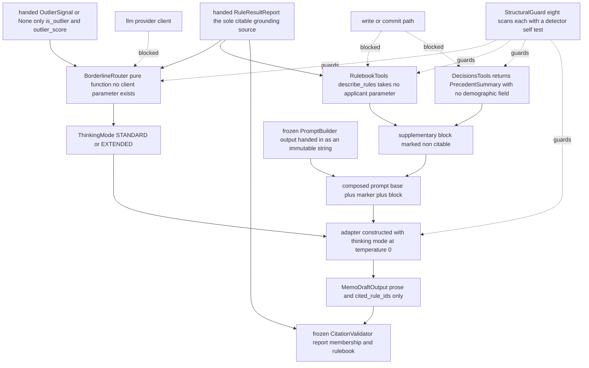

# NFR Design Patterns — `memo-extensions` (U19, C4, Phase 2)

**Stage**: BUILD → NFR Design (per-unit) · **Unit**: U19 `memo-extensions` · C4 · **Phase 2** · **Depth**: comprehensive · **Date**: 2026-07-17.
**Built ON** the frozen FD (**BR-MEXT-1..13**; the four-module inventory; the **`OutlierSignal`** Protocol; the construction-time thinking-mode mechanism; the MCP boundary) **and** the approved NFR Requirements (**fifteen `NFR-MEXT-*`**; the load-bearing **ROUTE-1**/**FROZEN-1** pair + **GROUND-1**; **`MCP-TRANSPORT-DEFERRED`**; folds **NFR-MEXT-Fold-1..4**) — **re-opening neither.** Answers **Q1–Q3 (all A)** + the NFR-Design folds **NFR-ND-MEXT-Fold-1..3** (plan §5.5).
**Backend Python unit** — "component relationship" = **module/class relationships + Python data flow** (the U18 convention), not a JSX tree.

> ### ⚠️ What "by construction" can and cannot mean in Python (the honest scope, carried from plan §0)
> This unit does **not** claim a mechanism the language does not provide. Python affords by-construction guarantees for:
> **(i) DATA** — a typed structure with **no field** for the forbidden thing (U18's `P-OUT-1 AllowlistProjectionPattern`; here **`OutlierSignal`** + **`PrecedentSummary`**);
> **(ii) SIGNATURE** — a callable with **no parameter** to pass the forbidden thing through (here the **router** and the two **adapters**);
> **(iii) SURFACE** — a class exposing **no member** to call (here the **handler surfaces** — the only legitimate analog to `ui-history`'s `ReadOnlySeamPattern`, which works because it concerns an *exported surface*, not an import);
> **(iv) LANGUAGE SEMANTICS** — e.g. **`str` immutability** makes "U4's prompt is never modified" *unrepresentable* (Fold-1).
> It affords **NONE for imports**: any module may `import anything`. **U18's own "no LLM / no write / no DB" guarantee is a SCAN** (`P-OUT-8`), and so is ours — **Q1-A makes it an ALLOW-LIST**, the strongest available form. Where only a behavioral guarantee exists (**P-MEXT-8**), it is labelled **test-only** rather than dressed as structural. **Header comments document; they never enforce.**

---

## §P-MEXT-1 — PureFunctionRoutingPattern → NFR-MEXT-ROUTE-1 — **LOAD-BEARING (determinism / no-LLM-in-path)**

**The mechanism, spelled out — not asserted:**

```python
# borderline_router.py
from __future__ import annotations
RULE_PROXIMITY_MARGIN: Final[float] = ...   # ONE module-level literal
OUTLIER_SCORE_CUTOFF:  Final[float] = ...   # ONE module-level literal

def route_borderline(
    rule_report: RuleResultReport,
    outlier_signal: OutlierSignal | None = None,
) -> ThinkingMode: ...
```

- **SIGNATURE-level (genuinely by construction)**: there is **no `client` / `provider` / `adapter` parameter** — a provider is **structurally un-injectable**; **no argument exists** to pass one through. The return type is the **frozen `ThinkingMode` enum**, so the function **cannot** return a provider-specific value. It is a **module-level pure function** holding **no state**.
- **IMPORT-level (scan-only — the honest half, Q1-A)**: an LLM call would require a **new top-level import**. The `StructuralGuard` asserts the module's **top-level import roots are a SUBSET of an explicit ALLOW-LIST** (Fold-3):

  | Allowed root | Why |
  |---|---|
  | `__future__` | `annotations` (enables type-only annotation) |
  | `typing` | `Protocol`, `Final`, `runtime_checkable` |
  | `enum` / `dataclasses` | local structures |
  | `backend.memo_agent_core.schemas` | `ThinkingMode` (the frozen return type) |
  | `backend.rules_engine.report_schema` | `RuleResultReport` (the input type; may be `TYPE_CHECKING`-only) |
  | *(U19-local)* | the `OutlierSignal` Protocol |

  **`audit_store` is deliberately ABSENT** — it is `decisions-tools`' edge, **not the router's**. The allow-list is therefore **tighter** than FROZEN-1's unit-level rule and is a **subset** of it, so the two scans **agree by construction** (Fold-3). **Mandatory detector self-test**: a synthetic `import anthropic` is fed to the detector and **must be flagged**.
- **Why allow-list, not U18's denylist (Q1-A)**: it fails on **ANY** unforeseen import — including an LLM reached **transitively** through an innocuous module, and packages nobody thought to blacklist. It mirrors the project's genuine **allow-list lineage** (`ALLOWED_INPUT_FIELDS`, `OUTLIER_FEATURE_FIELDS`).
- **Meets the target**: (ROUTE-1) purity teeth (identical `(report, signal)` → identical `ThinkingMode` across N≥2 calls, no retained state); trigger teeth (REFER ⇒ `EXTENDED`; within margin ⇒ `EXTENDED`; outside ⇒ `STANDARD`; score above cutoff ⇒ `EXTENDED`); **boundary teeth** — a value **exactly at** each threshold lands on the intended side with `<=` vs `<` **explicit**; **constants parameterized off the named constant**, never a hardcoded number (the `NFR-OUT-THRESHOLD-1` precedent ⇒ calibration is a one-constant edit).
- **Tier**: structural (AST) + component (teeth). **Rigor**: **full (highest)**.

## §P-MEXT-2 — MirroredBoundaryAssertionPattern → NFR-MEXT-FROZEN-1 — **LOAD-BEARING (frozen boundary)**

**The exact import (production only) and the two re-asserted behaviors:**

```python
# U19's own test module — NOTE: memo_agent_core.tests.* is NEVER imported (scanned)
from backend.memo_agent_core.provider import route_borderline as u4_stub
import backend.memo_agent_core.provider as provider_module

# (1) U4's Phase-2 seam stays a seam:
with pytest.raises(NotImplementedError): u4_stub()

# (2) U4's namespace stays clean of U19's additions:
assert not any(("Claude" in n or "Ollama" in n or "Mcp" in n or "MCP" in n)
               for n in dir(provider_module))
```

- **Why the PRODUCTION module and not U4's test file (Q1-A)**: `memo_agent_core.provider` is **already U19's own frozen edge** — both facts are re-assertable from it. Importing U4's **test file** would be an **unprecedented cross-unit test dependency**, would **double-collect** those tests under pytest, and would couple U19 to **U4's test-function names** (a rename in a frozen unit would break U19 — inverting the dependency direction).
- **Why this is STRICTLY STRONGER than U4's own test, not a duplicate (Fold-1)**: `dir(provider_module)` inspects a **live namespace** in whatever **import state** the session is in. U4's test module imports **only U4**; under pytest's default collection order (`memo_agent_core` **before** `memo_extensions`) U19 may **not yet be imported** when it runs — so an **import-time namespace pollution originating in U19** (an accidental `provider_module.ClaudeAdapter = ...` monkeypatch) **would escape U4's own test**. U19's mirror runs where U19's adapters **are** imported ⇒ it **catches it**.
- **Why NOT a file-hash/mtime pin (Fold-4)**: mtime is meaningless across a git checkout, and a hash pin would **false-fail a deliberate future amendment** (e.g. if **`OUTLIER-IN-PROSE`** is ever resolved toward a U4 change **with the hold explicitly lifted**) — turning a guard into an obstacle. **No prior unit did this**; session-level mtime verification is a **reviewer/agent** discipline, **never a test**.
- **Import-discipline half**: U19's `backend.*` imports ⊆ **{`memo_agent_core`, `rules_engine`, `audit_store`}** — exactly its three frozen edges (`unit-of-work-dependency.md:48`) — **+ no `memo_agent_core.tests.*`** (+ detector self-tests).
- **Meets the target**: (FROZEN-1) both behaviors re-asserted locally; import discipline scanned; adapters live outside U4's namespace; **the full frozen backend suite stays green** (**1011 passed / 31 skipped** baseline — zero regression, purely additive).
- **Tier**: component (behavioral) + structural. **Rigor**: **full (highest)**.

## §P-MEXT-3 — SoleCitationGatePattern + AppendOnlyPromptComposition → NFR-MEXT-GROUND-1 — **the groundedness pattern**

**The gate — the frozen validator, unchanged, is the ONLY one:**
U19 **adds no second gate and modifies none**. The frozen `CitationValidator` is constructed with the handed `RuleResultReport` and requires every `cited_rule_id` ∈ **report** *and* ∈ **rulebook**. A rule that **exists in the `Rulebook`** — *precisely what MCP can describe* — but was **not evaluated for this applicant** fails **report-membership** ⇒ **`citation_failure`**. **The retrieval-miss guard is structural, not instructional.**

**The append point (Q3-A) — and why modification is *unrepresentable* (Fold-1):**

```python
# mcp_tools.py — McpToolService (Q3-A: no fifth module; the frozen four stand)
SUPPLEMENT_MARKER: Final[str] = ...   # explicitly marks the block NON-CITABLE

def supplementary_block(self, context: SupplementaryContext) -> str: ...
def compose_prompt(self, base_prompt: str, context: SupplementaryContext) -> str:
    return base_prompt + SUPPLEMENT_MARKER + self.supplementary_block(context)
```

- **U4's `PromptBuilder.build()` output is passed in as a `str` and only appended to** — **never parsed, edited, reordered, or re-templated**. **Python's `str` is IMMUTABLE**, so `base + marker + block` **cannot** mutate it even by accident; it necessarily returns a **new object**. **Verified on the real interpreter (3.12.10)**: after the append, `base` is unchanged and `composed is not base` → `True`. **So "U4's builder output is never modified" is guaranteed by LANGUAGE SEMANTICS, not by discipline** — the pattern is *"modification is unrepresentable"*, not *"we promise to only append"*.
- **Boundary bonus (Fold-2)**: because the base arrives as a **`str` parameter**, `mcp_tools.py` **does not import `memo_agent_core.prompt_builder`** — the orchestrator calls `build()` and hands the string in. **U19 never touches U4's builder even by import.**
- **Meets the target**: (GROUND-1) the direct retrieval-miss test; `citation_validator.py` unmodified; the supplement **explicitly marked non-citable** in the composed prompt (**testable inside U19 precisely because of Q3-A**); **no U19 path appends to `cited_rule_ids`** (scan + self-test).
- **Tier**: component (teeth) + structural. **Rigor**: full.

## §P-MEXT-4 — ConstructionTimeInjectionPattern → NFR-MEXT-THINK-1 + NFR-MEXT-AGNOSTIC-1 + NFR-MEXT-TEMP0-1

**Exact constructors (mirroring the frozen `CitationValidator` precedent — per-invocation state supplied at construction so the frozen signature is preserved):**

```python
# provider_secondary.py / provider_showcase.py
_PRODUCTION_TEMPERATURE: Final[int] = 0        # central; NEVER a parameter (TEMP0-1 part ii)

class ClaudeAdapter:                            # implements the frozen ProviderAbstraction
    def __init__(self, client: LLMClient, *, model: str,
                 thinking_mode: ThinkingMode = ThinkingMode.STANDARD) -> None: ...
    def complete(self, prompt: str, schema: type[MemoDraftOutput]) -> MemoDraftOutput: ...
    @property
    def model_version(self) -> str: ...

class OllamaAdapter:                            # identical shape
    def __init__(self, client: LLMClient, *, model: str,
                 thinking_mode: ThinkingMode = ThinkingMode.STANDARD) -> None: ...
    def complete(self, prompt: str, schema: type[MemoDraftOutput]) -> MemoDraftOutput: ...
```

- **Why construction-time**: the frozen `complete(prompt, schema)` admits **no** thinking parameter, and a frozen U4 test asserts the signature **exactly** (`params == ["self","prompt","schema"]`). U4 cannot be amended ⇒ the mode arrives at **construction**.
- **TEMP0-1 by SIGNATURE**: `complete` has **no `temperature` parameter** — temperature is a **module-level constant read inside `complete`**, so caller control is **structurally impossible**, for **both** adapters, in **both** modes. **Extended thinking never implies a non-zero temperature.**
- **AGNOSTIC-1 by SIGNATURE**: the **router's** signature contains **no provider** (P-MEXT-1) ⇒ the routing outcome **cannot** vary by provider. Capability degrades **at the adapter** (an Ollama adapter constructed with `EXTENDED` still **completes**), never at the trigger.
- **Gemini (the PRIMARY) reaches its thinking budget by INJECTION** — a thinking-configured **`LLMClient`** is another implementation of that frozen seam; **U4 untouched, no Gemini module added** (none is in U19's frozen list). The capability/config binding lands where U4 **already** frozen-deferred the real client.
- **Meets the targets**: (THINK-1) the frozen signature assertion applied to **each** new adapter + offline capturing-double proof that `EXTENDED` produces a thinking-configured request and `STANDARD` does not; (TEMP0-1) `temperature == 0` recorded on **every** call from **every** adapter in **both** modes; (AGNOSTIC-1) identical `(report, signal)` → identical mode under all three provider selections.
- **Tier**: component (offline doubles) + structural. **Rigor**: full.

## §P-MEXT-5 — MinimalSurfaceProtocolPattern → NFR-MEXT-SIGNAL-1 + NFR-MEXT-SCOPE-1

**The Protocol's own narrowness IS the guard (the U18 `FeatureInputs` mechanism applied to the router's input):**

```python
@runtime_checkable                              # Q2-A — mirrors U4's own ProviderAbstraction
class OutlierSignal(Protocol):
    is_outlier: bool
    outlier_score: float
    # NOTE: no flagged_features, no shap_value, no provenance — they do not EXIST on this type.
```

- **SCOPE-1 by construction**: `signal.flagged_features` is an **attribute that does not exist on the declared type** — a **type error**, not a lint finding. The prose-bearing fields are **structurally unreachable from the router**, which is what holds the registered **`OUTLIER-IN-PROSE`** gap out of scope (BR-MEXT-13). The `StructuralGuard` scan (zero `flagged_features`/`shap_value`/`provenance` references under `backend/memo_extensions/`, + **mandatory detector self-test**) is the **regression layer on a design-level guarantee**, not the only safeguard.
- **SIGNAL-1 by construction**: satisfied **by shape** — **no `outlier_model` import, no edge** (the U20 *"never imported"* discipline). **`None` is a first-class tested input** ⇒ rule-proximity alone (**FR-MEMO-7**).
- **Q2-A, VERIFIED on the pinned runtime (3.12.10), not assumed**: `isinstance(fake, OutlierSignal)` → `True`; `isinstance(not_a_signal, OutlierSignal)` → `False` (**discriminating, not vacuous**); a **frozen Pydantic model built BY VALUE** in the U18 `OutlierResult` shape → `True`. So SIGNAL-1(b)'s **interop self-test** reads `assert isinstance(built_by_value_outlier_result, OutlierSignal)` — a **direct structural proof with no import**. **`isinstance` is used in TESTS ONLY**; production stays **duck-typed** (no unrequested runtime gate inside a pure function).
- **Tier**: component + structural. **Rigor**: full.

## §P-MEXT-6 — AsymmetricDemographicFreedomPattern → NFR-MEXT-BIAS-1 (Q3-A of NFR-Req + Fold-3)

**Asymmetric by design — the teeth go where a leak is possible; a by-construction argument goes where it is not:**

```python
# rulebook-tools — NO applicant-shaped parameter EXISTS in the signature:
def describe_rules(self, rule_ids: Sequence[str]) -> list[RuleDescription]: ...

# decisions-tools — the return type CANNOT REPRESENT a demographic (the FeatureInputs analog):
class PrecedentSummary(BaseModel):              # frozen, extra="forbid"
    ...                                          # NO full_name / gender / city / demographics field
def recent_precedent(self, query: PrecedentQuery) -> list[PrecedentSummary]: ...
```

- **`rulebook-tools` — by construction, no swap test**: it **takes no applicant**, so an applicant (and therefore a demographic) **cannot enter**. A swap test here would have **nothing to swap** and would pass **vacuously** — **strictly weaker than the structural argument**, and exactly the false confidence the detector-self-test convention exists to prevent.
- **`decisions-tools` — by construction + swap-tested**: the leak risk is real because it reads **stored records about other applicants** — the demographics live in **the data it returns**. So `PrecedentSummary` is frozen with **no demographic field** (unrepresentable), **and** the **output-projection swap teeth** (records differing **ONLY** in `full_name`/`gender`/`city` over identical financials → **byte-identical** projection) are the **regression layer** on that guarantee (Fold-3).
- **Input side, both surfaces**: the query/parameter types carry **no** demographic field — the same by-construction argument.
- **Why this matters**: U19 **may not reintroduce through MCP what U4's frozen `PromptBuilder` deliberately excluded** (*"Demographic identifiers … are **deliberately excluded** … the memo prose never sees them"*). `quality-gates` remains the **external** CON-BR1 delta verifier.
- **Tier**: structural + component (teeth). **Rigor**: full.

## §P-MEXT-7 — ReadOnlyHandlerSurfacePattern → NFR-MEXT-MCPRO-1

- **Pattern (by construction — SURFACE, the one legitimate `ui-history`-style argument in this unit)**: both handler classes expose **only read members**. There is **no `commit*` / `write*` / `persist*` / `update*` member to call**, and **no request-body / mutation builder exists**. This works *here* — unlike the import case (§0) — because it concerns a **class surface**, exactly like `ui-history`'s exported-surface argument.
- **Scope under `MCP-TRANSPORT-DEFERRED` (Fold-2)**: the handler surface **IS** the "server" at this stage — **where a write could actually be written** — so the invariant is verified at **FULL strength with no protocol present**; a deferred transport **cannot introduce a write the handlers do not expose**.
- **The `compose_prompt` question — resolved, not glossed (Fold-1)**: `compose_prompt` is a **pure function returning a new `str`** — it **persists nothing**, **touches no transport/DB/session/record**, **mutates no argument**, **has no side effect**. A **"write" in the SEC-4 sense** is *a mutation of persistent state through a write surface*; a pure string transformation shares **none** of those properties and **cannot be a step toward a commit because there is no state for it to reach**. **P-MEXT-7's claim is unweakened.** Two anti-drift guards are adopted: **(i)** the forbidden-member list is defined by **SEMANTICS** (persistence / mutation / transport members + write-transport imports), **never by word-matching on "output-producing"** — which would false-flag `compose_prompt` and invite someone to **weaken the scan**; **(ii)** `compose_prompt` / `supplementary_block` are **enumerated as pure, non-persisting members** in the module header **and asserted side-effect-free** (same input → same output; no argument mutated), so purity is **tested, not assumed**.
- **Disclosed consequence**: Q3-A gives `McpToolService` **two responsibilities** (read-only source **+** prompt composer) — a **cohesion** observation, **not** a read-only violation; the frozen four-module layout leaves **no fifth module**, so Q3-A is the only option that keeps GROUND-1(c) testable without amending the decomposition.
- **Meets the target**: (MCPRO-1) no write/mutate/commit member; no `DecisionCommitService`/write-transport/session-write import (+ self-test); both edges read-only. **The human approval gate is untouched and outside this unit.**
- **Tier**: structural. **Rigor**: full.

## §P-MEXT-8 — NonFatalDegradationPattern → NFR-MEXT-MISS-1 — ***honestly test-only***

- **This pattern is BEHAVIORAL and is not dressed up as structural.** *"A miss degrades rather than blocks"* is a property of **control flow** — the supplement is optional; a handler failure yields an **empty block**, never an exception escaping into the draft path. **No type or signature can encode it.**
- **The structural half that DOES exist**: the supplement is a **separate append** (P-MEXT-3) onto a prompt that is already complete without it — so **the citable set never depended on MCP** (P-MEXT-3's gate is unaffected). Degradation is therefore *possible by design*; that it *happens* is verified by teeth.
- **Meets the target**: (MISS-1) with **both** handlers unavailable (failing / timing-out / empty doubles), drafting still yields a **valid `MemoDraftOutput`** whose citations **pass** the frozen gate; the failure path adds **no** content to the prompt; the miss is **observable** (surfaced for U21), not silent.
- **Tier**: component (teeth). **Rigor**: full.

## §P-MEXT-9 — NoNewContractPattern → NFR-MEXT-CONTRACT-1

- **Pattern (by construction, inherited not re-implemented)**: **U19 declares no Pydantic model at all** for the LLM path — `MemoDraftOutput` remains the model's only output type, and it declares **no `recommendation`/`confidence` field** ⇒ *"the LLM changed the recommendation"* stays **unrepresentable** through **every** new provider and **both** modes (**CON-BR2-TYPE**). Adding a provider or a routing mode **widens no authority**. *(`PrecedentSummary`/`RuleDescription` are handler-side read projections, not LLM output contracts.)*
- **Meets the target**: (CONTRACT-1) scans find **no** `Recommendation`-producing path and **no** LLM-output model declared under `backend/memo_extensions/` (+ self-test); `MemoDraftOutput`/`DecisionMemo`/`MemoAgentInput` **unmodified**; **QA-5** holds for Claude and Ollama exactly as for Gemini; no "decision"-as-verdict wording in U19 strings.
- **Tier**: structural. **Rigor**: full.

## §P-MEXT-10 — StructuralGuardPattern → NFR-MEXT-SCOPE-1 (+ the structural halves) — *(mirrors U18's `P-OUT-8`)*

- **Pattern (single substrate)**: one `StructuralGuard` of independent scans, **each with a mandatory detector self-test** (non-vacuous — the CG-NFR-OUT-Fold-3 convention):

  | # | Scan | Target |
  |---|---|---|
  | 1 | **router import ALLOW-LIST** (subset check; synthetic `import anthropic` flagged) | ROUTE-1 |
  | 2 | no `outlier_model` import | SIGNAL-1 |
  | 3 | no `flagged_features` / `shap_value` / `provenance` reference | SCOPE-1 |
  | 4 | no demographic read over **both** handler surfaces | BIAS-1 |
  | 5 | no write/mutate/commit member; no write-transport import (**semantic** list — Fold-1) | MCPRO-1 |
  | 6 | no `Recommendation`-producing path / no LLM-output model | CONTRACT-1 |
  | 7 | `backend.* ⊆ {memo_agent_core, rules_engine, audit_store}` **+ no `memo_agent_core.tests.*`** | FROZEN-1 |
  | 8 | no append to `cited_rule_ids` | GROUND-1 |

- **Scan 1 ⊂ Scan 7 by construction** (Fold-3) — the router's allow-list is **tighter** than the unit rule (it excludes `audit_store`), so the two **agree** rather than needing reconciliation.
- **Tier**: structural. **Rigor**: full.

## §P-MEXT-11 — ReferencedObservedBoundaryPattern → NFR-MEXT-PROVGATE-1 + PERF-1 + SEC-1 *(referenced / observed / governance)*

- **PROVGATE-1**: the **Ollama** adapter **IS** unit-tested offline (constructed; `temperature=0`; structured output parsed) — ***"wired-only" ≠ untested code***; `temperature=0` + CON-BR2-TYPE hold for it **identically**, because **FR-PROV-GATE-1's decision-level gates apply to ALL providers**. Its **absence from the groundedness/promptfoo set** is **`llm-judge` (U22) tooling config** — a **governance fact recorded, not a U19 code test**.
- **PERF-1**: **observed / soft, non-gating**; **no hard SLO** (the project's uniform posture). **Nothing to time at tier-U** — every provider and transport is a double. Real latency → deploy-config / `observability` (U21).
- **SEC-1**: the Security-Guardrails governance table — enforced by review + the P-MEXT-10 scans. **Not over-specified.**
- **Tier**: referenced / observed / governance. **Rigor**: soft / governance.

---

## §12 — Module-relationship diagram (validated — rectangle-only, alphanumeric IDs, quoted labels, no special characters; **no-LLM-in-routing** and **no-write-in-handlers** as VISIBLE blocked edges)



### Text alternative (always included)
- **The no-LLM-in-routing guarantee is a VISIBLE graph property**: the only edges **into** `BorderlineRouter` are the **handed `RuleResultReport`** and the **handed `OutlierSignal` (or `None`)`**. The dashed **blocked** edge from **`llm provider client`** shows an LLM has **no edge into the router** — it has **no parameter to arrive through** (P-MEXT-1, signature-level) and **no allowed import to be reached by** (Q1-A allow-list, scan-level).
- **The no-write-in-handlers guarantee is a VISIBLE graph property**: the dashed **blocked** edges from **`write or commit path`** into **both** `RulebookTools` and `DecisionsTools` show that **no write member exists to call** on either surface (P-MEXT-7). Both handlers only **produce** the supplementary block; neither reaches state.
- **The scope guarantee is visible in the input node**: `OutlierSignal` carries **only** `is_outlier` and `outlier_score` — `flagged_features`/`shap_value`/`provenance` are **not on the type**, so the router cannot reach them (P-MEXT-5).
- **The grounding path**: the **handed report** flows to **both** the router and — crucially — **directly into the frozen `CitationValidator`**, which is what makes report-membership authoritative: an MCP-described-but-not-evaluated rule id **cannot** survive (P-MEXT-3). The **supplementary block** reaches only the **prompt**, never the citation gate.
- **The composition**: U4's frozen `PromptBuilder` output arrives as an **immutable string** and is **only appended to** (marker + block) — `str` immutability makes modification **unrepresentable**.
- **`StructuralGuard`** (dashed) guards the router, both handlers, and the adapters; it is **test-only**, never a runtime dependency.

---

## §13 — Traceability (pattern → target → tier → rigor)

| Pattern | Target(s) | Tier | Rigor |
|---|---|---|---|
| **P-MEXT-1 PureFunctionRoutingPattern** | **NFR-MEXT-ROUTE-1** | structural + component | **full (highest)** |
| **P-MEXT-2 MirroredBoundaryAssertionPattern** | **NFR-MEXT-FROZEN-1** | component + structural | **full (highest)** |
| **P-MEXT-3 SoleCitationGate + AppendOnlyPromptComposition** | **NFR-MEXT-GROUND-1** | component + structural | full |
| P-MEXT-4 ConstructionTimeInjectionPattern | NFR-MEXT-THINK-1, NFR-MEXT-AGNOSTIC-1, NFR-MEXT-TEMP0-1 | component + structural | full |
| P-MEXT-5 MinimalSurfaceProtocolPattern | NFR-MEXT-SIGNAL-1, NFR-MEXT-SCOPE-1 | component + structural | full |
| P-MEXT-6 AsymmetricDemographicFreedomPattern | NFR-MEXT-BIAS-1 | structural + component | full |
| P-MEXT-7 ReadOnlyHandlerSurfacePattern | NFR-MEXT-MCPRO-1 | structural | full |
| P-MEXT-8 NonFatalDegradationPattern *(test-only)* | NFR-MEXT-MISS-1 | component (teeth) | full |
| P-MEXT-9 NoNewContractPattern | NFR-MEXT-CONTRACT-1 | structural | full |
| P-MEXT-10 StructuralGuardPattern | NFR-MEXT-SCOPE-1 (+ structural halves of ROUTE/FROZEN/SIGNAL/BIAS/MCPRO/CONTRACT/GROUND) | structural | full |
| P-MEXT-11 ReferencedObservedBoundaryPattern | NFR-MEXT-PROVGATE-1, NFR-MEXT-PERF-1, NFR-MEXT-SEC-1 | referenced / observed / governance | soft / governance |

**All fifteen `NFR-MEXT-*` covered; no orphan.** (ROUTE→P1 · FROZEN→P2 · GROUND→P3 · THINK/AGNOSTIC/TEMP0→P4 · SIGNAL→P5 · SCOPE→P5+P10 · BIAS→P6 · MCPRO→P7 · MISS→P8 · CONTRACT→P9 · PROVGATE/PERF/SEC→P11.)
