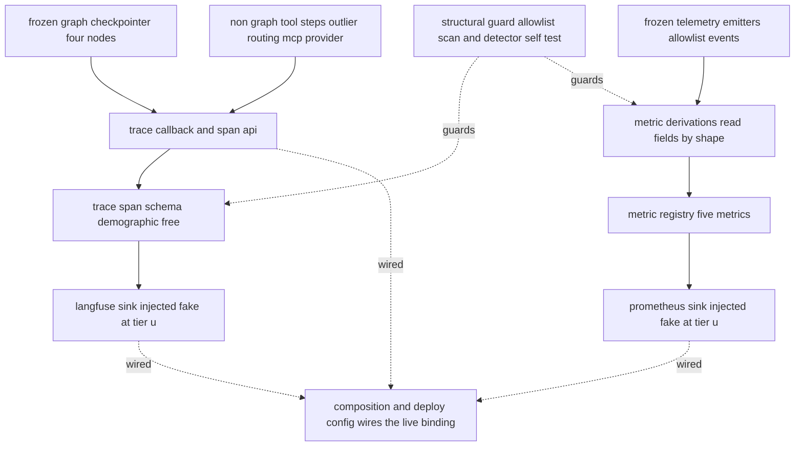

# Business Logic Model — `observability` (U21, EPIC-6, Phase 2)

**Stage**: BUILD → Functional Design (per-unit) · **Unit**: U21 `observability` · EPIC-6 · **Phase 2** · **Depth**: lighter · **Date**: 2026-07-17 · Story **US-PLAT-9**.
**Scope**: the lifecycle/flow view — how the **two frozen source streams** reach the **two sinks** through U21's **two sub-components**, and where the **FD↔Infrastructure-Design/composition boundary** falls. Built on **Q1–Q5 = A** + **FD-OBS-Fold-1..3**. **NO code in this stage.**

---

## 1. The two-plane lifecycle (Q2-A / Fold-2)

**Trace plane (T)** — *per-step, 100%*:
`frozen checkpointer node executions {draft, validate, finalize, flag}` **and** `non-graph tool steps {outlier score, route_borderline, MCP retrieval, provider selection}` → U21's **trace callback + span API** → a **demographic-free `TraceSpan`** → the **Langfuse sink** (injected; recording fake at tier-U). Every graph node yields exactly one span **by construction** (Fold-1); tool steps are wrapped **at composition**; the system-wide 100% is **AC-7's deploy-time audit**.

**Metric plane (M)** — *aggregate, ~5*:
`frozen emitter allowlist events {MemoTelemetryEvent, rules/audit/intake events}` → U21's **metric derivations (read fields by shape, Q5-A)** → a **registry of 5 metrics** (3 from emitted events; 2 from step outcomes at the span-API boundary) → the **Prometheus sink** (injected; fake at tier-U) → one Grafana dashboard.

**The two planes never merge into one bus** (Q2-A). A single occurrence (a memo completion) is **one span** (T) **and** a **metric contribution** (M) drawn from the **same** frozen `MemoTelemetryEvent` — via two pre-existing frozen streams, not a new shared concept (Fold-2).

## 2. Invariants carried by the flow
- **No frozen unit edited** (BR-OBS-1): the callback attaches to the frozen checkpointer **at composition**; the span API wraps call sites **at composition**; U21 defines, never wires.
- **Demographic-free by construction, verified** (BR-OBS-4 / Fold-3): every derivation/sink reads **only** allowlist field names; a forbidden field is never propagated (detector self-test), and a structural scan finds no non-allowlist read.
- **Consume by shape, import nothing** (BR-OBS-5): no frozen event type is imported into U21 production; the three declared edges stay trace-step edges; the metric side adds no new code edge.
- **Tier-U = schema/interface correctness** (BR-OBS-6): injected fakes only; no network/key/Docker; live capture deferred.
- **Advisory-only inherited trivially** (BR-OBS-7): observe/export only; `duration_ms`/`*_micros` observed, never gated.

## 3. FD ↔ later-stage boundary
- **This FD pins**: the two sub-components + interfaces; the two frozen source streams; the two trace mechanisms + the grounded node list; the ~5 metric names/kinds/sources + demographic-free labels; the tier-U testable surface.
- **Infrastructure Design (comprehensive) / composition / deploy-config owns**: the **live** callback→checkpointer binding, the `/metrics` mount + scrape, the Grafana dashboard topology, the Langfuse/Prometheus keys+endpoints (`secrets-config`), and **AC-7's deploy-time 100%-trace audit** — the composition-root parallel (Q1-A).

## 4. Component-relationship diagram (validated — rectangle-only, alphanumeric IDs, quoted labels, no special characters; 7 rules)

### Text alternative (always included)
- **Two source streams feed two sub-components**: the **frozen graph checkpointer** (four nodes `draft`/`validate`/`finalize`/`flag`) **and** the **non-graph tool steps** both feed U21's **trace callback and span API**; the **frozen telemetry emitters** (allowlist events) feed U21's **metric derivations**. These are two distinct, pre-existing frozen streams (Fold-2).
- **Trace plane**: the callback/span-API produces a **demographic-free trace span**, which reaches the **Langfuse sink** (an injected interface with an offline recording fake at tier-U). Every checkpointer node yields exactly one span by construction (Fold-1).
- **Metric plane**: the derivations read event fields **by shape** (importing no event type — Q5-A) into a **registry of five metrics**, which reaches the **Prometheus sink** (injected fake at tier-U).
- **The live binding is deferred**: the dashed **wired** edges from the Langfuse sink, the Prometheus sink, and the trace callback all point to **composition and deploy-config**, which performs the live wiring (plugging the callback into the frozen checkpointer, mounting `/metrics`, the Grafana dashboard, the keys) — the composition-root parallel (Q1-A). U21 edits no frozen unit.
- **The structural guard** (dashed **guards**) covers the trace-span schema and the metric derivations — the allowlist AST scan + detector self-test proving no demographic/free-text field is ever read or propagated (Fold-3). It is test-only.

## 5. Invariant self-check
- Every BR-OBS lands in the flow: BR-OBS-1 (the dashed `wired` edges to COMP; no edit) · BR-OBS-2 (CKPT+STEP → CB, grounded node list) · BR-OBS-3 (two separate chains T and M, no merge) · BR-OBS-4 (GUARD guards TS and MD) · BR-OBS-5 (EMIT → MD read-by-shape) · BR-OBS-6 (both sinks are injected fakes at tier u) · BR-OBS-7 (no recommendation node anywhere in the flow).
- **No orphan; no re-opened frozen artifact; no code.**
