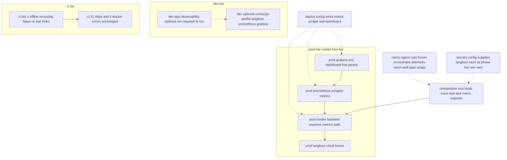

# Deployment Architecture — `observability` (U21, EPIC-6, Phase 2)

**Stage**: BUILD → Infrastructure Design (per-unit) · **Unit**: U21 `observability` · EPIC-6 · **Phase 2** · **Date**: 2026-07-18
**Depth**: comprehensive. Built ON the frozen FD + approved `NFR-OBS-*` + NFR Design (**C-OBS-1..4**) — re-opening none.
**SEC-3 / BR-SEC-6**: no key/endpoint **values** anywhere — only variable-name **shapes**. **No frozen unit edited.**

Companion to `infrastructure-design.md` (component→infra mapping + deferred-halves + secrets contract). This artifact gives the
**dev / CI / prod topology**, the **trace/metric flow per tier**, the **Grafana dashboard topology**, **networking**, and the
`secrets-config` / `deploy-config` / composition boundaries — with a validated deployment-topology Mermaid + text alternative.
Answers **Q1–Q9 (all A)** + folds **INFRA-OBS-Fold-1..3**.

---

## 1. Three-tier topology (Deployment + Monitoring)

| Tier | Observability posture | Trace sink | Metric sink | Live sinks? |
|---|---|---|---|---|
| **dev** | **Optional / local** — never required to run the app; an opt-in Docker Compose profile a developer may enable | self-hosted Langfuse **or disabled** | opt-in Prometheus + Grafana | optional |
| **CI** | **tier-U offline** — recording fakes only; **no network, no key, no Docker** (BR-OBS-6 / TIERU-1) | **injected recording fake** | **injected recording fake** | **NO** |
| **prod** | **Render** backend exposes the metrics path; managed free-tier trace + metric backends | **Langfuse Cloud** (free-tier) | **Prometheus + Grafana** (Grafana Cloud free-tier or Render-hosted) | yes |

**Free-tier everywhere** (Phase-2 validation deploy, distinct from Phase-3 production, per `unit-of-work.md` U23). **CI stays offline** —
the **31 skips + 5 pre-existing Docker errors are unchanged** (U21 adds none). No tier requires the live binding for the unit's tier-U
invariants (TRACE-1 / SEP-1 / METRIC-1 / STEPMETRIC-1 each verified against offline fakes).

---

## 2. Trace / metric flow per tier

### Trace plane (Langfuse)
1. **Metric-plane memo completion rides U4's existing seam** (Fold-1a): composition constructs the frozen orchestrator with a
   `TelemetryEmitter` whose sink drives `derive_from_event` — **no U4 edit**.
2. **Run-level + tool-step spans wrap at composition** (Fold-1b): `TraceRecorder.span` wraps `orchestrator.run()` and each non-graph
   tool step (U18 scoring, U19 routing / adapter selection / MCP retrieval) — **no U4 edit**.
3. **Per-internal-graph-node spans are the ONLY deferred bit** (Fold-1c): they need LangGraph's per-node callback, which the frozen
   `run()` does not forward. Recorded as an `OBS-SINK-DEFERRED` composition item with a **named shape** (a minimal `callbacks` passthrough
   on `run()`) — **NOT taken here**. In **prod** the run-level + tool-step spans egress to **Langfuse Cloud** over HTTPS; in **CI** the
   injected recording fake captures the same call sequence.

### Metric plane (Prometheus + Grafana)
1. Derivations (`derive_from_event` / `derive_from_step_outcome`) write to the **in-memory registry** behind the `MetricExporter` Protocol.
2. In **prod** the registry is bound to `prometheus-client`; the **metrics path is mounted on the existing FastAPI service** (no new
   compute); **Prometheus scrapes** it at a fixed interval (pull-based, no app-side key).
3. **Grafana** reads Prometheus as its datasource and renders the **one dashboard** (§3). In **CI** the injected fake exporter captures
   contributions; nothing is scraped.

---

## 3. Grafana dashboard topology (Q4-A / NFR-OBS-2)

**One dashboard**, datasource = Prometheus, **five panels mapped 1:1 to the five frozen metrics** — panels 1..5:
**decision latency** (histogram) · **decisions by recommendation type** (counter by `recommendation` enum label) · **rule-evaluation
duration** (histogram) · **LLM-call errors** (counter) · **outlier-flag rate** (counter-gauge). **Every label is an enum value / count —
no demographic, no per-applicant, no free-text panel** (CON-BR1). The **panel→metric topology is designed here**; the committed
**dashboard-as-code file** is a **Code-Gen / deploy-config deliverable**, home **named-not-created** (Fold-2). Full panel table in
`infrastructure-design.md §3.3`.

---

## 4. Networking

Narrow + provider-managed. **Egress**: the app sends traces to the **Langfuse host** over **HTTPS** (`LANGFUSE_HOST` shape, value from
`secrets-config`). **Scrape**: **Prometheus pulls** the metrics path from the backend (pull-based, no app-side key). **Datasource**:
Grafana reads Prometheus. **SSL / auth** are provider-managed; **no load balancer, API gateway, or custom VPC** is designed for a managed
free-tier telemetry stack (N/A for a sink/wiring unit, justified). All key/endpoint **values** come from `secrets-config` (SEC-3).

---

## 5. Monitoring + Shared nature

- **Monitoring (CORE)**: `observability` **IS** the monitoring infra — Langfuse traces + the Prometheus/Grafana metric plane. This is the
  unit whose whole purpose is the telemetry topology.
- **Shared-by-observation, not shared-instance** (Q8-A): the sinks are **single composition-wired consumption points** all traced units
  feed; U21 provisions **no shared instance** (unlike `database`'s Postgres), so **no separate `shared-infrastructure.md`** is authored —
  the shared nature is this section. `database`'s existing `shared-infrastructure.md` already names `observability` as the owner of
  app-level metrics/traces — that reference-not-own boundary is **kept, not re-opened**.

---

## 6. Deployment-topology diagram

Mermaid validated before write against the 7 rules (alphanumeric node IDs + underscore; every label double-quoted; **no hyphens, no
semicolons, no colons, no parentheses, no special characters** in labels; balanced blocks; rectangle-only). Text alternative follows.

### Text alternative (always included)

- **dev tier**: the app runs with observability **optional** — a developer may enable an opt-in Docker Compose profile bringing up local
  Langfuse plus Prometheus plus Grafana; never required to run the app.
- **CI tier**: **tier-U offline** — recording fakes only, no live sinks; the **31 skips and 5 Docker errors stay unchanged**.
- **prod tier (Render, free-tier)**: the Render backend **exposes the metrics path**; **Prometheus scrapes** it (pull-based); **Grafana**
  reads Prometheus and renders the **one dashboard with five panels**; the app **sends traces to Langfuse Cloud** over HTTPS.
- **composition root** constructs and **binds** the real trace sink and the metric exporter and attaches them to the prod backend — the
  live construction is the closed composition root's, named here, not edited.
- **memo-agent-core (U4, frozen)** contributes the existing `telemetry` seam (metric plane) and is wrapped by the span API (trace plane) —
  **frozen, not edited**; only the per-internal-graph-node callback is a named deferred item.
- **secrets-config** (dashed) supplies the `LANGFUSE_*` key **values** as Phase-2 env vars, consumed at the composition sink-binding
  boundary — never in the repo, never through the frozen `Settings` model (SEC-3, `extra="ignore"`).
- **deploy-config** (dashed) wires the metrics-path mount, the scrape config, and the committed dashboard-as-code file.

---

## 7. Settled items held (not re-opened)

- The `TraceSink` / `MetricExporter` Protocols + the derivations + the allowlist (C-OBS-1..4) are unchanged — only their **binding /
  mount / scrape / dashboard / key delivery** per tier is designed.
- **BR-OBS-1 / NOEDIT-1**: no frozen unit edited — **U4's orchestrator NOT edited**; the **frozen `secrets_config.Settings` model NOT
  edited** (`extra="ignore"` is the sanctioned seam). The live binding is composition/deploy-config's.
- **SEC-3 / BR-SEC-6**: no key/endpoint values; only shapes. **CON-BR1**: no demographic label, metric, or dashboard panel.
- **AC-7 is deploy-time** (BR-OBS-6), not tier-U — CI stays offline; **31 skips + 5 Docker errors unchanged**.
- Reference boundaries: `secrets-config` (values + `.env` governance), `deploy-config` (pipeline + mount + scrape + dashboard file),
  the closed composition root (live sink construction/attachment), `memo-agent-core` (the frozen orchestrator) — **named, not authored
  here**. **CON-BR1 / advisory-only / no LLM path** in `observability`.
