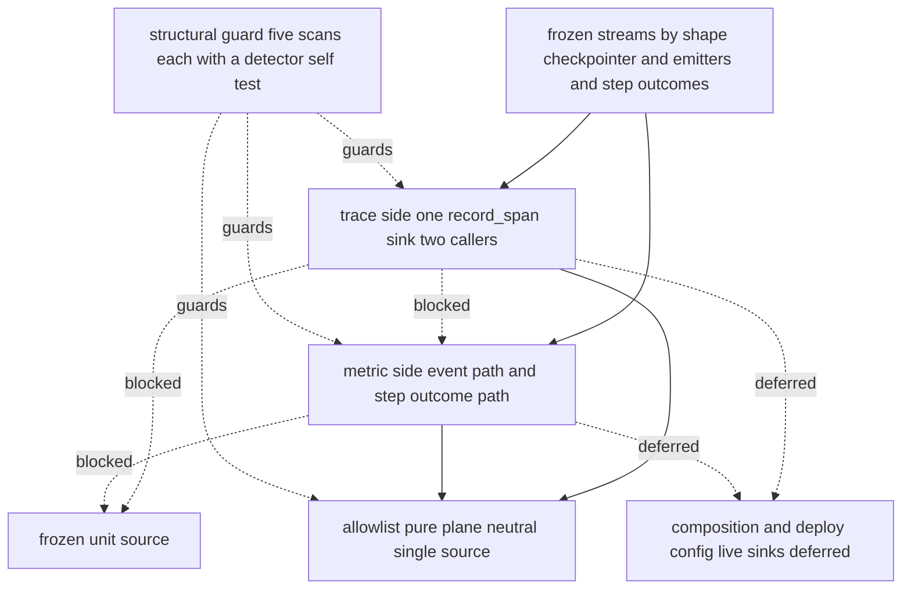

# Logical Components — `observability` (U21, EPIC-6, Phase 2)

**Stage**: BUILD → NFR Design (per-unit) · **Unit**: U21 `observability` · EPIC-6 · **Phase 2** · **Depth**: lighter · **Date**: 2026-07-18.
**Built ON** the frozen FD + the **eleven `NFR-OBS-*`** + the patterns **`P-OBS-1..11`** (`nfr-design-patterns.md`) — re-opening none. The **four logical components** (three owned + the `StructuralGuard` substrate) with responsibilities, ownership, and the **exact signatures that enforce each by-construction guarantee**. Answers **Q1–Q3 (all A)** + folds **NFR-ND-OBS-Fold-1..3**.
**Module layout is OPEN** (Q4-A of FD) — sized to the two planes + the shared allowlist module; no frozen file-count constraint.

---

## 1. Components + signatures (the by-construction surface)

### C-OBS-1 `trace-side` (`trace_schema.py` + `langfuse_sink.py`) — P-OBS-1, P-OBS-2, P-OBS-4
**Responsibility**: the demographic-free span schema + the **one** injected span sink + its **two callers** (the checkpointer callback adapter + the span-API context-manager). **No LLM. No frozen edit. Reaches state through no path.**

```python
ScalarValue = str | int | float | bool               # allowlist leaves only — no prose/PII

class TraceSink(Protocol):                            # INJECTED; recording fake at tier-U
    def record_span(self, step_name: str, attributes: Mapping[str, ScalarValue]) -> None: ...

_SPAN_ALLOWED: frozenset[str] = frozenset({...})      # the permitted span-attribute names

class TraceRecorder:                                  # ONE sink, TWO callers (Q3-A)
    def __init__(self, sink: TraceSink) -> None: ...
    def on_step(self, step_name: str, raw_attributes: Mapping[str, object]) -> None:   # checkpointer callback
        self._sink.record_span(step_name, project_allowlisted(raw_attributes, _SPAN_ALLOWED))
    @contextmanager
    def span(self, step_name: str, raw_attributes: Mapping[str, object]):              # span API — tool steps
        self._sink.record_span(step_name, project_allowlisted(raw_attributes, _SPAN_ALLOWED)); yield
```

**By-construction guarantees**: the sink is **injected** (P-OBS-1 — nothing to gain by editing a frozen unit; the live callback→checkpointer binding is composition's, `OBS-SINK-DEFERRED`); **both callers project via `project_allowlisted`** so a demographic attribute is **dropped** (P-OBS-4); one span schema over one stream ⇒ *"100% = graph nodes ∪ tool steps"* is a **union**, each teeth test driving one caller, `step_name` giving latent attribution (Fold-1). **Header comment** documents: holds no LLM; edits no frozen unit; every attribute routed through the allowlist *(documentation only)*.

### C-OBS-2 `metric-side` (`metrics.py` + `prometheus_sink.py`) — P-OBS-6, P-OBS-7, P-OBS-4
**Responsibility**: the ~5 `MetricDefinition`s + the in-memory registry + the **two structurally-separate derivation paths** + the injected exporter. **No `trace-side` import** (P-OBS-3).

```python
class MetricExporter(Protocol):                       # INJECTED; fake at tier-U (prometheus-client at deploy)
    def export(self, contribution: MetricContribution) -> None: ...

_EVENT_ALLOWED:  frozenset[str] = frozenset({"recommendation", "duration_ms", ...})   # emitter-sourced
_STEP_ALLOWED:   frozenset[str] = frozenset({"is_outlier", ...})                      # step-outcome (Fold-3)

def derive_from_event(fields: Mapping[str, object]) -> list[MetricContribution]:      # P-OBS-6 (3 metrics)
    safe = project_allowlisted(fields, _EVENT_ALLOWED); ...
def derive_from_step_outcome(outcome: Mapping[str, object]) -> list[MetricContribution]:  # P-OBS-7 (2 metrics)
    safe = project_allowlisted(outcome, _STEP_ALLOWED); ...   # reads is_outlier by value; no outlier_model import
```

**By-construction guarantees**: the two derivation paths are **structurally separate** (distinct `allowed` sets + distinct fixtures — no overlap, P-OBS-7); labels pass **through `project_allowlisted`** (demographic-free, P-OBS-4); `derive_from_step_outcome` reads **`is_outlier` by value** and the fixture's names ⊆ `_STEP_ALLOWED` (Fold-3 — agree by construction). **Header comment**: does not import `trace-side`; every label routed through the allowlist; step outcomes read by shape *(documentation only)*.

### C-OBS-3 `allowlist` (`allowlist.py`) — P-OBS-4, P-OBS-5, P-OBS-3 — **the shared plane-neutral module (Q1-A)**
**Responsibility**: the **single source** of the demographic-free discipline; a **pure, plane-agnostic** projection **both** planes import — the **one legitimate shared import** that **cannot** couple them.

```python
def project_allowlisted(fields: Mapping[str, object], allowed: frozenset[str]) -> dict[str, ScalarValue]:
    """Drop any non-allowlisted OR non-scalar field. Knows NOTHING of spans or metrics."""
    return {k: v for k, v in fields.items() if k in allowed and _is_scalar(v)}
```

**By-construction**: **pure + plane-neutral** ⇒ (i) a demographic/free-text field is **unrepresentable downstream** (dropped), and (ii) it holds **no** span- or metric-specific knowledge, so it is **structurally incapable of being a `trace↔metric` coupling point** (Req-Fold-3). **Its detector self-test IS DEMOFREE-1's** (Fold-2) — feed a forbidden attribute + an excluding `allowed` set → asserted dropped; **no separate duplicate test**. **Header comment**: pure, no side effect, no plane knowledge; the single source of the demographic-free guarantee *(documentation only)*.

### C-OBS-4 `StructuralGuard` substrate (`tests/`) — P-OBS-10 — **test-only**
**Responsibility**: the five AST scans, **each with a mandatory detector self-test** (non-vacuous): **(1)** no assignment into a frozen namespace (NOEDIT-1) · **(2)** no `trace_* ↔ metrics_*/*_sink` cross-import — **semantic**, permits the shared `allowlist` (SEP-1) · **(3)** no plane reads a raw attribute without routing through `project_allowlisted` — **no-bypass** (DEMOFREE-1) · **(4)** no import of a frozen event type (SHAPE-1) · **(5)** no `Recommendation`/verdict declared (CONTRACT-1). **Not a runtime dependency.**

---

## 2. Component-relationship diagram (validated — rectangle-only, alphanumeric IDs, quoted labels, no special characters)



### Text alternative (always included)
- **`trace side`** and **`metric side`** are the two planes; both consume the **`frozen streams`** (checkpointer steps + emitter events + step outcomes) **by shape**, importing no frozen event type.
- **No-cross-import is visible**: the dashed **blocked** edge **between** `trace side` and `metric side`. **No-frozen-edit is visible**: dashed **blocked** edges from **both** planes into **`frozen unit source`**.
- **Both** planes connect to **`allowlist`** — the **one legitimate shared import**, a pure plane-neutral function (cannot couple them); it is the single source of the demographic-free guarantee.
- The dashed **deferred** edges to **`composition and deploy config`** show the live Langfuse/Prometheus sink binding is composition's (`OBS-SINK-DEFERRED`).
- **`structural guard`** (dashed **guards**) covers both planes + the allowlist; test-only.

---

## 3. Reference-not-own check — **three distinct categories, kept separate**

| # | Category | Members | Discipline |
|---|---|---|---|
| **1** | **Consumed BY SHAPE — frozen streams** | the **checkpointer node executions** (trace) · the **emitter allowlist events** `MemoTelemetryEvent`/rules/audit/intake (metric) · the **step outcomes** `is_outlier` etc. | **no import of a frozen event type** (SHAPE-1); read by shape through C-OBS-3; the interop fake is built **by value** (Req-Fold-2 — **no Protocol**, `is_outlier` grounded in U18's real field) |
| **2** | **SHARED INTERNAL — U21-owned, plane-neutral** | **`allowlist.py`** (C-OBS-3) | the **only** module both planes import; **carries no plane knowledge**, so it is **not** a `trace↔metric` coupling (Req-Fold-3) |
| **3** | **DEFERRED to composition** | the real **`langfuse`** callback→checkpointer binding · the **`prometheus-client`** `/metrics` mount + scrape · the **Grafana** dashboard · keys via `secrets-config` · **AC-7** deploy-time audit | **`OBS-SINK-DEFERRED`** — the composition-root parallel (Q1-A of FD); **non-blocking, non-dependency** (both SDKs floored+installed) |

**Edits no frozen unit; imports no frozen event type; imports no consumer.** **Adds no new dependency; adds no LLM/recommendation path.**

## 4. Component → target coverage (no orphan)

| Component | `NFR-OBS-*` targets met | Patterns |
|---|---|---|
| `trace-side` (C-OBS-1) | **TRACE-1**, NOEDIT-1 (injected), DEMOFREE-1 (via C-OBS-3) | P-OBS-2, P-OBS-1, P-OBS-4 |
| `metric-side` (C-OBS-2) | METRIC-1, STEPMETRIC-1, NOEDIT-1 (injected), DEMOFREE-1 (via C-OBS-3) | P-OBS-6, P-OBS-7, P-OBS-1, P-OBS-4 |
| `allowlist` (C-OBS-3) | **DEMOFREE-1**, SHAPE-1, SEP-1 (plane-neutral shared import) | P-OBS-4, P-OBS-5, P-OBS-3 |
| `StructuralGuard` (C-OBS-4) | **NOEDIT-1**, SEP-1, DEMOFREE-1, SHAPE-1, CONTRACT-1 (structural halves) | P-OBS-10 |
| *(referenced / observed)* | TIERU-1, PERF-1, SEC-1 | P-OBS-8/9/11 |

**All eleven `NFR-OBS-*` covered; no orphan.**

## 5. Settled items held (not re-opened)
- The **frozen FD** (BR-OBS-1..7 + the two sub-components + the grounded node list) + the **eleven `NFR-OBS-*`** + **`P-OBS-1..11`** are the substrate.
- **Q1-A**: `project_allowlisted` is a **pure, plane-neutral function** — single-sources DEMOFREE-1, structurally incapable of coupling the planes.
- **Q2-A**: **pure duck-typing through the allowlist** — no per-event Protocol/TypedDict; the allowlist set **is** the surface (even more minimal than U19's `OutlierSignal`, Req-Fold-2).
- **Q3-A**: **one `record_span` sink, two callers**; single span schema; union coverage; **Fold-1** — each teeth test drives one caller, `step_name` gives latent attribution.
- **Fold-2**: the allowlist utility's detector self-test **IS** DEMOFREE-1's (single-sourced), + a no-bypass scan. **Fold-3**: STEPMETRIC-1's `is_outlier`-by-value fixture ⊆ `_STEP_ALLOWED` — fixture and consumption **agree by construction**.
- **Deferred to Infrastructure Design (comprehensive) / composition / deploy-config**: the live Langfuse callback→checkpointer binding, the `/metrics` mount + scrape, the Grafana dashboard, keys, AC-7's deploy-time audit (`OBS-SINK-DEFERRED`).
- **Deferred to Code-Gen**: the exact `_SPAN_ALLOWED` / `_EVENT_ALLOWED` / `_STEP_ALLOWED` contents; the span/attribute serialization; the metric bucket bounds; the recording-fake + fake-step-outcome fixtures; the final module names.
- **tier-B N/A + NOT authorized**; the **`audit_store` Docker-guard gap untouched** (31 skips + 5 Docker errors to stay unchanged); **no new dependency**; **no other unit started**; the **23-unit decomposition unchanged**.
