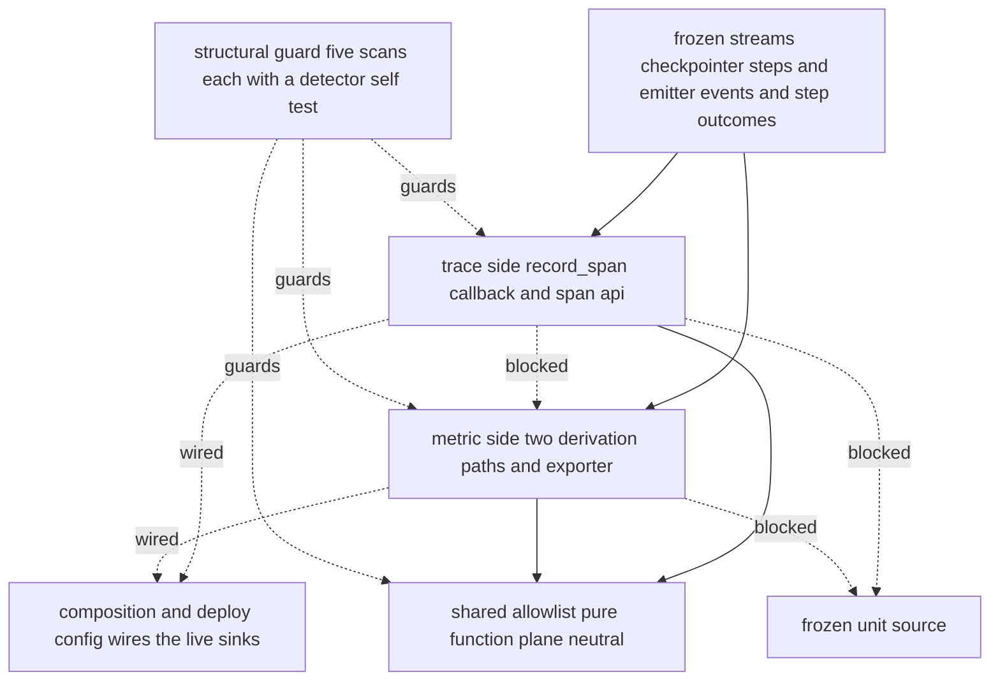

# NFR Design Patterns — `observability` (U21, EPIC-6, Phase 2)

**Stage**: BUILD → NFR Design (per-unit) · **Unit**: U21 `observability` · EPIC-6 · **Phase 2** · **Depth**: lighter · **Date**: 2026-07-18.
**Built ON** the frozen FD (**BR-OBS-1..7**; the two-sub-component inventory; the grounded checkpointer/tool-step boundary) **and** the approved NFR Requirements (**eleven `NFR-OBS-*`**; the load-bearing **NOEDIT-1**/**TRACE-1** pair; **`OBS-SINK-DEFERRED`**) — **re-opening neither.** Answers **Q1–Q3 (all A)** + folds **NFR-ND-OBS-Fold-1..3** (plan §5.5).
**Backend Python unit** — "component relationship" = module/class relationships + data flow.

> ### What "by construction" means for this unit (the honest scope)
> **Injected sinks** (Protocols handed in at composition) make editing a frozen unit **structurally unnecessary** — there is *nothing to gain* by reaching into one (P-OBS-1). A **pure, plane-agnostic allowlist function** makes a demographic label **unrepresentable downstream and structurally incapable of coupling the two planes** (P-OBS-3/4). Where only a scan can enforce (imports, namespace writes), the scan carries a **mandatory detector self-test** (P-OBS-10). Where only behavior can prove (span counts, derivations), the teeth are **grounded in frozen facts** (U4's real node list; `MEMO_CITATION_RETRY_CAP=2`; U18's real `is_outlier`). **Header comments document; they never enforce.**

---

## §P-OBS-1 — InjectedSinkAbstractionPattern → NFR-OBS-NOEDIT-1 — **LOAD-BEARING**

**The mechanism, spelled out:**

```python
# every sink is an injected Protocol — handed in at composition, faked at tier-U
class TraceSink(Protocol):
    def record_span(self, step_name: str, attributes: Mapping[str, ScalarValue]) -> None: ...

class MetricExporter(Protocol):
    def export(self, contribution: MetricContribution) -> None: ...
```

- **By-construction half (genuine)**: U21's trace callback / span API / metric registry all drive **injected** `TraceSink` / `MetricExporter`. Because the real sink is **handed in at composition**, U21 has **nothing to gain** by reaching into `memo_agent_core` / `outlier_model` / `memo_extensions` / `intake` / `rules_engine` / `audit_store` — editing a frozen unit is **structurally unnecessary**, not merely forbidden. (The live callback→checkpointer binding is composition's — `OBS-SINK-DEFERRED`.)
- **Scan half (the honest complement)**: a `StructuralGuard` AST scan proves **no U21 production module performs an assignment/monkeypatch into a frozen namespace** + a **detector self-test** (a synthetic `memo_agent_core.provider.X = ...` **must** be flagged). **Behavioral**: running U21's suite **mutates no frozen file**.
- **Meets the target**: (NOEDIT-1) nothing-to-gain by construction + nothing-touched by scan + nothing-changed on disk. **Tier**: structural. **Rigor**: **full (highest)**.

## §P-OBS-2 — DualCoverageTracePattern → NFR-OBS-TRACE-1 — **LOAD-BEARING**

**Two distinct, jointly-exhaustive mechanisms — ONE span sink, TWO callers (Q3-A):**

```python
# both callers project via the allowlist and call the SAME record_span
def on_step(self, step_name: str, raw_attributes: Mapping[str, object]) -> None:   # checkpointer callback
    self._sink.record_span(step_name, project_allowlisted(raw_attributes, _SPAN_ALLOWED))

@contextmanager
def span(self, step_name: str, raw_attributes: Mapping[str, object]):               # span API (tool steps)
    self._sink.record_span(step_name, project_allowlisted(raw_attributes, _SPAN_ALLOWED))
    yield
```

- **(a) graph nodes, by construction**: the callback fires **per checkpointer step**, so **one span per node execution** over U4's **real** node list `{draft, validate, finalize, flag}`. Grounded teeth over **both real paths** (Q1-A of NFR-Req, one parametrized test, two cases): the **finalize path** `draft→validate→finalize` records the ordered `step_name` list `[draft, validate, finalize]` (**3** spans); the **retry-then-flag path** records `[draft, validate, draft, validate, flag]` (**5** spans at the frozen `MEMO_CITATION_RETRY_CAP=2` — Req-Fold-1); **one span per EXECUTION** (`draft`/`validate` twice, each its own span), **no execution missed, none double-counted**. Sequences mirror `orchestrator.py`'s node names **by value**; the retry length is the **frozen cap**, referenced.
- **(b) tool steps, explicit**: the `span` context-manager wraps a **fake non-graph tool step** (the mechanism U18 scoring / U19 routing·MCP·provider are traced by, at composition) and records a span.
- **Union over ONE span stream (Fold-1)**: *"100% = graph nodes ∪ wrapped tool steps"* — a single span schema, a single sink; the recording fake counts/orders spans across both callers, and each teeth test drives **exactly one caller** (so the union count is that caller's count). `step_name` gives **latent per-caller attribution** if ever needed (graph names ≠ tool names). **System-wide live 100% = AC-7 deploy-time audit — NOT a tier-U assertion.**
- **Meets the target**: (TRACE-1) both grounded paths + the tool-step wrap + the demographic-free span schema (→ P-OBS-4). **Tier**: component (teeth) + structural. **Rigor**: **full (highest)**.

## §P-OBS-3 — TwoPlaneSeparationPattern → NFR-OBS-SEP-1

- **Pattern**: the **trace module** and **metric module** **do not import each other** — a **semantic** AST scan (the memo-extensions MCPRO-1 *not-word-match* precedent) flags a `trace_* ↔ metrics_*/*_sink` plane-to-plane import and **permits** the one legitimate shared import: the **plane-neutral allowlist module** (P-OBS-4), which **carries no plane knowledge** and is therefore **structurally incapable** of being a coupling point (Fold-3 of NFR-Req).
- **SEP-1's single-value/two-planes proof (Q3-A of NFR-Req)**: **two independent assertions from the SAME input VALUE, no shared mechanism** — one feeds a `MemoTelemetryEvent` value to the trace plane (→ exactly one span); a second feeds the **same** value to the metric plane (→ exactly one *decisions by recommendation type* counter contribution). Sharing the **value** proves "one event → both planes"; sharing a **mechanism** would recreate the coupling SEP-1 forbids.
- **Meets the target**: (SEP-1) no cross-import (semantic scan + self-test) + the same-value/two-planes teeth. **Tier**: component (teeth) + structural. **Rigor**: full.

## §P-OBS-4 — SingleSourcedAllowlistPattern → NFR-OBS-DEMOFREE-1

**A pure, plane-agnostic function is the single source (Q1-A):**

```python
def project_allowlisted(fields: Mapping[str, object], allowed: frozenset[str]) -> dict[str, ScalarValue]:
    """Drop any non-allowlisted OR non-scalar field. Knows nothing of spans or metrics."""
    return {k: v for k, v in fields.items() if k in allowed and _is_scalar(v)}
```

- **Pattern**: **both** planes project every span attribute / metric label **through `project_allowlisted`** — the **single source** of the demographic-free guarantee. Being **pure and plane-agnostic**, it (i) makes a demographic/free-text field **unrepresentable downstream** (dropped), and (ii) is **structurally incapable of coupling** the planes (it holds no span- or metric-specific knowledge — composes with SEP-1).
- **DEMOFREE-1's detector self-test IS the utility's (Fold-2)**: feed `project_allowlisted` a `fields` dict with a forbidden attribute (free-text/demographic/`original_span`-style) + an `allowed` set excluding it → assert it is **dropped** — one test at the single source, **not** a separate duplicate. **Complemented** by a **no-bypass structural scan**: neither plane reads a raw attribute into a span/label **without** routing through the utility.
- **Meets the target**: (DEMOFREE-1) the utility drops forbidden fields (self-test) + no plane bypasses it (scan). **Tier**: structural + self-test. **Rigor**: full.

## §P-OBS-5 — ByShapeConsumptionPattern → NFR-OBS-SHAPE-1

- **Pattern (Q2-A)**: emitted events / step outcomes are consumed **by shape through the allowlist utility** — **pure duck-typing**, **no per-event `Protocol`/`TypedDict` declared**. The **allowlist field-name set IS the surface**: derivations read only the names the utility permits; fakes are shaped **by value**. **Even more minimal than U19's `OutlierSignal`** — which existed because U19 had a real Protocol contract; **U21 has none** (Req-Fold-2), so a typed surface would only duplicate the allowlist set.
- **Scan**: no U21 production module imports any frozen **event type** (`MemoTelemetryEvent` / rules / audit / intake) — **+ detector self-test** (a synthetic `from backend.memo_agent_core.telemetry import MemoTelemetryEvent` in production is flagged). The metric side adds **no** code edge beyond the three declared trace-step edges.
- **Meets the target**: (SHAPE-1) import nothing, consume by shape, fakes by value. **Tier**: structural. **Rigor**: full.

## §P-OBS-6 — EmitterSourcedDerivationPattern → NFR-OBS-METRIC-1

- **Pattern**: the **3** emitter-sourced metrics derive from **fake emitted events**: *decisions by recommendation type* (counter ← `recommendation` enum value) · *decision latency* (histogram ← `duration_ms`) · *rule-evaluation duration* (histogram ← `rules_engine` `evaluate_micros`). Labels pass **through P-OBS-4** (enum values/ids only).
- **Meets the target**: (METRIC-1) each derives the right contribution from a fake event; demographic-free labels. **Tier**: component (teeth). **Rigor**: full.

## §P-OBS-7 — StepOutcomeDerivationPattern → NFR-OBS-STEPMETRIC-1

- **Pattern (Q2-A / Req-Fold-2 / Fold-3)**: the **2** span-API-boundary metrics derive from **dedicated fake step outcomes**, a **structurally separate** path from P-OBS-6 (distinct fixtures, no overlap): *LLM-call errors* (counter ← `fake_provider_error_outcome`) · *outlier-flag rate* (counter/gauge ← `fake_outlier_step_outcome` exposing **`is_outlier` by value** — U18's real field name, no `outlier_model` import).
- **Consistency (Fold-3)**: the fixture's field names (`is_outlier`, the provider-error field) are a **subset of the derivation's `allowed` set**, grounded in U18's real field ⇒ the by-value fixture and the by-shape consumption **agree by construction**; a consistency assertion fails loudly on a rename either side.
- **Meets the target**: (STEPMETRIC-1) both step-metrics derive from their dedicated fakes; distinct path. **Tier**: component (teeth). **Rigor**: full.

## §P-OBS-8 — InjectedFakeTierUPattern → NFR-OBS-TIERU-1
- Every sink is an **injected fake** at tier-U — **no socket/key/Docker/live server**; the metric registry is **in-memory pure Python**; the **31 skips + 5 pre-existing Docker errors stay unchanged**. Live capture is deferred (composition Scope B/C). **Tier**: governance + structural. **Rigor**: full.

## §P-OBS-9 — NoContractObservedNotGatedPattern → NFR-OBS-CONTRACT-1 + NFR-OBS-PERF-1
- **By construction**: U21 declares **no** `Recommendation`/verdict (scan + detector self-test); it emits/exports signals only — no path an outcome flows through. `duration_ms`/`*_micros` are **observed, never gated** (no timing-failing assertion; no hard SLO — PERF-1). **Tier**: structural / soft. **Rigor**: full / soft.

## §P-OBS-10 — StructuralGuardPattern → the structural halves *(mirrors U18/U19's substrate)*
- One substrate of independent AST scans, **each with a mandatory detector self-test**:

  | # | Scan | Target |
  |---|---|---|
  | 1 | no assignment into a frozen namespace | NOEDIT-1 |
  | 2 | no `trace_* ↔ metrics_*/*_sink` cross-import (**semantic**; permits the shared allowlist) | SEP-1 |
  | 3 | no plane reads a raw attribute without routing through `project_allowlisted` (no-bypass) | DEMOFREE-1 |
  | 4 | no import of a frozen event type | SHAPE-1 |
  | 5 | no `Recommendation`/verdict declared | CONTRACT-1 |

- **Tier**: structural. **Rigor**: full.

## §P-OBS-11 — ReferencedGovernancePattern → NFR-OBS-SEC-1 (+ `OBS-SINK-DEFERRED`)
- **SEC-1**: the Security-Guardrails governance table — review + the P-OBS-10 scans. **`OBS-SINK-DEFERRED`**: the live-wiring deferral, **recorded, non-blocking, non-dependency** (both SDKs floored+installed). **Not over-specified.** **Tier**: referenced / governance. **Rigor**: governance.

---

## §12 — Module-relationship diagram (validated — rectangle-only, alphanumeric IDs, quoted labels, no special characters; **no-frozen-edit** and **no-cross-import** as VISIBLE blocked edges)



### Text alternative (always included)
- **The no-frozen-edit guarantee is a VISIBLE graph property**: the dashed **blocked** edges from **both** `trace side` and `metric side` into **`frozen unit source`** show U21 **cannot** edit a frozen unit — every sink is **injected** (nothing to gain), and the scan proves nothing is touched (P-OBS-1).
- **The no-cross-import guarantee is a VISIBLE graph property**: the dashed **blocked** edge **between** `trace side` and `metric side` shows the two planes **do not import each other** (P-OBS-3). Yet **both** connect to **`shared allowlist`** — the **one legitimate shared import**, a pure plane-neutral function that cannot couple them (P-OBS-4).
- **Two frozen source streams** feed the two planes: the checkpointer steps + emitter events + step outcomes (`frozen streams`) flow into `trace side` (spans) and `metric side` (derivations) — consumed **by shape**, importing no frozen event type (P-OBS-5).
- **The live sinks are deferred**: the dashed **wired** edges from both planes to **`composition and deploy config`** show the real Langfuse/Prometheus binding is composition's (`OBS-SINK-DEFERRED`), not U21's.
- **`structural guard`** (dashed **guards**) covers both planes + the shared allowlist — the five AST scans, each with a detector self-test. It is test-only.

---

## §13 — Traceability (pattern → target → tier → rigor)

| Pattern | Target(s) | Tier | Rigor |
|---|---|---|---|
| **P-OBS-1 InjectedSinkAbstractionPattern** | **NFR-OBS-NOEDIT-1** | structural | **full (highest)** |
| **P-OBS-2 DualCoverageTracePattern** | **NFR-OBS-TRACE-1** | component + structural | **full (highest)** |
| P-OBS-3 TwoPlaneSeparationPattern | NFR-OBS-SEP-1 | component + structural | full |
| P-OBS-4 SingleSourcedAllowlistPattern | NFR-OBS-DEMOFREE-1 | structural + self-test | full |
| P-OBS-5 ByShapeConsumptionPattern | NFR-OBS-SHAPE-1 | structural | full |
| P-OBS-6 EmitterSourcedDerivationPattern | NFR-OBS-METRIC-1 | component | full |
| P-OBS-7 StepOutcomeDerivationPattern | NFR-OBS-STEPMETRIC-1 | component | full |
| P-OBS-8 InjectedFakeTierUPattern | NFR-OBS-TIERU-1 | governance + structural | full |
| P-OBS-9 NoContractObservedNotGatedPattern | NFR-OBS-CONTRACT-1, NFR-OBS-PERF-1 | structural / observed | full / soft |
| P-OBS-10 StructuralGuardPattern | structural halves of NOEDIT/SEP/DEMOFREE/SHAPE/CONTRACT | structural | full |
| P-OBS-11 ReferencedGovernancePattern | NFR-OBS-SEC-1 (+ OBS-SINK-DEFERRED) | referenced / governance | governance |

**All eleven `NFR-OBS-*` covered; no orphan.**
