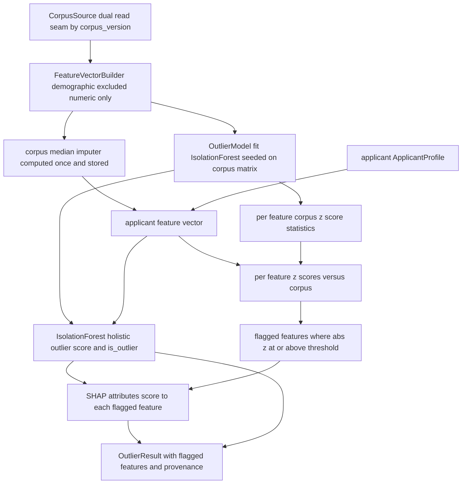

# Business Logic Model — `outlier-model` (U18, C3, Phase 2)

**Stage**: BUILD → Functional Design (per-unit) · **Unit**: U18 `outlier-model` · C3 · **Phase 2** · **Depth**: comprehensive · **Date**: 2026-07-16 · Stories **US-OUT-1/2/3**.
**Scope**: the scoring lifecycle — **fit** (once, on the seeded corpus) then **score** (per applicant) — producing the `OutlierResult`, plus the seeded/reproducible argument, the fit-vs-score boundary, and the FD↔later boundary. Built on **Q1–Q5 (all A)** + **CG-OUT-Fold-1..4**, re-opening none. **NO code in this stage.**

---

## 1. The two-phase lifecycle

`outlier-model` has a **fit phase** (once per `corpus_version`) and a **score phase** (per applicant), sharing one fitted model. This mirrors the frozen `services.md` seam (`API->>OUT: score profile + corpus_version; OUT-->>API: OutlierResult + SHAP`) — U18 owns the scorer; the orchestration is downstream.

### Fit phase (once, deterministic under the seed)
1. **`CorpusSource`** loads the corpus `CorpusRecord[]` — `from_records` (tier-U/S fixture) or `from_file` (tier-B frozen `corpus/`), by `corpus_version` (BR-OUT-8). Reads **only** the `profile` stream (the `label` is unused).
2. **`FeatureVectorBuilder`** projects each corpus profile onto the numeric, demographic-excluded vector (BR-OUT-1), building the **corpus feature matrix**. Missing optionals are imputed from the **corpus median**, computed once and stored as the **imputer** (BR-OUT-3).
3. **`OutlierModel.fit`** constructs **IsolationForest** with `random_state = CorpusManifest.seed` (BR-OUT-4), fits it on the matrix, and computes the **per-feature corpus z-score statistics** (mean + std). The fitted model holds `{forest, z_stats, imputer, provenance}`.

### Score phase (per applicant, deterministic)
4. The applicant `ApplicantProfile` → the **same** builder + the **stored** imputer → the applicant feature vector.
5. **IsolationForest** scores the vector → the holistic `outlier_score` + `is_outlier` (BR-OUT-5).
6. **Per-feature z-scores** vs the corpus stats → a feature is **flagged** iff `|z| >= Z_SCORE_FLAG_THRESHOLD` (default 3.0, BR-OUT-6). An imputed feature has `z == 0`, so it never flags (BR-OUT-3).
7. **`ShapExplainer`** attributes the IsolationForest score to the features → each flagged feature's `shap_value` + `direction` (BR-OUT-7).
8. Assemble the **`OutlierResult`** = `{outlier_score, is_outlier, flagged_features[], provenance{corpus_version, seed, outlier_model_version}}` (CG-OUT-Fold-2).

---

## 2. Flow diagram (validated — rectangle-only, alphanumeric IDs, quoted labels, no special characters)

### Text alternative (always included)
- **Fit** (once, seeded): `CorpusSource` loads the corpus by `corpus_version` → `FeatureVectorBuilder` builds the corpus matrix (demographic-excluded, numeric-only) → this both **fits** the seeded `IsolationForest` and produces the **corpus z-score statistics**, and separately produces the **corpus-median imputer** which is stored.
- **Score** (per applicant): the applicant profile plus the stored imputer produce the applicant feature vector; that vector is scored by the fitted `IsolationForest` (→ holistic `outlier_score` + `is_outlier`) and z-scored against the corpus statistics (→ features whose `|z|` is at or above the threshold become `flagged features`).
- **Explain + assemble**: `SHAP` attributes the IsolationForest score to each flagged feature (so no flag is unexplained); the `OutlierResult` collects the score, the flagged features with their SHAP explanations, and the provenance triple `{corpus_version, seed, outlier_model_version}`.

---

## 3. Determinism argument (CON-DET-1 / BR-OUT-4 — identical input → identical output, 100%)

The score phase is a **pure function of** `(applicant profile, corpus_version, seed, outlier_model_version)`:
- **Seed**: `random_state` is single-sourced from `CorpusManifest.seed` — the only stochastic element (IsolationForest tree construction) is fixed.
- **No wall-clock / RNG / dict-ordering**: no `random`, `time`, `datetime.now`, or unordered-`set` iteration in a scoring path; the feature field order is a **stable sort** (BR-OUT-4).
- **Imputation is deterministic** (BR-OUT-3): the corpus median is a fixed function of the seeded corpus.
- **Version-anchored** (CG-OUT-Fold-2): `outlier_model_version` records the sklearn version + feature-schema version, so a replay knows the exact library it must match — closing scikit-learn's cross-version gap that a bare seed leaves open.
- **Swap-invariance** (BR-OUT-1): a demographic swap changes no field the vector reads, so the whole pipeline is invariant to it — by construction.

## 4. Faithful-explanation argument (NFR-EXPLAIN-1 / BR-OUT-7)

Zero unexplained flags is a **schema property**, not a runtime hope: a `FlaggedFeature` cannot be constructed without its required `shap_value`. A flag therefore **carries** its explanation by definition — the SHAP step must succeed for the flag to exist, so "every flag has a SHAP explanation" holds by construction.

## 5. Fit-vs-score boundary + FD↔later boundary

- **Fit is corpus-scoped, score is applicant-scoped**: one fit per `corpus_version` is reused across many applicants; the fitted model is the deterministic bridge. Whether the orchestrator caches the fitted model or re-fits per request is a **downstream / NFR** concern — the FD pins only that the fit is deterministic and reusable.
- **FD pins**: the lifecycle, the components, `OutlierResult`, the invariants (BR-OUT-\*), the threshold **name + 3.0 default**.
- **NFR / Code-Gen owns**: the exact `Z_SCORE_FLAG_THRESHOLD` value (post-calibration, CG-OUT-Fold-1), IsolationForest hyper-parameters, the sklearn lock / `outlier_model_version` string, the `secrets-config` seam.
- **Out of scope (named-not-designed)**: the orchestrator wiring; `memo-agent-core` / `ui-outlier-view` consumption (Q3-A — their FDs); the **tier-B corpus build** (Q4-A — not triggered, not required here).

## 6. Consumer / dependency map

- **Depends on (frozen, by shape)**: `intake.schema.ApplicantProfile`; `corpus_generator.records` (`CorpusRecord`/`CorpusManifest`, call-only via `CorpusSource`); `rules_engine.report_schema.Recommendation` (label space, unused by scoring); `secrets-config` (config seam, thin). **No edge to `quality_gates`** (Q4-C rejected).
- **Consumed by (downstream, not built here)**: `memo-agent-core` (memo cites flags + SHAP), `ui-outlier-view` U20 (displays, orchestrated), `observability` U21 (traces via `provenance`), `quality-gates` (verifies via the bias-swap suite — the external CON-BR1 check).
- **Edits nothing frozen; imports no consumer** (BR-OUT-10).

## 7. Invariant self-check

| Invariant | Holds because | Rule |
|---|---|---|
| No demographic identifier in the vector | the builder reads only `OUTLIER_FEATURE_FIELDS`; `demographics` is unnameable | BR-OUT-1 |
| Swap-invariant recommendation-relevant output | a demographic swap changes no read field | BR-OUT-1 |
| Reproducible across a dependency upgrade | seed single-sourced + `outlier_model_version` recorded | BR-OUT-4 / CG-OUT-Fold-2 |
| A missing value never manufactures a flag | imputed feature has `z == 0` | BR-OUT-3 |
| Zero unexplained flags | `shap_value` is a required field of `FlaggedFeature` | BR-OUT-7 |
| Score is interpretable + replayable | `corpus_version` in provenance (score is corpus-relative) | CG-OUT-Fold-2 |
| Advisory-only, no verdict | no `Recommendation`-producing path; flags + score only | BR-OUT-9 |
| Tier-B not required to build/test | `CorpusSource.from_records` fixture path; no hard `corpus/` dep | BR-OUT-8 |
