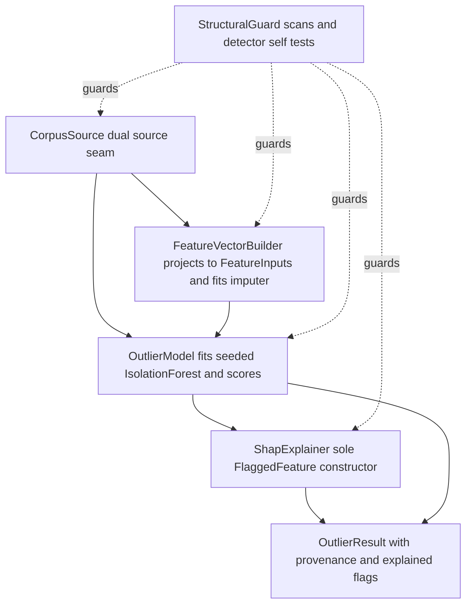

# Logical Components — `outlier-model` (U18, C3, Phase 2)

**Stage**: BUILD → NFR Design (per-unit) · **Unit**: U18 `outlier-model` · C3 · **Phase 2** · **Depth**: comprehensive · **Date**: 2026-07-16.
**Built ON** the frozen FD + the thirteen `NFR-OUT-*` + the patterns `P-OUT-1..9` (`nfr-design-patterns.md`) — re-opening none. The **five logical components** (four owned + the StructuralGuard substrate) with responsibilities, ownership, and the **exact method signatures that enforce each by-construction guarantee** (Q1-A: signatures + injected deps are the guarantee; comments document, scans regress). Answers **Q1–Q4 (all A)** + folds **CG-ND-OUT-Fold-1..3**.

---

## 1. Components + method signatures (the by-construction surface)

### C-OUT-1 `FeatureVectorBuilder` (`feature_vector.py`) — P-OUT-1, P-OUT-3
**Responsibility**: project an `ApplicantProfile` onto the numeric, demographic-excluded feature space; own the missing-value imputation + the imputed-mask.
**Owns**: `OUTLIER_FEATURE_FIELDS` (U18-local frozenset), the `FeatureInputs` projection type, the fitted `imputer`.

```text
OUTLIER_FEATURE_FIELDS: frozenset[str]          # the 9 numeric names; no demographic / categorical name

@dataclass(frozen=True)
class FeatureInputs:                             # the builder's WORKING TYPE — Q2-A / P-OUT-1
    values: tuple[float, ...]                    # resolved numeric vector, in field_order()
    imputed: tuple[bool, ...]                    # per-feature imputed mask — CG-ND-OUT-Fold-1
    # NOTE: no `demographics`, no name/gender/city, no categorical field EXISTS on this type.

@dataclass(frozen=True)
class CorpusImputer:                             # fitted once, stored — deterministic (no RNG)
    medians: tuple[float, ...]                   # per-feature corpus median over PRESENT values

class FeatureVectorBuilder:
    @staticmethod
    def field_order() -> tuple[str, ...]: ...    # stable sort of OUTLIER_FEATURE_FIELDS (determinism)
    @staticmethod
    def fit_imputer(corpus_profiles) -> CorpusImputer: ...          # median over present corpus values
    @classmethod
    def project(cls, profile, imputer: CorpusImputer) -> FeatureInputs: ...  # raw -> FeatureInputs (+mask)
    @classmethod
    def build_matrix(cls, corpus_profiles, imputer) -> list[FeatureInputs]: ...
```
**By-construction guarantees**: `project` reads profile fields **only** through the `field_order()` accessor map and emits a **`FeatureInputs` with no demographics field** — a demographic value cannot reach the vector without adding a field to `FeatureInputs` (P-OUT-1 / BIAS-1). A missing optional is filled with `imputer.medians[i]` **and** its `imputed[i]` set `True` (P-OUT-3 / CG-ND-OUT-Fold-1) — the median feeds the IsolationForest score, the mask drives z=0-at-flagging. **Header comment** documents the demographic-exclusion + imputed-mask guarantees (documentation only, Q1-A).

### C-OUT-2 `CorpusSource` (`corpus_source.py`) — P-OUT-6
**Responsibility**: the read-only dual-source corpus seam. **Owns**: nothing persisted; imports `corpus_generator.records` **call-only**.
```text
class CorpusSource:
    @staticmethod
    def from_records(records) -> list[CorpusRecord]: ...   # tier-U/S in-memory (default CI path)
    @staticmethod
    def from_file(path) -> list[CorpusRecord]: ...         # tier-B frozen corpus (NOT required for build/test)
    @staticmethod
    def profiles(records) -> list[ApplicantProfile]: ...
    @staticmethod
    def corpus_version(manifest) -> str: ...
```
**By-construction**: **mirrors — never imports —** `quality_gates/corpus_loader.py`; deterministic I/O (no RNG, no seed — CG-ND-OUT-Fold-3); `from_file` unused by the default path (tier-B independence). **Header comment**: read-only, mirror-not-import, never triggers a corpus build / never calls an LLM.

### C-OUT-3 `OutlierModel` (`model.py`) — P-OUT-2, P-OUT-3, P-OUT-5, P-OUT-7 (+ orchestrates P-OUT-4)
**Responsibility**: fit IsolationForest (seeded, seed-local) + corpus z-stats; score an applicant → `OutlierResult`. **Owns**: the fitted forest, z-stats, imputer, the injected `RandomState`, provenance.
```text
class OutlierModel:
    @staticmethod
    def fit(corpus_profiles, manifest, explainer: ShapExplainer) -> "FittedOutlierModel":
        # rng = np.random.RandomState(manifest.seed)         # Q3-A: explicit local instance
        # forest = IsolationForest(random_state=rng, ...)    # injected instance; NEVER np.random.* global
        ...
class FittedOutlierModel:
    provenance: OutlierProvenance                            # {corpus_version, seed, outlier_model_version}
    def score(self, profile) -> OutlierResult: ...           # compose score + flags + explanation
```
**By-construction guarantees**: the **only** RNG source is the injected local `RandomState` — global `np.random.*` never touched (P-OUT-2 / DET-1). `score` computes candidate flags from **non-imputed** features with `|z| >= threshold` (P-OUT-3: an imputed feature's flagging z is 0 by the mask, so it is never a candidate), then **delegates construction to the explainer** (P-OUT-4) — it **never builds a `FlaggedFeature` itself**. Every `OutlierResult` is built with its required `OutlierProvenance` (P-OUT-7). **Header comment**: seed single-sourced from `CorpusManifest.seed`; deterministic given `(corpus_version, seed, outlier_model_version)`; constructs no `FlaggedFeature`.

### C-OUT-4 `ShapExplainer` (`shap_explainer.py`) — P-OUT-4 (**the SOLE `FlaggedFeature` constructor**)
**Responsibility**: attribute the IsolationForest score to features and **build every `FlaggedFeature`**.
```text
class ShapExplainer:
    def explain(self, fitted_forest, feature_inputs, candidates) -> list[FlaggedFeature]:
        # the ONLY code path that constructs FlaggedFeature(...) — attaching shap_value per candidate.
        # candidates == [] -> return []  (no SHAP run; CG-ND-OUT-Fold-2)
        ...
```
**By-construction**: `FlaggedFeature` requires `shap_value` (schema) **and** is constructed **only here** (single-constructor scan, EXPLAIN-1) — a flag is born from SHAP. TreeExplainer (deterministic for the tree model, no seed — CG-ND-OUT-Fold-3); the empty-candidate case short-circuits. **Header comment**: sole constructor of `FlaggedFeature`; a flag cannot exist without a SHAP value.

### C-OUT-5 `StructuralGuard` substrate (`tests/` + scans) — P-OUT-8 (test-only)
**Responsibility**: the single substrate of import/AST scans, each with a **detector self-test** (non-vacuous): no-forbidden-import (`quality_gates`/`memo_agent_core`/`ui_outlier_view`/`observability`); no-demographic-read (BIAS-1); no-global-`np.random` (DET-1); no-write/LLM/DB + no-`Recommendation` + no-verdict (ADVISORY-1); single-`FlaggedFeature`-constructor (EXPLAIN-1); call-only `corpus_generator.records` (CORPUS-1). Forward-looking `ui_outlier_view`/`observability` scans are **regression guards proven by the self-test** (CG-NFR-OUT-Fold-3).

---

## 2. Component-relationship diagram (validated — rectangle-only, alphanumeric IDs, quoted labels, no special characters)



### Text alternative (always included)
- **`CorpusSource`** feeds the corpus to both **`FeatureVectorBuilder`** (to fit the imputer + build the corpus matrix) and **`OutlierModel`** (to fit the forest).
- **`FeatureVectorBuilder`** emits `FeatureInputs` (numeric-only, with the imputed mask) into **`OutlierModel`**.
- **`OutlierModel`** routes candidate flags through **`ShapExplainer`** (the sole `FlaggedFeature` constructor) and assembles the **`OutlierResult`** (score + provenance + explained flags).
- **`StructuralGuard`** (dashed) guards all four production components with scans + self-tests — it is test-only, not a runtime dependency.

---

## 3. Reference-not-own check (three distinct categories, kept separate)

| Category | Modules | Discipline |
|---|---|---|
| **Consumed by shape** (imported, used verbatim, re-declared none) | `intake.schema.ApplicantProfile`; `corpus_generator.records` (`CorpusRecord`/`CorpusManifest`, **call-only** via `CorpusSource`); `rules_engine.report_schema.Recommendation` (label space, **unused** by scoring) | import the frozen type, never re-declare; the only `backend.*` production imports |
| **Mirrored, not imported** (pattern reused, module NOT imported) | `quality_gates/corpus_loader.py` (the dual-source pattern → `CorpusSource` mirrors it) | U18 has **no edge** to `quality_gates`; importing it is Q4-C, **rejected** |
| **Excluded** (must NOT be imported; scanned) | `quality_gates`, `memo_agent_core` (**exist** — non-vacuous scan today); `ui_outlier_view` (U20), `observability` (U21) (**forward-looking** — regression guards proven by the detector self-test) | P-OUT-8 no-forbidden-import scans + self-tests |

**Edits no frozen unit; imports no consumer.** The seed flows **only** into `OutlierModel` → IsolationForest (CG-ND-OUT-Fold-3): `CorpusSource` (I/O), `FeatureVectorBuilder` (median = deterministic statistic), `ShapExplainer` (TreeExplainer = deterministic) need no seed.

## 4. Component → target coverage (no orphan)

| Component | NFR-OUT-* targets met | Patterns |
|---|---|---|
| `FeatureVectorBuilder` | BIAS-1, FEAT-1, IMPUTE-1 (+ THRESHOLD-1 mask half) | P-OUT-1, P-OUT-3 |
| `CorpusSource` | CORPUS-1 | P-OUT-6 |
| `OutlierModel` | DET-1, THRESHOLD-1, COMPOSE-1, PROV-1 (+ IMPUTE-1 flag-exclusion half) | P-OUT-2/3/5/7 |
| `ShapExplainer` | EXPLAIN-1 | P-OUT-4 |
| `StructuralGuard` substrate | SCOPE-1, ADVISORY-1 (+ the structural halves of BIAS/DET/CORPUS/EXPLAIN) | P-OUT-8 |
| (referenced/observed) | PERF-1, SEC-1 | P-OUT-9 |

**All thirteen `NFR-OUT-*` covered; no orphan.**

## 5. Settled items held (not re-opened)
- The **frozen FD** (BR-OUT-1..10 + schemas + imputation policy) + the **thirteen NFR-OUT-*** targets are the substrate.
- **Q1-A**: Python-native by-construction (typed/frozen structures + injected deps + scans); header comments **document, not enforce**.
- **Q2-A**: the `FeatureInputs` typed projection with **no demographics field** is the demographic-exclusion mechanism (AST scan + swap teeth regress it).
- **Q3-A**: an injected local `RandomState` instance + a no-global-`np.random` scan; the seed is single-component (OutlierModel only).
- **Q4-A**: `ShapExplainer` is the **sole `FlaggedFeature` constructor** (single-constructor scan).
- **CG-ND-OUT-Fold-1** (imputed-mask + z=0-by-design at flagging) reconciles the frozen "median imputation" with "imputed never flags" — the median feeds the score, the mask drives flag-exclusion. *(Flagged for confirmation at the gate.)*
- **Deferred to Code-Gen**: the exact `Z_SCORE_FLAG_THRESHOLD` value (post-calibration), IsolationForest hyper-parameters, the `outlier_model_version` string / sklearn lock, the TreeExplainer wiring, the seeded-fixture corpus. **tier-B stays out-of-band / not required.**
