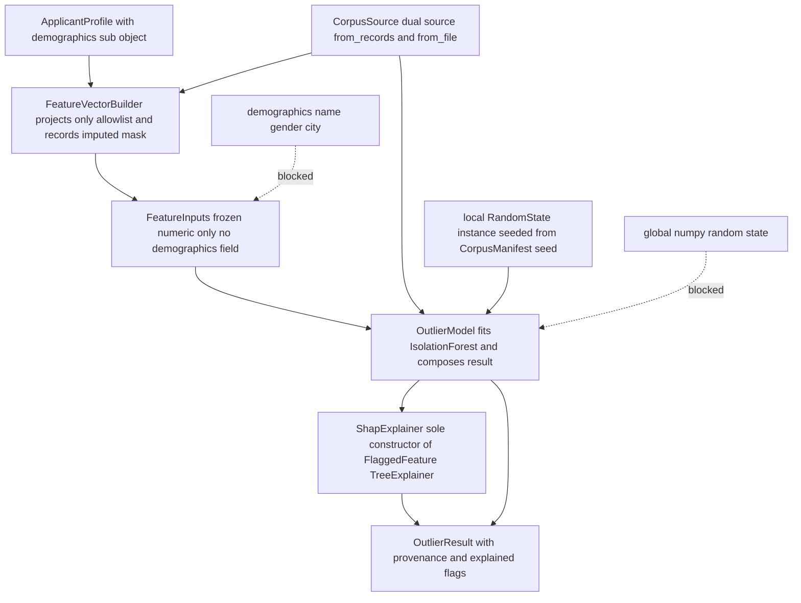

# NFR Design Patterns — `outlier-model` (U18, C3, Phase 2)

**Stage**: BUILD → NFR Design (per-unit) · **Unit**: U18 `outlier-model` · C3 · **Phase 2** · **Depth**: comprehensive · **Date**: 2026-07-16.
**Built ON** the frozen FD (**BR-OUT-1..10**; the four-component inventory + method signatures; `OutlierResult`/`FlaggedFeature`/`OutlierProvenance`; the imputation policy) **and** the approved NFR Requirements (**thirteen `NFR-OUT-*`**; folds **CG-NFR-OUT-Fold-1..3**) — **re-opening neither.** Each pattern structurally meets its `NFR-OUT-*` target(s) + is traced. **Backend Python unit** — "component relationship" = module/class relationships + numpy/sklearn API usage + Python data flow. Answers **Q1–Q4 (all A)** + the NFR-Design ambiguity-check folds **CG-ND-OUT-Fold-1..3** (plan §3.5).

> **By-construction mechanism for a Python unit (Q1-A, stated once, upheld everywhere).** Unlike the frozen UI units (JSX prop signatures) this unit has **no component tree**, so a "by-construction" guarantee is realized through the mechanisms Python actually affords: **(i) typed/frozen structures where the forbidden thing is unrepresentable** (a `FeatureInputs` projection with no demographics field; a `FlaggedFeature` that cannot exist without `shap_value`); **(ii) injected dependencies** (a seed-local `RandomState`, the fitted `imputer`) so global state is never reached; **(iii) the `StructuralGuard` AST/import scans + detector self-tests** as the **regression layer**; **(iv) header comments as documentation only — NOT enforcement** (a comment carries no load-bearing weight in Python). This mirrors the frozen `rules-engine` (`NamespaceBuilder`'s real `assert` + `test_no_forbidden_imports`'s scan), not the UI prop-signature.

---

## §P-OUT-1 — AllowlistProjectionPattern → NFR-OUT-BIAS-1 (+ NFR-OUT-FEAT-1) — **LOAD-BEARING (bias)**
- **Pattern (by construction, Q2-A)**: `FeatureVectorBuilder` never builds the vector from a raw `ApplicantProfile`. An internal step projects **only** the `OUTLIER_FEATURE_FIELDS` numeric values into a **frozen `FeatureInputs` structure that has no `demographics` field** (and no `full_name`/`gender`/`city`) — the strongest Python analog to the UI prop-signature isolation. The vector is built **from `FeatureInputs`**, so a demographic field is **structurally absent from the builder's working type** — there is no wired path by which it could enter the vector without first adding a demographic field to `FeatureInputs`, an obvious, reviewable change. Numeric-only (FEAT-1): the three categoricals (`employment_type`/`smoking_status`/`occupation`) are likewise absent from `FeatureInputs`, each for the documented reason (FD §2.2).
- **Meets the target**: (BIAS-1) the by-construction design is **confirmed** by (a) the StructuralGuard **AST scan** — no module references `.demographics`/`full_name`/`gender`/`city` in a feature path, and `set(FeatureVectorBuilder.field_order()) == OUTLIER_FEATURE_FIELDS` (+ self-test flagging a synthetic `profile.demographics.city` read); (b) the **swap-invariance teeth** — swapped name/gender/city over identical financials → byte-identical vector AND `OutlierResult`. The scan + teeth are the **regression layer on the design-level guarantee**, not the only safeguard. `quality-gates`' bias-swap suite stays the external delta verifier.
- **Tier**: structural (AST) + component (teeth). **Rigor**: **full (highest)**.

## §P-OUT-2 — SeedLocalDeterminismPattern → NFR-OUT-DET-1 — **LOAD-BEARING (determinism)**
- **Pattern (by construction, Q3-A)**: `OutlierModel` constructs an **explicit `np.random.RandomState(seed)` instance** (seed single-sourced from `CorpusManifest.seed`) and **injects that instance** into `IsolationForest(random_state=<instance>)` (verified accepted). The model's **only** randomness source is that visible local instance; **global `np.random.*` is never read or written** anywhere in a scoring path. A `StructuralGuard` scan **forbids any global `np.random.<fn>` call** in the unit (+ self-test), so RNG leakage is a **build failure**, not merely a determinism-teeth catch.
- **Meets the target**: (DET-1) same corpus+seed+inputs → **byte-identical `OutlierResult` across N≥2 runs**, **and** byte-identical **across a deliberate global-RNG perturbation** between the two runs (CG-NFR-OUT-Fold-1 — proves seed-locality); the no-global-RNG scan + stable field-order sort are the structural guarantees the teeth confirm.
- **Tier**: component (teeth) + structural. **Rigor**: **full (highest)**.

## §P-OUT-3 — ImputeThresholdCompositionPattern → NFR-OUT-IMPUTE-1 + NFR-OUT-THRESHOLD-1 *(revised per CG-ND-OUT-Fold-1)*
- **Pattern (by construction)**: "an imputed feature never flags" is a **composed, designed** property, not two coincident facts — and it is made **correct** (CG-ND-OUT-Fold-1): a missing optional is imputed to the **corpus median** (the IsolationForest **score** input), **and** the `FeatureInputs` projection **records which features were imputed** (an `imputed` mask). At **flagging**, an imputed feature's z-score is **0 by design** — a **missing value is not anomaly evidence** — so it is excluded from flag candidacy by the mask, **independently** of whether the median equals the mean. The threshold is **strictly `> 0`** (CG-NFR-OUT-Fold-2), so even the boundary is safe. *(This reconciles the frozen FD's two claims — median imputation for the score; z=0 for imputed at flagging — which are inconsistent if z=0 is left to depend on median==mean; verified: median imputation alone gives z ≈ −0.43 for a skewed feature, not 0.)*
- **Meets the target**: (IMPUTE-1) a fixture with a deliberately-missing optional scores deterministically; the imputed feature's flagging z-score is **exactly 0** (by the mask) and it **never** appears in `flagged_features`; same `(corpus, seed)` → same imputed value. (THRESHOLD-1) exactly one fixed named `Z_SCORE_FLAG_THRESHOLD` constant, **strictly `> 0`** (guard), flag-selection tested **parameterically off the constant** + one inclusive-boundary case.
- **Tier**: component (teeth). **Rigor**: full.

## §P-OUT-4 — SoleExplainerConstructionPattern → NFR-OUT-EXPLAIN-1 (Q4-A)
- **Pattern (by construction)**: `FlaggedFeature` is **required** to carry `shap_value` (schema, `frozen`/`extra="forbid"`, no default) **and** `ShapExplainer.explain(candidates, …) -> list[FlaggedFeature]` is the **SOLE constructor** of `FlaggedFeature`. `OutlierModel.score` computes the candidate flags (feature + z + direction) but **does not build `FlaggedFeature` objects itself**; it hands the candidates to the explainer, which is the **only** code path that constructs one (attaching the SHAP value). A flag is therefore **born from SHAP by construction** — no call site can produce a flag without an explanation. A `StructuralGuard` scan asserts `FlaggedFeature(` is constructed in **exactly one place** (the explainer) + self-test.
- **Meets the target**: (EXPLAIN-1) construction-time — a `FlaggedFeature` cannot be instantiated without `shap_value` (schema) **and** cannot be built outside the explainer (single-constructor scan); every flag in every result carries a finite `shap_value`; **zero unexplained flags** holds by construction. Zero-candidate case: `explain([]) -> []`, no SHAP run, no degenerate call (CG-ND-OUT-Fold-2).
- **Tier**: component (construction) + structural. **Rigor**: full.

## §P-OUT-5 — ScoreFlagExplainCompositionPattern → NFR-OUT-COMPOSE-1
- **Pattern**: `OutlierModel.score` composes the three techniques into the `OutlierResult` (BR-OUT-5): **IsolationForest** → the holistic `outlier_score` + `is_outlier`; **per-feature z-scores** (non-imputed features only, P-OUT-3) → the flag candidates (`|z| >= threshold`); **`ShapExplainer`** (P-OUT-4) → the `FlaggedFeature[]`. One score, explicit per-feature flags, every flag explained.
- **Meets the target**: (COMPOSE-1) `outlier_score` from IsolationForest; `flagged_features` are exactly the non-imputed features with `|z| >= threshold`, each with a `shap_value` + `direction`; a normal applicant → `flagged_features == []` + a valid score + populated provenance.
- **Tier**: component. **Rigor**: full.

## §P-OUT-6 — DualSourceSeamPattern → NFR-OUT-CORPUS-1
- **Pattern (mirror-not-import)**: `CorpusSource.{from_records(records), from_file(path)}` — the tier-U/S in-memory path and the tier-B frozen-file path — both yielding the `profile` stream, **mirroring** the frozen `quality_gates/corpus_loader.py` **without importing it** (U18 has no edge to `quality_gates`), importing `corpus_generator.records` **call-only**. `from_file` is **never invoked/required by the default (tier-U) path** — the unit builds + tests fully on the in-memory fixture with no `corpus/` present (tier-B independence, BR-OUT-8).
- **Meets the target**: (CORPUS-1) `from_records` and `from_file` yield the same downstream `profile` shape; `from_file` unused by default; `corpus_generator.records` call-only; + self-test.
- **Tier**: component + structural. **Rigor**: full.

## §P-OUT-7 — VersionAnchoredProvenancePattern → NFR-OUT-PROV-1
- **Pattern (by construction)**: every `OutlierResult` is constructed with a **required** `OutlierProvenance{corpus_version, seed, outlier_model_version}` (schema, no default), so a result **cannot exist without** its provenance. `seed` is the single-sourced `CorpusManifest.seed`; `outlier_model_version` bundles the sklearn version + feature-schema version (version-anchored replay, CG-OUT-Fold-2); **no `rulebook_version`** (the score never reads the corpus `label` — label-independent).
- **Meets the target**: (PROV-1) provenance completeness holds by schema; `seed == CorpusManifest.seed`; no `rulebook_version`.
- **Tier**: component. **Rigor**: full.

## §P-OUT-8 — StructuralGuardPattern → NFR-OUT-SCOPE-1 + NFR-OUT-ADVISORY-1 (+ the structural halves of BIAS/DET/CORPUS/EXPLAIN)
- **Pattern (single substrate)**: one `StructuralGuard` substrate of independent scans, **each with a detector self-test** (non-vacuous): **no-forbidden-import** (`quality_gates`/`memo_agent_core`/`ui_outlier_view`/`observability` — SCOPE-1; `quality_gates`+`memo_agent_core` exist so non-vacuous today, the two U20/U21 scans are **forward-looking regression guards proven by the self-test**, CG-NFR-OUT-Fold-3); **no-demographic-read** (BIAS-1 AST); **no-global-np.random** (DET-1); **no-write/LLM/DB + no-`Recommendation`-producing path + no-verdict-field** (ADVISORY-1); **single-`FlaggedFeature`-constructor** (EXPLAIN-1); **call-only `corpus_generator.records`** (CORPUS-1).
- **Meets the target**: (SCOPE-1) the forbidden-import scans pass over `backend/outlier_model/` + each self-test flags a synthetic violation; (ADVISORY-1) no verdict/LLM/write path + self-test.
- **Tier**: structural. **Rigor**: full.

## §P-OUT-9 — ReferencedObservedBoundaryPattern → NFR-OUT-PERF-1 + NFR-OUT-SEC-1 *(soft / governance)*
- **PERF-1**: SHAP + fit runtime **observed/recorded**, **non-gating** — kept fast by the small seeded fixture + the tree-model TreeExplainer fast path; SHAP *correctness* (zero unexplained) stays gating via P-OUT-4. No hard SLO (the project's uniform soft-perf posture).
- **SEC-1**: the Security-Guardrails governance table (bias-free + reproducibility + explainability Compliant; input/prompt/secrets/DB/audit N/A) — enforced by review + the P-OUT-8 scans; not over-specified.
- **Tier**: observed / governance. **Rigor**: soft / governance.

---

## §10 — Module-relationship diagram (validated — rectangle-only, alphanumeric IDs, quoted labels, no special characters; demographic-exclusion + RNG-isolation as VISIBLE structural properties)

### Text alternative (always included)
- **The demographic-exclusion guarantee is a visible graph property**: `ApplicantProfile` (which contains the `demographics` sub-object) reaches `FeatureVectorBuilder`, but the builder emits a **`FeatureInputs`** node that is **numeric-only with no demographics field**, and **only `FeatureInputs` flows into `OutlierModel`**. The dashed **blocked** edge from `demographics` to `FeatureInputs` shows there is **no path** by which a demographic field enters the feature flow — it is excluded by the projection type (P-OUT-1 / Q2-A).
- **The RNG-isolation guarantee is a visible graph property**: the **only** randomness edge into `OutlierModel` comes from the **local `RandomState` instance** (seeded from `CorpusManifest.seed`); the dashed **blocked** edge from **global numpy random state** to `OutlierModel` shows the global RNG has **no edge** into the model — determinism is seed-local (P-OUT-2 / Q3-A).
- **The sole-explainer guarantee**: `OutlierModel` routes candidate flags through **`ShapExplainer`**, the **only** constructor of a `FlaggedFeature`, before the `OutlierResult` is assembled — a flag cannot bypass SHAP (P-OUT-4 / Q4-A).
- **Corpus** flows from `CorpusSource` (dual-source, mirrored) into both the builder (fit matrix) and the model (fit); it is never regenerated.

---

## §11 — Traceability (pattern → target → tier → rigor)

| Pattern | Target(s) | Tier | Rigor |
|---|---|---|---|
| **P-OUT-1 AllowlistProjectionPattern** | **NFR-OUT-BIAS-1**, NFR-OUT-FEAT-1 | structural + component | **full (highest)** |
| **P-OUT-2 SeedLocalDeterminismPattern** | **NFR-OUT-DET-1** | component + structural | **full (highest)** |
| P-OUT-3 ImputeThresholdCompositionPattern | NFR-OUT-IMPUTE-1, NFR-OUT-THRESHOLD-1 | component | full |
| P-OUT-4 SoleExplainerConstructionPattern | NFR-OUT-EXPLAIN-1 | component + structural | full |
| P-OUT-5 ScoreFlagExplainCompositionPattern | NFR-OUT-COMPOSE-1 | component | full |
| P-OUT-6 DualSourceSeamPattern | NFR-OUT-CORPUS-1 | component + structural | full |
| P-OUT-7 VersionAnchoredProvenancePattern | NFR-OUT-PROV-1 | component | full |
| P-OUT-8 StructuralGuardPattern | NFR-OUT-SCOPE-1, NFR-OUT-ADVISORY-1 (+ structural halves of BIAS/DET/CORPUS/EXPLAIN) | structural | full |
| P-OUT-9 ReferencedObservedBoundaryPattern | NFR-OUT-PERF-1, NFR-OUT-SEC-1 | observed / governance | soft / governance |

**All thirteen `NFR-OUT-*` targets covered; no orphan.** (BIAS→P1, FEAT→P1, DET→P2, IMPUTE→P3, THRESHOLD→P3, EXPLAIN→P4, COMPOSE→P5, CORPUS→P6, PROV→P7, SCOPE→P8, ADVISORY→P8, PERF→P9, SEC→P9.)
