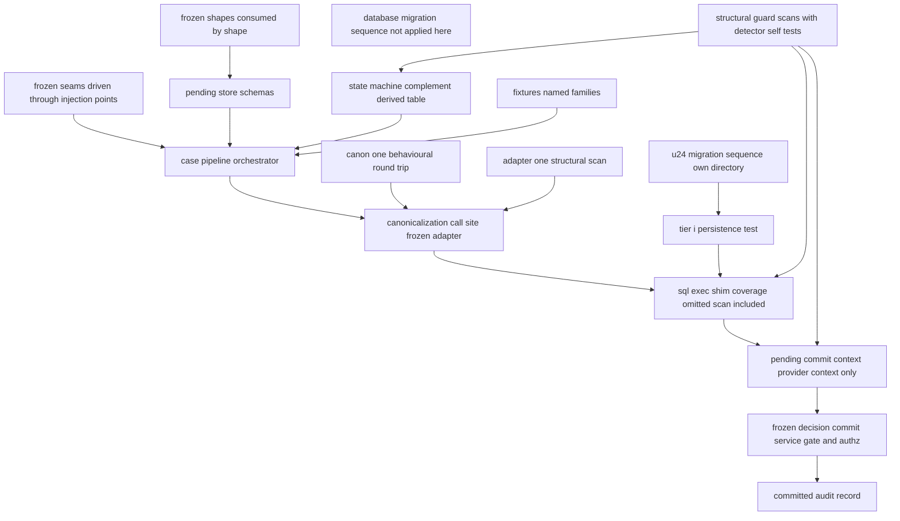

# NFR Design Plan (Part 1) — `case-lifecycle` (U24, Scope B)

**Phase / Stage**: BUILD → per-unit loop → **NFR Design, Part 1 (Planning)** (plan-then-generate + `[Answer]:` tags)
**Loop position**: `case-lifecycle` (U24) · FD ✅ → NFR Requirements ✅ (approved) → **NFR Design ← here (the 3rd of U24's
5 stages)**
**Unit**: U24 · **Scope B** · **Date**: 2026-07-20 · **Depth**: **comprehensive**
**Status**: **Plan — awaiting `[Answer]:` tags. NO NFR Design artifact; no code; no wiring; `backend/case_lifecycle/`
ABSENT.**

Built **ON** the frozen FD (**`BR-CASE-1..14`**) **AND** the approved NFR Requirements (the **seventeen `NFR-CASE-*`**
targets; the **three LOAD-BEARING** targets **CANON-1 / ADAPTER-1 / COMMITBOUND-1**; the **two-tier tier-U/tier-I split**
with `database`'s known-good Docker guard reused; the **narrow SQL-exec-shim coverage omit that stays INSIDE ADAPTER-1's
scan set**; the **named fixture families** with `illegal_transition_cases()` and `drafting_failure_double()` isolated) —
**re-opening NEITHER.**

**Backend Python unit** — "component relationship" = module/class relationships + data flow (the established reading).

---

## 1. What "by construction" means for this unit (the honest scope)

- **Genuinely by construction**: a **complement-derived** transition table makes an *unenumerated* illegal transition
  **impossible to forget** (P-CASE-4). Routing through the **frozen `CanonSerAdapter`** makes a second serialization
  discipline **structurally absent**. A provider whose return type is `CommitContext` makes *"the provider committed
  something"* **unrepresentable**. Creating the `PendingRecommendation` and the `drafted` transition **in one transaction**
  makes a `failed` case with a live recommendation-id **unreachable**.
- **Test-only where that is the honest answer**: import/namespace/call-site facts can only be enforced by **scan**, so each
  scan carries a **mandatory detector self-test**. Disclosure facts can only be enforced by **token presence**.
  Byte-identity can only be proven by **round-tripping real bytes**.
- **Header comments document; they never enforce.** (Verbatim from the U21 precedent.)

---

## 2. Draft `NFR-CASE-*` → pattern map (**all seventeen mapped — NO ORPHAN**)

| Pattern | Target(s) | Tier / rigor |
|---|---|---|
| **P-CASE-1 `CanonicalRoundTripPattern`** | **NFR-CASE-CANON-1** | tier-U (component) · **full-highest [LOAD-BEARING]** |
| **P-CASE-2 `FrozenAdapterSoleSourcePattern`** | **NFR-CASE-ADAPTER-1** | tier-U (structural) · **full-highest [LOAD-BEARING]** |
| **P-CASE-3 `ComposedCommitBoundaryPattern`** | **NFR-CASE-COMMITBOUND-1** | tier-U (structural + component) · **full-highest [LOAD-BEARING]** |
| **P-CASE-4 `ComplementDerivedTransitionPattern`** | NFR-CASE-STATE-1 · **NFR-CASE-STATE-2** | tier-U (component + exhaustiveness detector) · full |
| P-CASE-5 `AtomicEagerAdvancePattern` | NFR-CASE-EAGER-1 (+ COMMITBOUND-1's atomicity clause) | tier-U (component) · full |
| P-CASE-6 `SideEffectFreeReadPattern` | NFR-CASE-TRIGGER-1 | tier-U (component + spy) · full |
| P-CASE-7 `IsolatedFailureFamilyPattern` | NFR-CASE-FAILED-1 | tier-U (component) · full |
| **P-CASE-8 `TokenChecklistGovernancePattern`** *(DISCLOSE-1 / DOC-1 lineage)* | NFR-CASE-PROJECT-1 | governance / doc-presence · governance |
| P-CASE-9 `FinalizingTransitionCanonicalizationPattern` | NFR-CASE-CANONTIME-1 | tier-U (component) · full |
| P-CASE-10 `ExplicitRoutingRederivablePattern` | NFR-CASE-ROUTE-1 | tier-U (spy + re-derivation) · full |
| P-CASE-11 `NamespacedMigrationGuardPattern` | NFR-CASE-MIGNAME-1 · NFR-CASE-MIGSCOPE-1 | tier-U (structural + detector) · full |
| **P-CASE-12 `SelfContainedIntegrationTierPattern`** | **NFR-CASE-PERSIST-1** | **tier-I** · full (in tier) |
| P-CASE-13 `ProvenanceScanPattern` | NFR-CASE-NOMETRIC-1 | tier-U (structural) · full |
| P-CASE-14 `StructuralGuardPattern` *(U18/U19/U21/U22 substrate)* | the **structural halves** of ADAPTER-1 / COMMITBOUND-1 / MIGSCOPE-1 / NOMETRIC-1 / PROJECT-1 | tier-U (structural) · full |
| P-CASE-15 `ObservedNeverGatedGovernancePattern` | NFR-CASE-PERF-1 · NFR-CASE-SEC-1 | observed / governance · soft / governance |

### 2.1 ⚑ Why CANON-1 and ADAPTER-1 are **two patterns**, not one

The same reasoning `llm-judge` applied to EXEMPT-1's two mechanisms and NOEDIT-1/NOMETRIC-1's two mechanisms:

| | **P-CASE-1 (CANON-1)** | **P-CASE-2 (ADAPTER-1)** |
|---|---|---|
| **Kind** | **behavioural** | **structural** |
| **Subject** | the **bytes** — round-trip, type fidelity, hash stability, mutation detection | the **call sites** — what code may invoke, and how |
| **Would still pass if…** | U24 had its own **correct-but-FORKED** serializer | U24's serializer were **broken** |
| **Fails when** | encoding drifts | the frozen adapter is **bypassed or re-derived** |

**⚑ Neither alone is sufficient — that is precisely why they are two.** Together they assert *the encoding is correct*
**and** *it is the single frozen encoding, not a fork*. **No single edit can weaken both**, because they read different
things: one reads bytes, the other reads the AST. **⚑ And they converge on ONE call site** — the module that invokes
`CanonSerAdapter` — which is why the diagram (§4) shows two verification paths meeting at a single node.

---

## 3. Draft logical components (eight — six production, two test substrates)

| # | Component | Owns | Patterns |
|---|---|---|---|
| **C-CASE-1** | `state machine` (`states.py`) | `CaseState` · the **complement-derived** legal-transition table · the transition guard | P-CASE-4 |
| **C-CASE-2** | `pending-store schemas` (`schemas.py`) | `PendingApplication` · `PendingRecommendation` — the `BYTEA` + `content_hash` + scalar-stamp shape | P-CASE-1/9 |
| **C-CASE-3** | **`SQL-exec shim`** (`repository.py`) | the **only** module issuing SQL. **⚑ COVERAGE-OMITTED *and* SCAN-INCLUDED** (CASE-Req-Fold-3) | P-CASE-2/12 |
| **C-CASE-4** | `CasePipeline` (`pipeline.py`) | drives the frozen units in order; **explicitly calls `route_borderline`**; canonicalizes at the finalizing transition | P-CASE-5/6/7/9/10 |
| **C-CASE-5** | `PendingCommitContextProvider` (`provider.py`) | the **real** `CommitContextProvider` — **context only** | P-CASE-3 |
| **C-CASE-6** | `migration sequence` (`migrations/` + a runner call) | U24's own `NNNN_case_lifecycle.sql` + `checksums.json` + the **collision guard** | P-CASE-11/12 |
| **C-CASE-7** | `fixtures` substrate (`tests/fixtures.py`) | the **five named families** (Q2-A) + the offline doubles | P-CASE-7 and every component test |
| **C-CASE-8** | `StructuralGuard` substrate (`tests/structural.py` + `test_structural_guard.py`) | the scans, **each with a detector self-test**; `production_py_files()` **EXCLUDING `tests/`** | P-CASE-14 |

**⚑ C-CASE-3 is modelled explicitly as a DUAL-STATUS component** (per CASE-Req-Fold-3): **omitted from coverage** (it is
exercised at tier-I, the `pg_repository.py` precedent) **but INCLUDED in ADAPTER-1's scan set**, with a **positive
assertion that it contains no canonicalization call at all**. The two sets are deliberately different.

### 3.1 Reference-not-own — **three categories, kept distinct**

| # | Category | Members | Discipline |
|---|---|---|---|
| **1** | **Consumed BY SHAPE** (frozen output shapes) | `DecisionMemo` · `RuleResultReport` · `ApplicantProfile` · `OutlierResult` | **imported read-only**; instantiated/round-tripped, never mutated, never re-declared. **import-to-read ≠ edit.** |
| **2** | **DRIVEN THROUGH AN EXISTING INJECTION POINT** (frozen seams) | the U19 **provider adapters** · **`route_borderline`** · **`MigrationRunner`** / `verify_checksums` · **`CanonSerAdapter`** | invoked through their **existing** parameters/constructors — `thinking_mode=`, `migrations_dir=`, `canonical_bytes(model)`. **No seam widened, no adapter edited.** `temperature=0` stays **centrally fixed inside** the frozen adapters. |
| **3** | **COMPOSED WITH, NEVER RE-IMPLEMENTED** (frozen enforcement) | **`DecisionCommitService`** — its CON-BR4 gate, its independent authz re-check, its atomic write | U24 supplies **only** a `CommitContextProvider`. **⚑ It implements NO gate, NO authz check, and NO write to `audit_record`** — asserted structurally by P-CASE-3. |

**⚑ The categories must not blur**: category 1 is **read**, category 2 is **called**, category 3 is **deferred to**. A
category-3 member appearing anywhere in U24's own logic would mean the human-in-the-loop enforcement had been duplicated —
the exact failure COMMITBOUND-1 exists to prevent.

---

## 4. Draft module-relationship diagram (to be **mechanically re-validated** at Part 2)



**How the three required properties are made VISIBLE:**
- **⚑ The commit-boundary crossing**: **`committed audit record` has exactly ONE inbound edge, and it comes from
  `frozen decision commit service`.** No U24 component — not the pipeline, not the shim, not the provider — reaches it
  directly. **The provider's only outbound edge is INTO the frozen service**, which is the structural expression of
  *"context only, never a write."*
- **⚑ The CANON-1 / ADAPTER-1 pair**: **two distinct verification nodes** — `canon one behavioural round trip` and
  `adapter one structural scan` — **both point at the SAME node**, `canonicalization call site frozen adapter`. Two
  independent paths converging on one call site is exactly the "neither alone is sufficient" design made graphical.
- **⚑ The tier-I isolation**: **`database migration sequence not applied here` has ZERO edges** — nothing in U24's graph
  connects to it. `tier i persistence test` is fed **only** by `u24 migration sequence own directory`. The **absence of
  any edge** is the isolation property (CASE-Req-Fold-1).

---

## 5. Clarifying questions — fill each `[Answer]:` tag

> **I will improvise none of these.** Options are lettered; a recommendation is given where the ground-truth pass produced
> a grounded one. **No answer is pre-filled.**

---

### Question 1 — How is the transition table represented, and how is STATE-2's exhaustiveness guaranteed?

NFR-CASE-STATE-2 requires the illegal set be checked **against the full state cross-product**, *"so a rejection that is
missing from the table is caught, not just the ones anticipated."* **How that is achieved is a real fork.**

**A) Declare the LEGAL set only; derive ILLEGAL as its COMPLEMENT over the cross-product (RECOMMENDED).**
`LEGAL_TRANSITIONS: frozenset[tuple[CaseState, CaseState]]` is the **single source of truth**; the guard rejects anything
not in it; and the test derives the illegal set as
`set(product(CaseState, CaseState)) - LEGAL_TRANSITIONS` and asserts **every member is rejected**.
**Why**: exhaustiveness becomes **automatic and by construction** — a newly added state instantly appears in the derived
illegal set with **no test edit**, so there is **nothing to forget**. There is **one** table, so two tables cannot drift.
**Cost**: the illegal set is not enumerated in readable prose — mitigated by asserting a few **named** landmark cases
(skip-evaluation, a backward move, a terminal exit) *in addition to* the derived sweep.

**B) Enumerate BOTH the legal and the illegal sets explicitly.** *(Most readable; but two hand-maintained tables **can
drift**, and a newly added state would be silently absent from the illegal list — precisely the failure STATE-2's
exhaustiveness clause exists to prevent.)*

**C) Per-state guard methods** (each state knows its successors). *(Object-oriented and local; but there is no single set
to take a complement of, so exhaustiveness would have to be reconstructed by reflection — more machinery for less
certainty.)*

**D) Other (describe after `[Answer]:`)**

[Answer]: A

---

### Question 2 — Is the SQL-exec shim an INJECTED Protocol, or a concrete class tier-U simply avoids?

Q1-A fixed that **pure logic is tested at tier-U with NO database**. But the state machine, `CasePipeline` and the provider
all need *somewhere to put things*. **How tier-U gets a store without a database is genuinely open.**

**A) A `CaseStore` Protocol with an in-memory fake at tier-U and the SQL shim at tier-I (RECOMMENDED).**
`C-CASE-3` implements a Protocol that `CasePipeline` and the provider are **injected** with. tier-U drives an
**in-memory fake**; tier-I drives the **real SQL shim** against testcontainers.
**Why**: it is the **established injected-Protocol precedent** (U4's `LLMClient`, U19's adapters, U21's sinks, U22's
`RubricEngine`); it makes the **whole pipeline and the provider's assembly logic tier-U-testable** — including
COMMITBOUND-1's behavioural half — **without a database**; and it is what makes the coverage split honest, since the
**omitted module is exactly the Protocol's SQL implementation** and nothing else.
**Cost**: two implementations of one Protocol must agree — which is precisely what **PERSIST-1 (tier-I)** exists to check.

**B) A concrete SQL class that tier-U never constructs** (tier-U tests only pure functions in isolation). *(Fewer moving
parts; but `CasePipeline` and the provider then have **no tier-U-testable path at all**, which would gut COMMITBOUND-1's
behavioural half and EAGER-1 — both currently specified as tier-U.)*

**C) Other (describe after `[Answer]:`)**

[Answer]: A

---

### Question 3 — Where does the migration collision guard execute?

BR-CASE-11 requires a *"startup collision assertion"* that fails **loudly** if U24's filenames ever collide with U15's.
**Its placement determines whether it protects production or only the test suite.**

**A) In production, at U24's migration-apply call site — and additionally asserted by a test (RECOMMENDED).**
The guard runs **inside** U24's apply routine, before delegating to the frozen `MigrationRunner`; a tier-U test drives it
with a **synthetic colliding name** and asserts it raises (the detector self-test).
**Why**: the hazard (**a silently skipped migration — a no-op, not an error**) is a **production** hazard, so the guard
belongs on the production path; and being production code it is **counted and coverable**, consistent with Q3-A's
"everything but the SQL shim at 100%".
**Cost**: a few lines of production code whose only job is to fail — the same shape as `DbUrlGuard`.

**B) Test-only assertion.** *(Zero production code; but the guard would **not protect a real deployment** — exactly where a
silent skip does its damage.)*

**C) At import time of the migration module.** *(Earliest possible failure; but import-time side effects are the thing this
codebase has consistently avoided — the composition root's own boot discipline reads settings at **request** time, never
at import.)*

**D) Other (describe after `[Answer]:`)**

[Answer]: A

---

### Question 4 — How does `CasePipeline` signal a drafting failure to the state machine?

FAILED-1 needs a case to reach **`failed`**, and COMMITBOUND-1(d) needs the `drafted` transition to be **atomic** with
creating the `PendingRecommendation`. **The failure-signalling mechanism is open.**

**A) A result object — `DraftOutcome` carrying success-with-artifacts or failure-with-reason (RECOMMENDED).**
`CasePipeline.draft(case) -> DraftOutcome`; the caller transitions to `drafted` **or** `failed` based on it, and the
`drafted` branch creates the `PendingRecommendation` **in the same transaction**.
**Why**: it makes **both outcomes ordinary, testable return values** rather than control flow; the atomicity requirement
becomes a **visible single branch**; and it composes with the frozen orchestrator, whose `run()` already returns
**`DecisionMemo | None`** — a `None` is simply mapped to a failure outcome, so U24 **adds no new failure vocabulary**.
**Cost**: one more small type.

**B) Exceptions** — the pipeline raises, the caller catches and transitions to `failed`. *(Idiomatic; but it makes the
atomic boundary harder to see, and mixes genuine programming errors with an expected domain outcome.)*

**C) Other (describe after `[Answer]:`)**

[Answer]: A

---

### Question 5 — Where does the `failed → pending` wire projection live?

**⚑ A genuine tension.** NFR-CASE-PROJECT-1 is **U24's target**, so U24 must be able to test it at tier-U. But the
composition root's `projections.py` is documented as *"the composition root's **ONLY** transformation layer"*, and the
later wiring pass will need to emit the `MemoView` shape.

**A) A PURE projection function in U24, which the root's `projections.py` calls at wiring time (RECOMMENDED).**
U24 owns `case_to_memo_view_state(case) -> "ready" | "pending"` (and the accompanying field selection) as a **pure
function with no I/O**; PROJECT-1 tests it directly at tier-U. At the wiring pass, `projections.py` **calls it** rather
than re-deriving the mapping.
**Why**: the **`failed → pending` decision is domain knowledge** — it is U24 that knows a failed case exists at all, and
the root must not learn that vocabulary; it keeps PROJECT-1 **testable inside U24**, where the target lives; and the root's
"only transformation layer" role is preserved, since the root still owns **assembling the wire body** and merely delegates
the **state decision**.
**Cost**: the mapping is authored in U24 and consumed in the root — a seam that must stay a **pure function** to avoid
becoming a second transformation layer.

**B) The projection lives entirely in the root's `projections.py`.** *(Cleanest reading of the root's stated role; but
PROJECT-1 is **U24's** NFR target and would then be **untestable within U24** — the target would have no home in the unit
that owns it. It would also teach the composition root about the `failed` state, which is U24-internal.)*

**C) U24 emits the wire-shaped value directly** (a `MemoView`-shaped dict). *(Rejected: U24 would then own a WIRE-1 shape,
making it a second transformation layer and coupling a domain unit to the API contract.)*

**D) Other (describe after `[Answer]:`)**

[Answer]: A

---

## 5.5 Mandatory ambiguity-check (Q1–Q5 all A) — **CLEAN**

**Ran**: 2026-07-20 · **Result**: **CLEAN — 3 folds RESOLVED, no genuine gap.** **⚑ One fold CORRECTS a recommendation I
made in §5**, and one adds an **amplification note to register #13**. Both are flagged, not silently folded in.

### ⚑ CASE-ND-Fold-1 [check (i)] — RESOLVED, and it **INVERTS my own §5 framing**

**The question**: does *"same transaction"* require the `CaseStore` Protocol to expose an explicit transactional
operation, or can both implementations honour atomicity through the same shape without one needing extra machinery?

**My §5 framing anticipated** that exposing a transaction primitive would burden the in-memory fake with rollback
simulation the SQL shim gets free from SQLAlchemy — implying a **single composite method** instead.
**Measured on disk, the frozen precedent does the opposite, deliberately — and it is strictly better for U24's targets.**

`audit_store/repository.py`:
```python
class AuditRepository(Protocol):
    def atomic(self) -> Iterator[None]: ...          # ⚑ the Protocol DOES expose it
    def insert(self, record: AuditRecord) -> None: ...

class InMemoryAuditRepository:
    """… ``atomic()`` buffers inserts and flushes only on a clean exit —
    simulating a transaction's both-or-neither rollback."""
    @contextmanager
    def atomic(self):
        self._pending = []
        try: yield
        except BaseException:
            self._pending = None          # rollback — discard buffered inserts
            raise
        else:
            for record in self._pending:  # commit — flush atomically
                self._store[record.decision_id] = record
            self._pending = None

    def insert(self, record):
        if self._pending is None:
            raise RuntimeError("insert() must run inside atomic()")   # discipline enforced
        ...
        if self._fail_on_insert:          # a BUILT-IN fault injector for the rollback test
            raise FaultInjected(...)
```

**⚑ Why the precedent's approach wins, decisively**: with a **composite method**, the fake would satisfy atomicity
**trivially** — a single method body cannot half-execute in a single-threaded test — so **EAGER-1's *"no partial row"*
assertion and COMMITBOUND-1(d)'s atomicity clause would be VACUOUS at tier-U**. With an exposed `atomic()` **and a
buffering fake**, *"no partial row"* **actually tests something**: inject a fault mid-transaction and assert **nothing was
flushed**. The precedent even ships the fault injector (`fail_on_insert`) and makes `insert()` **raise outside
`atomic()`**, so the discipline is enforced rather than hoped for.

**⇒ Resolution**: `CaseStore` **exposes `atomic()`**, mirroring `AuditRepository` **verbatim**; U24's in-memory fake
**buffers-and-discards** exactly like `InMemoryAuditRepository`. **Both implementations honour atomicity through the same
Protocol shape**, and the fake's ~15 lines are **the precedent's own**, not new machinery. **My §5 concern was wrong and is
corrected here rather than left standing.**

### ✅ CASE-ND-Fold-2 [check (ii)] — RESOLVED: genuinely separate concerns, with anti-conflation pinned

The two guards share **nothing**:

| | migration collision guard (P-CASE-11) | transition guard (P-CASE-4) |
|---|---|---|
| **Domain** | migration **filenames** (strings) | **state pairs** (`CaseState × CaseState`) |
| **Question** | *"do U24's filenames intersect U15's?"* | *"is `(from, to)` in `LEGAL_TRANSITIONS`?"* |
| **Operation** | set **disjointness** across two directories | set **membership** in one declared table |
| **Owner** | **C-CASE-6** (migration sequence) | **C-CASE-1** (state machine) |
| **Failure mode** | a migration **silently skipped** (a no-op) | an **illegal state move** accepted |

**⚑ The only conceivable conflation** would be a shared generic "guard" helper used by both. **Pinned: there is none.**
Each guard lives in **its own component**, with **no shared helper module**, so a change to one **cannot** reach the other.
*(Recorded because "both are set operations" is a superficial similarity that a later refactor might be tempted to
unify — and unifying them would couple a migration concern to a domain-state concern for no benefit.)*

### ✅ CASE-ND-Fold-3 [check (iii)] — RESOLVED: no new file, no U23 breakage — **plus one previously-unconsidered interaction with #13**

**Measured:**
1. **U23's `test_no_new_route_file_added_under_backend_app_by_u23` globs `backend/app/routes/*.py` ONLY.**
   **`projections.py` lives at `backend/app/projections.py` — NOT under `routes/`.** Adding an import to it changes
   **no file set**. ✓
2. **U23's route-table test** asserts the **(path, method)** set — an import cannot affect it. ✓
3. **No frozen test constrains `projections.py`'s contents or imports.** *(The one out-of-root grep hit —
   `memo_extensions/tests/test_structural_guard.py` — refers to U19's own internal "read projections" concept
   (`PrecedentSummary`/`RuleDescription`), **not** `backend/app/projections.py`.)* ✓
4. **U23's `structural.py` / `test_noedit.py` references to `backend/app`** are **detector assertions that the frozen-prefix
   set covers it** — they constrain **U23's own authored paths**, not the directory's contents. ✓

⇒ **A future import of U24's pure function into `projections.py` requires NO new file under `backend/app/routes/` and
breaks no frozen assertion.**

**⚑ THE PREVIOUSLY-UNCONSIDERED INTERACTION WITH #13** *(flagged, as asked)*: the eventual call chain becomes
**`not_wired.py` (R4's handler) → `projections.py` → U24's `case_to_memo_view_state`**. So once R2–R5 are wired in place,
**the misleadingly-named file sits directly on the system's primary user journey**, not merely on four `501` markers. This
**does not change #13's disposition** — the rename remains a **matched pair** with U23's test relaxation, still owned by a
future authorized change — but it **materially raises the readability cost** of leaving it stale: a maintainer tracing the
memo-view flow will land in a file called `not_wired.py` that is, by then, entirely wired. **Recorded as an aggravating
factor on register item #13**, so the eventual rename pass has the full rationale rather than only the original one.

**⇒ Ambiguity-check CLEAN. Part 2 generated.**

---

## 6. Explicit HOLDS for Part 2

- **No NFR Design artifact until all `[Answer]` tags are filled**, followed by the **mandatory ambiguity-check**,
  **surfacing-and-stopping** on any genuine gap.
- **No code · no wiring · `backend/case_lifecycle/` NOT created · nothing under `backend/app/` touched ·
  `requirements.txt` and `pyproject.toml` NOT edited.**
- **The frozen FD and the approved NFR Requirements are re-opened NEITHER.**
- **WIRE-1's contract text NOT touched · Q1-B NOT resolved · `not_wired.py` NOT renamed · U23's test NOT edited · no
  frozen unit's internals touched** · the **`audit_store` Docker-guard gap NOT touched** (**5 errors unchanged**) ·
  **tier-B NOT authorized**.
- **The five invariants bind**: advisory-only/human-in-the-loop · no LLM in the deterministic rules path ·
  `temperature=0` centrally fixed in the frozen adapters · bias-free · reproducibility.

---

## 7. Next step (STOP here)

Fill the five `[Answer]:` tags in §5. On your signal I will read the answers, run the **mandatory ambiguity-check**,
**embed the full Q&A in this plan file**, and generate **Part 2** — `nfr-design-patterns.md` (`P-CASE-1..15` with each
mechanism spelled out) + `logical-components.md` (`C-CASE-1..8` with exact signatures, the three-category
reference-not-own check, the component→target coverage table, and the **mechanically-validated** Mermaid) — then present
the standardized 2-option completion message.
