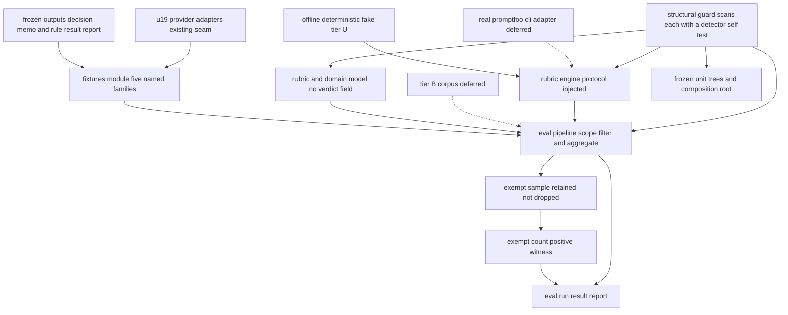

# NFR Design Plan (Part 1) — `llm-judge` (EPIC-6 / U22, Phase 2)

**Phase / Stage**: BUILD → per-unit loop → **NFR Design, Part 1 (Planning)** (plan-then-generate + `[Answer]:` tags)
**Loop position**: `llm-judge` (U22) · **FD ✅** → **NFR Requirements ✅ (approved 2026-07-19)** → **NFR Design ← here
(the 3rd of U22's 5 stages)**
**Unit**: U22 · EPIC-6 · **Phase 2** · **Date**: 2026-07-19 · **Depth**: **standard** (`unit-of-work.md` L249 pin)
**Status**: **Plan — awaiting `[Answer]:` tags. NO NFR Design artifact generated; no code; no files beyond this plan.**

Built **ON** the frozen FD (**`BR-JUDGE-1..11`**, the domain model, the **`RubricEngine`** seam, the four fixture roles, the
three register items) **AND** the approved NFR Requirements (the **eleven `NFR-JUDGE-*`**, the **two LOAD-BEARING
full-highest** targets **EXEMPT-1** + **NOEDIT-1/NOMETRIC-1**, the three named deferrals with **distinct** discharge
criteria, the fixture-family design with **`degenerate_all_in_gate_set()` as a genuinely separate builder**) —
**re-opening NEITHER.**

**⚑ U22 is the LAST unit in the entire 23-unit decomposition.**

**Backend Python unit** — "component relationship" = module/class relationships + data flow (the established reading).

---

## 1. What "by construction" means for this unit (the honest scope)

The build-wide philosophy — **by-construction where possible, test-only where honest** — lands here as follows:

- **Genuinely by construction**: an **injected `RubricEngine`** makes reaching into a frozen unit **structurally
  unnecessary** (nothing to gain). A domain model that **declares no `Recommendation`-typed field** makes *"the judge changed
  the recommendation"* **unrepresentable**, not merely forbidden. **`exempt_count` as a required report field** makes the
  exemption **provable by presence** rather than by absence. **`anchoring_pair()` returning a tuple** makes the pair
  **unsplittable at the type level**.
- **Test-only where that is the honest answer**: import/namespace/path facts can only be enforced by **scan**, so each scan
  carries a **mandatory detector self-test** (the U18/U19/U21 `structural.py` substrate). Disclosure facts can only be
  enforced by **token presence** (U23's DOC-1).
- **Header comments document; they never enforce.** (Verbatim from the U21 precedent.)

---

## 2. Draft `NFR-JUDGE-*` → pattern map (**all eleven + PERF-1/SEC-1 mapped — NO ORPHAN**)

| Pattern | Target(s) | Tier / rigor |
|---|---|---|
| **P-JUDGE-1 `PositiveWitnessExemptionPattern`** | **NFR-JUDGE-EXEMPT-1** *(positive half)* | component (teeth) · **full-highest [LOAD-BEARING]** |
| **P-JUDGE-2 `DegenerateSetGuardPattern`** | **NFR-JUDGE-EXEMPT-1** *(the DISTINCT structural safeguard)* | structural · **full-highest [LOAD-BEARING]** |
| **P-JUDGE-3 `FrozenPathScanPattern`** *(U23 P-DEP-1 lineage)* | **NFR-JUDGE-NOEDIT-1** | structural/path scan · **full-highest [LOAD-BEARING]** |
| **P-JUDGE-4 `StaticNoDriftAssertionPattern`** | **NFR-JUDGE-NOMETRIC-1** | structural (read-only) · **full-highest [LOAD-BEARING]** |
| **P-JUDGE-5 `SatisfiableNonVacuousProtocolPattern`** | **NFR-JUDGE-CLIDEFER-1** | tier-U absence + Protocol · full |
| **P-JUDGE-6 `UnsplittablePairedFixturePattern`** | **NFR-JUDGE-ANCHOR-1** | component (paired teeth) · full |
| **P-JUDGE-7 `TokenChecklistGovernancePattern`** *(U23 DOC-1 lineage)* | **NFR-JUDGE-DISCLOSE-1** | governance/doc-presence · governance |
| P-JUDGE-8 `PureBoundaryArithmeticPattern` | NFR-JUDGE-THRESH-1 | component (teeth) · full |
| P-JUDGE-9 `ScopePartitionPattern` | NFR-JUDGE-INGATE-1 · NFR-JUDGE-EXEMPTSCOPE-1 | component + structural · full |
| P-JUDGE-10 `UnrepresentableVerdictPattern` | NFR-JUDGE-ADVISORY-1 / NOVERDICT-1 | structural + token · full |
| P-JUDGE-11 `DemographicTokenScanPattern` | NFR-JUDGE-NODEMO-1 | structural + self-test · full |
| P-JUDGE-12 `AbsenceProofDeferralPattern` | NFR-JUDGE-EVALDEFER-1 | tier-U absence + deferral · full |
| P-JUDGE-13 `StructuralGuardPattern` *(U18/U19/U21 substrate)* | the **structural halves** of NOEDIT/NOMETRIC/ADVISORY/NODEMO/CLIDEFER/DISCLOSE | structural · full |
| P-JUDGE-14 `ObservedNeverGatedGovernancePattern` | NFR-JUDGE-PERF-1 · NFR-JUDGE-SEC-1 | observed / governance · soft / governance |

**⚑ EXEMPT-1 deliberately takes TWO patterns (P-JUDGE-1 + P-JUDGE-2), not one** — per the standing instruction that the
degenerate-configuration guard is **a distinct structural safeguard, NOT folded into the same mechanism as the positive
teeth**. Their *mechanisms* are different in kind: one is **behavioural over a three-sample composition**, the other is a
**validity predicate applied to a set**. Sharing a mechanism would let a single edit weaken both halves at once.

---

## 3. Draft logical components (five)

| # | Component | Owns | Patterns |
|---|---|---|---|
| **C-JUDGE-1** | `rubric` + domain model (`rubric.py` / `schemas.py`) | `GroundednessRubric` · `RubricDimension` · `JudgedSample` · `ProviderScopeTag` · `DimensionScore` · `SampleScore` · `EvalRunResult` · `EvalTier` | P-JUDGE-8/10 |
| **C-JUDGE-2** | `eval pipeline` (`pipeline.py`) | assemble → **scope-filter** → score-through-seam → **aggregate/threshold** → **report assembly** (incl. `exempt_count`) | P-JUDGE-1/8/9 |
| **C-JUDGE-3** | `engine seam` (`engine.py` production Protocol; the **fake lives in `tests/`**) | the `RubricEngine` Protocol + the offline deterministic fake | P-JUDGE-5 |
| **C-JUDGE-4** | `fixtures` substrate (`tests/fixtures.py`) | the **five named families** (Q1-A) + the run-validity predicate's negative input | P-JUDGE-2/6 |
| **C-JUDGE-5** | `StructuralGuard` substrate (`tests/structural.py` + `tests/test_structural_guard.py`) | the AST/path/token scans, **each with a detector self-test** | P-JUDGE-3/4/7/10/11/13 |

**⚑ Pinned from the precedent, not re-derived**: the `StructuralGuard` substrate parses every **production** `.py` under
`backend/llm_judge/` **EXCLUDING `tests/`** (verbatim U21 `structural.py` behaviour), and carries an
`EXPECTED_PRODUCTION_MODULES` **non-vacuity guard** so a scan can never pass over an empty file set.
**⚑ The offline fake lives in `tests/`, not production** — so no production module can depend on it, and CLIDEFER-1's
"no promptfoo import in production" scan has a clean production set to scan.

### 3.1 Draft module-relationship diagram (to be **mechanically re-validated** at Part 2)



**How the two required properties are made VISIBLE:**
- **The no-frozen-edit guarantee** — **`frozen unit trees and composition root` has exactly ONE inbound edge, and it comes
  from `structural guard`** (a read-only scan). **No component U22 authors — not the rubric, not the pipeline, not the
  fixtures — has any edge into it.** The absence of an authored edge *is* the guarantee, and the single guard edge is what
  proves the absence non-vacuously.
- **The exempt-count-as-positive-witness mechanism** — the exempt route is a **visible three-node chain**
  `eval pipeline → exempt sample retained not dropped → exempt count positive witness → eval run result report`. The exempt
  sample **terminates in a counted witness inside the report**, never in a dead end — proof **by presence**, not by absence.
- **Deferred paths are the only dashed edges**: `real promptfoo cli adapter` → the Protocol, and `tier B corpus` → the
  pipeline.

---

## 4. The five called-out pattern specifics

### 4.1 P-JUDGE-1 / P-JUDGE-2 — EXEMPT-1's two distinct mechanisms
- **P-JUDGE-1 (positive)**: `exempt_count` is a **required field on `EvalRunResult`**, and the scope-filter **retains** the
  exempt sample in `sample_scores`. Teeth over the **three-sample composition**: `scored_count == 2` ∧ `exempt_count == 1` ∧
  the Ollama sample present. **Detector**: a wrongly-scored Ollama sample makes `scored_count` read `3`.
- **P-JUDGE-2 (the distinct safeguard)**: a **pure validity predicate over a sample set**, applied to
  `degenerate_all_in_gate_set()`, asserting a set with **`exempt_count == 0`** is **flagged as a degenerate verification
  configuration**. Its **exact home and signature is Q1** — a genuine fork.

### 4.2 P-JUDGE-3 / P-JUDGE-4 — NOEDIT-1/NOMETRIC-1's paired mechanisms *(the U23 + U21 shape)*
- **P-JUDGE-3 `FrozenPathScanPattern`** — the **U23 `P-DEP-1` mechanism, reused not reinvented**: `ALLOWED_U22_PREFIXES`
  (U22's own tree) vs `FROZEN_PREFIXES` (every frozen `backend/<unit>/` tree + `backend/app/**`); assert the authored set
  ⊆ allowed **and disjoint from** frozen. **Detector self-test**: a synthetic authored path under a frozen tree is flagged.
- **P-JUDGE-4 `StaticNoDriftAssertionPattern`** — the read-only check against `observability`'s `METRIC_DEFINITIONS` and
  `deploy-config`'s `deploy/grafana-dashboard.json`, **without re-running either unit's suite**. **What exactly is asserted
  is Q3** — "byte-unchanged" admits more than one mechanism, with materially different fragility.

### 4.3 P-JUDGE-5 — CLIDEFER-1's pattern, with the no-replica rationale **first-class**
Per the standing instruction, the **absence of a by-value interop replica is part of the pattern's own definition**, not a
footnote. The pattern is stated as a **two-part contract**:
- **Delivered**: `assert isinstance(fake, RubricEngine)` (**satisfiable**) ∧ `assert not isinstance(object(), RubricEngine)`
  (**non-vacuous** — the exact U19 assertion), plus the **production AST scan** proving no promptfoo import.
- **⚑ Deliberately NOT delivered, and why it is a property of the pattern**: U19's
  `test_interop_by_value_u18_outlier_result_satisfies_protocol` was legitimate **because U18's `OutlierResult` is a FROZEN,
  ON-DISK shape** — a verifiable mirror target. **The pattern's precondition is the existence of such a target.** For U22
  that precondition is **absent** (the CLI is absent; its output shape is external, version-dependent, unpinned). A replica
  would attest to an **assumption** and pass green while the real interop was broken. ⇒ **real-shape interop is the 5th
  named discharge criterion of `PROMPTFOO-CLI-DEFERRED`**, not a faked test.

### 4.4 P-JUDGE-6 — ANCHOR-1's unsplittable pair as its own structural safeguard
`anchoring_pair() -> tuple[JudgedSample, JudgedSample]` returns **close and divergent together** — a single return value, so
**the pair cannot be split at the call site** (a test cannot take one without the other). **Detector self-test**: a
single-fixture-only configuration is flagged as insufficient. **The pair is NOT overlapped** onto the provider-tagged
samples (Q1-A). **⚑ How the two scores are actually PRODUCED is Q2** — a genuine fork with a real vacuity risk.

### 4.5 P-JUDGE-7 — DISCLOSE-1's token checklist + the anti-conflation mechanism
Mirrors U23's **DOC-1**: match a **token set**, not headings or prose; a removed token **fails**. Tokens:
`FEWSHOT-ANCHOR-UNIMPLEMENTED` **+ its `memo-agent-core` (U4) owner attribution** + its rationale + the **negative
assertion** that no U22 artifact claims discharge.
**⚑ Anti-conflation (NFR-JUDGE-Req-Fold-3)**: DISCLOSE-1's token set is keyed to the **register name + U4 owner
attribution**; CLIDEFER-1's is keyed to its **five discharge criteria**. **Each detector self-test asserts that the other's
tokens being present does NOT mask its own token's removal** — non-interchangeable by construction.

---

## 5. Clarifying questions — fill each `[Answer]:` tag

> **I will not improvise on any of these.** Each is a genuine fork with a materially different artifact on the other side.
> **C/D "Other"** — describe after the tag.

---

### Question 1 — Where does EXEMPT-1's degenerate-configuration guard LIVE, and what is its signature?

P-JUDGE-2 must be a **distinct structural safeguard**. But *"an all-in-gate set is FLAGGED as degenerate"* needs a **home**,
and the choice has a real consequence: **a production-side check would be asserting something about U22's own verification
configuration, which is not a production concern** — and worse, it could wrongly reject a legitimate production run over a
corpus that happens to contain no Ollama memos.

**A) A PURE PREDICATE in production, APPLIED by the test — `is_nonvacuous_exemption_set(samples) -> bool` (RECOMMENDED).**
A small pure function in `C-JUDGE-2` answering *"does this sample set contain at least one exempt-tagged sample?"*. It
**flags nothing on its own and raises nothing** — the **test** applies it to `degenerate_all_in_gate_set()` and asserts
`False`, and to the three-sample composition and asserts `True`. **Why this one**: the predicate is **honest production
logic** (a set property, not a test-configuration opinion), it is **tier-U-coverable** like every other line (Q3-A), the
**"flagging" stays in the test where the configuration question belongs**, and the two halves of EXEMPT-1 keep **genuinely
different mechanisms** (behavioural teeth vs a set predicate) so one edit cannot weaken both. It also **cannot** reject a
legitimate production run, because nothing in production calls it as a gate.

**B) A run-validity gate inside report assembly** — `assemble_report()` raises/marks when `exempt_count == 0`.
*(Available; rejected as the default: it makes production **refuse or flag a legitimate corpus** that contains no Ollama
memos, converting a verification-set property into a production constraint the FD never asserted.)*

**C) Test-substrate only** — the predicate lives in `tests/`, with no production function.
*(Available; but it puts a genuine, reusable set property outside the coverable production tree, and makes the safeguard
invisible to the component model — weaker than A for a LOAD-BEARING target.)*

**D) Other (describe after `[Answer]:`)**

[Answer]: A

---

### Question 2 — How does the offline fake PRODUCE ANCHOR-1's "close scores high, divergent scores low"?

**⚑ This is a genuine vacuity risk, and I am flagging it rather than designing around it silently.** The frozen FD defines
the tier-U fake as returning *"fixed, **fixture-declared** scores"*. If the fake simply **echoes a score the fixture
declared**, then ANCHOR-1's teeth reduce to *"the fixture said high, and the fake returned high"* — which proves the
**plumbing** (a per-sample score reaches the right `SampleScore`, in declared order, aggregated correctly) but proves
**nothing about anchoring discrimination**. The NFR Requirements' wording (*"the close fixture scores high; the divergent
fixture scores low"*) does not by itself settle **how** the score arises. **This is an NFR Design decision, and it is open.**

**A) DECLARED-ECHO fake + honestly-narrowed ANCHOR-1 scope; real discrimination deferred to `PROMPTFOO-CLI-DEFERRED`
(RECOMMENDED).**
Keep the FD's fake exactly as frozen (declared scores). **State plainly in the pattern** that ANCHOR-1's tier-U teeth prove
**the paired-fixture plumbing and the unsplittable-pair safeguard** — that two distinguishable samples flow through the
seam and land as distinguishable `SampleScore`s with the close one higher — and that **whether a real judge actually scores
divergence lower is exactly what the deferred engine discharges**, added as a **named criterion** alongside the
real-shape-interop one. **Why this one**: it is the **honest** reading, it **re-opens no frozen FD text**, and it matches
this build's repeated pattern of *"deliver the verifiable half, name the unverifiable half"* (BR-JUDGE-6, CLIDEFER-1,
EVALDEFER-1). It **does not overclaim** that U22 has proven anchoring discrimination.

**B) The fake implements a small DETERMINISTIC offline similarity heuristic** (e.g. structural/token overlap against
`reference_memo()`), so "close high / divergent low" is genuinely **derived**, giving ANCHOR-1 real discriminating teeth at
tier-U. *(Available and stronger-looking; but U22 would then own a **scoring heuristic that is not what the real engine
does** — a second, divergent notion of "anchoring consistency" living in the repo. A green ANCHOR-1 would attest to
**U22's own heuristic**, not to the rubric — the same "false confidence" failure mode Q2-A rejected for the interop
replica. It also arguably extends the frozen FD's definition of the fake.)*

**C) A U22-owned pure `structural_divergence(memo, reference) -> float` in production, exercised DIRECTLY by ANCHOR-1**,
with the fake left as declared-echo. *(A middle path: the discrimination is real and testable, and it is honestly U22's own
structural measure rather than a pretend-rubric. But it adds a production function whose relationship to the real rubric
dimension is unclear, risking two competing definitions of the same dimension.)*

**D) Other (describe after `[Answer]:`)**

[Answer]: A

---

### Question 3 — What exactly does P-JUDGE-4's "byte-unchanged" check ASSERT?

The approved NFR Requirements say `observability`'s five `METRIC_DEFINITIONS` and `deploy-config`'s
`deploy/grafana-dashboard.json` are read read-only and **"asserted unchanged"**. **"Unchanged" admits more than one
mechanism, with materially different fragility** — and U22 is the **last** unit, so whatever it pins, it pins permanently.

**A) PROPERTY assertions — the five metric NAMES and the five dashboard PANELS (RECOMMENDED).**
Assert `len(METRIC_DEFINITIONS) == 5` and that the five `.name` values equal the frozen set (read **by value**, imported
read-only), and that the dashboard declares **exactly five panels**. **Why this one**: it asserts **precisely the property
U22 must not drift** — that U22 added no sixth metric and no sixth panel — which is what BR-JUDGE-11 and `deploy-config`'s
**five-panel no-drift scan** actually mean. It is **robust to legitimate unrelated edits** by U21/U23's owners (a
description reword would not break U22's suite), and it invents **no** magic constant.

**B) A CONTENT-HASH pin** — record a hash of each file in U22's substrate and assert it matches.
*(Literally "byte-unchanged"; but **fragile and arguably wrong**: it makes **any** future legitimate change to a frozen unit
break **U22's** suite, and U22 would be asserting a hash **it invented at Code-Gen time** rather than a property anyone
declared. It converts "U22 changed nothing" into "nobody may ever change these files" — a stronger claim than U22 is
entitled to make.)*

**C) mtime comparison.** *(Rejected — mtimes are not content, are not stable across clone/checkout, and would make the suite
environment-dependent, breaking the deterministic tier-U discipline.)*

**D) Other (describe after `[Answer]:`)**

[Answer]: A

---

## 5.5 Mandatory ambiguity-check (RAN against Q1-A / Q2-A / Q3-A + the frozen FD + the approved NFR Requirements) — **CLEAN**

**Ran**: 2026-07-19 · **Result**: **CLEAN — 3 folds RESOLVED, no genuine gap, no surface-and-stop.**
**⚑ One DISCLOSURE is raised for the stage gate** (Fold-1's residue) — it does not block Part 2 and requires no improvisation,
but it is the user's call, not mine, so it is surfaced rather than silently reconciled.

---

### ⚑ NFR-JUDGE-ND-Fold-1 [check (i)] — RESOLVED: a legitimate **Design-stage clarification**, NOT a material change — **with one disclosure**

**The question is real and important**: does Q2-A's honest narrowing quietly weaken something the NFR Requirements gate
already approved?

**It does not — and the decisive reason is provenance, not interpretation.** The declared-echo behaviour of the tier-U fake
is **NOT an NFR-Design choice at all**. It was **frozen at the FD stage**, before NFR Requirements existed:
`domain-entities.md` §8 defines the tier-U binding verbatim as *"**Offline deterministic fake** … Returns **fixed,
fixture-declared scores**"*, and `business-logic-model.md` §3 repeats it. **The FD outranks and predates NFR Requirements.**
⇒ Q2-A **chooses nothing new**; it **states explicitly a consequence the frozen FD had already determined** and that the
NFR Requirements text simply did not spell out. A Design stage making a frozen upstream consequence explicit is exactly what
a Design stage is for.

**Confirmed against the approved text, read verbatim this session.** ANCHOR-1's four **acceptance criteria** are:
**(a)** the pair is driven by `anchoring_pair()` returning both together (unsplittable) · **(b)** the single-fixture-only
detector self-test · **(c)** style/structure adherence, not textual identity · **(d)** the pair is its own non-overlapped
family. **⚑ NONE of (a)–(d) claims engine-side discrimination.** Every operative, testable criterion survives Q2-A
**untouched** — no criterion is removed, no teeth are weakened, no tier or rigor changes. ⇒ **no material change; the
approved artifact needs no revision to remain accurate as an acceptance contract.**

**⚑ THE DISCLOSURE (raised, not silently reconciled).** ANCHOR-1's one-line **Assertion** sentence — *"the close fixture
scores high; the divergent fixture scores low"* — **would read as over-promising if quoted in isolation**, detached from
the frozen FD's definition of the fake. That is a **presentation** issue, not a correctness one. **I am NOT editing the
approved artifact**, for the same reason this build never back-dates an audit entry: **approved artifacts are built ON, not
retro-edited**, and an unrequested edit to an approved gate output would be worse than the imprecision. Instead:
- Part 2 states the narrowing **as a first-class clause of P-JUDGE-6's own definition**, where a designer will meet it;
- the honest scope is repeated in the pattern→target traceability row;
- **the user is offered the choice at the gate** — leave the approved artifact as-is (recommended, consistent with the
  build's no-retro-edit discipline), or request a one-line clarifying amendment as an explicit, logged change.

**⇒ Fold RESOLVED. Not a gap: Part 2 proceeds without improvisation either way.**

---

### ⚑ NFR-JUDGE-ND-Fold-2 [check (ii)] — RESOLVED: the predicate and the positive teeth test **genuinely different things**

They differ on **subject, stage, and failure mode** — this is not the same assertion twice:

| | **P-JUDGE-1 positive teeth** | **P-JUDGE-2 `is_nonvacuous_exemption_set()`** |
|---|---|---|
| **Subject** | the **`EvalRunResult`** — an **OUTPUT** object | the **`Sequence[JudgedSample]`** — an **INPUT** set |
| **Field read** | `scored_count` / `exempt_count` / `sample_scores` | `sample.provider` tags |
| **Stage** | **after** a full pipeline run | **before** any run |
| **Fails when** | the **pipeline** mis-partitions (scores Ollama, or drops it) | the **fixture set** is degenerate (nothing to exclude) |

**⚑ The decisive point — one guards the other's PRECONDITION.** Over an all-in-gate set, a pipeline **that never implemented
exemption at all** would still report `scored_count == 2`; P-JUDGE-1's teeth would pass **vacuously**. P-JUDGE-2 is
precisely what makes P-JUDGE-1's fixture non-degenerate. They are **complementary, not duplicative** — and that
complementarity is the whole reason EXEMPT-1 was split across two patterns.

**⚑ Anti-collapse mechanism pinned so Code-Gen cannot drift them together**: `is_nonvacuous_exemption_set()` takes
`Sequence[JudgedSample]` and returns `bool`. It **never constructs, runs, or reads an `EvalRunResult`** — implementing it by
running the pipeline and reading `exempt_count` would collapse it into P-JUDGE-1 and is forbidden by its signature.
**No user decision needed.**

---

### ⚑ NFR-JUDGE-ND-Fold-3 [check (iii)] — RESOLVED on disk: the mechanism is **precise, already frozen, and reused not reinvented**

**The concern was well-founded in general** — Grafana schemas *can* nest panels inside `row`-type panels, which would make a
naive top-level `len()` silently under-count. **So I measured the actual committed file rather than assuming:**

| Measured property of `deploy/grafana-dashboard.json` | Value |
|---|---|
| top-level `panels` array length | **5** |
| any panel carrying a nested `panels` key | **False** |
| any `type: "row"` panel | **False** |
| panel `targets[0].expr` values | the **five** frozen metric names, exactly |

⇒ **flat, unnested, unambiguous.** `len(dashboard["panels"]) == 5` is precise **for the file that actually exists**.

**⚑ And better than designing a mechanism: one already exists, frozen, on disk.** `deploy-config`'s own
`backend/deploy_config/tests/test_scope.py::test_grafana_dashboard_panels_match_observabilitys_frozen_five_no_drift`
already does exactly this, cross-referencing `METRIC_DEFINITIONS` **by value**:
```python
panels = dashboard["panels"];  assert len(panels) == 5
dashboard_metrics = {p["targets"][0]["expr"] for p in panels}
frozen_metrics = {m.name for m in METRIC_DEFINITIONS}
assert dashboard_metrics == frozen_metrics
```
⇒ **U22 REUSES the frozen precedent's exact technique rather than inventing one** — the same discipline P-JUDGE-3 applies to
U23's `P-DEP-1` path scan. **Robustness note carried into Part 2**: U22 additionally asserts **no panel carries a nested
`panels` key**, so if a future edit ever introduced row-nesting the check **fails loudly** instead of silently under-counting.

**⚑ A REAL OVERLAP surfaced by this check, and P-JUDGE-4 is re-scoped to eliminate it.** Since U23's frozen test **already**
catches both drift directions (a sixth metric breaks `dashboard_metrics == frozen_metrics`; a sixth panel breaks
`len(panels) == 5`), a U22 check that only re-asserted the same property would be a **near-duplicate of a frozen test** —
and U22 cannot rely on it executing anyway, since the standing instruction forbids re-running either unit's suite.
⇒ **P-JUDGE-4's PRIMARY mechanism is the one nothing else makes**: a scan of **U22's OWN production tree** asserting **no U22
module declares a metric name / `MetricDefinition`** — a provenance claim that is genuinely U22's to make. The read-only
five-names + five-panels property assertion is **corroborating**: it pins the baseline U22 claims not to have moved, making
the provenance scan **non-vacuous**. **No user decision needed.**

---

**⇒ Ambiguity-check CLEAN. Part 2 generated. One disclosure carried to the gate (Fold-1's residue).**

---

## 6. Explicit HOLDS for Part 2

- **No NFR Design artifact until all `[Answer]:` tags are filled**, followed by the **mandatory ambiguity-check**,
  **surfacing-and-stopping** on any genuine gap rather than improvising.
- **No code**; **no `backend/llm_judge/`**; **no promptfoo config**; **no live eval run**; **`requirements.txt` NOT edited**;
  **`pyproject.toml` NOT edited** (the `--cov` line lands at Code-Gen per Q3-A of NFR Requirements).
- **The frozen FD and the approved NFR Requirements are re-opened NEITHER** — `BR-JUDGE-1..11`, the domain model, the
  `RubricEngine` seam, the four fixture roles, the three register items, the eleven `NFR-JUDGE-*` targets, the two
  LOAD-BEARING designations and the fixture-family design are **built ON, not revised**.
- **WIRE-1 untouched · the 17 frozen P1 units untouched (INCLUDING `memo-agent-core`) · `outlier-model` (U18) ·
  `memo-extensions` (U19) · `ui-outlier-view` (U20) · `observability` (U21) · `deploy-config` (U23) untouched · the CLOSED
  composition root untouched · tier-B NOT authorized · the `audit_store` Docker-guard gap untouched · no other unit
  started · the 23-unit decomposition unchanged.**
- **Domain invariants bind**: advisory-only wording; the judge never alters a recommendation; no LLM in the deterministic
  rules path; `temperature=0` centrally fixed in U19's frozen adapters (U22 neither sets nor overrides it); no demographic
  identifier anywhere.

---

## 7. Next step (STOP here)

Fill the three `[Answer]:` tags in §5. On your signal I will read the answers, run the **mandatory ambiguity-check**,
**embed the full Q&A in this plan file**, and generate **Part 2** — `nfr-design-patterns.md` (`P-JUDGE-1..14` with the
mechanism spelled out per pattern) + `logical-components.md` (`C-JUDGE-1..5` with exact signatures, the reference-not-own
three-category check, the component→target coverage table, and the **mechanically-validated** Mermaid) — then present the
standardized 2-option completion message.
**No NFR Design artifact is generated until the answers are in and checked.** This is the **3rd of U22's 5 stages**, and
U22 is the **LAST unit in the 23-unit decomposition**.
