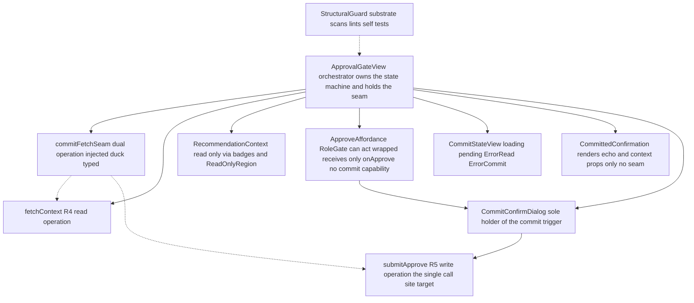

# NFR Design Part 1 (Plan) — `ui-approval-gate` (U7)

**Stage**: BUILD → per-unit loop → NFR Design → Part 1 (Planning)
**Unit**: `ui-approval-gate` (U7) · C-cluster UI · Phase 1 · **Depth**: **COMPREHENSIVE** (consistent with the FD + NFR-Requirements depth)
**Date**: 2026-07-09
**Status**: **Part 1 plan — ANSWERED (Q1–Q4 all A) · ambiguity-check CLEAN (three folds) · Part 2 GENERATED.** The four `[Answer]` tags are embedded (§6). Ambiguity-check run against the four answers + the frozen FD + approved NFR Requirements — no genuine gap → three clarity-folds (§6A). Part 2 (`nfr-design-patterns.md` + `logical-components.md`) generated. WIRE-1 / ui-shell / ui-queue / ui-memo-view (all frozen) untouched; tier-B NOT authorized; no other unit started. **STOPPED at the NFR-Design 2-option completion gate.**

**Built ON** the frozen FD (`domain-entities.md` / `business-rules.md` / `business-logic-model.md` — **BR-AG-1..11**, the component/prop inventory, the full client state machine **including the split `ErrorRead`/`ErrorCommit` recovery paths**, the AUTHZ-1 defense-in-depth structural note) **and** the approved NFR Requirements (**nineteen `NFR-AG-*` targets** across full-highest/full/medium/soft/governance; the dual-operation single-double convention; **NFR-AG-Fold-1..4**) — **re-opening none of it**. One design pattern per target-cluster, each **structurally** meeting its target(s) + traced. **Advisory-only; no LLM; no live backend** (R4/R5 doubled). Tier convention inherited (Vitest + RTL + jsdom · ESLint over the one `FORBIDDEN_TERMS` · file/import scans · detector self-tests).

> **Reference-not-own (stated once, upheld everywhere).** No `ui-approval-gate` component **modifies** `ui-shell` (frozen — its copy/`FORBIDDEN_TERMS`/`RoleGate`/`ReadOnlyRegion`/badges/`RoleContext`/testid convention are **reused**), **imports** `ui-queue` / `ui-memo-view` (frozen — their fetchSeam/StructuralGuard/testid-lint conventions are **mirrored**, not imported), or authors the wire: WIRE-1 **R4 + R5** are consumed **by shape**; the **real `commitFetchSeam` wiring** is the composition root's / Build & Test's, not designed here. The unit **owns no authorization decision** (`RoleGate` is cosmetic; AUTHZ-1 is the server's), **no override** (U8), and **no persistence** (audit-store's).

> **ND-D-Fold (from the sibling D-Fold precedent).** `commitFetchSeam` is a **duck-typed injected seam with no formal Protocol/interface** — no-TS React, so no interface construct exists; the contract is self-documenting via **JSDoc** (`fetchContext(applicationId)` → `MemoView`; `submitApprove(recommendationId)` → `CommittedDecision`; both reject with a `{error:{code,message,detail}}` envelope) **plus the single capturing double** as the worked example.

---

## 1. Pattern → target map (each pattern structurally meets its target(s))

### §P1 — SingleCallSiteConfirmGatedCommitPattern → NFR-AG-NOFINAL-1 + CONFIRM-1 + CANCEL-1 — **THE LOAD-BEARING PATTERN**
- **Pattern (by-construction guarantee — Q2)**: the commit-trigger capability exists **structurally** in only one place. `ApproveAffordance` receives **only** an `onApprove` callback (which opens the dialog) — it holds **no** reference to `submitApprove` or the seam. The commit trigger (the wired `submitApprove` invocation) is passed **only** to `CommitConfirmDialog`, whose `Confirm` handler is the **sole** call site. A premature commit is therefore **structurally unwritable** in `ApproveAffordance` — not merely discouraged by convention. Mirrors ui-memo-view's `StructuralIsolationCompositionPattern` by-construction precedent (prop signatures enforce the invariant; a header comment makes it self-evident when reading the component in isolation). The **single inbound invocation edge into `submitApprove` (from `CommitConfirmDialog`)** is a **visible graph property** (§5), not just prose.
- **Meets the targets**: (NOFINAL-1) a structural scan confirms `submitApprove` has exactly one call site (the confirm handler); mount / read / `confirming`-toggle issue no POST. (CONFIRM-1, teeth) `Approve`-click → `submitApprove.calls.length === 0` **and** `fetchContext.calls.length === 1` (the Fold-1 cross-guard); only `Confirm` → `=== 1`. (CANCEL-1, teeth) open + `Cancel` → **both** ops' counts unchanged; context identical; state `ready(idle)`. The by-construction design is the guarantee; the teeth are the regression guard on top.
- **Tier**: structural + component (teeth). **Rigor**: **full (highest)**.

### §P2 — CosmeticRoleGateCompositionPattern → NFR-AG-RBAC-1
- **Pattern (first real `RoleGate` use)**: `ApproveAffordance` is wrapped in `<RoleGate can="act">` (frozen ui-shell), which reads the current Role **internally** via `useCurrentRole()` (no `role` prop), renders children for `underwriter` (`act:true`) and the `fallback` for `auditor`/`admin`/`null` (`act:false`/no role). **Cosmetic only** — imports no backend, calls no authz function; AUTHZ-1 is the real gate. Explicit contrast with ui-queue/ui-memo-view, which compose **no** `RoleGate` (RoleInvariantRenderingPattern).
- **Meets the target** (RBAC-1): (a) structural — no backend import / no authz call (StructuralGuard); (b) RTL stub `RoleProvider` over **all three roles + null** (Fold-3) — `underwriter` → affordance present; `auditor`/`admin`/`null` → absent.
- **Tier**: structural + component. **Rigor**: full.

### §P3 — ApproveOnlyRequestBuilderPattern → NFR-AG-BODY-1 + NFR-AG-SCOPE-APPROVE-1
- **Pattern (by-construction — Q4)**: `buildCommitRequest(recommendationId)` takes **only** `recommendationId`; its body is the literal `{ action: 'approve' }`. It has **no `reason` and no `underwriter_id` parameter**, so it **structurally cannot** emit either. Approve-only is enforced by the builder's signature, not by discipline.
- **Meets the targets**: (BODY-1) the body **deep-equals** `{ action: 'approve' }` (no `underwriter_id`, no `reason`); `recommendation_id` in the path. (SCOPE-APPROVE-1) no override control / no reason input in the tree.
- **Tier**: unit + structural. **Rigor**: full.

### §P4 — PerStatusEnvelopeToRenderPattern → NFR-AG-ERROR-1
- **Pattern**: extends the sibling `ErrorEnvelopeToRenderPattern` for the **four-status table**. `CommitStateView` maps the WIRE-1 envelope `{error:{code,message,detail}}` to the correct state — **200** → committed; **403** → not-permitted; **409** → already-committed/conflict; **400 & 422** → generic invalid — with uniform discipline: `message` visible (`approval-error-message`), `code` testid-only hidden (`approval-error-code`), `detail` never rendered.
- **Meets the target** (ERROR-1): table-driven RTL, each status programmed on the double; DOM scan finds `detail` nowhere.
- **Tier**: component (table-driven) + structural. **Rigor**: full.

### §P5 — ConfirmationFromEchoPattern → NFR-AG-NOREFETCH-1
- **Pattern (by-construction — Q3)**: `CommittedConfirmation` receives the R5 `CommittedDecision` echo + the R4 context **as props only** — it holds **no** seam reference, so a re-fetch is **structurally impossible**. It renders `action=approve` + `recommendation_id` + `underwriter_id` (echo) + the recommendation value (context in hand).
- **Meets the target** (NOREFETCH-1, teeth): after a successful commit, **both** `fetchContext.calls.length` and `submitApprove.calls.length` stay unchanged (`1` and `1`); no further transport call.
- **Tier**: component (teeth). **Rigor**: full.

### §P6 — CauseDifferentiatedRecoveryPattern → NFR-AG-RECOVERY-1
- **Pattern**: distinct from the sibling single-cause retry. `ErrorRead`'s `Retry` re-issues `fetchContext(same applicationId)`; `ErrorCommit` returns the machine to `ready(idle)` with **no** automatic `submitApprove` — a fresh `Approve → Confirm` cycle is required. The two recovery legs are separate transitions (the FD split `ErrorRead`/`ErrorCommit`).
- **Meets the target** (RECOVERY-1, teeth): (a) `ErrorRead` Retry → exactly one further `fetchContext`, recorded arg === X; (b) `ErrorCommit` → `ready(idle)`, `submitApprove.calls.length` stays `1`.
- **Tier**: component (teeth). **Rigor**: full.

### §P7 — DualOperationFetchSeamPattern → NFR-AG-FETCH-1 (seam) + NFR-AG-BODY-1 (builder) + NFR-AG-PERF-1 (bounded)
- **Pattern**: an **own-local thin module `approvalGate/commitFetchSeam`** with **two** operations — `fetchContext` (R4 read) + `submitApprove` (R5 write) — both **injected** via prop, duck-typed (ND-D-Fold). Production wires the real transport at the composition root; tests inject the **single capturing double** with **two independently-counted spies** (Fold-1). **Mirrors** the sibling `fetchSeam` pattern **without importing** it. Bounded: R4 one resource, R5 one commit (no list path).
- **Meets the target** (FETCH-1): the seam is injected, never hard-wired; per-operation counting supports the teeth. (PERF-1) structural bounded-fetch scan.
- **Tier**: component + structural.

### §P8 — ExtendedStateMachinePattern → NFR-AG-FETCH-1 (states + transitions) *(precedent-determined; ND-Fold-A)*
- **Pattern**: `ApprovalGateView` **owns** the machine (a responsibility, not a separate component; hook/reducer mechanics → Code-Gen, mirroring the sibling `FourStateMachinePattern`): `loading → ready(idle) → confirming → submitting → {committed | ErrorCommit}`, plus `pending` and `ErrorRead`. Sub-components (`CommitStateView`/`RecommendationContext`/`ApproveAffordance`/`CommitConfirmDialog`/`CommittedConfirmation`) are **presentational**, receiving state + callbacks as props (single source of transition truth).
- **Meets the target** (FETCH-1): per-state renders + **ONE consolidated transition test (Fold-4)** on the same dual-operation double covering all legs incl. both split-error recovery paths.
- **Tier**: component.

### §P9 — StructuralGuardPattern → NFR-AG-COPY-1 + ADVISORY-1 + NAMESPACE-1 + TESTID-1 + NOTS-1 + REFNOTOWN-1 *(one substrate; ND-Fold-B)*
- **Pattern**: **one `StructuralGuard` substrate** grouping independent structural checks, each with a **detector self-test** (non-vacuous), mirroring the sibling single-substrate convention: **testid** convention (`approval-<element>-<purpose>`); **no-`.ts`/`.tsx`**; **no-backend-import**; **no-`ui-queue`-import**; **no-`ui-memo-view`-import**; **no-router-import**; **bounded-fetch** (P7); the **`FORBIDDEN_TERMS` reuse** lints (`no-inline-label` + `advisory-vocabulary`); and the **NOFINAL-1 single-call-site scan** (P1). **Q4-A property (named)**: the `advisory-vocabulary` lint is applied **UNMODIFIED** (single `FORBIDDEN_TERMS`, no carve-out) because the copy honors the reserved-word constraint **semantically** (no literal `decision` token) — NFR-AG-Fold-2.
- **Meets the targets**: COPY-1 (no-inline-label), ADVISORY-1 (advisory-vocabulary unmodified + `LINT_FORBIDDEN_TERMS === FORBIDDEN_TERMS`), NAMESPACE-1 (`FORBIDDEN_TERMS` collision guard + `COMMIT_ACTION_LABELS`), TESTID-1, NOTS-1, REFNOTOWN-1 — each + self-test.
- **Tier**: structural / lint.

### §P10 — ReferencedObservedBoundaryPattern → NFR-AG-PERF-1 + NFR-AG-A11Y-1 + NFR-AG-SCOPE-1 *(soft / governance)*
- **PERF-1** — bounded (R4 one resource, R5 one commit; structural via P7/P9); latency/bundle observed, non-gating.
- **A11Y-1** — semantic markup + focusable `Approve`/`Confirm`/`Cancel`/`Retry`; **soft** (Q6-A of NFR-Req). The confirm-dialog **focus-trap** + **Escape-to-cancel** are **recorded NFR-Design→Code-Gen targets**, not Phase-1 gates. **Note**: the BR-AG-3 "cancelable" invariant stays **gated** as full-rigor teeth via CANCEL-1 (P1) — only the a11y polish is soft.
- **SCOPE-1** — governance/exclusion: patterns realize only `ui-approval-gate`'s behavior; **not** other UI units, backend internals, or the WIRE-1 route implementation; ui-shell mechanisms **reused, not modified**; the siblings' **mirrored, not imported**.
- **Tier**: observed / soft / governance.

---

## 2. Logical components (responsibilities · ownership)

| # | Component | Responsibility | Owns / holds |
|---|---|---|---|
| **C1** | `ApprovalGateView` | orchestrator; owns the state machine (P8); holds the injected `commitFetchSeam`; runs the initial R4 read; passes state + callbacks to presentational children; passes the **commit trigger ONLY to `CommitConfirmDialog`** (P1) | the seam ref; the machine |
| **C2** | `commitFetchSeam` | own-local dual-operation seam (`fetchContext` R4 + `submitApprove` R5) + `buildMemoRequest`/`buildCommitRequest` (P3) + `normalizeError` (P4 envelope) | request builders; no real network |
| **C3** | `CommitStateView` | non-`ready`/non-`committed` renders: `loading`, `pending` (no affordance), `ErrorRead`/`ErrorCommit` envelope render (P4); `Retry` re-runs R4 read (P6) | none (presentational) |
| **C4** | `RecommendationContext` | read-only display of the recommendation being approved via `RecommendationBadge`/`ConfidenceBadge` inside `ReadOnlyRegion` | none (presentational) |
| **C5** | `ApproveAffordance` | the approve button, wrapped in `RoleGate can="act"` (P2); receives **only** `onApprove` (opens the dialog) — **no `submitApprove`/seam access** (P1, Q2) | none; **no commit capability** |
| **C6** | `CommitConfirmDialog` | the confirm step (pure client-side toggle); the **SOLE holder of the commit trigger**; its `Confirm` handler is the single `submitApprove` call site (P1); `Cancel` → `ready(idle)`, zero side effect | the commit trigger |
| **C7** | `CommittedConfirmation` | the success state; renders from the echo + R4 context **props only** — **no seam access** (P5, Q3) | none; **no fetch capability** |
| **C8** | `StructuralGuard` | one substrate grouping the structural/lint checks + detector self-tests (P9) | the guard test suite |
| **C9** | `approvalGate/copy.js` | approval-local UI strings (advisory-clean per Fold-2); LINT-SUBJECT | the local copy |

---

## 3. Reference-not-own check (consumed / mirrored / by-shape — none modified)

| Dependency | Relationship | Evidence |
|---|---|---|
| ui-shell `RoleGate`/`AppFrame`/`Panel`/`ReadOnlyRegion`/`RecommendationBadge`/`ConfidenceBadge`/`shell/copy`+`FORBIDDEN_TERMS`/`shell/session` | **reused, not modified** | composed as imports; no `src/shell` edit; `RoleContext` stub is RBAC-1's injection point |
| ui-queue / ui-memo-view `fetchSeam` + `StructuralGuard` conventions | **mirrored, not imported** | REFNOTOWN-1 `noUiQueueImport`/`noMemoViewImport` guards (P9) |
| auth-rbac `Role`/`PERMISSION_MATRIX`/`RBAC_COMMIT` | **referenced by value shape, not imported** | `RoleGate` cosmetic capability mirrors the semantics; cross-language |
| audit-store `DecisionCommitService`/`CommittedDecision`/`CommitAction` | **consumed by shape** | `CommittedDecision` is R5's response shape (P5); the real gate is the server's |
| WIRE-1 R4 + R5 + envelope | **consumed by shape** | seam builders (P3/P7); route impl deferred to Build & Test (SCOPE-1) |

---

## 4. Component → target coverage (no orphan)

| Target | Pattern(s) | Component(s) |
|---|---|---|
| NFR-AG-NOFINAL-1 / CONFIRM-1 / CANCEL-1 | P1 | C1, C5, C6 |
| NFR-AG-RBAC-1 | P2 | C5 (+ ui-shell `RoleGate`) |
| NFR-AG-BODY-1 / SCOPE-APPROVE-1 | P3 | C2, C5 |
| NFR-AG-ERROR-1 | P4 | C3 |
| NFR-AG-NOREFETCH-1 | P5 | C7 |
| NFR-AG-RECOVERY-1 | P6 | C1, C3 |
| NFR-AG-FETCH-1 | P7 + P8 | C1, C2 |
| NFR-AG-COPY-1 / ADVISORY-1 / NAMESPACE-1 / TESTID-1 / NOTS-1 / REFNOTOWN-1 | P9 | C8 (+ C9) |
| NFR-AG-PERF-1 / A11Y-1 / SCOPE-1 | P10 | C1..C9 (observed / governance) |

**All nineteen `NFR-AG-*` targets covered; no orphan.**

---

## 5. Validated component-relationship Mermaid — single-call-site as a visible graph property

Validated against the 7 rules (alphanumeric node IDs; every label double-quoted; **no hyphens, semicolons, colons, parentheses, or special characters**; balanced blocks; **rectangle-only**). **Solid = invokes / data-flow; dashed = provides / scans.** The **only solid inbound edge into `SubmitApprove` originates from `Dialog`** — the single-call-site guarantee, shown structurally.

### Text alternative (always included)
- `ApprovalGateView` (C1) holds the injected `commitFetchSeam` (C2) and **invokes `fetchContext`** for the initial R4 read (and for `ErrorRead` Retry, both View-owned).
- The **only solid inbound edge into `submitApprove` is `Dialog --> SubmitApprove`** — `CommitConfirmDialog` (C6) is the **sole** commit-trigger holder; its `Confirm` handler is the single call site (P1, Q2).
- `ApproveAffordance` (C5) is invoked/rendered by the View and **only opens the dialog** (`Affordance --> Dialog`); it has **no edge to `SubmitApprove`** — a premature commit is structurally unwritable there.
- `CommittedConfirmation` (C7) is rendered by the View from props only — **no edge to the seam** (P5, Q3).
- Dashed = the seam **provides** both operations, and the **StructuralGuard** (C8) scans the source tree (the single-call-site scan, no-import guards, lints).

---

## 6. Open questions — full text + lettered options (`[Answer]` BLANK; standing convention)

### Q1 — NFR-Design depth
Confirm the depth.
- **A. COMPREHENSIVE** — consistent with the FD + NFR-Requirements; by-construction structural rigor on the load-bearing patterns.
- B. Lighter.

**[Answer]:** A

### Q2 — By-construction single-call-site: does `ApproveAffordance` have NO access to `submitApprove`? *(the key pattern decision)*
Should the write capability structurally exist **only** inside `CommitConfirmDialog`?
- **A. Yes — by-construction.** `ApproveAffordance` receives **only** an `onApprove` callback (opens the dialog); it holds **no** reference to `submitApprove`/the seam. The commit trigger is passed **only** to `CommitConfirmDialog`, whose `Confirm` handler is the **sole** call site. A premature commit is **structurally unwritable** in `ApproveAffordance` (not convention). The single inbound invocation edge into `submitApprove` (from the dialog) is a **visible graph property** (§5); a header comment makes it self-evident in isolation; NOFINAL-1's scan + CONFIRM-1's teeth are the regression guard on top. Mirrors ui-memo-view's `StructuralIsolationCompositionPattern` precedent.
- B. `ApproveAffordance` holds `submitApprove` but calls it only after the dialog resolves (**convention**, not by-construction).
- C. A single combined affordance-plus-dialog component owns both.

**[Answer]:** A

### Q3 — By-construction confirmation-from-echo: does `CommittedConfirmation` have NO seam access?
Should the confirmation be structurally incapable of a re-fetch?
- **A. Yes — by-construction.** `CommittedConfirmation` receives the `CommittedDecision` echo + R4 context **as props only**; it holds **no** seam reference, so a re-fetch is **structurally impossible**. Parallels Q2's discipline; NOREFETCH-1's both-counts-frozen teeth are the regression guard.
- B. It holds the seam but is disciplined not to re-fetch (convention).

**[Answer]:** A

### Q4 — By-construction approve-only request builder: can `buildCommitRequest` structurally emit no `reason`/`underwriter_id`?
- **A. Yes — by-construction.** `buildCommitRequest(recommendationId)` takes **only** `recommendationId` and returns the literal body `{ action: 'approve' }` — it has **no `reason` and no `underwriter_id` parameter**, so it **cannot** emit either. Approve-only + session-derived-committer are enforced by the signature, not discipline. BODY-1's deep-equality is the regression guard.
- B. The builder accepts an optional `reason`/committer but omits them here (convention).

**[Answer]:** A

---

## 6A. Ambiguity-check (RUN against Q1–Q4 all-A + the frozen FD + approved NFR-Req) — **CLEAN, three folds, no STOP**

The three explicitly-requested checks resolve as clarity-folds (each adopting the frozen self-evidence-in-isolation precedent); no genuine gap.

- **ND-Fold-1 — check (i): `ApproveAffordance` self-evidence-in-isolation.** `ApproveAffordance` carries a **header comment** (the frozen convention — cf. ui-memo-view's `NarrativeRegion` NFR-DESIGN-Fold-1, `ReadOnlyRegion.jsx`/`fetchSeam.js` JSDoc) stating: **props are `{ onApprove }` (+ cosmetic display props) ONLY — no `submitApprove` / seam / `onConfirm` reference; it opens the confirm dialog and cannot commit.** So the "no commit capability" guarantee is discoverable by **reading the component alone**, not only by tracing `ApprovalGateView`'s composition. Clarity-fold (adopt), not a gap.

- **ND-Fold-2 — check (ii): `CommitConfirmDialog` self-evidence-in-isolation.** `CommitConfirmDialog` carries a **header comment** marking it the **SOLE commit-trigger holder**: its `onConfirm` prop (the wired `submitApprove` invocation) is the **single call site**; opening/canceling is a **pure client-side toggle** with no side effect (BR-AG-3 / AG-Fold-1). Discoverable in isolation. Clarity-fold (adopt).

- **ND-Fold-3 — check (iii): `CommittedConfirmation` genuinely cannot re-fetch, even indirectly.** Two independent structural facts make a re-fetch impossible: (a) `CommittedConfirmation`'s props are `{ decision, context }` **only** — no seam instance; (b) the **transport-bearing seam** (the object returned by `createCommitFetch(transport)`, whose `fetchContext`/`submitApprove` close over the injected `transport`) is held **ONLY** by `ApprovalGateView`. The **pure builders** (`buildMemoRequest` / `buildCommitRequest`) construct request **objects** but perform **no I/O**, so even a hypothetical accidental import of a builder grants **no** fetch capability. A **StructuralGuard** assertion additionally confirms the presentational components (incl. `CommittedConfirmation`) do **not** import `createCommitFetch` (the transport-closing factory). No indirect request-construction enables a network call. Clarity-fold (confirmed), not a gap.

---

## 7. Planned Part-2 structure (NOT generated yet)

On the filled answers → ambiguity-check → explicit go, Part 2 generates in `guide-docs/build/ui-approval-gate/nfr-design/`:
- **`nfr-design-patterns.md`** — §P1..§P10 (adjusted per answers), each structurally meeting its `NFR-AG-*` target(s) + tier + rigor; the **pattern-integration Mermaid** (7-rule validated) + text alt; the traceability table (pattern → target → tier → rigor, no orphan).
- **`logical-components.md`** — C1..C9 with responsibilities + ownership; the reference-not-own check (§3); the component → target coverage (§4, no orphan); the **component-relationship Mermaid** (§5, single-call-site visible) + text alt.

Per the standing convention, the plan file is **re-saved with the filled answers + any folds embedded** at that point. **Precedent-determined (not questions)**: ND-Fold-A (View owns the state machine — sibling `FourStateMachinePattern`), ND-Fold-B (one StructuralGuard substrate — sibling P9), the RoleGate cosmetic composition (Fold-3 all-roles+null), the dual-operation single-double (Fold-1).

---

## 8. Holds (this stage)
- **No NFR-Design artifact generated** — `nfr-design-patterns.md` / `logical-components.md` deferred to Part 2 on explicit go.
- **No code** under `frontend/src/approvalGate/`; **WIRE-1 · ui-shell · ui-queue · ui-memo-view (all frozen) untouched**; no backend file touched.
- Frozen FD (BR-AG-1..11 + inventory + state machine incl. split recovery + AUTHZ-1 note) and the approved NFR Requirements (19 `NFR-AG-*` + Fold-1..4) are the substrate — **not re-opened**.
- **tier-B NOT authorized**; **no other unit started**; `audit_store` Docker-guard gap still deferred.

---

## 9. Gate
**Part 2 GENERATED** (`guide-docs/build/ui-approval-gate/nfr-design/nfr-design-patterns.md` + `logical-components.md`, folding in Q1–Q4 + ND-Fold-1..3). **STOPPED at the NFR-Design 2-option completion gate (1. Request Changes / 2. Continue to Next Stage → Infrastructure Design)** for the user's review of both artifacts. Did NOT advance past the gate.
