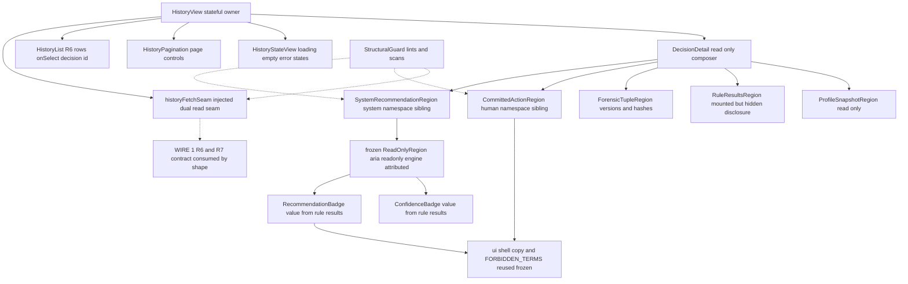

# NFR Design — Plan (Part 1) — `ui-history` (U9)

**Stage**: BUILD → per-unit loop → NFR Design **Part 1 (Plan)** · **Unit**: U9 `ui-history` · C5 · Phase 1
**Depth**: **lighter (display) + INV-FAITHFUL + INV-NAMESPACE** via StructuralGuard + focused teeth (consistent with the FD and NFR Requirements depth) · **Date**: 2026-07-14
**Built ON** the frozen FD (**BR-HIST-1..11**, the component/prop inventory, the `HISTORY_STATE` master-detail machine with position-preserving Back, the namespace-distinct detail composition, the `history-<element>-<purpose>` testid inventory incl. the two region testids) **and** the approved NFR Requirements (seventeen `NFR-HIST-*` targets + governance; the **single injected/capturing dual-read** double; **NFR-HIST-Fold-A/B/C/D**) — **re-opening none of it**. Mirrors the sibling units' NFR-Design structure: **patterns → logical components → reference-not-own → component→target coverage → validated Mermaid** (rectangle-only).

> **STATUS UPDATE 2026-07-14**: Q1–Q4 **answered (all A)**; ambiguity-check **RUN → CLEAN (1 fold — NFR-DESIGN-Fold-1: the seam-module header comment)** — §6.5; the full Q&A is embedded. **Part 2 GENERATED** (`nfr-design-patterns.md` + `logical-components.md`). **STOPPED at the NFR Design 2-option completion gate** (1. Request Changes / 2. Continue → Infrastructure Design).

---

## 0. Prerequisites & grounding (read, not re-derived)

- [x] NFR Requirements approved for `ui-history` (`nfr-requirements.md` + `tech-stack-decisions.md`, gate approved 2026-07-14).
- [x] Frozen FD + the seventeen `NFR-HIST-*` targets are the substrate — patterns realize them, re-opening neither.
- [x] **Sibling NFR-Design structure inherited** (frozen U5–U8): `*Pattern` naming; a **StructuralGuard test/lint substrate** grouping structural scans (testid lint + no-TS/no-router/no-`RoleGate`/bounded-fetch/`FORBIDDEN_TERMS`-reuse, each with a **detector self-test**); a component-relationship Mermaid under the 7-rule rectangle-only convention. `ui-memo-view`'s **StructuralIsolationCompositionPattern** and **RoleInvariantRenderingPattern** are the direct precedents for the load-bearing separation + view-only patterns.
- [x] **Reused-not-modified / mirrored-not-imported**: ui-shell's **one `FORBIDDEN_TERMS`** + ESLint + testid convention + `RoleContext` seam + **`ReadOnlyRegion`** + `RecommendationBadge`/`ConfidenceBadge` are **reused** (frozen); **all five** sibling units' fetchSeam/StructuralGuard/testid-lint are **mirrored as a convention, not imported** (frozen); WIRE-1 **R6/R7** contracts consumed **by shape**. Nothing frozen is edited.
- [x] **The genuinely-new design concerns vs the siblings** (the load-bearing decisions this plan must pin):
  1. **NFR-HIST-SEPARATION-1** — the **first dual-namespace** render (system `Recommendation` + human `CommittedDecision`). Isolation must be a **by-construction** property (the same philosophy as `ui-memo-view`'s StructuralIsolationCompositionPattern) — the two region components' **prop signatures** must make mis-nesting **unwritable**, with the DOM-containment test as a **confirmation/regression guard** (Q1).
  2. **NFR-HIST-FAITHFUL-1** — the **first pure read surface with a load-bearing NO-WRITE guarantee**. A dedicated **ReadOnlySeamPattern**: `historyFetchSeam`'s **exported shape** (only `fetchList`/`fetchDetail` + two **GET** builders + `normalizeError`; **no** request-body builder) should make a write capability **structurally absent**, not merely linted-against (Q2).
  3. A **master-detail** state machine with **state retention across navigation** (BACKPRESERVE) — a new pattern vs the single-screen siblings.
  4. A **mounted-but-hidden faithful disclosure** for `rule_results` and a **no-superseded-branch** governance scan — both new.

---

## 1. Draft pattern map (`NFR-HIST-*` → named pattern → primary logical component)

| # | Pattern (draft) | Target(s) | Primary component | Tier |
|---|---|---|---|---|
| P1 | **SharedForbiddenTermsReusePattern** — reuse ui-shell's **one** `FORBIDDEN_TERMS` + ESLint; **no new word-list**; enum labels look up **by value**; the **human-region wording avoids the standalone singular "decision" token** so the reused blanket `advisory-vocabulary` lint stays unmodified (Q2-A / Fold-D, verified vs the real detector) | COPY-1, ADVISORY-1 | StructuralGuard + copy.js + the two regions | lint / structural |
| P2 | **StructuralIsolationCompositionPattern** *(load-bearing — mirrors ui-memo-view)* — the **system** region and the **human** region are **siblings by construction**: `DecisionDetail` renders `SystemRecommendationRegion`, `CommittedActionRegion`, `ForensicTupleRegion`, `RuleResultsRegion`, `ProfileSnapshotRegion` as **sibling children**; `SystemRecommendationRegion` is the **sole** holder of `{recommendation, confidence}` with **no** action/reason path; `CommittedActionRegion` is the **sole** holder of `{action, reason, underwriterId}` with **no** recommendation/confidence path (Q1). The DOM-containment test is a **confirmation/regression guard**, not the only safeguard | SEPARATION-1 | DecisionDetail + SystemRecommendationRegion + CommittedActionRegion | component (RTL) |
| P3 | **ReadOnlySeamPattern** *(load-bearing — NEW)* — `historyFetchSeam`'s **exported surface is exactly** `{ fetchList, fetchDetail }` + `buildHistoryListRequest` + `buildHistoryDetailRequest` + `normalizeError`; **both builders emit only `{ method: GET, path }`**; there is **no** request-body builder and **no** non-GET path anywhere — so a write capability is **structurally absent by construction** (Q2). The FAITHFUL-1 no-write-seam scan is a **regression guard on a design-level guarantee** | FAITHFUL-1 | historyFetchSeam + StructuralGuard | structural / AST |
| P4 | **DualReadFetchSeamPattern** — **one** injected seam exposing **two independently-capturing reads** (`fetchList(page,size)` / `fetchDetail(decision_id)`); explicitly contrasted with U7/U8's **asymmetric read+write** double — no write op, so the cross-guards are **read-attribution + call-count** teeth, not a write gate (Fold-A). Bounded single-page R6 + single-record R7 (PERF-1) | DUALREAD-1, STATEMACHINE-1(fetch), PERF-1(bounded) | historyFetchSeam + HistoryView | component + capturing double |
| P5 | **MasterDetailStateMachinePattern** — the seven-state `HISTORY_STATE` machine (`listLoading→list\|listEmpty\|listError`; `list→detailLoading→detail\|detailError`; `detailError→detailLoading` retry; `detail→list` back), owned by `HistoryView`; built **on** `historyFetchSeam` | STATEMACHINE-1, ERROR-1(transitions) | HistoryView + HistoryStateView | component |
| P6 | **StateRetentionAcrossNavigationPattern** *(NEW)* — `HistoryView` retains `{page, items}` across the detail excursion; **Back returns to `list` at the same page with the same items, no refetch** (the `QueueView.jsx` position-preserving discipline, extended to a master-detail navigation) | BACKPRESERVE-1 | HistoryView | component + capturing double |
| P7 | **ArrayLengthEmptyPattern** — `listEmpty` derived from **`items.length === 0`** (explicit contrast to `ui-memo-view`'s `status`-discriminator pattern; same as `ui-queue`) | EMPTY-1 | HistoryView + HistoryStateView | component |
| P8 | **PerOperationRetryTargetingPattern** — a `listError` Retry re-fetches the **last-requested page**; a `detailError` Retry re-fetches the **same `decision_id`**; the R7 **404 `not_found`** is surfaced through the **generic** `detailError` path (no special-casing) | ERROR-1 | HistoryStateView + HistoryView + historyFetchSeam | component + capturing double |
| P9 | **MountedButHiddenFaithfulDisclosurePattern** *(NEW)* — `rule_results` renders **every** entry **mounted** in the DOM (order preserved, none dropped); collapse via **`hidden`/`display:none`** (removes collapsed entries from the a11y tree — **no `aria-hidden`**); the faithfulness assertion uses a **DOM-level query** (Fold-C) | RULERESULTS-1 | RuleResultsRegion | component |
| P10 | **ConditionalFieldRenderingPattern** — within the **human** region, `reason` renders **iff** `action === 'override'` (present/non-blank), absent on `approve`; `action`/`underwriter_id` always shown. Confined to `CommittedActionRegion` (never leaks into the system namespace, P2) | REASON-1 | CommittedActionRegion | component |
| P11 | **RoleInvariantRenderingPattern** *(same as ui-queue)* — **no `RoleGate`**, **no router**, render **identical** across roles; `can="read"` deliberately **not** used (contrast: U7/U8 compose `RoleGate can="act"` for the underwriter-only write path) | VIEWONLY-1 | HistoryView + StructuralGuard | structural + component |
| P12 | **StructuralGuardPattern** — the file/import/AST/lint substrate: **testid** convention lint incl. the **two region-level testids** (TESTID-1), **no-`.ts`/`.tsx`** scan (NOTS-1), **no-router-import** scan + **no-`RoleGate`-import** scan (VIEWONLY-1 structural), the **no-write-seam** scan (FAITHFUL-1 structural half — inverted single-call-site guard), the **NEW no-superseded-branch** governance scan (NOSUPERSEDE-1 — no `status==='superseded'` branch / no `supersedes_decision_id` deref), **bounded-fetch** scan (PERF-1), `FORBIDDEN_TERMS` reuse lint (COPY/ADVISORY) — each with a **detector self-test** | TESTID-1, NOTS-1, NOSUPERSEDE-1 (+ structural halves of FAITHFUL-1/VIEWONLY-1/ADVISORY-1/PERF-1) | StructuralGuard | structural / lint |
| P13 | **ReferencedObservedBoundaryPattern** — soft/observed, not over-specified | PERF-1, A11Y-1, SCOPE-1 | (cross-cutting) | observed / soft / governance |

**No orphaned target**: COPY/ADVISORY→P1; **SEPARATION→P2**; **FAITHFUL→P3(+P12 scan)**; DUALREAD→P4; STATEMACHINE→P5(+P4 fetch); ERROR→P5+P8; BACKPRESERVE→P6; EMPTY→P7; RULERESULTS→P9; REASON→P10; VIEWONLY→P11(+P12); TESTID/NOTS/NOSUPERSEDE→P12; PERF/A11Y/SCOPE→P13.

## 2. Draft logical components (responsibilities · ownership · by-construction prop shapes)

`ui-history` production components live at `frontend/src/history/`; the StructuralGuard is a **test/lint substrate** (not a production component). Names align with the FD inventory (`domain-entities.md §4` / `frontend-components.md`).

| ID | Component | Responsibility | Prop shape (by-construction) | Backs |
|---|---|---|---|---|
| **C1** | **HistoryView** | The **only stateful** component: injects **historyFetchSeam**, holds `{state, page, items, pageInfo, record, error}`, drives the **master-detail machine** (P5), **retains `{page, items}` across the detail excursion** (P6), derives `listEmpty` from `items.length` (P7). Composes `HistoryList`/`HistoryPagination` (list) and `DecisionDetail` (detail). Reads **no** Role, composes **no** `RoleGate`, imports **no** router (P11). Holds **no** write reference (P3). | `{ fetchSeam }` where `fetchSeam = { fetchList, fetchDetail }` | DUALREAD-1, STATEMACHINE-1, BACKPRESERVE-1, EMPTY-1, VIEWONLY-1(render) |
| **C2** | **historyFetchSeam** *(own local thin module, P3/P4)* | The **read-only dual-read** seam: `createHistoryFetch(transport) → { fetchList(page,size), fetchDetail(decision_id) }`; `buildHistoryListRequest(page,size)` + `buildHistoryDetailRequest(decision_id)` emit **only** `{ method:'GET', path }`; `normalizeError`. **Injected** via prop; tests inject a **capturing dual-read double** (Fold-A). **No request-body builder, no non-GET path** (write structurally absent, P3). Mirrors the sibling read seams **without importing**. | exports **exactly** `{ createHistoryFetch, buildHistoryListRequest, buildHistoryDetailRequest, normalizeError }` — **no** `submit*`/`buildCommitRequest`-analog | FAITHFUL-1, DUALREAD-1, ERROR-1(retry), PERF-1(bounded) |
| **C3** | **HistoryList** | Presentational R6 list: renders each `DecisionSummary` as a row (`history-row-<decision_id>`) with the **human** `COMMIT_ACTION_LABELS[action]` + `timestamp`; a row calls `onSelect(decision_id)`. Preserves delivered order. **No** system recommendation in a row (R6 omits it). | `{ items, onSelect, testid }` | DUALREAD-1(select), TESTID-1 |
| **C4** | **HistoryPagination** | Presentational page controls over `page.total`; a page change calls `onPageChange(next)` → bounded single-page R6 (PERF-1). Local history component (ui-shell frozen). | `{ page, size, total, onPageChange, testid }` | PERF-1, TESTID-1 |
| **C5** | **HistoryStateView** | Presentational non-content states: `listLoading`/`detailLoading` (placeholder), `listEmpty` ("no decisions yet", P7), `listError`/`detailError` (`message` visible / `code` testid-only / `detail` never; Retry per P8; 404 generic). | `{ state, error, onRetry, testid }` | STATEMACHINE-1(states), EMPTY-1(render), ERROR-1, A11Y-1 |
| **C6** | **DecisionDetail** | Presentational **read-only composer**: composes the five detail regions **as siblings** (the P2 sibling-composition point); **no edit affordance, no mutation seam** (FAITHFUL-1). Passes each region **only** its own slice of the `AuditRecord`. | `{ record, testid }` | SEPARATION-1(sibling composition), FAITHFUL-1(no edit) |
| **C7** | **SystemRecommendationRegion** | Presentational **system namespace** (P2): composes the **frozen `ReadOnlyRegion`** (`aria-readonly`) + `RecommendationBadge`/`ConfidenceBadge`, engine-attributed; the **sole** render site for `recommendation`/`confidence`. **No** `action`/`reason`/`underwriterId` prop or path. | `{ recommendation, confidence, testid }` — **no human-namespace path** | SEPARATION-1(system node), COPY-1, TESTID-1 |
| **C8** | **CommittedActionRegion** | Presentational **human namespace** (P2/P10): renders `COMMIT_ACTION_LABELS[action]` + `underwriter_id`, and `reason` **iff** `action === 'override'`; token-avoiding heading (Fold-D). **No** `recommendation`/`confidence` prop or path. | `{ action, reason, underwriterId, testid }` — **no system-namespace path** | SEPARATION-1(human node), REASON-1, COPY-1, TESTID-1 |
| **C9** | **ForensicTupleRegion** | Presentational read-only forensic/replay fields: `rulebook_version`, `model_version`, `engine_version`, `memo_hash`, `content_hash`, tuple `timestamp`, `status`. **`status` display-only**; **no** superseded branch, **no** `supersedes_decision_id` deref (NOSUPERSEDE-1). | `{ auditTuple, contentHash, status, testid }` — **no** supersede path | NOSUPERSEDE-1, TESTID-1 |
| **C10** | **RuleResultsRegion** | Presentational faithful disclosure (P9): renders **every** `rule_results` entry **mounted** (order preserved); collapse via `hidden`/`display:none`; keyboard-focusable toggle. Owns its **local disclosure state** (view-local; mechanics → Code-Gen). | `{ ruleResults, testid }` | RULERESULTS-1, A11Y-1, TESTID-1 |
| **C11** | **ProfileSnapshotRegion** | Presentational read-only `ApplicantProfileSnapshot` render (verbatim persisted input; demographics = displayed forensic input, not a scored feature). Field subset → Code-Gen. | `{ profile, applicationId, contentHash, testid }` | FAITHFUL-1(read-only), TESTID-1 |

**Test / lint substrate (test-only, not a production component):**
- **C12 StructuralGuard** *(one substrate, Q3)* — grouping independent checks, **each with a detector self-test**: `FORBIDDEN_TERMS` reuse lints (COPY-1 no-inline + ADVISORY-1 vocabulary), **testid** convention lint incl. the **two region testids** (TESTID-1), **no-`.ts`/`.tsx`** scan (NOTS-1), **no-router-import** + **no-`RoleGate`-import** scans (P11), the **no-write-seam** scan (FAITHFUL-1 — inverted single-call-site guard: **zero** `submit*`/non-GET builders), the **NEW no-superseded-branch** scan (NOSUPERSEDE-1), **bounded-fetch** scan (PERF-1). Mirrors the siblings' single StructuralGuard substrate (convention, not imported).

## 3. Reference-not-own check (draft)

| Concern | Owner | This unit? |
|---|---|---|
| The history view behavior (dual read / master-detail state / namespace-distinct detail / faithful disclosure) | **`ui-history`** (C1–C12) | ✅ owns |
| Shell primitives / copy / `FORBIDDEN_TERMS` / `RoleContext` / **`ReadOnlyRegion`** / `RecommendationBadge` / `ConfidenceBadge` | **`ui-shell`** (frozen U10) | ❌ **consumed by import/shape, not modified** (reused; `ReadOnlyRegion`+badges composed in the system region) |
| The fetchSeam / StructuralGuard / testid-lint **convention** | **all five sibling UI units** (frozen U5–U8) | ❌ **mirrored as a convention, NOT imported** |
| The frontend↔backend **wire/serialization** (R6/R7 routes, `DecisionSummary`, `AuditRecord`, session) | **WIRE-1** (composition-root) | ❌ consumed **by shape**; the **real historyFetchSeam wiring** is deferred (composition root / Build & Test) |
| The persisted **`AuditRecord`/`AuditTuple`/`CommittedDecision`** schemas | **`audit-store`** (frozen) | ❌ consumed **by shape** (read); never re-declared |
| **R6/R7 route implementation** (`backend/app/main.py`) | Build & Test | ❌ not authored here |
| Authorization **decision** | **`auth-rbac`** (SEC-4) | ❌ the history view gates nothing (VIEWONLY-1); no `RoleGate`, no authz call |
| Human commit / gate (`approve`/`override`) — the **write** path | **`ui-approval-gate` (U7)** / **`ui-override-form` (U8)** | ❌ **no write path** (FAITHFUL-1); `ui-history` **reads** the records they wrote |
| Replay / re-evaluation; superseded/versioning | rules-engine / CLI; **OOS-7 Phase-3 seam** | ❌ not done here (no route; NOSUPERSEDE-1) |
| Aesthetic token **values**, profile-snapshot field subset, `rule_results` disclosure widget markup, state hook mechanics | **Code-Gen** | ❌ direction/shape only; values + mechanics deferred |

## 4. Component → target coverage (draft, no orphan)

| Target | Component(s) / item |
|---|---|
| NFR-HIST-COPY-1 | C7/C8 (label look-up) + copy.js + C12 (no-inline lint, `FORBIDDEN_TERMS` reuse) |
| NFR-HIST-SEPARATION-1 | C6 (sibling composition) + C7 (system node, no human path) + C8 (human node, no system path) |
| NFR-HIST-ADVISORY-1 | C8/copy.js (token-avoiding wording) + C12 (advisory-vocabulary lint, verified vs real detector) |
| NFR-HIST-FAITHFUL-1 | C2 (seam exports only reads, no write builder) + C6/C11 (read-only, no edit affordance) + C12 (no-write-seam scan) |
| NFR-HIST-DUALREAD-1 | C1 (owns both reads) + C2 (dual-read seam) + C3 (select) + C12 (no sibling/router import) |
| NFR-HIST-RULERESULTS-1 | C10 (mounted-but-hidden faithful disclosure) |
| NFR-HIST-REASON-1 | C8 (conditional reason within the human region) |
| NFR-HIST-VIEWONLY-1 | C1 (render) + C12 (no-`RoleGate` / no-router scans) |
| NFR-HIST-EMPTY-1 | C1 (`items.length` derivation) + C5 (empty render) |
| NFR-HIST-ERROR-1 | C5 (envelope render) + C1/C2 (per-operation retry targeting) + C12 (detail-never structural) |
| NFR-HIST-TESTID-1 | C3–C11 + C12 (testid lint incl. the two region testids) |
| NFR-HIST-NOSUPERSEDE-1 | C9 (status display-only) + C12 (no-superseded-branch scan) |
| NFR-HIST-NOTS-1 | whole unit + C12 (file scan) |
| NFR-HIST-STATEMACHINE-1 | C1 (machine) + C2 (seam) + C5 + C6 (renders) |
| NFR-HIST-BACKPRESERVE-1 | C1 (`{page, items}` retention, no refetch on Back) |
| NFR-HIST-PERF-1 | C2 (bounded reads) + C4 (single page) + C12 (scan) — observed |
| NFR-HIST-A11Y-1 | C5/C7/C10 (semantic regions + `aria-readonly` + focusable controls) — soft |
| NFR-HIST-SCOPE-1 | governance / boundary (documented, not an orphan) |

**All seventeen targets + SCOPE covered**; every component backs ≥1 target; SCOPE-1 is a documented boundary. No orphan.

## 5. Draft component-relationship diagram (validated Mermaid — 7 rules, rectangle-only)

Validated before write: alphanumeric node IDs; every label double-quoted; **no hyphens, no semicolons, no bare colons, no parentheses, no other special characters** (underscore per the established convention); balanced blocks; **rectangle-only, no decision diamonds**. The **namespace separation is a visible graph property**: `SystemRecommendationRegion` (`SYS`) and `CommittedActionRegion` (`HUM`) are **sibling children of `DecisionDetail`** with **no edge between them**; the recommendation/confidence nodes are **descendants of `SYS` only**, never of `HUM` — mis-nesting would be visible as a re-parented edge.

**Text alternative (always included)**:
- **HistoryView** injects **historyFetchSeam** (the dual-read R6/R7 seam) and composes **HistoryList** + **HistoryPagination** (list state), **HistoryStateView** (loading/empty/error states), and **DecisionDetail** (detail state).
- **DecisionDetail** renders **five siblings**: **SystemRecommendationRegion**, **CommittedActionRegion**, **ForensicTupleRegion**, **RuleResultsRegion**, **ProfileSnapshotRegion**.
- **Namespace separation (visible)**: **SystemRecommendationRegion** and **CommittedActionRegion** are **siblings** under DecisionDetail with **no edge between them**; SystemRecommendationRegion wraps the **frozen ReadOnlyRegion** which holds **RecommendationBadge** + **ConfidenceBadge** — so the recommendation/confidence nodes are descendants of the **system** region only, never of the human region.
- **RecommendationBadge** + **CommittedActionRegion** look up labels from the **reused frozen ui-shell copy / `FORBIDDEN_TERMS`** (never inlined).
- Dashed = substrate/boundary: **StructuralGuard** lints/scans the two regions + the seam (incl. the no-write-seam + no-superseded scans); **WIRE-1 R6/R7** (external, real wiring deferred to the composition root) is what **historyFetchSeam** consumes by shape.

---

## 6. Open pattern-decision questions ([Answer] tags — lettered; full Q&A embedded on disk once answered)

> **Part 1 gate**: answer each tag with a letter (notes welcome). On your answers I run the mandatory ambiguity-check (flag-and-stop, no improvisation), embed the full Q&A + any folds here (§6.5), and only then generate the Part 2 artifacts.

### Q1 — SEPARATION-1: by-construction namespace isolation (P2/C6–C8 — the load-bearing decision)  *(user-flagged)*
Should the two region components' **prop signatures** make mis-nesting **unwritable** (the same way `ui-memo-view` made the RO region's mis-nesting unwritable), or should isolation rely only on the DOM-containment test?
- **A. By-construction, both directions** *(Recommended)*.
  `DecisionDetail` composes the five regions as **sibling children**; **`SystemRecommendationRegion`'s props are `{recommendation, confidence, testid}` only** — **no** `action`/`reason`/`underwriterId` path; **`CommittedActionRegion`'s props are `{action, reason, underwriterId, testid}` only** — **no** `recommendation`/`confidence` path. A developer therefore has **no wired way** to render the system recommendation inside the human region (or the human action inside the system region) without first **adding an obvious, reviewable prop** to the wrong component — which the SEPARATION-1 DOM-containment test then **catches as a regression**. The test is a **confirmation/regression guard on top of a design-level guarantee**, not the only safeguard. Each region also carries a **header comment** stating its prop restriction (the frozen `NarrativeRegion` / `ReadOnlyRegion` self-evidence convention), so the guarantee is legible in isolation without reading `DecisionDetail`.
- **B. Test-only** — allow any prop wiring; rely solely on the DOM-containment test to catch mis-nesting after the fact. *(Weaker — the invariant lives only in a test; a refactor could wire a `recommendation` prop into `CommittedActionRegion` and the design wouldn't resist it, only the test would fail.)*

`[Answer]:` A — by-construction, both directions. `SystemRecommendationRegion`'s props are `{recommendation, confidence, testid}` only, **no** action/reason/underwriterId path; `CommittedActionRegion`'s props are `{action, reason, underwriterId, testid}` only, **no** recommendation/confidence path. A developer has **no wired way** to mis-nest either namespace without first adding an obvious, reviewable prop to the wrong component. Each region carries a **header comment** stating its prop restriction (the frozen `NarrativeRegion`/`ReadOnlyRegion` self-evidence convention). The SEPARATION-1 DOM-containment test is a **confirmation/regression guard on top of a design-level guarantee**, not the only safeguard.

### Q2 — FAITHFUL-1: ReadOnlySeamPattern — write capability structurally absent, or linted-against? (P3/C2 — the load-bearing decision)  *(user-flagged)*
Should `historyFetchSeam`'s **shape** make a write impossible-to-wire, or should the no-write guarantee rely only on the FAITHFUL-1 scan?
- **A. By-construction: the seam exports only the two GET reads + the two GET builders + `normalizeError`; no request-body builder exists** *(Recommended)*.
  `historyFetchSeam`'s exported surface is **exactly** `{ createHistoryFetch, buildHistoryListRequest, buildHistoryDetailRequest, normalizeError }`; both builders return **only** `{ method: 'GET', path }`; there is **no** `buildCommitRequest`/`buildOverrideRequest`-analog and **no** `submit*` function anywhere in the module. A view component thus has **no wired way** to issue a write — a POST/PUT/PATCH/DELETE would require **adding a new builder + a body**, an obvious, reviewable change. The FAITHFUL-1 no-write-seam scan (C12) becomes a **regression guard on a design-level guarantee** (mirrors the write-path units' single-call-site guard, **inverted to zero call sites**). Each region is `{...}`-only presentational (no seam reference), extending the guarantee to the whole unit.
- **B. Lint-only** — allow the seam to grow any method; rely solely on the FAITHFUL-1 scan to catch a write after the fact. *(Weaker — the no-write invariant lives only in a scan; the seam's shape wouldn't resist a write being wired in, only the scan would fail.)*

`[Answer]:` A — by-construction. `historyFetchSeam`'s exported surface is **exactly** `{createHistoryFetch, buildHistoryListRequest, buildHistoryDetailRequest, normalizeError}`; both builders return only `{method:'GET', path}`; there is **no** `buildCommitRequest`/`buildOverrideRequest`-analog and **no** `submit*` function anywhere in the module. A write capability is **structurally absent**, not merely linted-against — issuing a write would require adding an entirely new builder, an obvious reviewable change. The FAITHFUL-1 scan becomes a **regression guard on a design-level guarantee**, mirroring the write-path units' single-call-site guard **inverted to zero call sites**. *(The seam-module header-comment self-evidence refinement is recorded in §6.5 / NFR-DESIGN-Fold-1.)*

### Q3 — StructuralGuard granularity (P12/C12)
- **A. One `StructuralGuard` substrate** grouping the structural scans (testid incl. the two region testids / no-TS / no-router / no-`RoleGate` / **no-write-seam** / **no-superseded-branch** / bounded-fetch / `FORBIDDEN_TERMS` reuse), each an independent check with its own **detector self-test**. *(Recommended — mirrors the siblings' single test/lint substrate; the two NEW scans [no-write-seam, no-superseded] slot in as additional checks.)*
- **B. Separate named guard per concern** (one component each). *(Diverges from the established single-substrate convention.)*

`[Answer]:` A — one `StructuralGuard` substrate grouping all structural scans (including the two new **no-write-seam** and **no-superseded-branch** checks), each an independent check with its own detector self-test, mirroring the sibling single-substrate convention.

### Q4 — Master-detail state machine: a `HistoryView` responsibility, or a dedicated component?
The `HISTORY_STATE` machine is more elaborate than the siblings' (two fetch sources + position retention). Does it stay a **responsibility** of `HistoryView`, or become a dedicated state component?
- **A. A responsibility of `HistoryView`** *(Recommended)* — the logical state owner; the concrete hook/reducer mechanism is **Code-Gen**. No separate state-machine component. Consistent with the FD's "sole stateful component" and the `ui-memo-view` Q3-A precedent; the added master-detail complexity is state *content*, not a reason to split ownership.
- **B. A dedicated `HistoryStateMachine` component** (reducer/hook) separate from `HistoryView`. *(Available if you want the master-detail machine extracted; diverges from the "sole stateful component" framing and the sibling precedent.)*

`[Answer]:` A — the master-detail state machine stays a **responsibility of `HistoryView`** (the sole stateful component); the concrete hook/reducer mechanism is **Code-Gen**. No separate state-machine component — consistent with the FD's "sole stateful component" framing and the `ui-memo-view` precedent.

---

## 6.5 Ambiguity-check (RUN 2026-07-14, after the Q1–Q4 answers) — **CLEAN, no STOP** (1 fold)

Ran against the four answers (all **A**) + the frozen FD (BR-HIST-1..11) + the approved NFR Requirements (the seventeen `NFR-HIST-*` targets; Fold-A/B/C/D) + the frozen contracts (re-read on disk, incl. the frozen `queue/fetchSeam.js` header-comment/JSDoc precedent). **No genuine gap.** All four answers are the recommended, precedent-consistent options (no conflict with any frozen decision). One fold surfaced (resolvable by applying an **established** convention, no improvisation, no STOP):

### NFR-DESIGN-Fold-1 (user-flagged) — making the Q2-A by-construction seam guarantee self-evident on the seam module itself — **CLEAN**
Q1-A already gives the **region components** header comments (the frozen `NarrativeRegion`/`ReadOnlyRegion` self-evidence convention) so the namespace-isolation guarantee is legible in isolation. The **symmetric refinement for Q2-A**: the "no write builder exists" guarantee should be **self-evident to a future developer reading `historyFetchSeam.js` in isolation** — not only discoverable via the FAITHFUL-1 StructuralGuard scan or this design doc. Resolution — apply the project's **existing seam-module header-comment/JSDoc convention** (frozen precedent: `queue/fetchSeam.js`'s top comment "*This module owns request-building + failure NORMALIZATION only; it makes NO real network call itself…*" + its `createQueueFetch` JSDoc): **`historyFetchSeam.js` carries a header comment** stating it is a **READ-ONLY dual-read seam** whose exported surface is **exactly** `{ createHistoryFetch, buildHistoryListRequest, buildHistoryDetailRequest, normalizeError }`, both builders emit **only** `{ method:'GET', path }`, and there is **deliberately NO request-body builder and NO `submit*` — a write capability is structurally absent by construction** (the read-surface analog of the write-path units' single-call-site header comments). This makes the P3 guarantee **legible without reading the StructuralGuard or this doc**, complementing (not replacing) the FAITHFUL-1 no-write-seam scan. **Recorded** into P3 (`nfr-design-patterns.md` — the seam-shape argument + the header-comment) and C2 (`logical-components.md` — the header-comment convention on `historyFetchSeam`). No new mechanism, no gap, no STOP.

> The fold is a documentation/self-evidence refinement realized with the established seam-comment convention (symmetric to Q1-A's region header comments); **no STOP**. It is carried into Part 2 (P3 statement + C2 responsibility note). The other three answers (Q1 region by-construction, Q3 one StructuralGuard substrate, Q4 machine-as-`HistoryView`-responsibility) are all precedent-consistent with no further gap.

---

## 7. NFR Design **Part 2** plan — artifacts generated **after** approval (checkboxes)

- [x] **`guide-docs/build/ui-history/nfr-design/nfr-design-patterns.md`** — **GENERATED**. Sections P1–P13 (Q1–Q4 folded in), each with its `NFR-HIST-*` target(s) + tier; **P2 (StructuralIsolationCompositionPattern)** + **P3 (ReadOnlySeamPattern)** spelled out with the **actual prop/export shapes** (the by-construction arguments, not bare assertions) + the region/seam header-comment convention (NFR-DESIGN-Fold-1); a validated **pattern-integration Mermaid** (rectangle-only) + text alternative; the **pattern → target → tier → rigor** traceability (no orphan).
- [x] **`guide-docs/build/ui-history/nfr-design/logical-components.md`** — **GENERATED**. Components C1–C12 with responsibilities/ownership + **exact by-construction prop/export shapes** (SystemRecommendationRegion `{recommendation, confidence, testid}` / CommittedActionRegion `{action, reason, underwriterId, testid}` / historyFetchSeam exports exactly the four read members); the validated **component-relationship Mermaid** (system/human sibling isolation + no cross-edge as a visible graph property) + text alternative; the **reference-not-own** check (reused vs mirrored-not-imported vs consumed-by-shape kept distinct); the **component → target coverage** table (no orphan); settled items held.

## 8. Holds / guardrails (this Part 1)

- [x] **No NFR-Design artifact generated** — only this plan file written.
- [x] **Frozen FD + approved NFR Requirements not re-opened** — patterns/components realize them.
- [x] **WIRE-1 untouched** (R6/R7 by shape; real historyFetchSeam wiring deferred to composition root / Build & Test); **`ui-shell` (frozen) untouched** (copy/`FORBIDDEN_TERMS`/`RoleContext`/`ReadOnlyRegion`/badges/testid convention **reused, not modified**); **the five sibling UI units (frozen) untouched** (fetchSeam/StructuralGuard/testid-lint **mirrored as a convention, not imported**); **`audit-store` schemas** consumed by shape.
- [x] **No write surface introduced** (INV-FAITHFUL / P3). **No application/test code** written (patterns/components only). **No LLM. No TypeScript.**
- [x] **tier-B corpus run NOT authorized**; **no other unit started**; `audit_store` Docker-guard gap still deferred.
